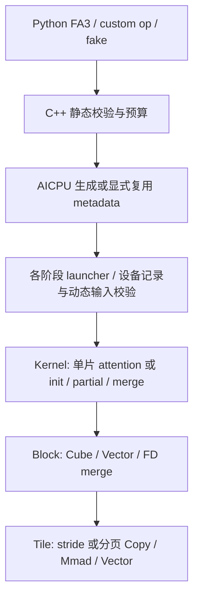

# CANN FIA MLA → FA3 NPU：契约与架构

本文保存已确认的迁移契约和实现依据。**第 1、4 节定义范围，第 2–3 节定义接口，第 5–6 节说明 metadata 与实现架构，第 7 节定义验收口径。** 交付状态、运行结果和环境只在 [status](status.md) 维护，实施顺序和完成条件只在 [plan](plan.md) 维护；本文的目标能力不等于已接通能力。

| 核对内容 | 阅读位置 |
| --- | --- |
| 来源、迁移范围与排除项 | [固定依据](#1-范围与固定依据)、[功能边界](#4-功能边界) |
| 参数、布局、长度与输出 | [入口与记录选择](#21-入口与记录选择)、[选项与返回值](#22-后端选项与返回值)、[两种表示](#3-两种-mla-的接口映射)、[代表用例](#42-代表用例与参考实现边界) |
| 记录格式、校验与复用 | [metadata 协议](#5-metadata-设计)、[共同调度约束](#62-调度字段与边界) |
| 分配前缀、used 与真实地址 | [长度与布局](#63-长度与布局调度)、[stride 与 storage](#64-输入-stride-与地址校验) |
| 分页缓存的接口、地址与设备校验边界 | [PA 契约与来源](#643-nd-paged-cache-契约与来源)、[v6 协议与消费者](#57-v6nd-pa-记录) |
| Kernel / Block / Tile 与生产接入 | [代码结构](#6-代码结构)、[数值路径](#65-数值路径与资源布局)、[同步依赖](#66-同步依赖与组件复用结论)、[接入与构建](#67-生产接入与构建) |
| 精度、性能与证据 | [验收口径](#7-验收口径)、[参考工具边界](#72-参考工具与对照边界) |

术语：BSND 为 `[B,S,H,D]`，TND 为 `[T,H,D]`；“分配长度”决定物理起点，“used”限定其中参与计算的前缀。PA 表示 paged attention；FD 表示 FlashDecode/split-KV。下文的“独立组件/探针”有自己的验收边界，不能据其通过推断公开前向已开放。

## 1. 范围与固定依据

迁移集合是 **910B/C 上 CANN FIA 已有 MLA 前向能力，与官方 FA3 可表达能力的交集**，再加接入所必需的 metadata、softcap、调度选项与图执行适配，具体取舍见第 4 节。接口冲突按 FA3 调整；不搬迁普通 MHA/GQA、量化大框架、950 专用模板或反向算子。MLA prefill 中使用 GQA 的分组语义仍在范围内。

**迁移原则：保留固定 CANN 实现的行为，只做 CATLASS 风格的结构重构和必要的 FA3 接入。** 以源实现的验证积累为基础，保持数值路径与设备流水，具体边界见第 6 节。

| 依据 | 固定版本 | 用途 |
| --- | --- | --- |
| 本仓 | `cab322eda3112fdbfefd99c8632b6393273562f3` | 迁移前基线 |
| CANN ops-transformer | `ca18aee610729ca5270a44e2d84c751bc687fbf0` | MLA 功能与性能来源 |
| CATLASS 子模块 | `769cd40a8716b28650b6bebb08db4834eea4462f` | 组件、分层与编程风格 |
| 官方 Dao-AILab/flash-attention | `d15f1531a460ba456f41b01a774f33ab2db8febf`，2026-09-22 | 取该提交的 `hopper/` FA3 实现；不混用 FA2、FA4 或 CuTe MLA 接口 |

官方一手依据：

- [Python 入口与 metadata 签名](https://github.com/Dao-AILab/flash-attention/blob/d15f1531a460ba456f41b01a774f33ab2db8febf/hopper/flash_attn_interface.py)：`flash_attn_func`、`flash_attn_varlen_func`、`flash_attn_with_kvcache`、`get_scheduler_metadata`。
- [C++ 校验与调度](https://github.com/Dao-AILab/flash-attention/blob/d15f1531a460ba456f41b01a774f33ab2db8febf/hopper/flash_api.cpp)：`mha_fwd`、`mha_fwd_get_scheduler_metadata`；以实际分支为准，不仅看 docstring。
- [官方测试](https://github.com/Dao-AILab/flash-attention/blob/d15f1531a460ba456f41b01a774f33ab2db8febf/hopper/test_flash_attn.py)：`has_qv`、异维 Q/V、varlen、kvcache、metadata 的组合。
- [split 合并](https://github.com/Dao-AILab/flash-attention/blob/d15f1531a460ba456f41b01a774f33ab2db8febf/hopper/flash_fwd_combine_kernel.h)：部分结果与 LSE 的合并行为。
- [split 块范围](https://github.com/Dao-AILab/flash-attention/blob/d15f1531a460ba456f41b01a774f33ab2db8febf/hopper/block.h)：在 mask 范围内按 ceil-div 分片；显式 split 复用分片规则，逻辑 tile 与 mask 范围仍取 CANN。
- [softmax](https://github.com/Dao-AILab/flash-attention/blob/d15f1531a460ba456f41b01a774f33ab2db8febf/hopper/softmax.h) 的 `finalize` 与 [写回](https://github.com/Dao-AILab/flash-attention/blob/d15f1531a460ba456f41b01a774f33ab2db8febf/hopper/epilogue_fwd.hpp) 的 `store` / `store_zero`：全遮罩行及 kernel 内空 KV 的 O/LSE；不能只参考 host 的全局空张量分支。

CANN 根目录：`/home/zhangqijia/repo/ops-transformer/attention/fused_infer_attention_score`。下列路径均相对于此目录：

| 来源 | 已核实的事实 |
| --- | --- |
| `op_host/arch22/fia_tiling_nonquant_mla.cpp`，`IsCapable` | 专用模板为 FP16/BF16，内容维 512、RoPE 64、KV 头数 1；含 PA、FlashDecode、mask 等分支 |
| `op_kernel/arch22/fia_kernel_nonquant_mla.h`、`fia_block_cube_nonquant_mla.h`、`fia_block_vec_nonquant_mla.h`、`fia_block_vec_flashdecode_arch22.h` | 解码流水、两个矩阵乘、softmax、输出更新及 split 合并 |
| `op_host/arch22/fia_tiling_nonquant.cpp`，`IsHighPerformanceTemplate`；`op_kernel/arch22/fia_kernel_nonquant.h` 及关联 Block | prefill 的内容维 128 + RoPE 64、V 维 128 在通用非量化路径中，不能按文件名只取带 `mla` 的文件 |
| `op_host/arch22/fused_infer_attention_score_tiling_check_feature.cpp` | 维度、布局、mask、页大小和特性交叉约束；`CheckFeatureHeadDim`、`CheckFeatureAxisInfo`、`CheckFeatureBlockSize` 等 |
| `tests/pytest/test_fia_mla_d512_pa_dim0_noncontiguous.py` | PA 首维 stride 回归；golden 分别使用独立 K 和 V，不能假定源代码总是忽略 V |

源码与文档可能不一致。例如 V5 文档对 decode 的 K/V 复用描述不能替代上述 kernel 与测试；TensorList 的文档描述也必须经过 arch22 host 校验核实。实现时将实际可运行组合固定为用例，未证实组合标为待核实，不能静默删减。

## 2. FA3 入口与后端边界

- [Python FA3 入口](../../flash_attn_npu_3/flash_attn_npu_interface.py) 与 [910 C++ 前向](../../csrc/ascend910/flash_attn_npu_3/flash_api.cpp) 按 `qv` 和维度识别两种 MLA 表示，透传内容与 RoPE 分量，明确校验支持边界。
- Python 的三个公开 MLA 前向入口共用 `_mla_forward`，沿用固定 FA3 的公开参数、共用前向适配、后端算子边界。NPU 适配在此集中选择布局、mask、split 和调度选项；默认压缩 split 共用 `_mla_split_forward`，非默认有效调度选项使用 `_mla_gqa_forward`。各已注册算子仍独立校验 tensor/metadata，普通 attention 保留原有 Autograd 路径。
- 两种表示的五布局均按 V 维度分配 O，真实路径与 fake 对齐 O/LSE/accumulator。实现与验收状态见 [status](status.md)。
- dense/varlen metadata 调用传入实际 `headdim_v=v.shape[-1]`，使入口、调度和设备执行使用同一组维度。
- 复用 [metadata 参数](../../csrc/ascend910/flash_attn_npu_3/fa_metadata_args.h) 和 [AICPU 实现](../../csrc/ascend910/flash_attn_npu_3/fa_metadata.aicpu) 的启动与流同步机制，MLA 使用与源实现对应的调度字段。
- 普通 FA 保持现有 `uint8` metadata 协议兼容；MLA 提供设备 `int32` 调度 tensor，公开使用 `has_softcap`，计算 scale/softcap 数值由前向传入。
- 窗口归一化、split 范围及未支持参数按固定官方 FA3 分支逐项核对。

### 2.1 入口与记录选择

本节版本表适用于默认有效调度选项。`sm_margin>0` 或 G>1 且 `pack_gqa=False` 时，五布局的两种表示统一优先选择 [v47](#521-gqa-调度选项记录)，长度与公开入口约束仍按下表执行。

下表描述 512+64、`softcap=0` 的单 split（`num_splits=1`）入口映射；split 记录优先于单 split 的 mask 分派，见随后版本表。长度 tensor 均为同设备连续 int32，分配前缀为 `[B+1]`，实际长度为 `[B]`。**公开 varlen 支持 `seqused_q/k`；公开 kvcache 与 metadata 生成器没有 Q-used 参数。**

| 公开入口 | 输入与长度 | 记录选择 |
| --- | --- | --- |
| `flash_attn_func` | BSND Q/KV，使用整容量 | 无 mask 每次内部 v1，causal 每次内部 v7，非默认窗口每次内部 v12；无显式复用参数 |
| `flash_attn_varlen_func` | TND Q/KV，两组分配前缀、两组 max；可选 `seqused_q/k` | 非默认窗口每次内部 v13，causal 每次内部 v8；无 mask 时任一 used 存在用 v5，否则 v3；无显式复用参数 |
| `flash_attn_with_kvcache`，BSND Q | Q 整容量，只读 BSND cache；`cache_seqlens` 为 None（整容量）、`0..Sk` 整数或长度 tensor | 无 mask 且无长度/记录走 v1，否则 v2；causal 使用内部或显式 v7，非默认窗口使用内部或显式 v12 |
| `flash_attn_with_kvcache`，TND Q | Q 使用完整分配段，须给 Q 前缀和 `max_seqlen_q`；只读 BSND cache，KV 长度同上 | 无 mask 使用内部或显式 v4；causal 使用内部或显式 v9，非默认窗口使用内部或显式 v14；整数长度按 cache 的 B 物化 |
| `get_scheduler_metadata`，非 PA | 必须给 KV 长度 tensor，不接受 None/整数；`headdim=64, headdim_v=512` | 无 mask 的 BSND/混合生成 v2/v4；BSND/混合 causal 生成 v7/v9；BSND/混合非默认窗口生成 v12/v14；精确字数见 [第 5 节](#5-metadata-设计) |
| `flash_attn_with_kvcache(page_table=...)` | BSND/TND Q + ND PA cache；TND 须给 Q 前缀和 max Q；Q 使用完整分配段 | 无 mask 内部或显式 v6；BSND/TND causal 内部或显式 v10/v11，BSND/TND 非默认窗口内部或显式 v15/v16；KV 长度 None/整数/tensor，整数按逻辑 B 物化 |
| `get_scheduler_metadata(page_size=P)` | BSND/TND Q；KV 长度 tensor，可选 Q 前缀；`max_seqlen_k` 为逻辑容量 C | 无 mask 生成 v6，BSND/TND causal 分别生成 v10/v11，BSND/TND 非默认窗口分别生成 v15/v16；不接收或检查页表、物理页池 |

`flash_attn_func` / `flash_attn_varlen_func` 没有页表或显式 metadata 参数；PA 通过 kvcache 接入。used 只缩短使用范围，不移动分配起点。内部 used 分派见 [6.7.1](#671-非分页入口与记录选择)，记录格式和复用约束见 [第 5 节](#5-metadata-设计)。

split 请求在单 split 的窗口/causal 分派之前选择下表协议；每个版本均表达无 mask、右下 causal 和 window。公开 metadata 生成器没有 KV 前缀参数，因此不生成 TND Q/KV 的 v19/v20；varlen 每次内部生成。

| Q / KV 布局 | 显式 `num_splits=2..256` | 自动 `num_splits=0` |
| --- | --- | --- |
| 非 PA BSND / BSND | [v17](#6212-split-生产发射) | [v18](#6212-split-生产发射) |
| 非 PA TND / TND | [v19](#6212-split-生产发射) | [v20](#6212-split-生产发射) |
| 非 PA TND / BSND | [v21](#6212-split-生产发射) | [v22](#6212-split-生产发射) |
| BSND / ND PA | [v23](#6212-split-生产发射) | [v24](#6212-split-生产发射) |
| TND / ND PA | [v25](#6212-split-生产发射) | [v26](#6212-split-生产发射) |

192/128 的每个布局使用一个协议表达三种 mask 和单/显式/自动 split；Hq/Hkv 须整除。公开 metadata 使用 `headdim=192, headdim_v=128`，其余公开参数、默认值与返回数量见下节。

| Q / KV 布局 | 公开前向 | 记录 / 公开生成条件 |
| --- | --- | --- |
| BSND / BSND | func、kvcache | [v27](#511-192128-bsnd-prefill-记录)；KV used 长度 tensor |
| TND / TND | varlen | [v28](#512-192128-tnd-prefill-记录)；每次内部生成，两组 allocation 前缀及可选 Q/K-used；公开生成器没有 KV 前缀参数 |
| TND / BSND | kvcache | [v29](#513-192128-混合-prefill-记录)；Q 前缀/max 与非累计 KV used |
| BSND / ND PA | kvcache | [v30](#514-192128-bsnd-pa-prefill-记录)；KV used、逻辑容量及 `page_size` |
| TND / ND PA | kvcache | [v31](#515-192128-tnd-pa-prefill-记录)；v30 条件加 Q 前缀/max |

非零 softcap 开放五种布局的两种表示：BSND 压缩单片/显式片使用 v32，自动片使用 v33，192/128 使用 v34；TND 对应使用 v35/v36/v37，混合对应使用 v38/v39/v40，BSND PA 对应使用 v41/v42/v43，TND PA 对应使用 v44/v45/v46。三 mask 和全部 split 模式同步支持，记录和复用边界见 [5.16](#516-bsnd-softcap-记录)、[5.17](#517-tnd-softcap-记录)、[5.18](#518-混合-softcap-记录)、[5.19](#519-bsnd-pa-softcap-记录) 与 [5.20](#520-tnd-pa-softcap-记录)。上表其余记录均为 cap=0。

### 2.2 后端选项与返回值

512+64 的五种布局及 192/128 的五种布局均支持无 mask、右下 causal、有限/单侧窗口及 causal 叠加，窗口按 [6.2.6](#626-独立-cpu-window-归一化与范围) 归一化。split 与记录选择统一见 [2.1](#21-入口与记录选择)。五种布局的两种表示接受非负有限 FP32 `softcap`；正值启用 [6.5.3](#653-softcap-独立数值组件) 的数值语义，零值旁路。`pack_gqa=None/True/False` 与 `0 <= sm_margin < physical_AIC` 的调度语义见 [6.2.13](#6213-独立-gqa-调度坐标与资源预算)；非默认有效选项采用 [v47](#521-gqa-调度选项记录)，覆盖三 mask、全部 split 和 softcap。其余选项限定为 `attention_chunk=0` 和 `rotary_interleaved=True`；追加 KV、rotary/量化输入、cache 重映射/leftpad 等由 Python 与 C++ 明确拒绝。公开 metadata 生成器的 `has_softcap=True` 开放非 PA BSND、混合及 BSND/TND PA 布局，TND Q/KV 通过内部生成器绑定特征，表示特征而非 cap 数值；生成器仍要求 `max_seqlen_k_new=0`，拒绝数值 scale/softcap 兼容关键字。

func/varlen/内部前向的 `num_splits` 默认 1，kvcache/metadata 默认 0；普通与分页 cache 的 BSND/TND query 默认均使用自动路径。各已开放布局接受 0..256，负值明确拒绝。生成器 `qkv_dtype` 默认 BF16，必须匹配当次输入。前向默认 scale 见 [3.3](#33-共同契约)，显式值须能表示为有限 FP32；scale 不进入 MLA metadata。

请求 LSE 的开关分别为 func/varlen 的 `return_attn_probs=True` 和 kvcache 的 `return_softmax_lse=True`。前两者返回 `(O,LSE)`，kvcache 返回 `(O,LSE,out_accum,lse_accum)`；不开启时只返回 O。内部 raw/私有 split 前向也返回四项。O/LSE 的维度、dtype 与空值见 [3.3](#33-共同契约)。

| 请求与 Q 布局 | `out_accum` / `lse_accum` |
| --- | --- |
| 单 split | 同设备的两个空 tensor，dtype 随 PyTorch 默认浮点 dtype（通常 FP32），真实/fake 一致 |
| 显式 S>1，512+64 BSND（含 PA） | FP32 `[S,B,H,Sq,512]` / `[S,B,H,Sq]` |
| 显式 S>1，192/128 BSND（含 PA） | FP32 `[S,B,Hq,Sq,128]` / `[S,B,Hq,Sq]` |
| 显式 S>1，192/128 TND/混合/TND PA | FP32 `[S,Hq,totalQ,128]` / `[S,Hq,totalQ]` |
| 显式 S>1，512+64 TND（TND、BSND 或 ND PA KV） | FP32 `[S,H,totalQ,512]` / `[S,H,totalQ]` |
| 自动，已开放的 BSND/TND Q 布局 | 对应显式 shape 的首维固定为 26，其余维度和 dtype 相同 |

accumulator 使用原 Q allocation 地址，不压紧 Q-used。自动容量 26 是后端资源上界，不代表物理 AIC 数或均匀 26 分片；实际每 M 的片数由固定 CANN 原生端点决定。Direct 的原始 FP32 O 写第 0 片，其余片和无贡献行初始化为 0/-inf。func/varlen 不公开 accumulator；不能把空 tensor 或最终低精度 O 转成 FP32 当作真实分片结果。

M16 图执行已通过正确性验收，本次按用户授权接受图性能例外，公开图性能仍未达标（见 [第 7 节](#7-验收口径)）。已实现边界为：两种表示、五布局以 `torch.npu.NPUGraph` / `torch.npu.graph` 捕获既有公开入口并重放，包含已开放的 mask、split、softcap 和 GQA 调度选项。捕获固定 tensor 的 shape、stride、存储地址及 Python 标量选项；这些条件改变时须重新捕获。输入内容及设备长度/前缀可原地更新，长度改变须在图内重生成 metadata，或在重放前按 stream 依赖原地更新图持有的外部记录；图外旧快照不会自动更新。真实重放、动态值、跨层/多 stream 和生命周期由 [图专项](../../tests/mla/e2e/graph/) 独立验收，fake/compile 不替代这些证据；当前性能验收结果与实测环境见 [status](status.md)。

生产平台检查 [`DensePlatform`](../../csrc/ascend910/flash_attn_npu_3/mla/mla_forward.cpp) 当前只接受 `Ascend910B`，共享缓存平台查询也经此检查；910C 尚未开放，仍是迁移目标。910B C1V2 与容量限制属于本后端，不是官方 FA3 的通用限制。

## 3. 两种 MLA 的接口映射

### 3.1 压缩 MLA：512 + 64

CANN 一般形式为 `scores = (Q_content K_contentᵀ + Q_rope K_ropeᵀ) * scale`，再以 V 加权求和。
FA3 的 `qv` 形式为 `scores = (q kᵀ + qv vᵀ) * scale`，输出为 `softmax(scores) v`。

| CANN 含义 | FA3 参数 | 典型 dense shape |
| --- | --- | --- |
| queryRope | `q` | `[B, Sq, Hq, 64]` |
| keyRope | `k` / `k_cache` | `[B, Sk, 1, 64]` |
| query 的内容部分 | `qv` | `[B, Sq, Hq, 512]` |
| 共享的压缩 KV | `v` / `v_cache` | `[B, Sk, 1, 512]` |
| attentionOut | `out` | `[B, Sq, Hq, 512]` |

内部可将 `qv → CANN query`、`q → queryRope`、`k → keyRope`、`v → key 和 value`，直接重用同一压缩 KV 数据，不拼接 576 维张量、不展开所有头。

**边界必须明确：** CANN 可计算的独立 `K_content != V` 的 512 维场景，FA3 `qv` 接口不能等价表达；拼成 Q/K 576 维又超过该 FA3 路径的维度范围。这一组合按“TriDao 不支持特性除外”排除，不能通过偷偷替换 V 宣称支持。源测试中这类数据要重新构造为共享压缩 KV，并保留该排除说明。

### 3.2 展开 MLA prefill：192 / 128

- FA3 输入 `q=[Q_content(128), Q_rope(64)]`、`k=[K_content(128), K_rope(64)]`，`v` 为独立 128 维，`qv=None`；输出最后一维为 128。
- CANN RoPE 合并和分离两种形式归一到这一入口。FA3 的 `qv` 校验要求 V 维度至少为 256，不能把 128 维 prefill 内容塞进 `qv`。
- kernel 内可读取 192 维完整行，或用带真实 stride 的两个视图读取内容/RoPE；slice 后行 stride 仍可能是 192，不能当作紧凑 128 或 64。
- “prefill”和“decode”表示这里的数据表示方式，不按 `Sq==1` 分派。512 维路径也必须覆盖多 query token 和变长 query。

### 3.3 共同契约

以下同时包含已接通与待迁移能力的目标语义；调用前按 [2.2](#22-后端选项与返回值) 和 [status](status.md) 核对支持范围。

| 差异 | 适配规则 |
| --- | --- |
| 入口 | 保留 `flash_attn_func`、`flash_attn_varlen_func`、`flash_attn_with_kvcache`；内部按 qv、Q/K/V 维度分派，无新 `flash_mla` 公共入口 |
| scale | 显式值原样生效；缺省按 FA3：`(Dq + Dqv)^(-1/2)`，无 qv 则 `Dq^(-1/2)`。典型 decode 为 `1/sqrt(576)`，prefill 为 `1/sqrt(192)`；CANN 对照显式传同一值 |
| RoPE | CANN 的 queryRope/keyRope 是已形成的位置分量，不等于 FA3 的 `rotary_cos/sin`。本迁移接收已处理的分量，不能重复旋转 |
| dense/varlen | 对外 BSND / TND；CANN BSH、BNSD、NTD 等在模型边界用 reshape/permute 归一，支持最后一维连续的合法外层 stride，不每步强制复制完整 cache |
| 长度 | FA3 `cu_seqlens_*` 为带起始 0 的设备 int32 前缀和；`cache_seqlens` / `seqused_*` 是实际使用长度。CANN 常用 int64 且累计数组不带起始 0，内部重新解析，不能重解释指针 |
| 长度上界 | `max_seqlen_*`、cache 容量、每样本实际长度分别处理；padding 槽位不参与 softmax。不能只拿 batch 中最大实际长度生成所有样本的 mask |
| PA | `page_table:int32[B, max_pages]`，cache 为 `[num_pages, page_size, Hkv, D]`；携带页表行 stride 和 K、V 各自 stride，处理乱序页、尾页及首维非连续；目标契约与固定源映射见 [6.4.3](#643-nd-paged-cache-契约与来源) |
| 头数 | decode 的迁移范围 Hkv=1；prefill 保留 CANN 与 FA3 共同支持的 Hq/Hkv 整除组合。不是把整套普通 GQA 移过来 |
| mask | 对外只用 `causal`、`window_size`；右下对齐的位置中心为 `i + Sk - Sq`。CANN 0/3/4 模式归一为无 mask/右下 causal/band |
| 窗口归一化 | 固定 FA3 版本在入口按 `Sk-1`、`Sq-1` 处理左右窗口，并有单 query 分支；数学窗口与实际归一化分支都要测试，不能只验证等长序列 |
| 输出 | O 与 V 的末维相同、dtype 与 FP16/BF16 输入相同；LSE 为 FP32，dense `[B,Hq,Sq]`、varlen `[Hq,Tq]`，数学量为自然对数 |
| 空行/空 KV | O 为 0。非分页的整个 K 张量容量为 0 时，`mha_fwd` host 分支令 LSE 为 `+inf`；容量非零但某行全被 mask 或样本实际 KV 长度为 0 时，`softmax::finalize` / `epilogue::store_zero` 写 `-inf`，split 全空合并也为 `-inf`。零 query 的 O/LSE 保留空 shape；PA 须按 [6.4.3](#643-nd-paged-cache-契约与来源) 核对官方分支，不能按物理 cache 的空 shape 套用非分页规则 |
| 返回值 | 按入口对齐：dense/varlen 的可选 LSE 返回二元组；固定版本 kvcache 开启 `return_softmax_lse` 实际返回 O、LSE 及两个 accumulator，共四项，不能只按旧 docstring 实现 |
| split | `num_splits=0` 自动、1 不分割、>1 请求分割，固定官方实现上限为 256；核数限制属于实现资源策略，不能把普通 FA 后端的 PA+TND、至多核数限制误称为 FA3 或 MLA 的限制 |

## 4. 功能边界

| 能力 | 处理与验收 |
| --- | --- |
| FP16/BF16；512+64 压缩表示；192/128 prefill | 必迁，含 out 和 LSE |
| dense、TND、实际长度、GQA 分组（prefill） | 必迁；含非均匀长度、多 token、小 batch、尾块及零长度边界 |
| PA、16 对齐且不超过 1024 的源页大小、合法 stride | 必迁 ND 路径；CANN `GetBlockSize` / `CheckFeatureBlockSize` 要求 16..1024 的 16 倍数；固定 FA3 允许任意正页大小，TMA 整除条件只选择实现。因此交集保留全部 64 种源页大小，不额外限制为 128/256 的倍数 |
| 无 mask、右下 causal、有限/单侧窗口、FlashDecode | 必迁；包含功能组合，不能仅验证每个开关单独可用 |
| metadata、自动/显式调度、重复执行、图执行 | 本需求必需；普通 FA3 的既有路径需回归 |
| CANN 独立 512 维内容 K/V | FA3 qv 无等价表达，排除；见 3.1 |
| tree mask / sparseMode=9、任意用户 mask、独立左上 causal 接口 | FA3 hopper 公共入口没有等价参数，排除；保留能用标准右下窗口表达的计算 |
| 外部 NZ cache、CANN 布局字符串和特殊输出布局 | 不增加 CANN 专用公开参数；普通布局可由视图归一，NZ 外部格式按 FA3 不支持排除。内部是否使用分块布局由性能决定 |
| INT8 全量化、伪量化、后量化、CANN 专用量化因子 | 不迁移；不以 FA3 的 FP8 descale 冒充等价支持；950 的量化 MLA 不在芯片范围内 |
| PSE、公共前缀、TensorList、padding 参数、sink | 按 4.1 的 X05–X07 排除；TensorList/PSE/公共前缀/左 padding 不在所取源 MLA 能力内，源 prefill 可接受 sink，但固定 FA3 无等价参数。有效区末尾 padding 仍纳入实际长度验收 |
| 新 KV 原地追加、内置 rotary、cache_leftpad、attention_chunk、FA3 额外维度/头数组合 | 不因 FA3 签名存在就扩为本次 CANN MLA 迁移任务；未实现组合明确报错，不允许忽略。若后来源能力盘点证明属于交集，补入计划 |
| softcap、pack_gqa、sm_margin | 数学或调度参数不能默默丢弃；MLA 适配分别实现其有效语义，硬件调度方式可不同，资源不足清楚报错 |
| backward | 原 FIA 为推理前向，迁移不扩反向范围；qv 路径上游测试也跳过 backward。新增 MLA 前向不能误走本仓等维 backward，需要明确拦截未支持的梯度请求 |

这张表是需求边界；下列来源清单和代表用例定义验收追踪关系，运行结果只记入 status。

### 4.1 源能力清单

下表的 CANN 路径相对于第 1 节固定源目录，FA3 路径相对于固定官方提交的 `hopper/`。函数名用于源码追踪，不把 host 接受或 tiling 分支存在等同于已实测通过。用例 ID 对应 4.2；排除项在后续入口接通时必须明确拒绝。

| 能力 | 固定来源及边界 | 结论 / 用例 |
| --- | --- | --- |
| 512+64，FP16/BF16，KV 头数 1，单/多 query | `op_host/arch22/fia_tiling_nonquant_mla.cpp::IsCapable`；`op_kernel/arch22/fia_block_cube_nonquant_mla.h` 的内容与 RoPE 乘法 | 纳入共享 KV 子集；D01、D02 |
| 192/128 prefill，RoPE 分离/合并，独立 V | `op_host/arch22/fia_tiling_nonquant.cpp::IsHighPerformanceTemplate`；`fused_infer_attention_score_tiling_check_feature.cpp::CheckFeatureHeadDim`；通用 `fia_kernel_nonquant.h` | 纳入；P01、P02，不能由 decode 文件名推断不支持 |
| prefill 分组头 | `op_host/arch22/fia_tiling_nonquant.cpp` 的 `set_gSize(n1Size / n2Size)`；`fused_infer_attention_score_tiling_check_consistency.cpp` 的 `CheckQShape` / `CheckKVShape`；FA3 `mha_fwd` 的 `num_heads % num_heads_k` 校验 | 纳入两端有效整除组合；P01、P02；512 路径仍只允许 Hkv=1 |
| BSH/BSND/BNSD、TND/NTD、特殊输出布局 | MLA `IsCapable` 和 `CheckFeatureLayout`，专用 decode 不接受 NTD query，通用 prefill 可接受 | BSND/TND 纳入；普通布局由视图归一，特殊输出不增加公开参数；D/P/T01、ST01 |
| 实际长度、累计长度、padding 槽位 | `CheckFeatureActualSeqLens*`、`GetQActualSeqLenForPostQuant` / `GetKVActualSeqLenForPostQuant`；FA3 `cu_seqlens_*` / `seqused_*` / `cache_seqlens` | 纳入；T01、U01；CANN int64 累计尾值与 FA3 带 0 的 int32 前缀和须数值转换 |
| ND PA、页大小、尾页 | `CheckFeatureBlockSize`、`CheckFeatureLayout`、MLA 与通用 `GenTilingKey` 的 PA 分支；FA3 `mha_fwd` 的 page table 解析 | 纳入；PA01；源页大小为 16 的倍数且 16..1024；不把 NZ 一并纳入 |
| PA 首维不连续，K/V/RoPE 独立 stride | `fia_tiling_nonquant_mla.cpp::FillArch22MlaKvStrideParams`；`tests/pytest/test_fia_mla_d512_pa_dim0_noncontiguous.py::STRIDE_PROFILES` | 纳入 FA3 可表达的 stride；PA02；压缩表示中 FA3 K 是 RoPE，FA3 V 是共享内容 KV |
| 无 mask、右下 causal、band/window | `CheckFeatureMask`，MLA `IsCapable` 的 sparse 0/3/4；`flash_api.cpp::mha_fwd` 窗口归一化 | 纳入；MS01..MS03；源 sparse 3/4 仍需合法 mask tensor，基线适配不能只传 mode |
| FlashDecode / split-KV | 两个 tiling 的 `IsFlashDecode` / `GenTilingKey`；`op_kernel/arch22/fia_block_vec_flashdecode_arch22.h`；官方 combine kernel | 纳入；FD01、FD02；源自动分割与 FA3 0/1/显式 split 分别记录，不能伪称 CANN 有同一公开参数 |
| O、可选 LSE、空张量、空行 | `CheckFeatureLse`、`fia_tiling_empty_tensor.cpp`；FA3 `mha_fwd`、`softmax.h::finalize`、`epilogue_fwd.hpp::store_zero` | 纳入；Z01、MS02；空行符号按 FA3 路径区分，见 3.3 |
| metadata、图、重复执行 | 本仓 `fa_metadata.aicpu`；官方 `get_scheduler_metadata`、`mha_fwd_get_scheduler_metadata` | 接入必需的适配，非宣称原 FIA 签名已有相同 metadata 协议；MD01、GR01 |
| softcap、pack_gqa、sm_margin | 官方 `flash_attn_interface.py` 与 `flash_api.cpp` 的数学/调度参数；源 FIA 不能直接等参对照 | 纳入有效语义；SC01、MD01；softcap 用数学 reference 验收，CANN 无同义参数时单列性能口径 |
| 独立 512 维内容 K/V | 源 PA stride 测试的独立 golden K/V；FA3 `mha_fwd` 的 qv 维度校验 | 排除 X01：FA3 qv 的内容点积必须使用输出 V；不能替换源 V 来掩盖差异 |
| tree、任意 mask、独立左上 causal | MLA `IsCapable` 支持 sparse 9，`CheckFeatureSparseMode` 限制；FA3 公共入口只提供 causal/window | 排除 X02：无等价公开参数；可表达的标准窗口计算仍纳入 MS01..MS03 |
| 外部 NZ cache | `CheckFeatureLayout` / `CheckFeatureHeadDim` 的 NZ 分支与源 PA 测试 | 排除 X03：FA3 无外部 NZ 协议；ND PA 必迁，CANN 原生 NZ 性能可另列 |
| 全量化、伪量化、后量化和量化因子 | MLA `IsCapable` 的输入/输出 dtype 校验；`CheckParaExistenceMlaNoquant`；其他 arch/量化模板 | 排除 X04：超出此次非量化 910B/C 范围，不用 FP8 descale 替代 |
| TensorList | `CheckFeatureTensorList` 拒绝任何非 NO_ROPE 模式；专用 MLA `IsCapable` 也拒绝 | 排除 X05：不属于此次 MLA 源能力 |
| PSE、公共前缀、query/KV padding 参数 | split 由 `CheckParaExistenceMlaNoquant` 拒绝；combined 由 `CheckFeaturePSE` / `CheckFeatureGqaPrefix` / `CheckFeatureLeftPadding` 拒绝非 NO_ROPE | 排除 X06：不因 FIA 总签名存在就迁移；实际长度与有效区末尾 padding 仍纳入 U01 |
| learnable sink | 专用 MLA `IsCapable` 拒绝；通用路径 `CheckFeatureLearnableSink` 可接受每 query head 的 BF16 sink | 排除 X07：固定 FA3 hopper 无 sink 参数，不能宣称所有 CANN MLA 都不支持 |
| KV 追加、内置 rotary、cache_leftpad、attention_chunk、额外维度/头数、反向 | 固定 FA3 入口有前述额外选项；源本次 MLA 是已形成 RoPE 的前向计算，padding 校验见 X06 | 排除 X08：不是已确认迁移交集；MLA 梯度请求与未实现选项明确拒绝 |

### 4.2 代表用例与参考实现边界

所有数值用例使用 FP16 和 BF16。`D` 表示共享 512+64，`P` 表示 192/128；除 D 的 Hkv=1 外，头数写为 Hq/Hkv。未特别标注时无 mask、默认 scale，两个表示均校验 O/LSE。下表覆盖已接通和待接通功能的目标验收输入，**不是已运行 NPU 测试列表**；无意义或源拒绝的交叉组合须记录原因，不以 skip 冒充覆盖。

| ID | 代表输入 / 交叉条件 | 验收重点 |
| --- | --- | --- |
| D01 | D，BSND，B=2，Sq=1，Sk=257，8/1；默认 scale 与 0.23 | 两项点积、共享 KV、非整块 KV、输出 512 |
| D02 | D，BSND，B=1，Sq=7，Sk=65，16/1 | 多 query 不误分派到 prefill |
| P01 | P，BSND，B=2，Sq=17，Sk=31，8/2；源 split 与 combined RoPE | 两种 CANN 表示对同一 FA3 输入，独立 V、GQA、输出 128 |
| P02 | P，BSND，B=1，Sq=33，Sk=129，8/8 和 8/1 | 非分组/最大分组及尾块，内容/RoPE 视图 row stride=192 |
| T01 | D/P，TND，Q 长度 [3,0,1]，KV 长度 [17,0,33]；增加 `seqused` 小于分配长度的变体 | FA3 前缀和 [0,3,3,4] / [0,17,17,50] 与 CANN 尾值 [3,3,4] / [17,17,50]；累计/实际长度不混用 |
| U01 | D/P，BSND 容量 Sq=7、Sk=33，Q 实用 [3,1]、KV 实用 [17,0]，padding 填 poison | mask 按样本实际长度；非零容量中的空 KV LSE=-inf；分配容量不等于实际长度 |
| ST01 | D/P，BSND 与 TND 外层切片、非零 storage offset、BNSD/NTD 归一视图 | 最后一维连续，batch/row/head stride 保留；不每次复制完整 cache |
| PA01 | D/P，BSND/TND query，Q [3,1]，KV [page_size+1,2*page_size-3]，乱序页；页大小代表边界按 [7.3](#73-增量验收与证据继承)，显式完整矩阵遍历全部 64 种 | 尾页、页表 padding、无关物理页；性能代表页 16/128/256/1024 |
| PA02 | PA01，K/V 首维 padding 分别取 (17,0)、(0,29)、(17,37)，另测所有外层 stride | D 的 K 为 RoPE、V 为共享内容，P 保留独立 192/128 K/V；地址计算独立；源独立 512 维内容 K/V 用例不能原样宣称可迁移 |
| MS01 | D/P，Sq=2、Sk=5，causal；dense/TND/PA | 允许列分别为 0..3、0..4，右下对齐 |
| MS02 | D/P，Sq=5、Sk=2，causal；dense/TND/PA，有/无 split | 前三行全空，O=0、LSE=-inf；后两行分别看 1、2 个 KV |
| MS03 | D/P，(Sq,Sk)=(3,5)/(1,3)/(5,2)，窗口 (1,0)/(0,0)/(-1,0)/(0,-1)，叠加 causal；另取左右界恰为 Sk-1/Sq-1 | 单侧窗口、单 query、归一化边界、跨 PA 页的有限窗口 |
| FD01 | D/P，Sq=1/7，Sk=8193，split=0/1/2/8/256，dense/TND/PA | O/LSE 与不分割一致，显式分割资源校验、长 KV 性能；CANN 使用原生自动策略 |
| FD02 | D/P，小 KV、split 多于有效块、部分/全部空 split | 中间 -inf 哨兵和合并，accumulator shape/dtype/返回数量，不把未初始化槽位当数值 |
| Z01 | D/P，(Sq,Sk)=(0,3)/(3,0)/(0,0)，再测 batch 内零长度 | 非 PA 全局空 K 的 LSE 为 +inf，kernel 内空行及 PA 空 KV 为 -inf；零 query 的空 shape 与无 NaN |
| MD01 | D/P，D01/P01 输入，有/无 metadata，scale 默认/0/0.23；pack_gqa None/False/True；sm_margin 0/合法正值/耗尽资源 | 默认 scale 不写死到调度；跨层复用和参数有效语义，普通 FA byte metadata 回归 |
| SC01 | D/P，D02/P01 输入，softcap 0/15；metadata 复用时修改正 softcap 数值 | softcap 作用于两个分量总分数乘 scale 后的值；`has_softcap` 只表达调度特征 |
| GR01 | D/P，T01/PA01，图内长度修改并重算 metadata；多次 replay、跨层、多 stream | 图内/图外 metadata 生命周期、fake 与真实输出、workspace 隔离 |

代表用例定义输入与预期行为；参考实现、源执行器各自覆盖到哪里，见 [7.2](#72-参考工具与对照边界)。

## 5. metadata 设计

metadata 指 FA3 的 `get_scheduler_metadata` → `scheduler_metadata` 调用链，以及 func/varlen 的内部生成链路。兼容公开调用语义，NPU 记录布局由本后端管理，不与 CUDA buffer 互换。B 表示 batch，以下字数单位均为 int32。记录中的 token 起点属于分配坐标，不是元素或字节地址；真实地址还须结合各输入的 stride，见 [6.4](#64-输入-stride-与地址校验)。

| 协议 | version / kind | 精确字数 | 表达的布局与长度 |
| --- | --- | --- | --- |
| [v1](#52-v1整容量-dense-记录与消费者) | 1 / 1 | 401 | BSND Q/KV 均使用整容量 |
| [v2](#53-v2bsnd-实际-kv-长度记录与消费者) | 2 / 2 | 401+B | BSND Q 使用整容量，KV 保存逐样本实际长度 |
| [v3](#54-v3紧凑-tnd-记录与设备消费) | 3 / 3 | 405+4B | 紧凑 TND Q/KV；两轴起点来自分配前缀，使用整个分配段 |
| [v4](#55-v4tnd-q-与-bsnd-kv-混合记录) | 4 / 4 | 406+5B | TND Q 使用整个分配段，BSND KV 保存 64 位物理起点与实际长度 |
| [v5](#56-v5分配与-used-记录) | 5 / 5 | 410+8B | BSND Q/KV、TND Q/KV、TND Q + BSND KV；分别保存分配起点、容量与可选 Q/KV-used |
| [v6](#57-v6nd-pa-记录) | 6 / 6 | 408+5B | ND PA，BSND/TND Q 分配与可选 Q-used、非累计 KV 长度 |
| [v7](#59-causal--window-记录) | 7 / 7 | 410+8B | 非 PA BSND 右下 causal；分配起点/容量、可选内部 Q-used 和 KV 实际长度 |
| [v8](#59-causal--window-记录) | 8 / 8 | 410+8B | 非 PA TND Q/KV 右下 causal；两组分配前缀、可选 Q/KV-used |
| [v9](#59-causal--window-记录) | 9 / 9 | 410+8B | 非 PA TND Q + BSND KV 右下 causal；Q 分配前缀、可选内部 Q-used 与 KV 实际长度 |
| [v10](#59-causal--window-记录) | 10 / 10 | 408+5B | BSND Q + ND PA KV 右下 causal；可选内部 Q-used、P/C 与实际 KV 长度 |
| [v11](#59-causal--window-记录) | 11 / 11 | 408+5B | TND Q + ND PA KV 右下 causal；Q 分配前缀、可选内部 Q-used、P/C 与实际 KV 长度 |
| [v12](#59-causal--window-记录) | 12 / 12 | 413+8B | 非 PA BSND window；allocation/used、调用级上界及归一化窗口身份 |
| [v13](#59-causal--window-记录) | 13 / 13 | 413+8B | 非 PA TND Q/KV window；双前缀/used、调用级 maxQ/maxK 及归一化窗口身份 |
| [v14](#59-causal--window-记录) | 14 / 14 | 413+8B | 非 PA TND Q + BSND KV window；Q 分配前缀/可选内部 used、KV 容量/实际长度及归一化窗口身份 |
| [v15](#59-causal--window-记录) | 15 / 15 | 411+5B | BSND Q + ND PA KV window；Q 容量/可选内部 used、P/C、KV 实际长度及归一化窗口身份 |
| [v16](#59-causal--window-记录) | 16 / 16 | 411+5B | TND Q + ND PA KV window；Q 分配前缀/总量/maxQ、可选内部 used、P/C、KV 实际长度及归一化窗口身份 |
| [v17](#510-split-记录与独立校验) | 17 / 17 | 416+10B | 非 PA BSND 显式 split；allocation/used、窗口、片数和 M 前缀 |
| [v18](#510-split-记录与独立校验) | 18 / 18 | 758+10B | 非 PA BSND 自动 split；原生 AIC/FD/Vector 端点与 M 前缀 |
| [v19](#510-split-记录与独立校验) | 19 / 19 | 416+10B | 非 PA TND Q/KV 显式 split；双 allocation/used、窗口、片数和紧凑 M 前缀 |
| [v20](#510-split-记录与独立校验) | 20 / 20 | 758+10B | 非 PA TND Q/KV 自动 split；双 allocation/used、原生端点与紧凑 M 前缀 |
| [v21](#510-split-记录与独立校验) | 21 / 21 | 416+10B | TND Q + BSND KV 显式 split；64 位 KV 起点与紧凑 Q 计划 |
| [v22](#510-split-记录与独立校验) | 22 / 22 | 758+10B | TND Q + BSND KV 自动 split；紧凑 Q、64 位 KV 起点和原生 AIC/FD/Vector 端点 |
| [v23](#510-split-记录与独立校验) | 23 / 23 | 414+7B | BSND Q + ND PA KV 显式 S=2..256；逻辑页几何、allocation/used 与宽 M 前缀 |
| [v24](#510-split-记录与独立校验) | 24 / 24 | 756+7B | BSND Q + ND PA KV 原生自动 split；PA span、原生 AIC/FD/Vector 端点与 M 前缀 |
| [v25](#510-split-记录与独立校验) | 25 / 25 | 414+7B | TND Q + ND PA KV 显式 S=2..256；紧凑 allocation/used 和三种 mask，生产见 6.2.12 |
| [v26](#510-split-记录与独立校验) | 26 / 26 | 756+7B | TND Q + ND PA KV 原生自动 split；紧凑 allocation/used、原生 AIC/FD/Vector 端点及 M 前缀 |
| [v27](#511-192128-bsnd-prefill-记录) | 27 / 27 | 368+2B+2B·Hkv | 192/128 BSND，独立 K/V 与 GQA，三 mask 和单/显式/自动 split |
| [v28](#512-192128-tnd-prefill-记录) | 28 / 28 | 372+8B+2B·Hkv | 192/128 TND Q/KV，双 allocation/used、三 mask 和单/显式/自动 split |
| [v29](#513-192128-混合-prefill-记录) | 29 / 29 | 372+8B+2B·Hkv | 192/128 TND Q + BSND KV，Q allocation、cache used、三 mask 和单/显式/自动 split |
| [v30](#514-192128-bsnd-pa-prefill-记录) | 30 / 30 | 372+2B+2B·Hkv | 192/128 BSND Q + ND PA KV，页大小身份、独立 K/V 和 GQA、三 mask 与全部 split 模式 |
| [v31](#515-192128-tnd-pa-prefill-记录) | 31 / 31 | 372+8B+2B·Hkv | 192/128 TND Q + ND PA KV，Q allocation/used 与页大小身份、三 mask 与全部 split 模式 |
| [v32](#516-bsnd-softcap-记录) | 32 / 32 | 416+10B | 512+64 非 PA BSND softcap，三 mask 与单/显式 split |
| [v33](#516-bsnd-softcap-记录) | 33 / 33 | 758+10B | 512+64 非 PA BSND softcap，三 mask 与原生自动 split |
| [v34](#516-bsnd-softcap-记录) | 34 / 34 | 368+2B+2B·Hkv | 192/128 非 PA BSND softcap，三 mask 与单/显式/自动 split |
| [v35](#517-tnd-softcap-记录) | 35 / 35 | 416+10B | 512+64 非 PA TND Q/KV softcap，双 allocation/used、三 mask 与单/显式 split |
| [v36](#517-tnd-softcap-记录) | 36 / 36 | 758+10B | 512+64 非 PA TND Q/KV softcap，原生自动 split |
| [v37](#517-tnd-softcap-记录) | 37 / 37 | 372+8B+2B·Hkv | 192/128 非 PA TND Q/KV softcap，三 mask 与单/显式/自动 split |
| [v38](#518-混合-softcap-记录) | 38 / 38 | 416+10B | 512+64 非 PA TND Q / BSND KV softcap，三 mask 与单/显式 split |
| [v39](#518-混合-softcap-记录) | 39 / 39 | 758+10B | 512+64 非 PA TND Q / BSND KV softcap，原生自动 split |
| [v40](#518-混合-softcap-记录) | 40 / 40 | 372+8B+2B·Hkv | 192/128 非 PA TND Q / BSND KV softcap，三 mask 与单/显式/自动 split |
| [v41](#519-bsnd-pa-softcap-记录) | 41 / 41 | 414+7B | 512+64 BSND Q / ND PA KV softcap，三 mask 与单/显式 split |
| [v42](#519-bsnd-pa-softcap-记录) | 42 / 42 | 756+7B | 512+64 BSND Q / ND PA KV softcap，三 mask 与原生自动 split |
| [v43](#519-bsnd-pa-softcap-记录) | 43 / 43 | 372+2B+2B·Hkv | 192/128 BSND Q / ND PA KV softcap，三 mask 与单/显式/自动 split |
| [v44](#520-tnd-pa-softcap-记录) | 44 / 44 | 414+7B | 512+64 TND Q / ND PA KV softcap，三 mask 与单/显式 split |
| [v45](#520-tnd-pa-softcap-记录) | 45 / 45 | 756+7B | 512+64 TND Q / ND PA KV softcap，三 mask 与原生自动 split |
| [v46](#520-tnd-pa-softcap-记录) | 46 / 46 | 372+8B+2B·Hkv | 192/128 TND Q / ND PA KV softcap，三 mask 与全部 split 模式 |
| [v47](#521-gqa-调度选项记录) | 47 / 47 | 380+B·(8+2·headGroups) | 两种表示、五布局的非默认有效 GQA/资源选项；三 mask、全部 split 与 softcap |

协议能表达某布局，不代表该布局已接通生产入口。生成记录、设备校验、独立 attention、入口调用分别验收；当前接入层次见 [status](status.md)，生产分派见 [6.7](#67-生产接入与构建)。v1–v4 均不表达独立 Q-used 或 TND KV-used；v5 使用的归一与调度见 [6.3.4](#634-分配长度与-used-的-cpu-归一)。

### 5.1 签名与复用规则

- 保留官方参数名、顺序与默认值。`get_scheduler_metadata` 没有 `qv`、`cu_seqlens_k` 或 `seqused_q` 参数；`flash_attn_func` / `flash_attn_varlen_func` 没有显式 metadata 参数，采用内部生成。显式复用通过只读 kvcache 接入，不增加公共参数。
- 非分页生成器必须接收设备连续 `int32[B]` 的 `cache_seqlens`。无 Q 前缀时 `max_seqlen_q/k` 是 BSND 分配容量；有 `cu_seqlens_q:int32[B+1]` 时 Q 为 TND、KV 仍为 BSND，max Q 为逐段上界、max K 为 cache 容量。Q 总量由 AICPU 从前缀尾值推导并由前向与真实 shape 核对。版本按 [2.1](#21-入口与记录选择) 的布局、split 和 mask 选择；v2/v4 等单 split 规则不适用于默认 `num_splits=0`。
- None/整数便利长度只属于 kvcache，语义及物化规则见 2.1；显式记录仍须逐项核对当次长度，None 不表示信任记录快照。
- 记录保存静态几何、dtype、调度特征、切块、分核及长度快照，不保存地址、scale、stride 或可变 scratch。前向独立校验真实 qv 与 Q/K/V；softcap 数值同样由前向提供，不由 `has_softcap` 代替。
- 无记录时内部生成，显式复用时省去 AICPU 生成；两者共用源调度函数。host 只读 shape/dtype/stride 等静态信息，长度值由 AICPU/设备读取，不增加长度 D2H、`.item()` 或主机同步。host 分配预算仍可能计算调度，见 [6.7](#67-生产接入与构建)。
- 同设备、同调度条件和长度下可跨层复用；长度变化后重新生成。记录可克隆或用连续偏移视图复用，不依赖 Python 私有属性。每次调用独占 O/LSE/workspace；stream 和输入只读要求见 [5.8](#58-stream-与内存生命周期)。

普通 FA3 保留 `uint8` 协议。其旧数值参数 `softcap` / `softmax_scale` 为关键字兼容项，仍写入 byte 记录；单独 `has_softcap=True` 拒绝，须同时给出正 `softcap`。省略 `has_softcap` 时可由正 `softcap` 启用；True 与零值冲突、负值或非有限值均拒绝。MLA 不接受这两个生成器数值关键字。

**PA 生成接口与协议边界。** 上述 v1–v5 均不表达分页，不能把物理页当作 BSND batch，或只设置一个 PA 标志后复用旧记录。v6 保存 PA 类型、页大小、每样本逻辑容量、Q 分配/实际长度和 KV 实际长度及源调度；编码与独立调用 context 见 [5.7](#57-v6nd-pa-记录)。公开生成器 `get_scheduler_metadata(..., page_size=P)` 只知道逻辑几何和长度，既没有页表、物理页数，也没有 K/V storage 信息；生成器不校验或快照这些数据。P 须为 16..1024 的 16 倍数，`max_seqlen_k=C` 须在 0..16384 且可被 P 整除；`cache_seqlens` 仍必须是同设备连续 `int32[B]`，可选 `cu_seqlens_q` 是同设备连续 `int32[B+1]`。无 Q 前缀时 Q 使用 BSND 整容量，有前缀时使用 TND 分配段，总 Q 由 AICPU 推导。BSND/TND 公开 PA 前向核对记录的页大小与逻辑容量，再独立校验当次前缀、页表和物理 cache，见 [6.4.3](#643-nd-paged-cache-契约与来源)。

同长度、Q 分配和调度条件下，记录可跨合法页表映射、物理 cache 和 stride 复用；页表变化不要求重算调度，但每次消费仍检查有效页号。长度、Q 前缀或页大小改变则重生成；页表和 cache 在当次异步调用结束前只读。512+64 的内部 Q-used 每次生成，不开放显式复用；192/128 的内部复用边界见 [5.11](#511-192128-bsnd-prefill-记录)。两者均不新增公共 Q-used 参数。原 v1–v5 与普通 FA3 byte 协议保持兼容，PA 与非 PA 记录必须互相拒绝。

#### 共同编码与失败规则

[`mla_metadata.h`](../../csrc/ascend910/flash_attn_npu_3/mla/mla_metadata.h) 定义压缩协议的共同前缀，适用于 v1–v26 及 softcap 的 v32/v33、v35/v36、v38/v39、v41/v42、v44/v45：`magic=0x4d4c4131`；前八字依次为 magic、version、kind、wordCount、dtype、生成状态、源调度状态、保留位。其后 393 字为 `MlaMetadataSchedule`，保存几何、端点、FD 记账、workspace 与局部资源需求。保留位为零；64 位字段拆为低/高 32 位，只要求 4 字节对齐，允许奇数 storage offset。prefill 的 v27–v31、v34/v37/v40/v43/v46 复用 magic/dtype 和 low/high 编码，采用 [5.11](#511-192128-bsnd-prefill-记录) 起的 prefill 头部与布局扩展。

上述压缩协议中，除固定字数的 v1 外，生成器先按静态 B 计算精确字数，要求 wordCount 不超过 `UINT32_MAX`，再检查输出地址、对齐、地址加法及与输入的区间重叠。不安全输出返回失败且不写记录；区间判断不做可能溢出的终点加法。只读输入可以相互别名，不能与输出重叠。输出安全但 dtype、描述符、形状、长度值或调度失败时，写非成功头部并清零八字头后的**全部载荷**，包括快照。v3 起的这些压缩协议从调度器拥有的快照序列化成功记录，不二次读取原始前缀或 used。

| 生成错误 | v1 / v2 | v3 | v4–v26 及压缩 softcap 版本 |
| --- | --- | --- | --- |
| dtype 不支持 | `UnsupportedDtype=1` | 同左 | 同左 |
| 形状、平台或调度失败 | `ScheduleFailure=2`，另存调度状态 | 同左 | 同左 |
| 输入描述符错误 | `InvalidCacheLengths=3` | `InvalidPrefixes=3` | `InvalidLengths=3` |
| 长度数值错误 | v1 非整容量为 `UnsupportedCacheLength=4`；v2 越界为 `ScheduleFailure/UnsupportedShape` | `ScheduleFailure`，另存调度状态 | 同左 |

各协议消费者使用独立调用 context，先核对精确字数、版本/类型、生成状态、dtype，再校验形状、平台、实际 blockDim、workspace、局部资源、长度和端点。协议之间相互拒绝，不因 magic/dtype 相同就互换；64 位 workspace 和地址不能窄化。校验失败不改写返回调度。

设备适配层另检查输入地址、4 字节对齐、地址加法和编译 dtype。每个 Cube/Vector 在 TPipe、attention 同步和 O/LSE/workspace 写入之前完成校验；`Load*Metadata` 遇错执行不受 `NDEBUG` 影响的 `AscendC::Trap()`。**生成器写失败记录，消费者才触发设备异常**，由调用或同步点报告；异常用独立进程验收，不承诺错误上下文可继续使用。

消费者保证兼容性和计算地址边界，不认证记录来源或调度最优性；`maxCost` 仅作诊断。FD 记账及未使用核端点按各版本规则检查，例如 v5 要求未启用的数组和未用端点为零。空容量也不能绕过记录/长度校验；全局空容量见 [6.2.3](#623-全局空容量)，非空容量中的零长度按 [6.3](#63-长度与布局调度) 处理。

### 5.2 v1：整容量 dense 记录与消费者

[`BuildDenseMetadata`](../../csrc/ascend910/flash_attn_npu_3/mla/mla_metadata.cpp) 生成固定 `int32[401]`，可选 KV 长度必须逐项等于容量，缺省使用整容量。v1 只用于无长度和记录的整容量前向，不由公开 metadata 生成器返回；生成失败清零调度载荷。

[`mla_metadata_consumer.h`](../../csrc/ascend910/flash_attn_npu_3/mla/mla_metadata_consumer.h) 实现 CPU/设备共用校验，[`kernel/mla_metadata.hpp`](../../csrc/ascend910/flash_attn_npu_3/mla/kernel/mla_metadata.hpp) 提供设备适配。非空 dense 端点须单调并覆盖全部任务；`CheckDenseCacheLengths` 重新核对当次长度。通过后才构造 `MlaDenseKernelSchedule`。

### 5.3 v2：BSND 实际 KV 长度记录与消费者

[`mla_bsnd_metadata.h`](../../csrc/ascend910/flash_attn_npu_3/mla/mla_bsnd_metadata.h) 在 401 字共同前缀后追加 B 个实际 KV 长度；隐式整容量也保存快照，B=0 仍以版本/类型区分 v1。[`BuildBsndKvLengthMetadata`](../../csrc/ascend910/flash_attn_npu_3/mla/mla_bsnd_metadata.cpp) 接受 `[0,Sk]` 的长度，复用 `BuildBsndKvLengthSchedule`，与 AICPU 编译同一调度/序列化源码。

[`消费者`](../../csrc/ascend910/flash_attn_npu_3/mla/mla_bsnd_metadata_consumer.h) 逐项比较当次长度，缺省表示整容量。端点须单调且位于完整 M 块之间；省略尾部从样本边界开始，且各样本 KV 长度均为零。非空容量中的全零长度仍校验完整调度和 workspace。[`LoadBsndKvLengthMetadata`](../../csrc/ascend910/flash_attn_npu_3/mla/kernel/mla_bsnd_metadata.hpp) 校验后交给实际长度 Kernel；blockDim 必须匹配实际发射，静态预算见 [6.7.2](#672-校验输出与发射)。

### 5.4 v3：紧凑 TND 记录与设备消费

[`mla_tnd_metadata.h`](../../csrc/ascend910/flash_attn_npu_3/mla/mla_tnd_metadata.h) 的 401 字共同前缀后保存 Q/KV 总容量及 Q/KV max 上界；每样本四字为 `queryStart、kvStart、queryLength、kvLength`，单位为 token。调度 `s1Size/s2Size` 使用观测最大段长。[`BuildTndMetadata`](../../csrc/ascend910/flash_attn_npu_3/mla/mla_tnd_metadata.cpp) 接收两组 `int32[B+1]` 分配前缀，B=0 仍须两组 `[0]`；cap=0、无 mask、单 split 的 varlen 在无 used 时内部生成 v3，任一 used 存在时改用 v5。

[`消费者`](../../csrc/ascend910/flash_attn_npu_3/mla/mla_tnd_metadata_consumer.h) 核对总容量、max 上界、观测最大段长及两组完整前缀，空容量也不跳过。逐样本 M/S2 块数、端点和零成本后缀不能用矩形容量代替；末端及其后每个样本须 Q=0 或 KV=0，端点可在零 KV 样本的合法 M 块之间。[`LoadTndMetadata`](../../csrc/ascend910/flash_attn_npu_3/mla/kernel/mla_tnd_metadata.hpp) 返回独立 `MlaTndKernelSchedule`，避免误传 BSND Kernel。

### 5.5 v4：TND Q 与 BSND KV 混合记录

[`mla_tnd_bsnd_metadata.h`](../../csrc/ascend910/flash_attn_npu_3/mla/mla_tnd_bsnd_metadata.h) 的第 401..405 字（从 0 起）为 `totalQuery、maxQueryLength、kvCapacity、totalKvCapacity.low/high`，KV 总量为 64 位 `B*Sk`。每样本五字为 `queryStart、kvStart.low/high、queryLength、kvLength`；KV 起点恒为 `uint64(b)*Sk`。`s1Size` 为观测 Q 最大段长，`s2Size` 为物理 Sk。

[`BuildTndBsndMetadata`](../../csrc/ascend910/flash_attn_npu_3/mla/mla_tnd_bsnd_metadata.cpp) 接收 Q 前缀和逐样本 KV 长度。B=0 仍须 Q `[0]`，仅此时允许 KV null/count=0；底层 null 不代表整容量。生产 [`ComputeMlaTndBsndMetadataFromPrefix`](../../csrc/ascend910/flash_attn_npu_3/mla/mla_tnd_bsnd_metadata.aicpu) 在描述符校验后从 Q 尾值推导总量，独立入口保留显式总 Q，二者共用格式与失败规则。

[`消费者`](../../csrc/ascend910/flash_attn_npu_3/mla/mla_tnd_bsnd_metadata_consumer.h) 核对 Q 总量/max、Sk、64 位 KV 总量/起点、完整 Q 前缀及当前 KV 长度；前缀错误为 `InvalidPrefixes=12`，KV 错误为 `InvalidCacheLengths=11`。[`LoadTndBsndMetadata`](../../csrc/ascend910/flash_attn_npu_3/mla/kernel/mla_tnd_bsnd_metadata.hpp) 将五字 span 交给 `MlaTndBsnd`，设备寻址保持 64 位。长度和端点规则见 [6.3.3](#633-tnd-q-与-bsnd-kv-的混合调度)。

### 5.6 v5：分配与 used 记录

[`mla_used_metadata.h`](../../csrc/ascend910/flash_attn_npu_3/mla/mla_used_metadata.h) 在共同前缀后为 Q/KV 各存四字 `layout、totalTokens.low/high、maxLength`，layout 0/1 为 BSND/TND。第 409 字 `usedFlags` 的 bit 0/1 分别表示显式 Q/KV-used，其余为零；空 batch 的非空地址、零计数数组仍算显式提供。每样本八字为 `queryStart.low/high、kvStart.low/high、queryCapacity、kvCapacity、queryLength、kvLength`，单位为 token。

[`BuildUsedMetadata`](../../csrc/ascend910/flash_attn_npu_3/mla/mla_used_metadata.cpp) 与 [`AICPU`](../../csrc/ascend910/flash_attn_npu_3/mla/mla_used_metadata.aicpu) 共用 `BuildUsedSchedule`，覆盖 BSND Q/KV、TND Q/KV、TND Q + BSND KV。缺省 used 使用整个分配段；显式整段 used 与缺省 used 的源切块可能不同，因此保留存在标记。任一轴为空仍完整校验其余前缀/used；非空分配中的全零 used 保留调度和 workspace。

[`ReadUsedMetadata`](../../csrc/ascend910/flash_attn_npu_3/mla/mla_used_metadata_consumer.h) 接收独立 context 和当次四数组描述符，逐样本核对分配起点、容量、used、标志及端点/零成本后缀；未启用数组、未用端点和非 FD 记账按协议校验。[`LoadUsedMetadata`](../../csrc/ascend910/flash_attn_npu_3/mla/kernel/mla_used_metadata.hpp) 通过后，[`MlaUsed`](../../csrc/ascend910/flash_attn_npu_3/mla/kernel/mla_used.hpp) 才进入共享任务环。缩短 used 不压紧后续样本，未使用 Q 槽位不新增输出承诺；长度归一见 [6.3.4](#634-分配长度与-used-的-cpu-归一)，公开/内部入口边界见 [2.1](#21-入口与记录选择) 和 [6.7.1](#671-非分页入口与记录选择)。

### 5.7 v6：ND PA 记录

[`mla_paged_metadata.h`](../../csrc/ascend910/flash_attn_npu_3/mla/mla_paged_metadata.h) 定义 `version=6、kind=6`。共同前缀后，第 401..404 字为 Q 的 `layout、totalTokens.low/high、maxLength`（layout 0/1 为 BSND/TND）；第 405 字仅 bit 0 表示显式 Q-used，第 406/407 字为 P/C。每样本五字为 `queryStart.low/high、queryCapacity、queryLength、kvLength`。Q 起点按原分配保持 64 位；KV 长度非累计，不保存密集 KV 起点、页表、物理池、stride、地址或 scale。

[`BuildPagedMetadata`](../../csrc/ascend910/flash_attn_npu_3/mla/mla_paged_metadata.cpp) 复用 `BuildPagedSchedule`，三组输入为 TND Q 前缀、可选 Q-used、必需 KV 长度；BSND 不接收 Q 前缀。B=0 的 TND 仍须 `[0]`，仅 B=0 允许 KV null/count=0，空 Q-used 保留存在标记。共同调度独立保存源 `s2Size=ceil(max(KV length)/P)*P`，不能用 C 替代。输入/输出区间、失败清零及快照规则遵循 [共同编码](#共同编码与失败规则)。

[`ComputeMlaPagedMetadata`](../../csrc/ascend910/flash_attn_npu_3/mla/mla_paged_metadata.aicpu) 在输出、dtype 和全部长度描述符检查后从 TND 前缀尾值推导总 Q；BSND 仍校验显式总量，不读回 host。记录写完执行 `DataStoreBarrier`；不安全输出或空 launch 参数返回 1 且不写记录。公开 `PagedMetadataOp` 与内部前向共用此生成器，返回同设备连续 `int32[408+5B]`，无 Python 私有属性。

公开生成器按静态 B/maxQ/C 选择 blockDim：三者均非零时固定平台全核，否则单核。设备判定的零 Q/KV 调度仍为单工作核、零 workspace；工作核数和发射核数分开。生成器没有 Q-used 或页表参数，不执行 attention。生产 TND 空 Q 的发射适配见 [6.7.6](#676-tnd-pa-前缀与空-q)。

[`ReadPagedMetadata`](../../csrc/ascend910/flash_attn_npu_3/mla/mla_paged_metadata_consumer.h) 使用独立 `MlaPagedMetadataContext`、三组当前长度和当次 `MlaPagedCacheInputs`，依次检查记录/几何/描述符、逐样本快照、源 S2、全部有效页和资源/端点。调用方先用 `BuildPagedCacheLayout` 校验完整 storage；消费者再核对跨度、元素计数、地址/对齐及溢出。即使 Q 分配/used=0 也检查有效 KV 页；页表 padding 不读取。空表或空池仅在所有 KV 长度为零且描述合法时通过。

[`LoadPagedMetadata`](../../csrc/ascend910/flash_attn_npu_3/mla/kernel/mla_paged_metadata.hpp) 在每个 Cube/Vector、TPipe 和 attention 同步/输出写入前完成上述校验，失败执行 release Trap。合法页表、物理池和 stride 可以变化后复用记录；当次长度/前缀仍须匹配。设备校验、Copy 和 attention 分别由 [消费者测试](../../tests/mla/unit/paged_bsnd/test_flash_attn_npu_v3_mla_paged_metadata_consumer.py)、[release 探针](../../tests/mla/unit/paged_bsnd/test_flash_attn_npu_v3_mla_paged_metadata_device.py) 及 [6.4.3](#643-nd-paged-cache-契约与来源) 的组件测试验收。生成器失败记录不等于消费者 Trap，记录校验通过也不等于 attention 精度通过。

### 5.8 stream 与内存生命周期

v1–v6 的 eager 生产或独立生成路径使用当前 stream / AICPU stream 的双事件依赖；图捕获时改在当前 stream 执行同一 AICPU producer，跳过不能捕获的普通事件。捕获状态使用 torch_npu 导出的 `currentStreamCaptureStatusMayInitCtx` 查询，此时 metadata 分配已初始化上下文。v7–v47 已在调用者当前 stream 顺序提交 AICPU 生成和 attention 消费。两条图路径均保持长度更新先于生成、生成的设备写屏障先于消费，不增加协议、主机长度快照或设备同步。各 `Mla*MetadataArgs` 中的地址仅属于当次发射；对长度和记录登记实际使用的 allocator stream，并保留 tensor 生命周期。生成完成后记录不依赖原长度存储，但每次消费仍须与当次长度比较。

上述当前 stream 路径发射前通过 `NPUStream::stream()` 排空 torch_npu 的 host 提交队列，保证此前排入的长度更新等任务已提交，再在调用线程使用现有 ASC 发射器；该操作不等待设备完成。设置 `ASCEND_LAUNCH_BLOCKING` 或 `TORCH_NPU_SANITIZER` 时保留 `RunOpApiV2` 调试路径。前向与独立生成均保留发射错误检查、profiler 标记和输入/输出生命周期；不依赖 torch_npu 未导出的私有发射符号。

v5 的 `UsedForward` 持有两组分配前缀与两组可选 used，生成和 attention 使用同一组当次描述符，并在 worker/current stream 登记其非空 storage。B=0 的显式空 used 以零计数、非空地址表示存在：host 使用已持有 metadata 的地址作不读取的零跨度描述符，不将空 Tensor 的 null `data_ptr` 误当作缺省参数。

跨 stream 复用由调用方建立正常 stream/event 依赖；前向对本次输入、长度和记录登记 stream。生成或消费期间不得改写长度/记录或共享可变 scratch。图内生成在每次 replay 时重读设备长度，图外快照不会自动更新，过期快照和非法前缀仍由设备消费者 Trap。图池保留捕获中的临时 metadata、输入副本与 workspace，公开返回 tensor 可在图销毁后继续持有；[生命周期专项](../../tests/mla/e2e/graph/test_lifecycle.py) 检查 allocator 复用、独立输出与跨图 stream 依赖，[Trap 专项](../../tests/mla/e2e/graph/test_trap.py) 在独立进程验证动态拒绝。新增协议须更新 version、kind 和 wordCount 校验，避免旧记录被新语义误读。

### 5.9 causal / window 记录

causal 与 window 复用 allocation/used 和 PA 的编码、长度快照、失败规则及生命周期，不增加公共 Q-used 参数。版本和字数以本节开头的总表为准；同字数的不同布局或 mask 记录仍互斥。

| 记录族 | 生成与消费 | 特有身份 |
| --- | --- | --- |
| 非 PA causal v7/v8/v9 | [`mla_causal_metadata.cpp`](../../csrc/ascend910/flash_attn_npu_3/mla/mla_causal_metadata.cpp) 复用 `PrepareUsedSchedule` 与 `BuildCausalSchedule`；`ReadUsedMetadata` 按已知 BSND/TND/混合布局选择特化 | v5 的 allocation/used 编码，右下 causal 由 version/kind 标识 |
| PA causal v10/v11 | [`mla_causal_paged_metadata.cpp`](../../csrc/ascend910/flash_attn_npu_3/mla/mla_causal_paged_metadata.cpp) 复用 `PreparePagedSchedule`；页消费者逐次检查当次页表与 storage | v6 的五字 span、P/C，分别限定 BSND/TND Q |
| 非 PA window v12/v13/v14 | [`mla_window_metadata.cpp`](../../csrc/ascend910/flash_attn_npu_3/mla/mla_window_metadata.cpp) 与 `BuildWindowSchedule`；`ReadUsedMetadata` 的 window 特化 | v5 记录尾部增加归一化 kind/left/right 三字 |
| PA window v15/v16 | [`mla_window_paged_metadata.cpp`](../../csrc/ascend910/flash_attn_npu_3/mla/mla_window_paged_metadata.cpp) 与分页消费者 | v6 记录尾部增加相同三字，分别限定 BSND/TND Q |

原始窗口非默认时，即使归一化为无 mask 或 causal，仍使用对应 window 版本；不同非默认原始窗口只有归一化身份相同才可复用。归一化取调用级容量/max 上界，右下 mask 中心取逐样本有效 Sq/Sk，不能混用。记录不绑定 scale、地址或 stride；长度、前缀、归一化窗口、dtype、几何或资源不匹配时拒绝。所有有效全遮罩行和零 KV 行按 [3.3](#33-共同契约) 输出；未使用 Q 槽位不新增数值承诺。

非 PA causal/window 的 AICPU 复用拥有存储的长度快照，完整 M 分核覆盖尾部全遮罩行；PA 保留源 `s2Size=ceil(max(KV)/P)*P`，每次消费在同步和写入前检查全部有效页，包括 Q-used=0 的样本。TND 公开生成器在设备上安全读取前缀尾值；前向再与真实 allocation 匹配。内部 Q-used 每次生成新记录，不能和显式 metadata 组合。

v7 的整容量 BSND 快速候选缓存最多保存 16 个不可变调度，身份含线程、设备、dtype、B/Sq/Sk/H 与 AIC/AIV 资源。AICPU 每次仍读长度并完整校验，仅在全部长度为容量且候选几何/资源匹配时使用候选端点；否则重新分核。缓存不保存设备 tensor、长度结果或 metadata，排队任务持有候选所有权。TND/混合不使用该整容量候选。

### 5.10 split 记录与独立校验

split 在单片 mask 分派之前选择版本；每个版本均表达无 mask、右下 causal 和 window。

| 布局 | 显式 / 自动版本 | 基础记录与生成器 |
| --- | --- | --- |
| BSND Q/KV | v17 / v18 | v5 BSND；[`显式`](../../csrc/ascend910/flash_attn_npu_3/mla/mla_split_bsnd_metadata.h)、[`自动`](../../csrc/ascend910/flash_attn_npu_3/mla/mla_auto_split_bsnd_metadata.h) |
| TND Q/KV | v19 / v20 | v5 双前缀；[`显式`](../../csrc/ascend910/flash_attn_npu_3/mla/mla_split_tnd_metadata.h)、[`自动`](../../csrc/ascend910/flash_attn_npu_3/mla/mla_auto_split_tnd_metadata.h) |
| TND Q + BSND KV | v21 / v22 | v5 混合，KV 起点保留 64 位；[`显式`](../../csrc/ascend910/flash_attn_npu_3/mla/mla_split_mixed_metadata.h)、[`自动`](../../csrc/ascend910/flash_attn_npu_3/mla/mla_auto_split_mixed_metadata.h) |
| BSND Q + ND PA KV | v23 / v24 | v6 BSND；[`显式`](../../csrc/ascend910/flash_attn_npu_3/mla/mla_split_paged_bsnd_metadata.h)、[`自动`](../../csrc/ascend910/flash_attn_npu_3/mla/mla_auto_split_paged_bsnd_metadata.h) |
| TND Q + ND PA KV | v25 / v26 | v6 TND；[`显式`](../../csrc/ascend910/flash_attn_npu_3/mla/mla_split_paged_tnd_metadata.h)、[`自动`](../../csrc/ascend910/flash_attn_npu_3/mla/mla_auto_split_paged_tnd_metadata.h) |

显式记录在基础 allocation/used 记录后保存 window 三字、S 和 B+1 个 low/high uint64 M 前缀，精确字数为非 PA `416+10B`、PA `414+7B`。基础无 FD 端点用于调度身份校验，实际任务由紧凑 M 前缀与 S 决定。

自动记录使用 346 字 tail 取代显式的四字 window/S：window 三字、原生 usedCoreNum、三个 26 项 AIC 端点数组、四个 FD 标量、六个 26 项和两个 52 项 FD 数组；随后仍是 B+1 个 uint64 M 前缀。精确字数为非 PA `758+10B`、PA `756+7B`。不序列化地址、CPU 对象或逐任务数组。显式 S 无法表达原生逐 M 可变片数及所有权，自动版本必须保留这些字段；同字数的布局版本不能混用。

CPU/AICPU 构造器复用长度解析与对应计划。消费者先检查真实 version/kind，再用 v5/v6 的只读 schema view 核对当前几何、长度、平台和基础调度；随后独立重算 M 前缀、持久槽、workspace 与 accumulator 上界，不调用构造器、CPU 计划或 SplitCore。自动消费者由相邻 AIC 排他端点重建 FD head/片数/首片，校验每核最多两个 FD 槽、8 行 Vector 包含端点的完整覆盖及所有数组零尾；window 的零成本前缀不算 partial。校验复杂度与 B/AIC 相关，不遍历全部 M，也不认证调度最优性。

生产协议使用 C1V2；非空 scratch 按物理 AIC 容量分配，静态空容量保留校验核。host 独立检查公开固定 26 片或显式 S 片的 accumulator，不能用内部按实际 AIC 数的布局证明它安全。PA 还逐次检查全部有效页，Q-used=0 或全遮罩均不能跳过。成功后的 Task/Merge/Row 查询要求记录/context 与输入在消费期间不变；失败原子性沿用 [5.1](#51-签名与复用规则)。发射、初始化和真实 accumulator 见 [6.2.12](#6212-split-生产发射)。

### 5.11 192/128 BSND prefill 记录

v27–v31 及 v34/v37/v40/v43/v46 共用生成器、消费者及前向实现，布局由调用方 context 决定，不从记录切换。共同复用规则：形状、allocation/used、归一化 mask、split、dtype、平台或 softcap 启用状态改变须重生成；内容、scale、合法 stride、记录克隆及连续 offset view 不改变身份。公开 kvcache/metadata 没有 Q-used 参数；内部 BSND Q（v27/v30/v34/v43）的 Q-used 只支持隐式记录，内部 TND Q（v28/v29/v31/v37/v40/v46）支持 Q-used 与显式记录组合，每次消费仍完整核对当前长度。PA 另绑定 P，并逐次检查所有 live 页。

[`v27 定义与预算`](../../csrc/ascend910/flash_attn_npu_3/mla/mla_prefill_bsnd_metadata.h) 采用 20 字头、B 对 Q/KV 实际长度、既有 346 字原生端点 tail 和 B·Hkv+1 个 uint64 M 前缀。v1–v26 固定 512+64/Hkv=1 和对应 scratch，不能表达这里的独立 192/128 地址、GQA 分组及通用 M/N；复用端点算法及消费者，不复制逐任务列表。

| 字范围 | 内容 |
| --- | --- |
| 0..5 | magic、version=27、kind=27、总字数、dtype、生成状态（0 成功） |
| 6..12 | B、Sq、Sk、Hq、Hkv、请求 split、物理 AIC 数 |
| 13..19 | M、N、Q/K-used flags、归一化 mask kind/left/right、保留零 |
| 20..20+2B-1 | 每个样本的 Q/KV 实际长度快照 |
| 随后 346 字 | 5.10 的 window、原生 AIC/FD/Vector 端点；保留其数组容量和零尾约束 |
| 剩余 2(B·Hkv+1) 字 | 按 `(batch, KV head)` 排列的紧凑 M 前缀，low/high 编码 |

[`生成器`](../../csrc/ascend910/flash_attn_npu_3/mla/mla_prefill_bsnd_metadata.cpp) 复用固定 CANN `CalcInnerSize/CalcMBaseSize` 的非 PA BSND 规则和 `detail::SplitCore`。`Sq<=16` 时按 G 选择 N=8192/4096/2048，否则 N=512；mask 将 N 限制到 1024，随后按 Sk 裁剪。N 对齐 32 后决定 M=512/256/128/64/32。静态空 KV 使用 N=32 的只校验哨兵，不执行数值任务。dtype、长度描述和值失败时发布非零状态和全零载荷；不安全输出或输出/长度重叠不写记录。

[`消费者`](../../csrc/ascend910/flash_attn_npu_3/mla/mla_prefill_bsnd_consumer.h) 核对全部头字段、当前长度、scratch/持久片段/公开 accumulator 预算，再将 `(B,Hkv,G)` 映射为只读调度视图，复用 `ReadAutoSplitPartitions` 独立验证端点与前缀。数值输入输出仍按真实 BSND 寻址。显式 split 使用既有均匀片段规则，自动 split 保留每 M 的原生可变片数；单 split 使用完整窗口区间。scale、数据地址及 stride 不进入记录。Q-used 仅供内部隐式调用，存在时拒绝显式 metadata；空容量仍先执行记录校验。生命周期遵循当前流 AICPU→attention→merge 顺序，保留 tensor 并登记实际 allocator stream。

显式 v27 配合 `cache_seqlens=None` 时，host 在当前流生成完整容量长度供消费者核对；只有完整长度快照可复用，不把 metadata 内的部分长度当成当前输入。prefill 的 FD start 校验从既有 `Parts` 分片遍历同时取得 owner 对应的 split 序号，保留原有全部字段和边界检查，避免逐 split 重复扫描所有核；压缩 MLA 默认校验路径保持原样。

### 5.12 192/128 TND prefill 记录

v28 复用 [prefill 生成器](../../csrc/ascend910/flash_attn_npu_3/mla/mla_prefill_bsnd_metadata.cpp) 和 [消费者](../../csrc/ascend910/flash_attn_npu_3/mla/mla_prefill_bsnd_consumer.h) 的原生端点算法。v27 只有矩形容量及 used，不能表达 TND 的物理分配起点；v28 采用既有 v5 的 8 字 allocation/used span，保留通用 prefill 的 Hkv、M/N 和端点，不另建任务列表。实现文件保留原名，调用方的 `tnd` 标记固定协议选择，不能由不可信记录切换布局。

| 字范围 | 内容 |
| --- | --- |
| 0..19 | 与 v27 相同的字段语义，version/kind=28；Sq/Sk 是声明的 max 上界 |
| 20..23 | 实际分配总 token 数 Tq/Tk、两个保留零 |
| 每样本 8 字，从 24 起 | Q/K 起点各 low/high 两字，Q/K 分配容量，Q/K 实际 used |
| 随后 346 字 | 同 v27 的 mask 与原生 AIC/FD/Vector 端点 |
| 剩余 2(B·Hkv+1) 字 | `(batch,KV head)` 的紧凑 M 前缀 |

总字数 `372+B·(8+2Hkv)`。生成器复用 `ParseUsedLengths`；消费者复用 `ReadUsedMetadataAxis`，检查前缀从 0 开始、单调、末尾等于实际 tensor token 数、段长不超过 max、used 不超过本段容量及当前值与快照一致。没有 used 时使用整个分配段。内部复用遵循 [5.11](#511-192128-bsnd-prefill-记录)，公开 varlen 不暴露显式记录。

固定 CANN 通用 TND 使用 M=512、N=min(512,maxK)，静态空容量使用 N=32 校验哨兵。workspace 用真实 Tq 和每段 M 尾部预算，避免强加矩形 B·maxQ 的地址限制。全局空 Q/K 仍先校验记录和前缀，实际 Tk=0 时 LSE 为 +inf，不以声明 maxK 判断是否为空。

数值核使用独立 K/V 并保留源运算顺序：每个任务按已验证的 allocation 起点重定位 Q/K/V 指针，以单 batch 描述调用现有数值组件；direct O 使用 token 起点，LSE 的头间 stride 使用完整 Tq。128 维归并扩展既有 TND 特化，回写真实 KV head 和 allocation token，accumulator 布局见 [2.2](#22-后端选项与返回值)。TND 归并将 M 组内的独立行块分配到多个向量核，按 workspace 的分片容量 S 沿用既有 `max(1,min(8,192/S))` 行块规则；S>192 时仍使用单行及 8 KiB 缓冲，每行的分片及算术顺序保持不变。used 不移动起点，未使用槽位保留初始化的 0/-inf。

TND host 只分配输出存储，复用既有自动 split 的 `matmul::InitOutput` 分核方式，在一次独立发射中初始化完整 O/LSE/accumulator；各向量核使用互不重叠的区间。初始化同样先校验 v28，流顺序保证 metadata→初始化→attention→merge；全局空容量也不跳过校验。性能解析将该发射计入初始化，与原 zero/fill 保持相同分类，公开 E2E 始终包含全部发射。

`_mla_prefill_tnd_forward`、`_mla_prefill_tnd_metadata` 为内部 real/fake 算子；公开 varlen 与 raw C++ 前向共用生产路径。布局专项位于 [`e2e/prefill_tnd/`](../../tests/mla/e2e/prefill_tnd/)，公开性能与 native 对照边界统一见 [7.1](#71-固定性能矩阵与阶段边界)、[7.2](#72-参考工具与对照边界)。

### 5.13 192/128 混合 prefill 记录

v29 复用 v28 的 24 字头、8 字 allocation/used span、346 字端点 tail 和宽 M 前缀，总字数仍为 `372+B·(8+2Hkv)`。v28 要求 Q/K 双 TND 前缀，不能用于只有 Q 前缀的 BSND cache；v29 的 version/kind 均为 29，调用方固定混合布局，拒绝跨版本复用。头 20 为 Tq，21..23 保留零；每样本 Q span 沿用 v28，KV span 为 64 位逻辑起点 `b*Sk`、矩形容量 Sk 和非累计 used。记录不含设备地址。

`_mla_prefill_mixed_metadata` 及公开 `get_scheduler_metadata` 的 host 只读取静态描述；AICPU 从已校验地址的 Q 前缀尾值获得 Tq，再复用 `ParseUsedLengths` 和固定源 SplitCore。消费者以当次 Q tensor 的实际 token 数及 cache 容量校验完整记录、当前前缀和 used，包括空 batch/空容量；复用及 Q-used 边界遵循 [5.11](#511-192128-bsnd-prefill-记录)。

`PrefillBsndForward` 和共用 launcher 以混合布局标记选择 v29。Q/O/LSE/accumulator 沿用 TND allocation 坐标；K/V 各自按真实 BSND batch stride、token/head stride 定位，不把 `b*Sk` 乘 token stride 作为物理 batch 地址。数值 Kernel/Block/Tile 与 v28 相同，三 mask 和自动/1/显式 split 同步开放。整个 cache 的 Sk=0 时 O/LSE 为 0/+inf；容量非零而某样本 used=0 时有效行 O/LSE 为 0/-inf。未用 Q allocation 槽位保持初始化值。

布局专项位于 [`e2e/prefill_mixed/`](../../tests/mla/e2e/prefill_mixed/)，覆盖入口、地址、固定源数值、生命周期及 Trap；native 的逐次 KV gather 边界见 [7.2](#72-参考工具与对照边界)。

### 5.14 192/128 BSND PA prefill 记录

v30 复用 v27 的有效长度、346 字原生 partition tail 和 `(B·Hkv+1)` 个 uint64 M 前缀，头扩为 24 字，总字数 `372+B·(2+2Hkv)`。0..19 沿用 v27 字段语义，version/kind=30；20 为 P，21..23 保留零；24 起为 B 对 Q/K-used。v27 无法表达页大小身份，v28/v29 的 allocation span 属于其他布局，因此以独立版本拒绝跨布局及跨 P 复用，未引入新调度算法。静态 Sk 是逻辑容量 `page_table.shape[1]*P`。

`get_scheduler_metadata` 使用 `page_size`，kvcache、raw real/fake 及内部 BSND 前向使用 `page_table`。每次调用先检查独立 storage/地址描述，再在设备检查全部 live 页号，即使 Q-used=0 也不能跳过；负页号仅允许在 used 范围之外。复用及 Q-used 边界遵循 [5.11](#511-192128-bsnd-prefill-记录)，页表与 K/V 跟随当前流保活。

分页布局为独立 `K:[Np,P,Hkv,192]`、`V:[Np,P,Hkv,128]`，Hq/Hkv 整除；P 在 16..1024 且为 16 的倍数。复用既有 ND PA segment 和 ND-to-NZ Copy，按物理页、页内 token、KV head 及各自分量 stride 定位。N 基块沿固定 CANN PA 规则：在非 PA 规则上，N>P 且不整除时先向下取 P 的倍数，再截到逻辑容量；M 仍由对齐 N 决定。数值流水、三 mask、单/显式/原生自动 split 及真实 FP32 accumulator 沿用既有组件。所有 PA 空 KV 行 O/LSE 为 0/-inf，包括逻辑容量 0；空值也先校验记录和有效页。PA 复用 TND 的一次设备初始化发射，按矩形 `B·Sq·Hq` 地址覆盖完整 O/LSE/accumulator；随后 attention 和 merge 同流执行。PA 归并沿用 TND 的独立行块分工与 `max(1,min(8,192/S))` 行块上界，BSND 回写地址不变，单行算术次序不变。

布局专项位于 [`e2e/prefill_paged_bsnd/`](../../tests/mla/e2e/prefill_paged_bsnd/)，覆盖页尾、非单调/重复/共享页、GQA、stride、空值、复用、生命周期及记录/长度/页号 Trap。固定源数值片段与原生公开 PA 对照的不同边界见 [7.2](#72-参考工具与对照边界)。

### 5.15 192/128 TND PA prefill 记录

v31 复用 [v29](#513-192128-混合-prefill-记录) 的 24 字头、8 字 allocation/used span、346 字原生端点及宽 M 前缀，总字数 `372+B·(8+2Hkv)`。version/kind=31，头 20 为实际 Tq，21 为 P，22..23 保留零；每样本 Q span 保存分配起点、容量及 used，KV span 保存逻辑 `b*C`、容量 C 及非累计 used。v29 缺少 P 身份、v30 缺少 Q allocation，因此以版本区分，调用方布局固定，记录不能切换布局。生成器从设备 Q 前缀尾值取得 Tq，沿用既有前缀/used 和原生端点校验，不读回 host。

公开 metadata 通过 `cu_seqlens_q` 与 `page_size` 生成 v31，kvcache 通过 Q 前缀/max 与页表接入；内部 mixed real/fake 算子通过可选页参数复用此路径。复用及 Q-used 边界遵循 [5.11](#511-192128-bsnd-prefill-记录)；每次消费校验所有 live 页，即使 Q allocation 或 Q-used 为零。

数值任务将 Q/O 定位到 allocation 起点，LSE 的 head stride 保留完整 Tq；PA 保持物理 K/V 池地址，仅把页表移到当前逻辑 batch 行，再复用 [v30 PA Copy](#514-192128-bsnd-pa-prefill-记录)。TND 固定 M=512，N 从 512 按 P 对齐后裁剪到逻辑容量。初始化、归并和输出采用 v28 的 TND 坐标；未用 allocation 槽位与所有空 KV 行为 0/-inf。metadata、前缀、used、页表、独立 K/V 和 workspace 按当前流保活。

布局专项位于 [`e2e/prefill_paged_tnd/`](../../tests/mla/e2e/prefill_paged_tnd/)，覆盖 allocation 与页访问的联合语义、固定源对照及 Trap；native 布局与计时边界见 [7.2](#72-参考工具与对照边界)。

### 5.16 BSND softcap 记录

**softcap 共同规则（5.16–5.20）：** `has_softcap` 只绑定启用状态，实际 cap 随前向传入。cap=0 的旧记录没有这一身份，正 cap 使用独立 version/kind，字段、字数和调度沿用对应旧版本。host/AICPU context 与设备消费者必须匹配当次 `softcap>0`；记录不能自行切换特征。正 cap 之间可改变 cap、scale、内容、地址和合法 stride；长度、allocation/声明 max、mask、split、dtype 和平台仍须匹配，变更长度须重生成。生命周期与错误处理沿用 [5.1](#51-签名与复用规则) 和 [5.8](#58-stream-与内存生命周期)。

512+64 正 cap 的单片复用显式 partial/merge 及其持久 workspace，公开 accumulator 仍为空；多片保留真实 FP32 分片，自动容量为 26。192/128 沿用 prefill direct/partial/merge。三种 mask、全部 split 模式、allocation/used 与空值均沿用相应布局契约；数值与性能对照边界分别见 [6.5.3](#653-softcap-独立数值组件) 和 [7.1](#71-固定性能矩阵与阶段边界)。

BSND 的 v32/v33/v34 分别沿用 v17/v18/v27；公开 func/kvcache、metadata、raw C++ 与内部 real/fake 共用此语义。BSND Q-used 只允许内部隐式记录。专项在 [`e2e/softcap_bsnd/`](../../tests/mla/e2e/softcap_bsnd/) 和 [`unit/softcap_bsnd/`](../../tests/mla/unit/softcap_bsnd/)。

### 5.17 TND softcap 记录

v35/v36/v37 分别沿用 v19/v20/v28，使用 [5.16](#516-bsnd-softcap-记录) 的共同特征与单片规则。Q/KV 按各自 allocation 前缀寻址，used 不移动起点。公开 `flash_attn_varlen_func` 每次内部生成记录，携带两组前缀、max 和可选 used；公开生成器没有 KV 前缀参数，不提供 TND Q/KV 显式生成。内部 metadata 的 `has_softcap` 与前向实际 cap、raw C++、real/fake 同步；内部 Q-used/显式复用边界见 [5.1](#51-签名与复用规则) 和 [5.11](#511-192128-bsnd-prefill-记录)。

专项在 [`e2e/softcap_tnd/`](../../tests/mla/e2e/softcap_tnd/) 和 [`unit/softcap_tnd/`](../../tests/mla/unit/softcap_tnd/)。

### 5.18 混合 softcap 记录

v38/v39/v40 分别沿用 v21/v22/v29，使用 [5.16](#516-bsnd-softcap-记录) 的共同特征与单片规则。Q 起点取 allocation 前缀，KV 逻辑起点始终为 64 位 `b*Sk`，不受 used 缩短影响；真实 batch 地址使用各自 stride。

公开 kvcache 支持隐式生成与显式复用，`get_scheduler_metadata(has_softcap=True)` 接收 Q 前缀/max 与非累计 KV used。公开接口没有 Q-used；内部 prefill 支持带 Q-used 的记录，内部压缩 Q-used 限隐式生成。专项在 [`e2e/softcap_mixed/`](../../tests/mla/e2e/softcap_mixed/) 和 [`unit/softcap_mixed/`](../../tests/mla/unit/softcap_mixed/)。

### 5.19 BSND PA softcap 记录

v41/v42/v43 分别沿用 v23/v24/v30 的字段、长度与原生调度，使用 [5.16](#516-bsnd-softcap-记录) 的共同特征和单片规则；v41 额外接受正 cap 单片。记录绑定页大小 P 和逻辑容量 C，页表及物理 K/V 地址在每次调用重新校验，不写入记录。两种表示都保留全部有效页校验，包括 Q-used=0；乱序、重复页及合法独立 cache/table stride 不改变记录身份。PA 全局空容量及有效零 KV 行为 O=0、LSE=-inf。

公开 kvcache、metadata、raw C++ 及内部 real/fake/compile 同步接通三 mask 和全部 split 模式。公开入口没有 Q-used；两种表示的内部 BSND Q-used 只允许隐式记录。softcap 数值随当前调用传入 partial/归并或 prefill 数值核，正 cap 改值可复用记录；cap=0 与正 cap 记录互用会被拒绝，尺寸相同的特征混用由设备校验拦截。专项在 [`e2e/softcap_paged_bsnd/`](../../tests/mla/e2e/softcap_paged_bsnd/) 和 [`unit/softcap_paged_bsnd/`](../../tests/mla/unit/softcap_paged_bsnd/)。

### 5.20 TND PA softcap 记录

v44/v45/v46 分别沿用 v25/v26/v31 的字段、字数和原生调度，遵循 [5.16](#516-bsnd-softcap-记录) 的共同特征及单片规则；v44 额外接受正 cap 单片。TND 分配前缀决定 Q 起点，used 只缩短有效前缀，不移动输出或 accumulator 槽位。声明 max Q、分配/有效长度及页大小绑定记录；合法页表、物理池、独立 stride 和正 cap 数值可以改变后复用。

公开 kvcache、metadata、raw C++ 及内部 real/fake/compile 同步支持三 mask 和全部 split。公开 kvcache/metadata 没有 Q-used 参数；内部 512+64 的 Q-used 仍只允许隐式记录，192/128 支持 Q-used 和显式记录，每次消费核对实际长度。所有 live 页在写入和同步前校验，包括全零 Q-used；空 allocation 和未使用槽初始化 O/accumulator=0、LSE/accumulator LSE=-inf，单片公开 accumulator 为空。专项在 [`e2e/softcap_paged_tnd/`](../../tests/mla/e2e/softcap_paged_tnd/) 和 [`unit/softcap_paged_tnd/`](../../tests/mla/unit/softcap_paged_tnd/)。

### 5.21 GQA 调度选项记录

[`mla_gqa_metadata.h`](../../csrc/ascend910/flash_attn_npu_3/mla/mla_gqa_metadata.h) 的 v47 区分物理 Hkv 与调度 headGroups，绑定有效 pack、物理/预留/剩余 AIC。旧 S1G 记录无法表达逐 Q head 调度与不同资源预算，因此不复用其版本。32 字头保存共同 magic/version/kind/wordCount/dtype/status、形状、split、资源、pack、布局、TND 总量、页大小、used 标记、value dim、softcap 特征、归一化窗口及 M/N/headGroups。随后保留 B 个八字原始 allocation/used span、既有 346 字原生端点/FD tail 和 B·headGroups+1 个 uint64 M 前缀；不保存指针、stride、页号或数值 scale/cap。

[`BuildGqaMetadata`](../../csrc/ascend910/flash_attn_npu_3/mla/mla_gqa_metadata.cpp) 复用 `BuildGqaSchedule` 的 owned 长度和固定源分区；公开 mixed/PA 生成器在 AICPU 上推导总 Q。输出安全时，生成失败保留前五字身份、status=1，其余载荷清零；不安全输出不写入。消费者复用原 allocation 及 native 分区校验，用只读 view 将调度头轴映射回原 batch；按当次 context 独立校验记录、长度、workspace、所有 live 页和实际发射核数。

公开 `pack_gqa=None/True, sm_margin=0` 保留原记录选择；G=1 时 False 与默认同义。其余有效选项选 v47，复用记录要求有效 pack、预留核数、布局/长度、mask、split、dtype、页大小和 softcap 启用状态相同。正 cap 改值、scale、内容、合法输入/页表 stride 可变化；跨 stream 依赖和 Q-used 的公开/内部边界沿用原布局契约。`_mla_gqa_forward` 是五布局私有适配入口；公开 TND Q/KV 仍在前向内生成记录，公开生成器不新增 KV 前缀或 Q-used 参数。

私有 `_mla_gqa_metadata` 的可选 `seqused_q` 仅用于 192/128 的 TND Q / BSND 或 PA KV，保留这些布局既有的内部 Q-used 记录复用能力；host 与 fake 校验长度描述，AICPU 保存实际 allocation/used，消费时重新核对，公开生成器不传入该参数。

设备复用既有压缩 partial、prefill 和 FD merge 算法，只转换原输入 head/token 和输出/accumulator 坐标。init、attention、merge 合为一次剩余 C1V2 核数发射，各核先完整校验，再初始化并执行 partial；全部 Vector（含零工作核）按固定源 FlashDecode 的同步顺序进入归并。auto 的任务枚举使用实际最大分片数，partial 地址仍使用容量步长；短 Q 归并只枚举可能有行的 tile。auto 仍返回 26 个公开 accumulator 槽，内部 partial 容量使用剩余核数，single 返回空 accumulator。单元在 [`unit/gqa_options/`](../../tests/mla/unit/gqa_options/)，公开验收在 [`e2e/gqa_options/`](../../tests/mla/e2e/gqa_options/)；是否完成实机验收以 status 为准。

## 6. 代码结构

MLA 适配位于 `csrc/ascend910/flash_attn_npu_3/mla/`；入口沿用 [Python FA3 包](../../flash_attn_npu_3/flash_attn_npu_interface.py) 和 [flash_api.cpp](../../csrc/ascend910/flash_attn_npu_3/flash_api.cpp)。生产分派见 [6.7](#67-生产接入与构建)，记录选择见 [2.1](#21-入口与记录选择)。



| 层次 | 实现与职责 |
| --- | --- |
| host / AICPU | `mla_*schedule*`、`mla_*plan*`、`mla_*metadata*` 共用长度解析、固定源分核与序列化；CPU/AICore 共用消费者独立验证记录，见第 5 节 |
| 512+64 Kernel | [`mla_dense.hpp`](../../csrc/ascend910/flash_attn_npu_3/mla/kernel/mla_dense.hpp) 的 `MlaNonPaged/MlaTaskRing`；TND、混合、used、PA wrapper 选择布局/mask 特化；split partial 复用任务环，merge 在后续 Kernel 执行 |
| 512+64 Block / Tile | `mla_cube.hpp`、`mla_vector.hpp` 保留源 aMLA 算法与事件；`mla_copy.hpp` / `mla_paged_copy.hpp` 处理四路独立 stride 和逐页搬运；FD 归并见 [6.2.10](#6210-独立-bsnd-fd-归并与-accumulator-适配) |
| 192/128 数值组件 | 独立 `MlaPrefill` Kernel、通用 Cube/Vector 与 Tile，复用 Copy、mask 和 HeadDim=128 的 FD Block；不使用 512+64 的 aMLA 数值核，见 [6.5.1](#651-192128-通用非量化数值组件) |

不同布局使用独立 context，Q/KV 起点和运行时地址保持 64 位；metadata 不保存地址或 scratch。PA 的静态 storage 描述、CPU 页检查、设备消费者和页内 Copy 职责分开，见 [6.4.3](#643-nd-paged-cache-契约与来源)。构建包含某个对象或独立 probe 通过，不证明公开调用已接通。

- 保留固定 CANN 来源与版权，许可证为 [`LICENSE.cann`](../../csrc/ascend910/flash_attn_npu_3/mla/LICENSE.cann)。CATLASS 提供分层与可等价组件，不能替代源执行流程。
- 允许文件/类/模板组织、参数封装、构建接入和 gert/optiling 解耦；保留切块/分核、数值顺序、中间 dtype、舍入、尾块、内部布局、缓冲/预取及事件依赖。FA3 所需的长度、地址、mask/split 适配须单列。
- 组件无法等价复用时在本仓封装源逻辑，常规迭代不改 CATLASS 子模块或 CANN 源仓。生产不转调原 CANN attention。
- 目标兼容 910B/C 资源；核数、Cube/Vector 比和存储量来自平台查询。CPU 保留 C1V1/C1V2 不代表 910C 实机已验收。新增 AICPU 和设备头依赖须纳入 [构建清单](#673-实例与构建依赖)。

### 6.1 压缩 MLA 的来源映射

以下映射固定到第 1 节 CANN commit；路径仍相对于 FIA 根目录，`../common/` 指 `attention/common/`。目标路径相对于本仓 `csrc/ascend910/flash_attn_npu_3/mla/`，各模块的实现状态见 [plan](plan.md)。

| 固定源文件 / 函数 | CATLASS 层次与迁移位置 | 必须保留的行为 |
| --- | --- | --- |
| `op_host/arch22/fia_tiling_nonquant_mla.cpp`：`CalcInnerSize`、`CalcMBaseSize`、`Split`、`CalcMmResSize`、`CalcNormalWorkspaceSize` | `mla_schedule.h/.cpp`，host/AICPU 共用的无 gert 调度计算 | 切块、分核输入、workspace 尺寸及核数；不另写一套形状启发式 |
| 同一 tiling：`DealSameSeqEachBatch`、`CreateSplitInput`；`SplitCore` 的 `GetS1SeqSize/GetS2SeqSize` | `mla_bsnd_schedule.h/.cpp`，BSND 实际 KV 长度调度 | int32 长度完整校验后数值转换为源 int64；非均匀长度的 M 基块、成本与零长度尾部端点规则 |
| `op_host/fused_infer_attention_score_tiling_info_parser.cpp`：`GetS1Size`、`GetMaxActualSeq`、`ProcessKVActualSeqLoop`；同一 tiling 与 `SplitCore` 的累计长度分支 | `mla_tnd_schedule.h/.cpp`，CPU/AICPU 共用紧凑 TND 解析与调度 | 带 0 的 int32 前缀和校验、token 起点、数值转换的 int64 尾值、逐样本 M 块与零成本尾部 |
| 同一 parser 与 tiling：Q 累计长度、KV 非累计实际长度组合 | `mla_tnd_bsnd_schedule.h` 声明，`mla_tnd_schedule.cpp` 实现并复用变长调度 | Q 紧凑起点与 KV 的 64 位 `b*Sk` 分开，物理 KV 容量不随实际长度缩短 |
| 同一 tiling 的 `CreateSplitInput` 非累计 Q/KV 分支及 `SplitCore` | `mla_used_schedule.h` 声明，`mla_tnd_schedule.cpp` 的 CPU/AICPU 共用 used 入口 | 分配起点/容量与实际使用长度分别保存，Q/KV 独立选择累计尾值或非累计 used，复用变长端点映射 |
| `../common/op_host/split_core.cpp`：`SplitCore`、`CalcSplitInfo`、`CalcCostInfo`、`CalcSplitPlan`、`AssignByBatch/Row/Block`、`ForceAssign` | 调度模块私有的 `detail/cann_split_core.h/.cpp` | 枚举核数、cost、容差、遍历次序和相同 cost 时保留已有方案的规则；专用 MLA 使用此文件，不是 `split_core_v2.cpp`；保留源算法分支不表示开放对应功能 |
| 同一 `split_core.cpp`：`CalcNextTokenLeftUp`、`CalcS2Range`、`CalcS1GCache`、`SplitCore` | CPU `mla_causal.h/.cpp`，v7 BSND / v8 TND / v9 mixed / v10/v11 PA AICPU 调用 | 右下 causal 的逐样本有效长度、块范围与成本；完整 M 块端点及全遮罩行的输出归属，见 6.2.4 |
| 同一 `split_core.cpp`：`CalcPreTokenLeftUp`、BAND 分支、成本与分核；固定 FA3 `hopper/flash_api.cpp` 的 forward/metadata 归一化 | CPU `mla_window.h/.cpp`，v12/v13/v14/v15/v16 AICPU 与 host 归一化调用 | 调用级窗口归一化、逐样本 band 范围/空行和完整 M 分核，见 6.2.6。保留 `LICENSE.cann` 与 `LICENSE.fa3` |
| `op_host/fused_infer_attention_score_tiling.h`；`op_kernel/arch22/fia_public_define.h`：`ConstInfo`、`RunInfo` | 调度字段与 Kernel 运行时参数 | 明确字段宽度、单位、端点语义和运行时状态，见 6.2 |
| `op_kernel/arch22/fused_infer_attention_score_v3.cpp`：`INVOKE_FIA_OP_GENERAL_IMPL` 的 `BSH_KVBSH_MLA_TILING` 分支 | 独立实例化单元、launcher 和生成器 | FP16/BF16、无 PA、无 FD、BSND 输入输出、C1V1/C1V2；不带入 FIA 注册与大签名 |
| `op_kernel/arch22/fia_kernel_nonquant_mla.h`：`Init`、`InitCalcParamsEach`、`CalcParams`、`FlashAttention`、`ExecuteTask` | `kernel/mla_dense.hpp` | 核区间解析、三项任务环、两级延迟流水、初始化及排空 |
| `op_kernel/arch22/fia_block_cube_nonquant_mla.h`：`ComputeMm1/2`、`ProcessMm1/2` | `block/mla_cube.hpp` | QK 内容/RoPE 排列、L1/L0 切分、FP32 累加、Fixpipe 写回和原子加 |
| `op_kernel/arch22/fia_block_vec_nonquant_mla.h`：`SoftmaxFlashV2Compute`、`AmlaVecCompute`、`ProcessAmlaNupdate`、`ProcessVec1L/2L`、`DealBmm2ResBaseBlock` | `block/mla_vector.hpp` | 源 softmax 与 aMLA 更新、舍入、尾列、行分工、O/LSE 写回；不是普通 online softmax 的替代实现 |
| `../common/op_kernel/matmul.h`：`MatmulKPP`、`LoadDataToL0A/B`；`buffers_policy.h` | `tile/` 与 Cube Block 的局部资源管理 | L0 双缓冲、加载布局、首 K 清零、unitFlag 和小矩阵 PIPE_M barrier |
| `../common/op_kernel/memcopy/attn_copy_gm_to_l1.h`：`CopyQueryGmToL1`、`CopyKvGmToL1` | `tile/mla_copy.hpp` | BSND 的 S1G 展平次序、ND→NZ、跨 query/head 的复制分段 |
| 同一文件：`CopyKKropePAGmToL1`、`CopyKvGmToL1::ProcessPageAttention` | `tile/mla_paged_copy.hpp`，复用 `mla_copy.hpp` | 页内拆段、QK 每段共用页号查询、K/V 独立 64 位 stride、NZ 偏移；事件仍由 Block 管理 |
| `op_kernel/arch22/memory_copy.h`：`CopyAttenOutUbToGm`、`DataCopySoftmaxLseBSND` | `block/mla_vector.hpp` 的 dense 写回 | 保留 O 的 query/head 首段、中段和尾段复制，以及 LSE 的 `[B,Hq,Sq]` 寻址 |
| `../common/op_kernel/vector_common.h`：`RowDivs`、`RowMuls`、`ComputeSoftMaxLse` | `tile/mla_vector_ops.hpp` | 保留行列 repeat 选择、广播布局、向量指令及 barrier 顺序 |

对应 C1V2 dense 非 FD key 为 FP16 `105000000010000001`、BF16 `105000000010022221`；C1V1 分别为 `105000000110000001`、`105000000110022221`。key 只用于核对来源，FA3 不暴露 CANN key。源 `FiaKernelNonQuantMla::FlashDecode` 与 `fia_block_vec_flashdecode_arch22.h` 对应的 partial/归并及生产适配见 6.2.8–6.2.12；192/128 的通用数值组件见 [6.5.1](#651-192128-通用非量化数值组件)，公开接入状态见 status，不混入 512+64 分派。

### 6.2 调度字段与边界

本节集中定义 512+64 布局共用的字段、平台和空容量规则，以及可复用的 split/归并组件。192/128 的通用 M/N、预算和空容量规则见 [5.11–5.15](#511-192128-bsnd-prefill-记录) 与 [6.5.1](#651-192128-通用非量化数值组件)。逐样本长度及物理起点见 [6.3](#63-长度与布局调度)，真实输入地址见 [6.4](#64-输入-stride-与地址校验)。这些是后端实现边界，不能当作官方 FA3 的通用限制。

#### 6.2.1 基本块、字段与无 split 映射

`mBaseSize` 初值 256。固定源 `CalcMBaseSize` 仅在等长且 `(B*Hkv)%aicNum != 0` 时，按最小公倍数求可均分 S1G 的候选，须整除 `Sq*Hq` 并在 128..256；非均匀实际 KV 长度保持 256。不能改成按头数选择 8/16 行。正常 tiling 只调用一次 `Split`；非 PA 的 `s2BaseSize=min(Sk,512)`，不在分核后擅自重跑 `CalcInnerSize`。

| 源字段 / 计算 | 本仓归属与单位 | 规则 |
| --- | --- | --- |
| `baseParams.bSize/n2Size/gSize/s1Size/s2Size/headDim/headDimRope` | `MlaSchedule` 静态几何，元素/头/序列计数 | 对共享 KV 分别为 B、1、Hq、Sq、Sk、512、64；窄化前校验 |
| `innerSplitParams.mBaseSize/s2BaseSize` | 可复用调度，元素数 | 保留源基本块；BSND 的 `gS1=s1*Hq+head`，不是 head-major |
| `outerSplitParams.bN2End/gS1End/s2End`、`usedCoreNum` | 每核区间的排他结束三元组；gS1/S2 是块索引 | 第 0 核从零开始，其余从前核端点开始；Kernel 再乘基本块 |
| `aicNum/aivNum/cvRatio`、`CalcNumBlocks/CalcScheduleMode` | 平台资源、启动维度、`BATCH_MODE` | 核数、使用核数、blockDim 分开；端点容量 26 不是芯片核数 |
| `mm1ResSize/mm2ResSize` | 每核每槽元素数，字节计算用宽整数 | `M=align16(min(Sq*Hq,mBaseSize))`、`N=align32(s2BaseSize)`、`R1=M*N`、`R2=M*512`；N 对齐 32 个元素 |
| `fdParams`、`fdAccumOutSize/fdLogSumExpSize` | split 调度及 workspace 记账 | 保留源字段作对照；非 FD 路径不消费 split，不能清零原 FD 方案冒充等价 |
| `scaleValue`、地址、stride、workspace 地址 | 当次 launch 参数；独立于记录 | scale 仍在 QK 后 FP32 Muls 生效，缺省为 `1/sqrt(576)` |
| `softmaxLseFlag/outputLayout/batchContinuous/needInit`、长度/PA/mask 标志 | 布局与功能条件；地址另传 | 按功能步骤映射；dense 保留 LSE 初始化与同步，未接通组合明确拒绝 |
| `RunInfo.loop/bn2IdxInCurCore/isFirstSInnerLoop/isLastS2Loop/isValid` | 每次 launch、每核私有状态 | 任务环和缓冲轮换不进入可复用记录 |

**cap=0、无 mask 路径的禁止 split 映射。** `num_splits=1` 先运行原 `SplitCore`；无 FD 时保留原结果，有 FD 时将端点向上对齐到完整 M 块结束处、合并空区间，重建 `s2End=0` 分区。按源 `CalcBatchCache/CalcS1GCache` 重算正常块与尾块成本。基本块、原候选算法和设备数值/事件顺序不变；映射结果与原生非 FD 输出分开验收，不称为原生 CANN 输出。正 cap 单片使用 [5.16](#516-bsnd-softcap-记录) 的 partial/merge 路径。

#### 6.2.2 平台与溢出

`MlaPlatformInfo` 携带可用 L1/UB/L0、libapi 预留及平台 `CalcTschBlockDim(c*cvRatio,c,c*cvRatio)` 表，按实际使用核数索引，不能猜测 blockDim。源 `SetSplitOutput` 对 C1V1 的 FD vector 可能按两倍核数读取；本仓按 vector 实长复制到 52 项容量数组并清零剩余项，oracle 比较原完整 vector，不执行该越界序列化循环。

字段与地址限制由 [`mla_schedule.h`](../../csrc/ascend910/flash_attn_npu_3/mla/mla_schedule.h) 定义：`B<=2^32-1`、`Sq<=2^30`、`Hq<=floor((2^32-1)/512)`、`Sq*Hq<=2^32-256`、`B*Sq*Hq<=floor((2^63-1)/1024)`。还须检查 uint32 LCM/总物理块数、资源及 uint64 workspace 加法。它们是实现限制，不是官方 FA3 接口限制。QK/P workspace 按 S2 基块预算，不按完整 KV 容量分配；调度失败不改写调用方原输出。

#### 6.2.3 全局空容量

`B=0`、`Sq=0` 或 `Sk=0` 时，v1/v2 保留真实形状、dtype、平台信息，使用一个校验核；基本块、端点、FD、workspace 和局部内存需求为零。生成和消费仍校验全部当次长度，不能因空输出绕过错误上报。校验后跳过 attention，不访问 Q/K/V/qv 或分配 attention workspace；空 batch/query 返回空 shape，全局空 KV 在同一 stream 填 `O=0、LSE=+inf`。非零容量中的样本零 KV 为 `O=0、LSE=-inf`，与全局空容量分开验收。

#### 6.2.4 独立 CPU causal 范围与分核

[`mla_causal.h/.cpp`](../../csrc/ascend910/flash_attn_npu_3/mla/mla_causal.h) 只实现共享 512+64、Hkv=1、右下 causal、`num_splits=1` 的独立 CPU 算法。调用方先用既有长度解析器校验 allocation/used，再提供逐样本有效 Sq/Sk；位置中心为 `i+Sk-Sq`，不使用容量或 batch 最大长度。S1G 顺序仍为 query-major。块描述给出半开行/query/key/S2 区间、前导全遮罩行数，以及源 S2 正常/尾块和整块成本。Sq=0 仅接受块 0，返回空区间；Sk=0 的所有有效 Q 行都标为全遮罩。

分核接受调用方选择的逻辑 M=1..256、N=1..512、1..26 个 Cube、C1V1/C1V2，沿用既有每样本字段/地址边界和保守的 uint32 总矩形 tile 上限；不在这里选择生产基本块或验设备资源。先运行原 `SplitCore`，将部分 S2 端点向上对齐到完整 M 块、合并重复端点，再逐块重算 causal 成本，不能用无 mask 的首块成本乘块数。最后端点规范为 `(B,0,0)`，包含尾部零成本 Q 块；全部有效 Q/head 行有且仅有一个所属核。全空输入保留单个零成本核；未使用数组项为零，失败保持输出不变。

该 CPU 组件由独立 probe、v7 BSND、v8 TND 和 v9 mixed / v10/v11 PA AICPU 生成器调用；范围和分核验收本身不能证明设备 O/LSE、mask 或 causal 前向已开放。[CPU 测试](../../tests/mla/unit/causal_bsnd/test_flash_attn_npu_v3_mla_causal_schedule.py) 编译固定源 Git blob 对照范围/成本和全部原生 FD 字段，另用独立逐行可见 key 与每核任务枚举验完整 M 映射；布局输入对照从原始 allocation/used 直接解读，不复用待测解析器。

#### 6.2.5 独立 BSND causal 数值组件

共享 512+64 路径在 [`MlaTaskRing`](../../csrc/ascend910/flash_attn_npu_3/mla/kernel/mla_dense.hpp) / `MlaVector` 增加默认关闭的编译期 causal 特化；独立 `MlaCausalBsnd` 包装只接受连续 BSND、完整 Q 分配段和调用方已校验的逐样本 uint32 KV 有效长度，以及 6.2.4 的完整 M 分核。生产通过 v7–v11 的布局特化复用这些数值组件：非 PA 使用 `MlaUsed`，PA 使用 `MlaPagedBsnd/Tnd<InputT,true>`；记录与复用规则见 [5.9](#59-causal--window-记录)。

任务环按每个 M 块最后一个 query 和有效 `Sk-Sq` 计算 S2 半开范围，边界 tile 保留实际 KV 尾长度，逐行 mask 在 Vector 中执行。完全没有可见 key 的 M 块不消耗任务环槽位，O/LSE 初始化覆盖这些行；部分遮罩块保留 Cube/Vector 的原事件、softmax/aMLA、双缓冲与排空顺序。任务描述保存有效长度差，不能用容量或其他样本的长度。迁移侧生成隐式 causal mask，沿用固定源的有限负值哨兵；最终全遮罩行显式写 O=0、LSE=-inf，全局空非 PA KV 容量仍为 +inf。

独立设备 probe 从固定 Git blob 编译原 CANN Kernel，传真实 2048×2048 bool 三角 mask、sparse mode 3 和原始 int64 有效 KV 长度，双方使用同一非 FD 调度。数学对照按原始长度切片并传 causal=True，不读取迁移调度或长度快照。源全遮罩 LSE=+inf 与 FA3 的符号差异单独检查；非空行 O/LSE 逐元素源一致，并接受双数学精度检查；源精度冲突按第 7 节优先级记录。组件验收状态只在 status 记录，不能把实现代码或 CPU 证据写成已通过实机验收。

#### 6.2.6 独立 CPU window 归一化与范围

[`mla_window.h/.cpp`](../../csrc/ascend910/flash_attn_npu_3/mla/mla_window.h) 实现共享 512+64、Hkv=1、`attention_chunk=0`、`num_splits=1` 的独立 CPU window 组件。该组件由五布局的 host/AICPU window 分支及 split 范围查询复用；组件本身不定义 metadata，v12–v16 记录见 [5.9](#59-causal--window-记录)。

`NormalizeWindow` 先使用调用级 `maxQueryLength/maxKvLength`：左窗 ≥ `maxKvLength-1`、右窗 ≥ `maxQueryLength-1` 分别归为 -1；按固定 FA3 的单 query、双侧恰为 -1 特例消除 causal，再由剩余 causal 强制右窗为 0。左侧为负且右侧为 0 是 causal；其他至少一侧非负为 local；双负为无 mask。分类后，负侧分别填为 K/Q 上界减一。保留官方对负值与恰为 -1 的区别，不把当前样本 used 长度用作调用级归一化上界。

归一化后的有效行中心为 `i+Sk-Sq`，其中 Sq/Sk 是解析 allocation/used 后的逐样本有效长度，且必须不超过调用级上界。local 包含 `[i+Sk-Sq-left, i+Sk-Sq+right]` 内的合法 key；causal 使用原范围，无 mask 忽略两侧界。大正 int64 窗口先归一化再参与运算；host 归一化后仍小于 `INT32_MIN` 的负值返回 `FieldOverflow`，因为固定 FA3 forward 的 `set_params_fprop` 接收 int 窗口，而 metadata 保持 int64，不能将该窄化域外的两种行为冒充一致。Q/K 上界沿用已有 MLA 限制，零上界允许归一化参数为 -1，但实际空行不计算可见 key。

`BuildWindowBlock` 复用 causal 的字段/形状/逻辑 tile 校验，增加 lower-bound 描述；输出半开 row/query/key/S2 范围、前导全遮罩行数与正常/尾 S2 成本。空 key 并集统一为 `[0,0)`；Sk=0 时全部有效行为空。规范非负窗口在右下对齐下没有额外空尾行。cost 按实际访问的 S2 数量（含非零起点）计算，边界 tile 仍需逐行 mask。所有失败保持输出不变。

`BuildWindowSchedule` 的 causal 特例直接复用 `BuildCausalSchedule`，其余使用不变的固定源 band/无 mask SplitCore；在独立适配器中将候选端点上取整到完整 M 块、合并重复端点并重算窗口成本。保留 6.2.4 的 tile/核数、累计行数与 uint32 矩形 tile 上限、末端 `(B,0,0)`、空输入单零成本核及所有有效行唯一归属。现有 causal、allocation/used 和 SplitCore 实现不变。

[`window CPU 测试`](../../tests/mla/unit/window_bsnd/test_flash_attn_npu_v3_mla_window_schedule.py) 独立编译固定 CANN Git blob，对照范围/成本与所有原生 FD 字段；从哈希校验的固定 FA3 `flash_api.cpp` 提取 forward/metadata 原文，并保留 forward 到 int 参数的转换。另用 Python 逐行 key 枚举、完整 M 任务枚举与原始五布局 allocation/used 映射验收，不用迁移结果构造 oracle。普通与 ASan/UBSan 使用同一集合；CPU 通过不代表设备窗口数值、性能或公开能力通过。

#### 6.2.7 独立 BSND window 数值组件

`MlaWindowBsnd` 在同一 [`MlaTaskRing`](../../csrc/ascend910/flash_attn_npu_3/mla/kernel/mla_dense.hpp) 中增加默认关闭的 window 模板特化，只接连续 BSND、完整 Q 分配段、已校验的逐样本 uint32 KV 长度、6.2.6 的完整 M 分核与归一化窗口。轻量 [`MlaWindowKernelParams`](../../csrc/ascend910/flash_attn_npu_3/mla/mla_window_params.h) 保存归一化后的发射参数，本身不是 metadata 协议；生产 BSND/TND 的 `MlaUsed` window 特化复用同一数值路径，记录及公开边界见 [5.9](#59-causal--window-记录)。

按固定源 `CalcCurS2StartEndWithSparse`，每个 M 块的首/末 query 与有效 `Sk-Sq` 决定可见 S2 半开范围。任务环跳过遮罩前缀，首块标志取实际 S2 起点而非零；全遮罩块不增加 created/executed 计数，已有三槽任务环、两槽 workspace、Cube 事件及排空顺序保持不变。任务描述保存按样本计算的左右界，正常/尾 S2 的实际宽度仍以有效 KV 为准。

[`WindowMask`](../../csrc/ascend910/flash_attn_npu_3/mla/tile/mla_causal_mask.hpp) 对齐 S1G 行，在既有右界遮罩上增加左界遮罩；沿用源 `ElewiseCompute` 的有限负值哨兵和原 softmax/aMLA 舍入。规范窗口没有额外空尾行，前导全遮罩行复用 causal epilogue：O=0、LSE=-inf；全局空非 PA KV 容量仍为 +inf。归一化为 causal/无 mask 的情况由同一组件显式分类处理，不将调用级上界替换成当前 used 长度。窗口数值特化不改变共享 Cube、Copy、地址或 CPU 调度算法；v12 的 metadata 接入另见 [5.9](#59-causal--window-记录)。

[`独立 window probe`](../../tests/mla/support/mla_window_attention_probe.cpp) 编译未修改的固定 CANN Kernel，传真实 2048×2048 bool 压缩三角 mask、band sparse mode 4 和独立归一化的 pre/next；causal/无 mask 分别使用 3/0。双方使用同一非 FD 完整 M 调度，源的 int64 KV 长度直接来自原始用例。双数学 reference 从原始有效长度切片、按调用级参数独立归一化，并复用内容缓存；不读取迁移后的范围或任务描述。检查非空 O/LSE 逐元素源一致，空行先单独验源 +inf 与 FA3 符号适配，源精度限制仍按第 7 节记录。组件性能只比较同调度固定源与迁移 Kernel 和预分配 probe 调用，不称公开 E2E。验收结果只在 status 维护。

#### 6.2.8 显式 split 分区与持久任务

[`mla_split_kv.h/.cpp`](../../csrc/ascend910/flash_attn_npu_3/mla/mla_split_kv.h) 复用固定 CANN 的逻辑 M/S2、mask 范围和 workspace 公式，显式分片取固定 FA3 `block.h` 的 ceil-div 规则。在每个 M 的可见 S2 区间 `[a,b)` 内按 `ceil((b-a)/S)` 分片，空尾片规范为 `[b,b)`，边界 tile 仍逐行 mask。CPU `ResolveSplitKvRequest` 保留固定 FA3 的 `<=0` 自动规则；本后端公开入口只接受 0..256，负数拒绝，不能把 helper 的表示域当作已开放入口。

各布局计划复用 [`MlaSplitKvPlan`](../../csrc/ascend910/flash_attn_npu_3/mla/mla_split_kv_plan.h) 的所有权：有效 Q 的 M 块形成 uint64 紧凑前缀，任务编号 `g*S+s`，AIC 按编号模 blockDim 归属并跨波循环；merge 按 `g % (blockDim*cvRatio)` 归属。每片独占 `[g,s,M行,512或8]` 的 FP32 O/sum/max 持久槽，全部 partial 完成前不可覆盖。零 Q 不占任务；零 KV、全遮罩 M 和空尾片仍保留初始化所有者。

源非 FD scratch 包含每核两个 QK FP32、P 输入 dtype、PV/Vector FP32 GM 槽及原 host reserve；持久区在其后向上对齐 32 字节。任务数、M 前缀和波次为 64 位，workspace、libapi 与 accumulator 的乘加、stride、字节数分别检查非负 int64 范围。构造/查询失败不修改原结果，计划拥有长度副本。各布局预算见 [6.2.11](#6211-布局预算与地址)，实际阶段顺序见 [6.2.12](#6212-split-生产发射)。

#### 6.2.9 原生自动 split 计划

[`MlaAutoSplitKvPlan`](../../csrc/ascend910/flash_attn_npu_3/mla/mla_auto_split_kv_plan.h) 及 TND/混合/PA 适配保留固定 CANN `SplitCore` 的完整 AIC `(B,M,S2)` 排他端点和 FD Vector `(head,8行片)` 包含端点，不把 `maxS2SplitNum` 代入显式均匀分片公式。计划仅保存 O(B+AIC) 的长度、宽 M 前缀、原生分区和 FD 前缀。

相邻端点与 M 的实际 mask 区间相交，得到 Direct、Partial 或 Empty。完整 M 的单个非空片为 Direct；跨核片为 Partial；源端点省略的零成本 M 由独立 Empty 所有者初始化。仅 Partial 占持久槽，原生每 AIC 最多参与首尾两个 FD M，静态上界为 `2*AIC` 槽，单核无 FD 槽。归并保留原生 8 行 Vector 分区和片顺序。

CPU 计划的 accumulator 以实际 AIC 数作容量、单核无存储；公开 real/fake 另固定容量 26，见 [2.2](#22-后端选项与返回值)。生产预算还须在 FD 区后追加每 AIC 一个 Direct 临时槽，不能直接把 CPU 协议预算当作生产总量。Direct 的原始 FP32 O 写第 0 片，其余片与无贡献行由 init 写 0/-inf。动态片数不回读 host，不改变静态返回 shape。

#### 6.2.10 独立 BSND FD 归并与 accumulator 适配

[`partial Kernel`](../../csrc/ascend910/flash_attn_npu_3/mla/kernel/mla_split_kv.hpp) 复用共享任务环、Cube、softmax/aMLA 和 window mask；首尾标志按片端点，三槽环仍排空两轮。固定源在 `Bmm2FDDataCopyOut` 前已做 RowDivs，因此部分 O 是**已归一化、尚未转为输入 dtype 的 FP32**，八路 sum/max 仍不是 LSE。无 tile 片写 0/0/-inf；有 tile 的全遮罩行先保留源原始统计，再按几何适配。

[`归并 Block`](../../csrc/ascend910/flash_attn_npu_3/mla/block/mla_split_kv_merge.hpp) 保留固定 `fia_block_vec_flashdecode_arch22.h` 的 max、exp、乘 sum、顺序 ColAdd、除总权重及按片 RowMuls/Add，不再次除片内 sum。保留双槽 O 预取与 MTE2/Vector 事件；最终 FP16 CAST_ROUND、BF16 CAST_RINT。默认 HeadDim=512，192/128 组件使用 HeadDim=128 特化。

逐行贡献由片的真实 KV 区间与原始 causal/window 相交判定，不能从 sum/max 猜测。无贡献 O 清零、sum=0、max 排除，连无效 O 中的 NaN 也不得进入乘加；全空合并为 O=0、LSE=-inf。accumulator 保留有效片的原始 FP32 O，片 LSE 为 `log(sum)+max`，无效片为 0/-inf；按原 Q allocation 写入 [2.2](#22-后端选项与返回值) 的 FA3 布局。

归并行块为 `max(1,min(8,192/S))`，迁移统计缓冲为 8 KiB，超过 uint8 repeat 的操作拆成 255+余项并保持顺序。固定源 6 KiB 缓冲一行最多容纳 192 片，且原 repeat 不能表示 256；oracle 拒绝超域请求，不扩写源缓冲。193..256 按独立合并方程、真实 partial 与完整 attention 双数学验收，不宣称原生 FD 逐元素覆盖。源全空行的有限负最大值 LSE 与 FA3 -inf 分开检查。

[`partial probe`](../../tests/mla/support/mla_split_kv_attention_probe.cpp) 和 [`merge probe`](../../tests/mla/support/mla_split_kv_merge_probe.cpp) 执行未修改的固定源数值头，独立输入解析、guard、重复执行及双数学由所属模块验收。组件计时可使用规范化统计量并关闭 accumulator 写入，迁移行适配和 accumulator 成本须单列；此模式不对外开放，也不能替代公开 E2E。192/128 的独立 K/V、GQA 和组件边界见 [6.5.1](#651-192128-通用非量化数值组件)。

#### 6.2.11 布局预算与地址

所有计划将有效长度、分配起点与静态容量分开。令 H=Hq、T=totalQ、A=min(B,T)，M 为实际逻辑行块，S 为显式片数：

| 布局 | 显式持久区 / M 组上界 | 地址与独立约束 |
| --- | --- | --- |
| 非 PA BSND | `B*ceil(Qcap*H/M)` 组，每组 S×M 行 | Q/KV 起点为各自容量的 batch 偏移；Q-used 不压紧 O/LSE/accumulator |
| 非 PA TND / 混合 | 组数 `min(A*ceil(maxQ*H/M), floor((T*H+A*(M-1))/M))` | Q 用原 allocation token；TND KV 用其前缀，混合 KV 用 uint64 `b*Sk`，后者不受 TND int32 总量限制 |
| BSND PA | 静态组数 `B*ceil(Qcap*H/128)`；持久行数 `B*ceil(Qcap*H/256)*S*256` | 任务数与字节数分别限制；源 M=256 可有尾块，其他 M 为容量行数的 128..256 因子 |
| TND PA | 静态组数 `min(A*ceil(maxQ*H/128), floor((T*H+127*A)/128))`；持久行数 `S*(T*H+255*A)` | 覆盖每个可能 M 的独立样本尾块；不能用 B×maxQ 或一个统一矩形槽数替代 |

自动计划沿用对应 M 组上界，但持久 FD 槽最多 `2*AIC`，生产另加每核 Direct 槽。host scratch 按 M=256 和容量对应 N 预算，设备用实际源 M/N 独立核对。非 PA N≤512；PA 仅在 P<512 且不能整除 512 时向下对齐初始 N，再截短到源 `ceil(max(KV-used)/P)*P`，例如 P=112 得到 N≤448，P=528 仍允许 N=512。非空 PA 容量中全零 KV-used 的源空记录没有有效 M/N，split 初始化计划使用 M=256 和容量对应 N，不能因此省略有效 Q 的初始化。

TND 总量须在 int32 内且可由 B 个不超过 max 的段组成，max 不是分配步长；各样本尾块不能合并。O 写 token-major、LSE 写 head-major，归并的 batchIndex 表示原 Q token 起点、sq 表示 totalQ；DMA head 间距超 uint32 时逐头写，地址保持 64 位。PA Task 只提供逻辑 KV token 区间，真实地址始终由当次有效页与各自 K/V stride 计算。

静态 B/Q/KV 容量为零时任务/workspace 为零，但仍校验长度、metadata、页描述与 accumulator 的 shape/stride/字节上界。非空容量中的零 used 不能套用静态空容量捷径；其输出初始化依 [6.2.12](#6212-split-生产发射) 执行。具体预算函数位于各 `mla_*split*_plan.cpp`，记录消费者独立重算，不能信任序列化偏移。

#### 6.2.12 split 生产发射

公开、通用 raw 与私有算子共用 [`mla_forward.cpp`](../../csrc/ascend910/flash_attn_npu_3/mla/mla_forward.cpp) 的静态预算与分派，版本见 [2.1](#21-入口与记录选择)。AICPU 使用同一 CPU 构造器；公开 TND Q 生成器在设备上安全读取前缀尾值，内部生成使用已知 totalQ。每个设备阶段在输出写入、TPipe 或同步之前独立验证记录及当次长度，PA 还检查全部有效页。

| 模式 / 布局 | 同一 stream 的阶段 | 初始化与空值 |
| --- | --- | --- |
| 显式，非 PA BSND/TND/混合及 BSND PA | partial → merge | partial 独占持久槽，merge 在全部写回后归并；未使用 Q 槽无新增承诺。全局空容量仍校验，非 PA 空 KV 的最终 LSE=+inf，PA 为 -inf |
| 显式，TND PA v25 | init → partial → merge | init 覆盖全部 allocation 行和 S 片，O/accumulator=0、LSE/片 LSE=-inf；T=0/C=0 只发 init |
| 自动，全部五布局 | init → partial → merge | init 覆盖全部 allocation 与 26 片；静态空容量只发 init。非 PA 全局空 KV 的最终 LSE=+inf，其余空行与片为 -inf |

partial 跨波复用物理核 scratch，持久槽不复用。自动 Direct 使用 FD 区后独立每核临时槽并由 C1V2 行所有者立即写最终 O/LSE 与真实第 0 片；FD 在后一 Kernel 中按原生 Vector 端点归并。不依赖单 Kernel 内未经证明的跨核屏障。非 PA BSND 显式使用 [`BSND launcher`](../../csrc/ascend910/flash_attn_npu_3/mla/mla_split_bsnd_launch_impl.hpp)，TND/混合显式共用 [`TND launcher`](../../csrc/ascend910/flash_attn_npu_3/mla/mla_split_tnd_launch_impl.hpp)，非 PA 自动共用 [`自动 launcher`](../../csrc/ascend910/flash_attn_npu_3/mla/mla_auto_split_launch_impl.hpp)；PA launcher 对应表见 [6.7.5](#675-bsndtnd-pa-前向)。

显式记录可在相同 allocation/used、窗口、S、dtype、几何和资源下跨层、内容、scale 或合法视图复用；内部 Q-used 每次生成，仍拒绝显式复用。公开 varlen 每次内部生成，内部 TND split 算子才提供校验后的记录复用。cache 只读，生命周期遵循 [5.8](#58-stream-与内存生命周期)。

固定 CANN 原生自动 FD 与 FA3 显式均匀分片策略不同。公开性能的 single/explicit 组继续单列原生 FD，automatic 组将原生 FD 与非 FD 都纳入适用平均；不能把组件 FD 数值通过或原生时延替换成另一策略的公开同路径验收。输入与适用规则必须在采样前固定，详见 [第 7 节](#7-验收口径)。

#### 6.2.13 独立 GQA 调度坐标与资源预算

[`mla_gqa_schedule.h`](../../csrc/ascend910/flash_attn_npu_3/mla/mla_gqa_schedule.h) 的 `BuildGqaSchedule` 是独立 CPU 组件，生产 [v47](#521-gqa-调度选项记录) 的 host/AICPU 复用该组件。它解决原 S1G 记录不能区分独立 query head 与 KV head 的坐标问题，不引入新的数值算法。

固定 FA3 `flash_api.cpp` 显式选择 `pack_gqa`，并从物理 SM 数扣除 `sm_margin`。910B 将后者映射为预留 AIC 与两倍 AIV，要求 `0 <= sm_margin < physical_AIC`、物理 C1V2 及剩余核数对应的非零 blockDim 映射；生产 host 另核对沿用数值组件的 local-memory/libAPI 资源。None 保留 CANN 的打包默认，True 每 KV head 调度 G 个 query head，False 每 query head 单独调度，G=1 归一为未打包。fake 只校验架构最多 26 AIC 的静态包络，真实调用按当前芯片核数再次检查。

长度复用 `ParseUsedLengths` 的 owned allocation/used 快照。打包时虚拟头轴为 Hkv、每 query 有 G 行，未打包时虚拟头轴为 Hq、每 query 有 1 行；两者都保留原 tensor 的 Q token、KV head 与 allocation 起点。M 前缀按 `(batch,headGroup)` 保存，`Task` 复用既有 mask-dependent 显式 split 或固定 CANN `SplitCore` 的原生端点交集，`Row` 返回原 O/LSE 和 FP32 accumulator 的字节偏移。自动容量仍为 26，与剩余核数和实际原生片数区分；single 不产生 accumulator。空 KV/全遮罩保留初始化任务，零 Q 不产生任务。

组件接受压缩 512+64（Hkv=1）及 192/128 的五布局逻辑长度；PA 只使用矩形逻辑 KV spans，物理页号、页表与独立输入 stride 仍由现有组件验证。M/N 是调用方选定的逻辑块（M=32/64/128/256/512，N=1..8192），不自动选择新的数值块。构建前检查源 uint32 ceil-div/总 tile、虚拟头轴及公开 accumulator 的字段/字节边界；所有失败不修改旧计划或查询输出。单元在 [`unit/gqa_schedule`](../../tests/mla/unit/gqa_schedule/) 独占，固定源对照、独立行枚举与 sanitizer 不能替代后续公开入口的真实设备验收。

### 6.3 长度与布局调度

[`BuildDenseSchedule`](../../csrc/ascend910/flash_attn_npu_3/mla/mla_schedule.cpp) 处理整容量 BSND；以下入口复用同一 `detail/cann_split_core.*`，由 host/CPU 驱动与相应 AICPU 生成器编译同一源码。长度先完整校验，再数值转换为固定源格式；分配起点与 used 分别处理。记录格式见 [第 5 节](#5-metadata-设计)。

#### 6.3.1 BSND 实际长度与零尾部

[`BuildBsndKvLengthSchedule`](../../csrc/ascend910/flash_attn_npu_3/mla/mla_bsnd_schedule.cpp) 先校验全部 int32 长度再数值转换为源 int64，不重解释指针；缺省或整容量长度退化为既有 dense 结果。源 `CalcSplitPlan` 在成本耗尽后可能把尾部零 KV 样本留在计算端点之外；消费者校验省略部分逐样本为零。设备计算按源 `InitActualSeqLenQ/KV`、`InitOutputSingleCore`、`GetTaskDealMode/DEAL_ZERO` 独立初始化空行，不能仅凭计算分区覆盖它们。

`MlaDense<InputT, true, HasStrides>` 复用 dense 的 Cube / Vector / Tile：KV 分配容量与 batch 起点不随实际长度变化，物理 stride 见 [6.4.1](#641-bsnd-输入-stride-与地址校验)；S2 块数、尾块宽度和最后一块标志来自已校验 v2 的逐样本快照。零 KV 任务只推进轴，不递增任务环计数；存在零 KV 时，按全部输出范围清零 O，LSE 初始化为 FA3 的 `-inf`，因此端点之外的零尾部同样有定义结果。非空行由原数值路径覆盖输出；默认 `MlaDense<InputT>` 保持整容量行为。生产入口和独立驱动在任何 TPipe、attention 事件或输出写入前调用 v2 校验消费者。

固定源 `FiaInfoParser::ProcessKVActualSeqLoop` 对 BSND 中任意短 KV 设置 host `needInit`，源 probe 原样传入该标志；迁移特化仅在存在零 KV 时清零 O，避免重复初始化随后必被覆盖的非空输出。源零 KV 的 LSE 为 `+inf`，对照逐项检查此差异，并按第 3 节契约验收迁移结果的 `-inf`。

#### 6.3.2 紧凑 TND 解析与调度

[`ParseTndLengths` / `BuildTndSchedule`](../../csrc/ascend910/flash_attn_npu_3/mla/mla_tnd_schedule.h) 只接收 Q/KV 均为紧凑 TND 的输入，由 CPU 驱动和 v3 AICPU 生成器共用。两组前缀和均须为 `int32[B+1]`，包括 B=0 时的 `[0]`；起始 0、单调非降、尾值等于各自总容量，逐段差值不超过调用方的 `maxQueryLength/maxKvLength`。max 参数是上界，可大于观测最大值；源调度的 `s1Size/s2Size` 使用观测最大段长。先完成全部校验，再分配拥有存储的逐样本 token 起点与长度，并数值转换为不带起始 0 的 int64 累计尾值送入既有 `SplitCore`。不保留输入地址，失败不改写原结果；该入口不接受 used，独立 CPU used 见 [6.3.4](#634-分配长度与-used-的-cpu-归一)；混合 BSND KV 使用 [6.3.3](#633-tnd-q-与-bsnd-kv-的混合调度) 的独立入口；v3 协议见 [5.4](#54-v3紧凑-tnd-记录与设备消费)。

固定源 `ProcessKVActualSeqLoop` 的 `isSameActualseq` 比较**累计尾值**，不是 TND 各段差值，因此等段长 TND 与 BSND 可能选择不同 M 基块。例如 B=10、Q 每段 2、Hq=128、KV 每段 511，在 20 核时 TND 的 M=256、BSND 的 M=128；TND KV 改为 `[511,0,...,0]` 后累计尾值相同，M=128。该源行为保留，由原始 parser 函数与 tiling 独立差分验证；不以 BSND 的等长判断替换。BSND 等价检查在基本块相同的用例比较全部字段，布局特有的基本块差异另验计算覆盖与成本。

TND 的 M 块数随样本变化，禁止用 `B*统一块数` 展平端点。无 split 映射保留源端点跨空 query 样本的 batch 坐标，只向上取整被 S2 切开的 M 块并合并重复区间；逐批成本前缀计算包含尾 M 块。省略的后缀必须逐样本满足 Q=0 或 KV=0。总 Q 或总 KV 为零时沿用全局空容量的单校验核、零 workspace 规则，仍校验所有前缀和；两者总量非零但有效样本互不相交时保留源全零成本调度及 workspace。

TND 的 batch/max/head 字段沿用 [6.2.2](#622-平台与溢出) 的静态界限，其中 `maxKvLength<=16384` 限制每段长度上界，**不是整个 TND KV tensor 的总容量上限**。总 Q/KV 另须 `<=INT32_MAX`；地址上界检查 `totalQuery*Hq`，而非矩形 `B*maxQueryLength*Hq`。总物理块数按实际各段的 M/S2 块乘积求和，须落在 uint32 内；LCM、平台资源和 uint64 workspace 加法仍独立检查。公开紧凑 TND 的真实/fake/C++ 入口采用相同静态界限，前缀数值与调度资源由设备生成器及消费者校验。

[`kernel/mla_tnd.hpp`](../../csrc/ascend910/flash_attn_npu_3/mla/kernel/mla_tnd.hpp) 的独立计算入口只接受 `MlaTndKernelSchedule`，与 BSND 复用 `MlaNonPaged` 任务环及 Cube/Vector 数值路径。每个任务保存该样本的 Q/KV token 起点；M 块按实际 Q 段长推进，空 Q/KV 样本跳过计算，输出初始化覆盖端点外的零成本尾部。Tile 接收绝对 token 起点，O 写 `[Tq,Hq,512]`，LSE 直接写 FA3 `[Hq,Tq]`，不复制或转置完整输出。LSE 使用 64 位地址；头间字节跨度超过 DMA 的 uint32 字段时逐头写入。全局空 KV 的 O/LSE 初始化之间保留 MTE3→Vector 依赖，符号遵循 3.3。

#### 6.3.3 TND Q 与 BSND KV 的混合调度

[`ParseTndBsndLengths` / `BuildTndBsndSchedule`](../../csrc/ascend910/flash_attn_npu_3/mla/mla_tnd_bsnd_schedule.h) 是 CPU/AICPU 共用的混合布局解析与调度入口。Q 接收紧凑 `int32[B+1]` 前缀和，沿用 6.3.2 的起始零、单调、尾值、max 上界及地址检查；KV 接收恰好 B 个 `int32` 实际长度，每项在 `0..Sk`，`Sk=0..16384` 为 BSND 的单样本分配容量，不要求 cache 物理连续。B=0 仍要求 Q 的 `[0]`，零长 KV 数组可用空指针；非空 batch 不接受空 KV 指针表示整容量。调度输出持有独立的起点与长度，失败不改写已有结果。

KV token 起点固定为 `uint64(b)*Sk`，短长度和零长度不压缩 cache。`B*Sk` 不受紧凑 KV 的 `INT32_MAX` 总量限制，合法起点可超过 uint32；B/Sk 的既有界限保证最大 KV 字节跨度小于 `INT64_MAX`。Q token 起点来自前缀和，v4 的 Q 长度始终是完整分配段；独立 Q-used 由 [6.3.4](#634-分配长度与-used-的-cpu-归一) 的归一组件与 v5 协议表达。

固定源 `CreateSplitInput` 接收数值转换的 int64 Q 累计尾值与非累计 KV 长度，分别设置 `isAccumSeqS1=true`、`isAccumSeqS2=false`。调度 `s1Size` 使用观测 Q 最大值，`s2Size` 保留物理 Sk；观测 KV 最大值单独保存。`ProcessKVActualSeqLoop` 的等长判定比较原 KV 数组值，因此 B=10、Q 每段 2、Hq=128、20 核、Sk=511 且 KV 每段 511 时 M=128，而紧凑 TND 为 M=256。S2 基块按容量取 `min(Sk,512)`，任务成本和总物理执行块数按各样本实际 Q/KV 长度计算；后者须落在 uint32 内。

混合布局与紧凑 TND 共用变长 M 块端点映射、零成本后缀检查和 workspace 计算。总 Q=0、B=0 或 Sk=0 时使用单校验核与零 workspace；非空物理容量中的全零 KV 保留源零成本调度和 workspace。[独立 CPU 对照](../../tests/mla/unit/mixed/test_flash_attn_npu_v3_mla_tnd_bsnd_schedule.py) 的源 oracle 读取固定 CANN Git blob，不调用迁移解析器。CPU 与 [v4 AICPU 生成器](#55-v4tnd-q-与-bsnd-kv-混合记录) 共用此组件；其 64 位起点不能写入紧凑 v3 的四字 span。独立 attention 消费完整 v4 后，Q 使用紧凑起点、KV 使用物理起点，按当次样本 Q/KV 长度推进任务；O 为 `[Tq,Hq,512]`，LSE 为 `[Hq,Tq]`。非空物理容量中全零实际 KV 仍为 `O=0、LSE=-inf`，物理 Sk=0 则为 `O=0、LSE=+inf`；两者都先校验记录。公开混合前向复用这条链路，其调用段按第 7 节验收。

#### 6.3.4 分配长度与 used 的 CPU 归一

[`ParseUsedLengths` / `BuildUsedSchedule`](../../csrc/ascend910/flash_attn_npu_3/mla/mla_used_schedule.h) 是 CPU/AICPU 共用组件，覆盖 BSND Q/KV、TND Q/KV 和 TND Q + BSND KV。每个轴描述物理总 token 数与每样本容量上界；BSND 总量必须等于 `B*capacity`，TND 总量须 `<=INT32_MAX`，其 `int32[B+1]` 分配前缀须起始 0、单调且尾值等于总量。BSND 不接受前缀。静态 Q 字段/地址、KV 每段上界与既有路径相同，TND 地址检查仍按实际总容量而非矩形上界。

两组可选 used 均为 `int32[B]`，分别完整校验 `0 <= used[b] <= 本轴分配段长`，包括实际 Q 为零时的 KV 校验。缺省 used 使用整个分配段；空 batch 的 TND 仍要求 `[0]`。校验全部形状、计数和数值后才分配拥有存储的 span；失败不改写结果，不保留输入指针。span 分别保存 64 位 Q/KV token 起点、32 位分配长度和实际长度：BSND 起点为 `b*capacity`，TND 起点为分配前缀，缩短 used 不移动后续样本。BSND Q/KV 起点均可超过 uint32。

基本块与 workspace 的几何沿用分配容量；TND 使用观测的最大**分配段长**，调用方 max 参数仍只是上界。送入固定源 `CreateSplitInput` / `SplitCore` 的实际长度按轴选择：显式 used 数值转换为非累计 int64；缺省 TND used 沿用分配累计尾值；缺省 BSND used 使用整容量长度。源 `isSameActualseq` 仍比较所选 KV 数组的原值，因此 TND 显式整段 used 与省略 used 可有不同 M 基块。此处是 FA3 的分配前缀与 used 到源调度字段的适配；物理寻址另外使用 span，不用非累计 used 推算 TND 起点。

任务、成本和 uint32 物理执行块上界按实际 Q/KV 长度计算，复用既有变长 M 端点映射与逐样本零成本后缀检查。全局空分配沿用单校验核、零 workspace；非空分配中的全零 used 保留零成本调度和 workspace。独立 [CPU 测试](../../tests/mla/unit/used/test_flash_attn_npu_v3_mla_used_schedule.py) 从固定 Git blob 编译原始 parser/tiling/SplitCore，源端独立转换输入，另以原始测试输入枚举有效任务和成本。[v5 生成、设备校验与 attention](#56-v5分配与-used-记录) 使用同一长度语义；入口分派见 [6.7](#67-生产接入与构建)，既有 v1–v4 语义不变。

### 6.4 输入 stride 与地址校验

长度调度产生逻辑 token 起点，输入描述把它换算成真实元素地址。Q、qv、K、V 各有自己的 `data_ptr()`、stride 与 storage offset；metadata 不保存这些地址或 stride。下述 CPU 地址校验、设备消费及生产接入是不同验收层次，当前层次见 [status](status.md)。

#### 6.4.1 BSND 输入 stride 与地址校验

[`BuildBsndTensorLayout`](../../csrc/ascend910/flash_attn_npu_3/mla/mla_bsnd_layout.h) 是独立 CPU 组件，接收单个 FP16/BF16 BSND 视图的 shape、元素 stride、storage offset 与 storage 字节数。Q、qv、K、V 分别构造描述，不推导另一张量的 stride。它接受末维 64/128/192/512，供两种 MLA 表示共用；调度形状限制、dtype/device、跨张量匹配仍由前向边界另行检查。生产 BSND 前向在分配输出和发射前复用该组件，并检查 `data_ptr()` 加真实跨度的指针溢出。

描述保存 64 位 `batchStride/rowStride/headStride` 和相对 `data_ptr()` 的 `spanElements`；末维 stride 必须为 1，外层 stride 非负。只读的广播、重叠、外层切片及 BNSD 归一视图均可表达。非空视图的相对地址为 `b*batchStride+s*rowStride+h*headStride+d`；独立校验整个分配视图的末端及 storage offset 相加后的字节范围均不超过 `INT64_MAX`，且不越过 storage。每次乘加前检查溢出，不能用 used 长度缩短校验范围。空 batch/sequence 没有可达元素，`spanElements=0`，允许 offset 超过 storage；空维度/单例维度中未使用的 stride 不作字节窄化，负 stride 和非法末维仍拒绝。失败不修改输出描述。

固定 FA3 的 `set_params_fprop` / `mha_fwd` 分别读取各张量的 `data_ptr()` 和真实 stride。`data_ptr()` 已包含 storage offset，launch 不得再次加 offset；offset 只用于主机侧 storage 边界校验，stride 不写入 metadata。CPU 验收用真实 PyTorch 视图的标量地址与独立 Python 大整数 oracle；不将其记为设备执行验收。

BSND 设备组件的 `HasStrides` 模板实例将四路描述从 Kernel 传入 Cube Block / Copy Tile。前向根据四个输入的连续性选择连续或 stride 实例，覆盖整容量 v1、实际 KV 长度 v2 和 Q-used v5。Q/qv 仍按源 S1G 顺序分成首段 heads、中间矩阵和末段 heads，每一路分别计算 batch/row/head 地址；共享内容 KV 的 QK 和 PV 均使用 V 的真实布局。O/LSE、任务环、切块、数值及同步流程不变，不复制完整 cache；metadata 不绑定 stride，复用时仍检查当次长度。真实/fake/C++/compile 共用接受范围，完整 storage 与 scale 校验保留在算子的 fake/C++ 边界，公开包装器跟踪时不调用 Dynamo 不支持的 `storage_offset()` 或符号 `math.isfinite()`。

Copy Tile 沿用固定 CANN 源 `attention/common/op_kernel/memcopy/attn_copy_gm_to_l1.h` 的 ND→NZ 搬运和回退，并保留来源声明。固定源单矩阵在 `srcDValue>=65536` 时逐行复制，多矩阵在 `srcNdMatrixStride>65536` 时逐矩阵复制。FA3 适配始终保留 64 位地址运算，并将多矩阵回退边界改为 **`>=65536`**：910B 的实际 `Nd2NzParams::srcNdMatrixStride` 为 uint16，65536 会截断为零，独立实测已发现原边界产生错误输出。零 row/matrix stride 也使用逐行/逐矩阵复制；矩阵 stride 合法但 head stride 超限时必须同时走回退，不能窄化后再判断。

#### 6.4.2 TND 输入 stride 与地址组合

[`BuildTndTensorLayout`](../../csrc/ascend910/flash_attn_npu_3/mla/mla_tnd_layout.h) 将单个 `[T,H,D]` 视图映射为 `[1,T,H,D]`，复用 BSND 的完整 storage/有符号字节范围校验。描述保存 64 位 `tokenStride/headStride/spanElements`；要求 `T>=0、H>0、D∈{64,128,192,512}`、外层 stride 非负、末维 stride=1。空 token、单例、广播、重叠和非零 offset 沿用 6.4.1 的规则，失败不修改输出。

样本 b 的元素地址相对 `data_ptr()` 为 `(allocationPrefix[b]+token)*tokenStride+head*headStride+d`。前缀决定分配起点，used 只限定有效区；不能用 used 累加值或 `b*maxLength` 代替前缀。Q/qv/K/V 分别使用自己的描述；混合布局的 K/V 则使用各自 BSND 的 batch/row/head stride。两种描述均校验完整分配区，不能因任一轴 used 为零而跳过另一轴的校验。

该组件只校验单 tensor 地址；dtype/device、四路形状、分配前缀、used 和调度资源由各自入口检查。[CPU 验收](../../tests/mla/unit/tnd/test_flash_attn_npu_v3_mla_tnd_layout.py) 使用独立大整数 oracle 和真实 PyTorch 标量地址；设备精度与公开 E2E 按 [第 7 节](#7-验收口径) 分别验收。

独立设备链路将已校验的 TND 描述表示为 `batchStride=0、rowStride=tokenStride`，复用 `MlaBsndInputLayouts` 的四路 row/head 描述。`MlaTnd`、`MlaTndBsnd` 与 `MlaUsed` 的 `HasStrides` 实例在完成 v3/v4/v5 校验后传给 Cube / Copy Tile；Q 按 TND 分配前缀寻址，KV 的寻址模式由布局及 v5 已校验的 KV layout 决定。连续实例保留原地址路径，输出布局、metadata 字节协议、任务环、数值与同步顺序不变。生产前向复用同一设备组件，并在 host 发射前增加下述四路完整 storage 校验。

生产 `TndForward`、`TndBsndForward` 与 `UsedForward` 在分配输出及发射前调用地址组件，覆盖 TND Q/KV v3/v5 和混合 TND Q + BSND KV v4/v5 的全部四路输入；连续输入也检查完整 storage。混合 Q/qv 使用 TND 描述，K/V 使用独立 BSND 描述，内部混合 Q-used 继续复用 TND used launcher。按四路连续性选择原连续实例或 `HasStrides` 实例，stride 不写入 metadata，分配前缀和 used 仍逐次在设备检查。Python/fake 与 C++ 保持相同的 storage 边界；compile 跟踪时由算子 fake 检查、执行时由真实 C++ 检查。公开混合 v4 的 metadata 可跨合法视图复用，但仍须匹配当次 Q 前缀、KV 长度及静态几何。

#### 6.4.3 ND paged cache 契约与来源

本节定义各 mask/split 协议共用的 ND PA 地址与 Copy 契约，适用于 512+64、FP16/BF16、Hkv=1 的 BSND/TND Q，以及 192/128 BSND/TND Q。记录选择见 [2.1](#21-入口与记录选择)，512+64 split 发射见 [6.2.12](#6212-split-生产发射)，192/128 接入见 [5.14](#514-192128-bsnd-pa-prefill-记录) 和 [5.15](#515-192128-tnd-pa-prefill-记录)。

Q/qv 复用 BSND/TND stride 描述；512+64 cache 为 `k:[Np,P,1,64]`、`v:[Np,P,1,512]`；192/128 cache 使用独立 Hkv 和 192/128 末维，通过显式 prefill 参数复用同一地址组件，默认参数保留压缩 MLA 规则。页表为同设备 `int32[B,M]`，末维 stride=1、行 stride 合法非负。K/V 各自末维连续、外层非负 stride 和独立 offset，完整 storage/字节校验不可省略；只读广播、重叠和重复页号不因地址相同而拒绝。

##### 入口、容量与固定来源

公开入口为只读 `flash_attn_with_kvcache` 的 `page_table` 和 `get_scheduler_metadata` 的 `page_size`；BSND Q 使用整容量，TND Q 提供 `cu_seqlens_q` 与 `max_seqlen_q`。`flash_attn_func` / `flash_attn_varlen_func` 的固定签名没有页表，不能据“支持 TND query”给 varlen 新增 PA 参数。`page_table` 与 `cu_seqlens_k` 互斥；Q-used 只在内部前向接入，保持分配起点不随 used 缩短而移动。不支持的选项按 [2.2](#22-后端选项与返回值) 拒绝，迁移排除项见 [第 4 节](#4-功能边界)。

逻辑 KV 容量为 `C=M*P`，不等于 `Np*P` 或最大实际长度。调度采用每样本容量 `0..16384` 的后端边界，乘法先按宽整数检查；物理页池和跨 batch 总量不套用 16384 上限，另受页号可表达性、字段与地址界限约束。前向 `cache_seqlens=None` 表示 C，整数表示每样本同一 `0..C` 长度，tensor 是连续 `int32[B]`。整数物化用逻辑 B；TND 下 B 来自 Q 前缀长度，不能照抄官方包装器以 `q.shape[0]`（Tq）建长度 tensor 的分支。显式生成器仍只收长度 tensor，`max_seqlen_k` 须与前向 C 一致。

| 固定源锚点 | 核实结果与迁移映射 |
| --- | --- |
| CANN parser `GetBlockSize`；arch22 `CheckFeatureBlockSize` / `CheckKVShapeForPageAttention` | P 为正数、16 对齐且 ≤1024；FP16/BF16 的 32 字节对齐同样要求 16。固定官方 `flash_attn_interface.py` 的 kvcache 文档明确允许任意页大小，`flash_api.cpp::get_pagedkv_tma` 以页大小整除 tile 选择 TMA，非 TMA 路径仍存在；迁移保留 16..1024 全部 64 种 |
| CANN parser `GetKvLayout` / `GetS2SizeForPageAttention` / `GetBlockTableDim2` | ND cache 的源表示为 `BnBsH` 或 `BnNBsD`，外部 NZ 排除。普通 host tiling 从最大有效页数求 S2，最大 workspace 分支用页表列数；下发的 `maxBlockNumPerBatch` 是实际页表宽度。不能把源调度 S2、逻辑容量 C、页表行距和物理页数合为一个量 |
| arch22 `memory_copy.h::GetKvActSeqMode`；MLA `CreateSplitInput` | PA 的 KV 长度恒为 `BY_BATCH`；Q 为 TND 时才把 Q 前缀数值转换为不带起始 0 的 int64 累计尾值。不能照搬非分页 TND 对照中的累计 KV 长度 |
| MLA tiling `CalcInnerSize` / `CalcMBaseSize` / `Split` | 初始 S2 基块为 512；PA 且 P<512、`512%P!=0` 时向下对齐为 `floor(512/P)*P`，再按源次序处理短序列和分核。例：P=112、长 KV 时基块为 448；P=528 时仍为 512，仍须跨页复制。保留源 FD 候选与既有无 split 映射，不额外运行一次切块启发式 |
| MLA tiling `FillArch22MlaKvStrideParams`；Cube `Init` 中 K/V/RoPE 初始化 | 源分别下发 `keyBnStride/valueBnStride/keyRopeBnStride`。FA3 `v` 同时映射源内容 K 与 V，FA3 `k` 映射 RoPE K；两个 FA3 cache 的首维 stride 必须独立，不能因共享内容 KV 而共享 RoPE stride |
| `attention/common/op_kernel/memcopy/offset_calculator_v2.h::OffsetCalculatorImpl<..., GM_KV_PA_BNBD, ...>`；`parser.h::BlockTableParser` | 逻辑 token 先拆页号/页内位置，再查页表取物理页；源地址结果是 uint64。页表行距以 int32 表项计数，K/V stride 以各自输入元素计数，须独立传递；源未在这些 device helper 中校验页号范围，迁移消费者须在取 cache 地址前校验 |
| 同目录 `attn_copy_gm_to_l1.h::CopyKKropePAGmToL1` / `CopyKvGmToL1` | QK 同时搬运内容 K 与 RoPE K，每段共用一次页号查询、各自计算地址；PV 单独搬 V。复制在页边界拆段，保留 L1 NZ 偏移、内容/RoPE 两半的顺序及事件，不先 gather 完整 cache |
| `op_kernel/arch22/fused_infer_attention_score_v3.cpp` 的 BSH/TND、KVBSH/KVBNSD、`PAGEDCACHE_MLA_TILING` 分支 | 双 dtype、非 FD ND PA 有独立实例；FD 和 NZ 是其他分派，不能用编译成功或非分页 probe 代替 PA 原生运行证据 |
| `tests/pytest/test_fia_mla_d512_pa_dim0_noncontiguous.py` 的 `_build_block_table` / `STRIDE_PROFILES` / `_cpu_golden` | 源覆盖乱序页、尾页、无关物理页、未用列 -1 和三路独立 dim0 padding；golden 的内容 K/V 独立。迁移重构为共享内容 KV 后保留独立 RoPE/内容 stride，不把源独立 K/V 数据原样当成 FA3 可表达用例 |
| 官方 `flash_api.cpp::mha_fwd` / `mha_fwd_get_scheduler_metadata` | 页表末维连续且保存 `page_table_batch_stride`，K/V 保存各自 stride；前向由页表列数和 P 推导容量，生成器仅收到 P 与逻辑长度。metadata 不绑定页号与物理 cache 地址，不能在公开签名之外增加页表参数 |

CANN 表内路径仍相对于第 1 节 FIA 根目录，标明 `attention/common/` 的路径相对于源仓根目录。页大小/分派的源码可表达性与实机正确性分开验收；源测试仅提供用例依据，实际运行证据见 status。

##### 地址与有效页

对样本 b 的有效 KV 长度 L、token t，令 `j=t/P`、`r=t%P`、`p=page_table[b,j]`。FA3 cache X 的元素偏移为 `p*X.stride(0)+r*X.stride(1)+h*X.stride(2)+d`，基址为含 storage offset 的 `data_ptr()`；页表地址独立为 `b*table.stride(0)+j`。页号先以有符号 int32 校验 `0<=p<Np`，再转宽整数做乘加，不能先把 -1 转为无符号地址。每次复制长度为 `min(剩余行数,P-r)`；不能假定相邻逻辑页物理连续，也不能把整个 512 行块只查一次页表。

只要求每样本前 `ceil(L/P)` 项是合法页号，其余列可保留 -1 等 poison，不能因为 padding 中的哨兵拒绝合法调用。长度先检查 `0<=L<=C`，然后检查有效页；即使对应 Q-used 为 0，KV 长度和其有效页仍校验，反之 Q 前缀/used 也不因 KV 为 0 而跳过。host 检查静态 shape、dtype、同设备、stride、storage 和算术边界；页表值和动态长度由设备读取，禁止 D2H。所有参与执行的核在 attention 同步、TPipe 和 O/LSE/workspace 写入前完成消费者校验，错误执行 release Trap；运行期间页表不可被其他 stream 改写。

##### 空值与分层

B/Tq/Sq 为零的合法调用保留空输出 shape，但仍验长度、页表描述与必要的有效页。P 始终为正；M=0 或 Np=0 时所有 KV 长度必须为零。PA 的有效零 KV 行统一输出 `O=0、LSE=-inf`，包括合法空表/空物理池；不能套用非分页全局空 KV 的 `+inf` 分支。固定官方 PA host 以 `total_k=B*P` 判断空 KV，并非物理 cache 的 numel 或 C；该 host 分支不足以证明其全部空表/空池设备路径可调用。CANN `CheckBlockTable` 拒绝零元素页表，因此空表/空池适配按 FA3 数学契约单独验收，不计入原生 PA E2E。

**分层。** CPU 的 PA 地址描述优先复用 BSND/TND 的完整 storage 校验；PA 调度复用既有长度归一、源 SplitCore、无 split 端点与资源预算，仅增加源 PA 切块和逻辑容量信息。新增协议负责描述调度，消费者负责当次页表/物理 cache 校验，Kernel 负责逻辑 token 循环，Block/Tile 负责页内搬运；沿用现有 Cube/Vector 数值与同步流程。独立组件放在本仓 910 MLA 目录，保留 CANN 来源/版权，不修改 CATLASS 子模块或 CANN 源仓。

##### 静态地址描述与 CPU 动态检查

[`mla_paged_layout.h/.cpp`](../../csrc/ascend910/flash_attn_npu_3/mla/mla_paged_layout.cpp) 的三个接口必须区分：`BuildPagedCacheLayout` 只接收 shape、stride、storage offset/字节数等静态描述，不读取页表或 cache buffer，可由 host 为 NPU 视图构造描述。**仅 `ValidatePagedCachePages` 和 `GetPagedCopySegment` 读取 CPU host buffer**，不得传设备指针或为调用它们而 D2H。生产所需的动态检查由设备消费者执行；Q/qv 地址仍由 BSND/TND 组件检查。

| 接口 | 职责与边界 |
| --- | --- |
| `BuildPagedCacheLayout` | 分离逻辑 B、M、`C=M*P`、物理 Np、P、页表行距及 K/V 独立 storage；复用 BSND 完整 storage 校验，要求 `Np<=INT32_MAX+1` 使所有物理页号可由 int32 表达；不承担调度的 C≤16384 限制 |
| `ValidatePagedCachePages` | 校验每样本长度和全部有效页，仅读取前 `ceil(L/P)` 项，不读取 padding；不因 Q-used=0 跳过样本 |
| `GetPagedCopySegment` | 返回有效逻辑范围的首个页内段及 K/V 独立元素偏移，由调用方按 `rowCount` 迭代；零 count 返回零描述，失败保持输出不变 |

[`PA 地址测试`](../../tests/mla/unit/paged_bsnd/test_flash_attn_npu_v3_mla_paged_layout.py) 从固定 Git blob 提取 offset、页表 parser、QK 联合 Copy 和 PV Copy，替换搬运操作为 CPU 参数 trace，与组件和独立标量 oracle 对比。它验证地址、页边界、L1 偏移参数和查询次数，**不验证设备 Copy/L1 数值、同步、attention 或性能**；注入源 layout getter 的外层 stride 也不证明原生 FIA host 接受这些视图。大于 uint32 的 cache 地址在该套件中只作算术检查。

##### 独立设备 Copy

[`PagedCache` / PA Copy Tile](../../csrc/ascend910/flash_attn_npu_3/mla/tile/mla_paged_copy.hpp) 复用上述描述、页内分段语义和已有 ND→NZ Tile。调用方须先完成当次完整描述、长度和有效页校验，保证 QK 两坐标使用相同的合法 token 范围，并管理 L1 容量、事件与输入生命周期。Copy 不重复运行 metadata 校验；零 count 不读取页表或 cache，不能据此跳过前置校验。内容 K 与 RoPE K 的页号每段只读取一次，两路地址分别按 V/K stride 计算；PV 只搬运 V。

[`设备搬运测试`](../../tests/mla/unit/paged_bsnd/test_flash_attn_npu_v3_mla_paged_copy.py) 用独立 C1V2 probe 导出 L1 NZ，逐元素比较固定源 Copy 与原始 host 输入的标量索引；按 7.3 的代表/完整矩阵规则覆盖页大小、内容/RoPE 两半、PV 四个 D 块、双缓冲循环、零 count、真实 offset/stride 与大地址。源 Copy 的测试适配只注入 layout stride；无法等价表达的零 stride 或 >uint32 页表行距在测试侧先物化源输入，不能宣称原生 FIA 接受相同物理视图。诊断导出另同步 MTE3，固定源与迁移侧使用相同的探针缓冲/事件流程。

##### 独立 BSND/TND PA attention

[`MlaPagedBsnd` / `MlaPagedTnd`](../../csrc/ascend910/flash_attn_npu_3/mla/kernel/mla_paged.hpp) 复用既有任务环、Cube/Vector 数值流程与事件顺序；v6 的五字 span 提供 Q 分配起点、Q-used 和非累计 KV 长度。BSND Q 由样本槽位及独立 stride 寻址；TND Q/qv 使用已校验的分配前缀起点及各自 token/head stride，Q-used 只限制有效行，不移动后续样本。TND 的 O/LSE 为 `[Tq,Hq,512]` / `[Hq,Tq]`，总 Q 使用完整分配量。Cube 的编译期 PA 分支将 QK 联合内容/RoPE 与 PV 交给分页 Copy Tile，源调度 S2 不用于物理 cache 地址。各核在 `TPipe`、同步与 O/LSE/workspace 写入前完整消费 v6，检查当次长度、完整 cache 描述和所有有效页，包括 Q 分配或 used 为零的样本。

两种 Q 布局的独立 attention 都为空 query 保留空输出；非零 Q 的零 KV 有效行输出 `O=0、LSE=-inf`，合法空页表或空物理池也使用该 PA 设备空行语义。所有样本 KV 长度为零时使用已校验的单工作 C1V2、零 workspace 调度，不建立计算缓冲或读取 Q/cache。静态非空容量可保持全核发射，其余核不访问输出或预留 workspace；预算兼容见 [6.7.4](#674-bsndtnd-pa-静态发射计划)。设备组件与公开调用分别按 [第 7 节](#7-验收口径) 验收。

[`BSND`](../../tests/mla/unit/paged_bsnd/test_flash_attn_npu_v3_mla_paged_attention.py) / [`TND 独立 attention 测试`](../../tests/mla/unit/paged_tnd/test_flash_attn_npu_v3_mla_tnd_paged_attention.py) 比较未修改的固定源 PA/non-FD Kernel 和双数学 reference；数学侧从原始分配前缀、Q-used、长度和页表逐 token 索引，不读取 metadata span。固定源保留可原生表示的 K/V 独立页间距，其他 Q/cache 行/页表 stride 在测试侧计时前物化。源 TND Q 按原始 used 独立压紧并提交累计尾值，源 PA KV 仍接收非累计长度，源 `[Tused,Hq]` LSE 转为 `[Hq,Tused]` 后比较；迁移侧保留完整分配间隙和 poison。此转换不能解释为原生 FIA host 支持所有视图。非空有效行 O/LSE 要求与固定源逐元素一致，数学超限按第 7 节源精度优先级记录；零 KV 的源 `+inf` 与 FA3 `-inf` 分开检查；零工作调度/空表由数学对照验收，不伪造源可调用结果。独立 probe 的调用耗时不是公开 PA E2E。

##### CPU/AICPU 调度

[`ParsePagedLengths` / `BuildPagedSchedule`](../../csrc/ascend910/flash_attn_npu_3/mla/mla_paged_schedule.h) 在 `mla_tnd_schedule.cpp` 中复用分配/used 归一、变长 SplitCore、无 split 端点映射与资源预算；由独立与生产 v6 生成器共用。输入仅为逻辑几何及执行 CPU/AICPU 可读的长度数组，不接收页表、物理页池或 stride。P 必须为 16..1024 的 16 倍数，C 必须为 0..16384 且为 P 的整数倍；先限制 C 再计算虚拟 batch 总量，地址组件本身仍不施加这一调度上限。

Q 使用 BSND 分配容量或 TND 分配前缀，可选 Q-used 不移动 64 位分配起点；KV 必须显式提供逐样本 `int32[B]` 长度，包括 Q 分配/used 为零时，只有 B=0 才允许空指针与零计数。内部借用 BSND 虚拟分配校验 `0<=L<=C`，随后丢弃其 KV 起点；输出仅保留 Q 分配起点/容量、实际 Q/KV 长度及观测最大值，不把虚拟密集 KV 起点当作物理地址。输入数值全部校验后复制，失败保持输出不变。

调度分别保存逻辑 C 与固定源常规 PA 的 `s2Size=ceil(max(L)/P)*P`，不使用源最大 workspace 分支的 `s2Size=C`。Q 的 `s1Size` 仍按分配容量，TND 使用观测最大分配段长；基本块先按 PA 规则向下对齐 512，再裁到 `s2Size`，之后只运行一次源 SplitCore 和既有无 split 映射。B=0、Q 分配为空或所有 KV 长度为零时返回单校验核、零基本块/端点/workspace；分配非空、KV 非零而 Q-used 全零时保留零成本调度和 workspace。CPU 调度只定义工作划分；PA 空行 O/LSE 由上面的 Kernel 契约定义。

[`PA 调度测试`](../../tests/mla/unit/paged_bsnd/test_flash_attn_npu_v3_mla_paged_schedule.py) 从固定 Git blob 编译原始 parser/tiling/SplitCore，独立输入适配不调用迁移归一函数；逐字段比较分块、完整端点、FD 与 workspace，并用标量枚举有效任务和成本。原生 FD 候选另用原始 tiling 加迁移 SplitCore 对照完整字段，保留其原始结果，与 FA3 无 split 映射分开。零分配/全零 KV 的校验调度单独验收，不直接执行原始 `CalcInnerSize(0)`；这些证据不替代设备或公开 PA 验收。

### 6.5 数值路径与资源布局

以下描述 512+64 路径；192/128 通用非量化组件见 [6.5.1](#651-192128-通用非量化数值组件)。

QK 的 L1 循环顺序为 N→K→M，M/N 子块均为 128。576 维并非先算完整内容再算完整 RoPE：两组 288 依次为 `[content 0:256, rope 0:32]`、`[rope 32:64, content 256:512]`，每组按 K=96 的 L0 片累加到 FP32 L0C。Q 的 64 维 RoPE 一次复制跨越相邻 Q/P 槽，尾 M 用 padding 偏移保持相邻关系；复制前必须同时取得两个槽的释放事件。最终 QK 以 FP32 ND 写入 GM，再乘 scale。

Vector 保留 `SoftmaxFlashV2<float,...WITHOUT_BRC>` 和其动态 tiling；随后执行 `AmlaVecCompute`：计算 `round(-max/ln2)`、指数缩放因子、FP16/BF16 因子往返转换及 `cof/eps` 修正。P 在缩放后以 `CAST_ROUND` 转成输入 dtype。跨 S2 块的 `nUpdate` 含 `-30` 截断、`1.5` 修正、`1e-6` 和 `2^23`，以 int32 原子加更新 FP32 PV 缓冲的位表示；不能替换为常规 `O *= exp(old_max-new_max)`。

PV 同样按 N→K→M 循环，M/N 为 128、K 的 L1/L0 片分别为 256/128。首 S2 块覆盖写 FP32 GM，后续块在 nUpdate 完成后以 FP32 原子加写回。V2 每块消费完成事件，仅在最后 S2 块写输出：保留源对 `abs(PV)>1e10` 的清零、除以 `aMlaSum`、FP16 `CAST_ROUND` / BF16 `CAST_RINT`；LSE 则从原 softmax 的 max/sum 计算自然对数。单块范围也经过 aMLA 因子转换，不能省略这段数值路径。

| 资源 | 固定源布局与生命周期 |
| --- | --- |
| L1 | 每槽 `128*288*2=72 KiB`，Q/P 四槽与 K/V 三槽共 504 KiB；QK 与 PV 共用，迭代器跨任务延续。Q/P 在各自首个 N 子块加载，后续 N 复用，最后 N 才释放 |
| L0A / L0B / L0C | 分别为 `2*32 / 2*32 / 2*64 KiB`；A/B 共同跟随 K 片，C 轮换与 M/N 循环绑定；首 K 清零，最终 K/写回以 unitFlag=3 配对，其余累加用 2 |
| Vector UB | input1 `2*32 KiB`、input2 `2*8 KiB`、output1 `32 KiB`、output2 C1V2/C1V1 为 `4/8 KiB`、tmp1 `32 KiB`、mask tmp `8 KiB`；n/cof/aMlaSum/max/exp/sum 各 `2*1 KiB`，默认 max/sum 各 `1 KiB`，合计 `170/174 KiB`。即使无 mask 也保留源分区复用 |
| GM workspace | Kernel 顺序为双槽 QK FP32、P 输入 dtype、PV FP32、vec2 FP32。QK/P 用 `loop%2`，PV 用 `bn2IdxInCurCore%2`（每个新 S1G 任务递增），不是统一使用 tile 序号；调用间不得共用可变 scratch |
| workspace 预算 | 源 host 普通部分为 `2*aicNum*(6*R1+8*R2+8*mBaseSize)` 字节，包含 nUpdate/sum 的额外预留；设备按 `GetBlockNum()` 排四个段，nUpdate 实际在 UB 生成并操作 PV 的 int32 别名。保留预算与段界，不把预留当成新的 GM 数据流；框架 `libapiSize` 与用户 workspace 单列 |
| 任务 / 行分工 | 三项 `RunInfo` 环、两槽 GM；外层 M 基块最多 256。C1V2 将 M 按 16 行边界分给两条 Vector，M<=16 时第二条零行仍参与事件；C1V1 全部行由一条 Vector 处理，V1 内层每次至多 128 行 |

#### 6.5.1 192/128 通用非量化数值组件

[`MlaPrefill`](../../csrc/ascend910/flash_attn_npu_3/mla/kernel/mla_prefill.hpp) 接收调用方已校验的单 M 块、KV 片端点、有效长度与 Q/K/V 独立布局；[`参数`](../../csrc/ascend910/flash_attn_npu_3/mla/mla_prefill_params.h) 是组件发射数据，不是 metadata 协议。既有 dense 参数固定单 KV 头和共享内容 KV，无法表达这里的 KV 头索引及独立 K/V，因此用既有布局/window 描述组成新的当次参数。每个 AIC 处理一个 `(batch, KV head, S1G block, KV fragment)`，组内 `G=Hq/Hkv`；末维分别为 Q/K 192、V/O 128。BSND/TND/混合布局的生产接入见下节，BSND/TND PA 的 Copy 特化见 [5.14](#514-192128-bsnd-pa-prefill-记录) 和 [5.15](#515-192128-tnd-pa-prefill-记录)。

[`Cube`](../../csrc/ascend910/flash_attn_npu_3/mla/block/mla_prefill_cube.hpp) 特化固定源 `arch22/fia_block_cube_nonquant_gqa.h`：保留 Q2V2KP3 的 512 KiB L1 分区、Q/V 复用、Load3D、L0 双缓冲及 MMAD 次序；Q/K 的 192 行通过既有 stride Copy 读取，V 独立寻址。源 RoPE 合并/分离两种输入在测试侧归一为同一完整 192 行，迁移侧不将其误作紧凑 128/64。

[`Vector`](../../csrc/ascend910/flash_attn_npu_3/mla/block/mla_prefill_vector.hpp) 特化固定源 `fia_block_vec_nonquant.h`，M≤128 使用 BRC，较大 M 使用非 BRC 的 `SoftmaxFlashV2`；保留 scale、P 的输入 dtype 转换、前一块 FP32 O 重缩放、Add、最终 RowDivs 及输出舍入。它采用通用 online softmax 更新，不使用 512+64 的 aMLA 位操作。三槽任务环沿用源 `fia_kernel_nonquant.h::ExecuteTask` 的两轮排空，跨核事件为 QK→V1 的 7、V1→PV 的 8、PV→V2 的 9。C1V2 的零行 Vector 仍参与事件；组件 probe 按平台实际 AIC 数分波，不把参数容量 26 当作物理核数。

组件当前接受 M≤512，N≤8192；非 BRC 限 N≤1024，保证 softmax 的 UB 行对齐。mask 复用逐行 `WindowMask`；宽行单独发射 repeat，避免 uint8 repeat stride 溢出。direct 的 O/LSE 写 BSND / `[B,Hq,Sq]`，全遮罩行显式为 0/-inf。partial 保留源 FP32 O 和八路 sum/max；无 tile 的片由设备写 0/0/-inf，有 tile 的全遮罩行保留源原始统计。归并复用 [`MlaSplitKvMerge`](../../csrc/ascend910/flash_attn_npu_3/mla/block/mla_split_kv_merge.hpp) 的 `HeadDim=128` 特化，默认 512 不变；无贡献行、accumulator 和 193..256 片的源缓冲域外数学验收沿用 [6.2.10](#6210-独立-bsnd-fd-归并与-accumulator-适配)。组件测试将 KV head 映射为虚拟 batch 验证归并，公开头布局和生产协议不属于该组件的验收边界。

[`模块用例`](../../tests/mla/unit/prefill_attention/test_attention.py) 与 [`双数学 reference`](../../tests/mla/support/mla_prefill_reference.py) 从原始独立 Q/K/V 和窗口枚举可见键，验证分组、stride、尾块/空行、direct/partial/merge、重复执行及 guard；FP64/输入 dtype 结果使用既有内容缓存。oracle 由固定 Git blob 的通用 Kernel/Cube/Vector 编译，原始数值头不改，片段夹具只提供端点和缓冲地址；原生预检查要求实际分派属于通用 template 3/4，已观测模板与结果只在 status 记录。实际加载、构建依赖和原始证据由统一驱动校验；组件通过不能替代各布局的公开 real/fake/compile/E2E。

#### 6.5.2 prefill 共用生产接入

[`PrefillBsndForward`](../../csrc/ascend910/flash_attn_npu_3/mla/mla_forward.cpp) 是五布局共用的 host 前向，支持 qv=None、独立 K/V、GQA 与完整 storage/stride 校验；BSND/TND/mixed 私有算子、公开前向及 raw C++ 汇入此实现。Q/K 前缀与可选页参数选择 v27–v31 和对应 Copy 特化，非 PA BSND、TND Q/KV、混合及 BSND/TND PA 正 cap 分别使用 v34/v37/v40/v43/v46；所有版本共用 `ComputeMlaPrefillBsndMetadata` AICPU 入口。记录和寻址差异见 [5.11–5.15](#511-192128-bsnd-prefill-记录)，生产不转调原生 CANN。

[`launcher`](../../csrc/ascend910/flash_attn_npu_3/mla/mla_prefill_bsnd_launch_impl.hpp) 按平台物理 AIC 数分波，单 split 使用 direct；显式/自动 split 写真实 FP32 partial 后在同流运行 128 维归并。scratch 为 `aicNum*(12*M*Align32(N)+16*M*128)` 字节；多片持久区每槽 `M*(128+8+8)*4` 字节，容量按最大 M 组数乘显式 S 或实际 AIC 数分配。公开自动 accumulator 首维仍固定 26，独立验证分配和地址上界。归并参数携带 KV head 索引与数量；BSND 的 O/LSE 回写 `[B,Sq,Hq,128]` / `[B,Hq,Sq]`，TND Q 按 [5.12](#512-192128-tnd-prefill-记录) 回写原 allocation 坐标，accumulator 见 [2.2](#22-后端选项与返回值)。

输入/输出、长度、metadata、workspace 按 [5.8](#58-stream-与内存生命周期) 保活。O 和 accumulator 初始化为 0，LSE/accumulator LSE 为 -inf；非分页整个 KV 分配容量为零时，O/LSE 遵循 [3.3](#33-共同契约)，TND 以实际 Tk 判断。返回 dtype/shape 见 [2.2](#22-后端选项与返回值)。BSND 布局专项位于 [`e2e/prefill_bsnd/`](../../tests/mla/e2e/prefill_bsnd/)，其他布局见各协议节；各入口独立验收，不能由数值组件通过推断。

#### 6.5.3 softcap 独立数值组件

[`Softcap` Tile](../../csrc/ascend910/flash_attn_npu_3/mla/tile/mla_softcap.hpp) 在完整 QK 分数乘 scale 后、mask 前计算 `cap * tanh(score / cap)`；512+64 的内容与 RoPE 必须先求和，192/128 使用完整 Q/K 行。cap=0 直接旁路。两条 Vector 共用此 Tile，复用原 online softmax/aMLA、P 舍入、FP32 partial 和 FD 归并顺序。

非零路径复用 AscendC FP32 `Tanh`。其指数相减在近零处可能丢失有效位，因此 `|score/cap|≤1/8` 用 `x*(1-x²/3+2*x⁴/15-17*x⁶/315)`，截断相对误差小于 FP32 精度。按 2048 元素切片复用原有 32 KiB softmax scratch；tanh 输入、输出和临时区不重叠，不增加 UB/GM 预算或同步协议。该参数只随当次 Kernel/Block 调用传递，prefill 参数仍非序列化 ABI；五种布局已按 [5.16–5.20](#516-bsnd-softcap-记录) 完整接入。

910B 的 `CompareScalar` 仅处理完整 64 个 FP32 元素的 repeat；分支选择比较在 scratch 内向上对齐到 64，最终 Select 仅使用有效元素。32/480 元素的尾部由具名组件用例覆盖，PA48 / Q17 的 unpacked 自动 split 公开用例纳入日常回归，避免尾部复用旧 scratch 位。

最终 O 的 FP16 cast 在非零 cap 下使用 `CAST_RINT`，与数学 reference 的中点取偶一致；直接写回和 FD 共用这一规则，FP32 partial 不受影响。cap=0 保留固定源的 `CAST_ROUND`；BF16 沿用原有 `CAST_RINT`。FD 的 cap 作为默认零的调用参数传递，不增加 merge record 字段。

压缩 aMLA 在非零 cap 且 scale=0 时，可见分数恒为零、权重均匀，去掉 `1e-6` 修正扰动，避免连续 KV 块的精确均值偏离输出中点。非零 scale 的 aMLA 修正、整数指数更新、P dtype 和跨核同步仍沿用源路径；cap=0 保持全部源算术。

[`softcap 模块`](../../tests/mla/unit/softcap/test_attention.py) 复用两个 fragment reference、现有 probe/FD 及数学内容缓存，检查双 dtype 的饱和、两分量抵消、近零、三 mask、单/多片、空行、真实 accumulator 与重复执行；集合在 [`mla_softcap_cases.py`](../../tests/mla/support/mla_softcap_cases.py)。非零 cap 没有同义 CANN 对照，按 `tests/common/compare.py` 已有 softcap 双数学阈值检查，不接受源精度豁免；cap=0 仍实际运行固定源并逐元素比较。组件性能沿用既有计时协议，非零项的无 cap CANN 耗时只作额外开销参照，不能计入同义源或公开 E2E 平均。

性能分别记录预分配 partial attention 与单 M 块的 canonical FD，另列原始行适配和多片 accumulator 写回的 wall 样本。FD 对照两侧消费相同 capped partial，只比较归并算术及最终 cast，不表示 CANN 支持 softcap attention。固定输入、样本和 profiler 原始对应关系由 [`mla_softcap_profile.py`](../../tests/mla/support/mla_softcap_profile.py) 复用现有计时驱动保存。

### 6.6 同步依赖与组件复用结论

`ExecuteTask(t)` 在 Cube 上依次发出 `QK(t)`、`PV(t-1)`；Vector 上依次执行 `V1(t-1)`、`V2(t-2)`。创建结束后仍须排空任务环。下表均为源 mode 2 跨 Cube/Vector 事件，编号不与本地 HardEvent 混为一个命名空间。

| 源事件 | 生产 → 消费 | 保护的数据 / 时机 |
| --- | --- | --- |
| `syncC1V1=7` | Cube `PIPE_FIX` → V1 wait | QK 的 FP32 GM 写回完成 |
| `syncV1C2=8` | V1 `PIPE_MTE3` → Cube wait | P 写回完成，PV 可以加载 |
| `syncC2V1=4` | Cube `PIPE_FIX` → 下一次 V1 nUpdate wait | 前次 PV 完成后才能修改其位表示；Cube 初始化先发一个 token，Vector 结束回收最后一个 |
| `syncV1NupdateC2=5` | V1 `PIPE_MTE3` → PV 首次 Fixpipe 前 wait | nUpdate 原子加完成；首块跳过 nUpdate 计算也必须发/收事件 |
| `syncC2V2=9` | Cube `PIPE_FIX` → V2 wait | PV 写回完成；V2 在非末块也消费事件 |

`syncV0C1=6` 在源常量中存在，但此非量化 dense 路径不使用。L1 Q/P 的本地事件为 2/3/4/5，K/V 为 6/7/1，保留 `MTE1_MTE2` 释放和 `MTE2_MTE1` 就绪配对；L0 的 `M_MTE1` / `MTE1_M` 与 unitFlag 共同约束覆盖写。Vector 保留 input 的 `V_MTE2` / `MTE2_V` 和 output 的 `MTE3_V` / `V_MTE3`；`AllocEventID/FreeEventID` 和零行同步不能被提前返回绕过。启用 LSE 时，源 `InitOutputSingleCore` 的初始化与 `SyncAll` 也在 dense 执行链内。

固定 CATLASS 的复用结论如下；源码核对确定可用条件，组件实际接入仍须通过设备等价验收。

| 组件 | 核对结论 |
| --- | --- |
| `gemm/tile/tile_mmad.hpp::TileMmad` | 优先复用。FP16/BF16、M/N 已向 16 对齐时，可透传源的 K、initC、unitFlag，且包含同样的 `(M/16)*(N/16)<10` PIPE_M barrier；源 `MatmulKPP` 的 K 循环和加载/释放时机仍由本仓 Block 保留 |
| `gemm/tile/atlasa2/copy_l0c_to_gm.hpp::CopyL0CToGm` | FP32、RowMajor、无量化/无 ReLU 的特化可映射源 Fixpipe 的 M/N、src/dst stride 和 unitFlag；原子模式由源 Block 在同一位置开关，不能交给默认 epilogue |
| GM→L1、L1→L0 Tile | 在本仓封装源分段复制与加载，逐项匹配 NZ/ZN、转置、尾块和 stride 后再复用。`CopyGmToL1DynamicOptimized` 对小 M 改走 DataCopy，不能直接代替源 ND→NZ；Q 的跨槽 RoPE 复制也需专门保留 |
| `epilogue/block/block_epilogue_amla_tp1_softmax.hpp` / `block_epilogue_amla_tp1_rescale_o.hpp` | 同有 aMLA 思路，但使用自有归约、UB/事件和部分不同 Cast 模式；不能整体替换源 Vector。本仓按源封装 `SoftmaxFlashV2Compute/AmlaVecCompute` 等函数 |
| `arch/resource.hpp`、`arch/cross_core_sync.hpp` | 可复用资源/简单 flag 表达；Resource 构造会 `pipe.Destroy()`，必须统一资源所有权，不能与另一套 TPipe 分配混用。带 reverse-depth 的同步封装会增加等待，保留源事件协议 |

### 6.7 生产接入与构建

[Python 包装与 fake](../../flash_attn_npu_3/flash_attn_npu_interface.py)、[C++ 通用分派](../../csrc/ascend910/flash_attn_npu_3/flash_api.cpp)、[MLA 静态校验](../../csrc/ascend910/flash_attn_npu_3/mla/mla_validation.h) 与 [专用前向](../../csrc/ascend910/flash_attn_npu_3/mla/mla_forward.cpp) 共同实现入口。下文的分派和发射描述限定 512+64；192/128 见 [6.5.2](#652-prefill-共用生产接入)。[6.7.3](#673-实例与构建依赖) 列出两种表示的构建接入。

#### 6.7.1 非分页入口与记录选择

长度 tensor 均为同设备、连续 int32；分配前缀为 `[B+1]`，实际长度为 `[B]`。三种布局的 Q/K/qv/V 均允许末维连续、外层非负 stride，完整 storage 在发射前校验。`max_seqlen_*` 描述分配上界，used 不移动后续样本的分配起点；具体规则见 [6.3](#63-长度与布局调度)。

公开入口与记录选择统一见 [2.1](#21-入口与记录选择)。

内部 `_flash_attn_forward` / C++ `fwd` 的 cap=0、单 split 无 mask used 分支共用 `UsedForward`、v5 生成/校验与 `MlaUsed`，不增加公共签名：

| 内部输入 | 记录选择与边界 |
| --- | --- |
| BSND Q/KV | 有 `seqused_q` 时每次内部 v5，可选 `seqused_k`；无 Q-used 沿用 v1/v2；Q-used 与显式 metadata 组合拒绝 |
| TND Q/KV | 前缀、max、可选 used 及 v3/v5 选择与公开 varlen 相同；拒绝显式 metadata |
| TND Q + BSND KV | 无 Q-used 沿用 v4；有 `seqused_q` 时每次内部 v5，可选 `seqused_k`，复用 TND used launcher；Q-used 与显式 metadata 组合拒绝，混合入口始终拒绝 `max_seqlen_k` |

mask/split 分派遵循 [2.1](#21-入口与记录选择)：cap=0 时 split 优先，单片非默认窗口先于 causal；归一化为 causal/无 mask 的非默认窗口仍保留 window 版本。正 cap 使用 [5.16–5.20](#516-bsnd-softcap-记录) 的专属版本，包括单片。内部压缩 Q-used 每次生成，拒绝显式复用；TND split 的 raw/私有算子可复用经完整校验的 v19/v20 或正 cap v35/v36，公开 varlen 不增加 metadata 参数。Autograd 使用 fallthrough 保留 fake 分派，真实/fake 均拒绝梯度；实际阶段与 accumulator 见 [6.2.12](#6212-split-生产发射)。

#### 6.7.2 校验、输出与发射

选项、默认值与返回数量见 [2.2](#22-后端选项与返回值)。

公开包装校验选项，真实 C++ 与 fake 独立校验张量、scale 和记录外形；设备校验记录内容。Autograd 层透传，MLA 输入拒绝梯度；内部预分配 `out_` 也拒绝，以保持 functional custom op 的 alias 契约。BSND、TND、混合前向分别经 `DenseForward`、`TndForward`、`TndBsndForward`；used 分支经各自边界检查后共用 `UsedForward`。专用 custom op 与通用 `fwd` 汇入同一实现，不维护两套数值路径。

混合前向的 B/Sk 来自物理 cache，总 Q 来自 Q shape。输出 shape 与空值遵循 [3.3](#33-共同契约)。

`UsedForward` 只按静态分配容量预算 launch/workspace，前缀与 used 值留在设备检查。混合布局的 Q 起点来自 Q 分配前缀，KV 起点为 64 位 `b*Sk`；KV-used 缺省时使用整个 cache 槽位。O/LSE 保留分配区 shape，有效区及空值的输出承诺见 [5.6](#56-v5分配与-used-记录)。

各前向查询平台，为每次调用分配 O/LSE 和独立 workspace。`DenseForward` **仍在 host 调用 `BuildDenseSchedule`**，用于 launch、分配预算及独立校验 context；计算切块与端点来自设备记录。显式复用省去 AICPU 生成，不表示消除了全部 host 调度。

v2/v3/v4/v5/v7/v8/v9/v12/v13/v14 的非空物理容量按平台全核 blockDim 生成和发射，工作核数取设备记录；按源 `CalcNormalWorkspaceSize` 的最大 M=256 预算 workspace。TND 按静态总容量和 max 上界分配，不按矩形 `B*maxQ*Hq` 拒绝紧凑 Q。该预算不决定实际切块或数值路径。空 batch/query/KV 容量使用单校验核、零 workspace；空 KV 先校验记录，再初始化 O/LSE：BSND v1/v2 由 `DenseForward` 在同 stream 排入填充，TND/混合/used/causal 由对应 Kernel 写入。非空容量中的全零实际长度仍保留完整资源校验。

#### 6.7.3 实例与构建依赖

[`generate_kernels.py`](../../csrc/ascend910/flash_attn_npu_3/autogen/generate_kernels.py) 生成 FP16/BF16 C1V2 实例，BSND、TND、混合布局、BSND/TND used 及 BSND/TND PA 各用对应 launcher，混合 Q-used 复用 TND used launcher，共用 Kernel / Block / Tile。两种 dtype 均为 2 字节，调度/workspace 相同，数值舍入按 [6.5](#65-数值路径与资源布局)。修改这些生成实例应改生成器，不仅手改 autogen。显式 split 使用单独的 `mla_dispatch_fp16_split_bsnd.cpp` / `mla_dispatch_bf16_split_bsnd.cpp` 和对应 `split_tnd.cpp` / `split_mixed.cpp` / `split_paged_bsnd.cpp` / `split_paged_tnd.cpp` 薄实例，复用同一 launcher 并由 setup 显式编入。自动 split 使用对应的 `mla_dispatch_fp16_auto_split_bsnd.cpp` / `mla_dispatch_bf16_auto_split_bsnd.cpp` 及 `auto_split_tnd.cpp` / `auto_split_mixed.cpp` 薄实例，复用共享三阶段 launcher；`auto_split_paged_bsnd.cpp` / `auto_split_paged_tnd.cpp` 薄实例使用各布局 PA 三阶段 launcher，复用既有 PA partial 与 FD Block。

CANN 9.0 Bisheng ASC launcher 未提供调度模式参数；MLA 发射使用线程局部作用域给实际 ACL launch 设置源 `BATCH_MODE`，保留其他属性及错误码，普通 FA3 发射原样透传。绕过已验收 ACL 路径或作用域内不恰好发射一次时明确失败。显式 split 的 partial 与 merge、自动 split 的 init/partial/merge 各使用独立发射作用域，保持同一 stream 顺序。

[`setup.py`](../../setup.py) 的 910 FA3 `_build_aicpu_metadata()` 是构建清单依据。普通 FA 保留 `fa_metadata.aicpu`，MLA 单元在 `mla/`，同一构造/调度源码同时用于 CPU 和 AICPU：

| AICPU 文件 | 协议 / 职责 |
| --- | --- |
| `mla_metadata.aicpu`、`mla_bsnd_metadata.aicpu` | v1、v2 |
| `mla_tnd_metadata.aicpu`、`mla_tnd_bsnd_metadata.aicpu`、`mla_used_metadata.aicpu` | v3、v4、v5 |
| `mla_causal_metadata.aicpu`、`mla_window_metadata.aicpu` | 非 PA causal v7–v9、window v12–v14 |
| `mla_paged_metadata.aicpu` | PA 无 mask v6、causal v10/v11、window v15/v16 |
| `mla_split_bsnd_metadata.aicpu`、`mla_auto_split_bsnd_metadata.aicpu` | BSND 显式 v17、原生自动 v18；softcap 单/显式 v32、自动 v33 |
| `mla_split_tnd_metadata.aicpu`、`mla_auto_split_tnd_metadata.aicpu` | TND 显式 v19、原生自动 v20；softcap 单/显式 v35、自动 v36 |
| `mla_split_mixed_metadata.aicpu`、`mla_auto_split_mixed_metadata.aicpu` | 混合显式 v21、原生自动 v22；softcap 单/显式 v38、自动 v39 |
| `mla_split_paged_bsnd_metadata.aicpu`、`mla_auto_split_paged_bsnd_metadata.aicpu` | BSND PA 显式 v23、原生自动 v24；softcap 单/显式 v41、自动 v42 |
| `mla_split_paged_tnd_metadata.aicpu`、`mla_auto_split_paged_tnd_metadata.aicpu` | TND PA 显式 v25、原生自动 v26；softcap 单/显式 v44、自动 v45 |
| `mla_prefill_bsnd_metadata.aicpu` | 192/128 五布局 v27–v31 及五布局 softcap v34/v37/v40/v43/v46，共用生成器与原生分核 |

192/128 的五布局由 `mla_dispatch_fp16_prefill_bsnd.cpp` / `mla_dispatch_bf16_prefill_bsnd.cpp` 薄实例共用 prefill launcher，沿用文件名，不按布局另建数值核。公开生成器与内部前向复用对应构造器；带 TND Q 的公开生成模式在设备上安全解析前缀，生产前向再核对总量。split 单元同时编入所属计划/预算和安全协议，PA 构建包含静态布局与双 dtype 实例。编译选项、头文件和 `.cpp` 均参与依赖检查；MLA 另生成设备预处理依赖，防止 host `-MMD` 漏掉 `__NPU_ARCH__` 内的 Kernel 头。已有 `.so` 不证明源码已生效，运行验收须核对实际加载路径、哈希和链接对象。

#### 6.7.4 BSND/TND PA 静态发射计划

[`BuildPagedBsndPlan`](../../csrc/ascend910/flash_attn_npu_3/mla/mla_paged_plan.cpp) 是 BSND PA 生产前向使用的独立 host 适配器，保留不依赖 torch 的静态接口。输入只有 Q/qv/K/V 和页表的 shape、stride、storage 描述，以及 dtype、Q-used 是否存在和平台资源；不接收或读取 tensor 地址、长度值、页号及 metadata。复用既有布局校验，覆盖全部分配区，分离 `C=M*P`、物理池大小和两路 cache 的独立 stride。输出包括精确 v6 字数、逻辑 shape、四路布局、cache 描述、AICPU 平台参数和独立消费者 context；失败保持输出不变。

本适配器只接受 C1V2。它通过零 KV 容量的 `BuildDenseSchedule` 复用静态字段、平台和局部内存检查，不运行 SplitCore、不分配逐 batch 数组。B/Sq/C 任一为零时选单核和零 workspace，否则选平台全核，并固定生成器所有 `blockDims` 槽位；物理池大小及 Q-used 不参与此选择。workspace 按 M≤256、源 PA 的页大小对齐及逻辑容量预算，并检查含 libapi 的总字节数不超过 `INT64_MAX`。预算覆盖该静态几何下所有成功的 v6 调度，不预判动态长度能否通过源 tile/字段约束。

静态容量非空、实际 KV 全零时，v6 仍是单工作核、零 workspace 的记录，发射核数沿用静态选择。PA 消费者先完整校验当前长度、有效页、平台和记录，再允许调用方保留非零 workspace 预算；空记录的切块、端点、FD 记账和 workspace 载荷仍必须全零，Kernel 不访问预留区。静态空容量沿用零预算要求。静态计划只负责预算；公开 PA 前向经下述 launcher 执行设备校验与 attention。调用方还须校验真实 tensor 的 rank/dtype/device、地址和长度/metadata 描述符，物化便利长度并管理异步生命周期。[CPU 计划测试](../../tests/mla/unit/paged_bsnd/test_flash_attn_npu_v3_mla_paged_plan.py) 与 [PA attention 测试](../../tests/mla/unit/paged_bsnd/test_flash_attn_npu_v3_mla_paged_attention.py) 分别验收静态计划及设备预算兼容。

独立 [`BuildPagedTndPlan`](../../csrc/ascend910/flash_attn_npu_3/mla/mla_paged_plan.h) 接收 `[Tq,Hq,64/512]` 的 Q/qv、PA cache、页表及声明的 `maxQueryLength`；逻辑 B 来自页表行数，调用方另核对 Q 前缀描述为 `int32[B+1]`。它复用 TND 完整 storage 校验，Q/qv 描述映射为 `batchStride=0、rowStride=tokenStride`，与 BSND 共享静态平台/workspace 准备。`Tq<=INT32_MAX`，总输出地址只按实际 `Tq*Hq` 检查；声明的 max Q 仍受单样本字段约束，并要求 `Tq<=B*maxQ`，不把 `B*maxQ` 当作实际分配量。预算按 `min(Tq,maxQ)*Hq` 限制 M，context 保留原声明 max Q；B/Tq/C 任一为零使用单核与零 workspace，空物理池及 Q-used 不改变该选择。

两种布局共享 `MlaPagedPlan`，原 BSND 类型名保留为别名。TND 计划不接收前缀或 used 值，分配起点、当前有效页和记录匹配仍由既有 v6 消费者逐次检查；静态成功不能证明动态长度合法。[TND 计划测试](../../tests/mla/unit/paged_tnd/test_flash_attn_npu_v3_mla_tnd_paged_plan.py) 按 7.3 的代表/完整矩阵规则对照页大小与固定源调度预算并交给独立 context 的消费者，另验紧凑大几何、宽地址、空值、过期前缀及 sanitizer。TND 专用与通用前向经 `PagedTndForward` 使用本计划，公开 kvcache 复用同一实现。

#### 6.7.5 BSND/TND PA 前向

公开 kvcache、通用 `_flash_attn_forward` / raw C++ `fwd` 和专用算子汇入同一 [`PagedForward`](../../csrc/ascend910/flash_attn_npu_3/mla/mla_forward.cpp)。host 校验四路完整 storage、页表/长度/记录描述符和地址，调用静态计划，分配 O/LSE/workspace，再内部生成或复用无 mask v6 / BSND causal v10 / TND causal v11 / BSND/TND window v15/v16；v15/v16 在静态计划字数上增加三字窗口身份，预算与页布局不变。BSND 显式 S=2..256 选择 v23，叠加独立持久预算和真实 FP32 accumulator 分配，见 [6.2.12](#6212-split-生产发射)。BSND 自动 S=0 选择 v24、原生 AIC/FD 计划及三阶段 launcher，见 [6.2.12](#6212-split-生产发射)。动态长度、前缀和页号始终留给设备校验。

| Q 布局 | 专用算子 / C++ 入口 | 静态计划 / launcher / Kernel |
| --- | --- | --- |
| BSND，无 mask / causal / window | `_mla_paged_bsnd_forward` / `PagedBsndForward`，默认窗口按 causal 选择 v6/v10，非默认窗口选择 v15 | `BuildPagedBsndPlan` / [`mla_paged_bsnd_launch_impl.hpp`](../../csrc/ascend910/flash_attn_npu_3/mla/mla_paged_bsnd_launch_impl.hpp) / `MlaPagedBsnd` |
| TND，无 mask / causal / window | `_mla_paged_tnd_forward` / `PagedTndForward`，默认窗口按 causal 选择 v6/v11，非默认窗口选择 v16；另传 Q 前缀和 max Q | `BuildPagedTndPlan` / [`mla_paged_tnd_launch_impl.hpp`](../../csrc/ascend910/flash_attn_npu_3/mla/mla_paged_tnd_launch_impl.hpp) / `MlaPagedTnd` |
| BSND，显式 split，三种 mask | `_mla_split_paged_bsnd_forward` / `PagedBsndForward`，选择 v23 | `BuildPagedBsndPlan` + `BuildSplitPagedBsndBudget` / [`mla_split_paged_bsnd_launch_impl.hpp`](../../csrc/ascend910/flash_attn_npu_3/mla/mla_split_paged_bsnd_launch_impl.hpp) / `MlaSplitKvPagedBsnd` + `MlaSplitKvMerge` |
| BSND，自动 split，三种 mask | `_mla_split_paged_bsnd_forward` / `PagedBsndForward`，选择 v24 | `BuildPagedBsndPlan` + `BuildAutoSplitPagedBsndProductionBudget` / [`mla_auto_split_paged_bsnd_launch_impl.hpp`](../../csrc/ascend910/flash_attn_npu_3/mla/mla_auto_split_paged_bsnd_launch_impl.hpp) / `MlaSplitKvPagedBsnd` + `MlaSplitKvMerge` |
| TND，显式 split，三种 mask | `_mla_split_paged_tnd_forward` / `PagedTndForward`，选择 v25 | `BuildPagedTndPlan` + `BuildSplitPagedTndBudget` / [`mla_split_paged_tnd_launch_impl.hpp`](../../csrc/ascend910/flash_attn_npu_3/mla/mla_split_paged_tnd_launch_impl.hpp) / PA partial 与 TND merge |
| TND，自动 split，三种 mask | `_mla_split_paged_tnd_forward` / `PagedTndForward`，选择 v26 | `BuildPagedTndPlan` + `BuildAutoSplitPagedTndProductionBudget` / [`mla_auto_split_paged_tnd_launch_impl.hpp`](../../csrc/ascend910/flash_attn_npu_3/mla/mla_auto_split_paged_tnd_launch_impl.hpp) / PA partial 与 TND merge |

专用算子接收 None 或 tensor KV 长度，不接收整数。None 在当前流物化为逻辑容量 C；公开 kvcache 的整数先验证几何及 `0..C`，再按逻辑 B 物化。BSND 的 B 来自 Q batch，TND 的 Q 前缀元素数减一须与页表行数一致；Python 从前缀推导 B，C++ 静态计划从页表推导 B，分别检查另一侧。公开入口使用完整 Q 分配段；内部可传 `seqused_q`，存在时每次生成 v6（BSND/TND causal 为 v10/v11，BSND/TND window 为 v15/v16，BSND/TND 显式/自动 split 为 v23–v26），拒绝显式复用。其他选项和返回数量见 [2.2](#22-后端选项与返回值)。

生成和发射遵循 [5.8](#58-stream-与内存生命周期)：持有输入、页表、前缀/长度、记录、输出和 workspace；单 split 无 mask 的 eager 路径登记 current/worker stream 并用双 event 保证先生成后消费，图捕获时在 current stream 顺序提交。causal/window 和 BSND/TND 显式/自动 split 均在 current stream 顺序提交，split 额外持有 accumulator。共享 host 参数位于 [`mla_paged_inputs.h`](../../csrc/ascend910/flash_attn_npu_3/mla/mla_paged_inputs.h)。每个 Cube/Vector 在 TPipe 和 attention 之前运行对应 v6/v10/v11/v15/v16/v23–v26 消费者，再进入既有 Kernel / Block / Tile；不读回长度、不物化完整 cache、不调用 CANN attention。

专用/通用 fake 校验几何、P/C、完整 storage、前缀/长度/记录外形，并返回与真实路径相同的 O/LSE，BSND/TND 显式/自动 split 另返回真实 shape 的 FP32 accumulator。公开 `torch.compile(..., fullgraph=True)` 保留真实算子边界，执行时重新核对 storage 和动态值；这不等于完整图重放验收。PA 有效零 KV 行（含合法 C=0/空池）为 `O=0、LSE=-inf`。单 split 和 BSND 显式 split 对未使用 Q 槽位不新增值承诺；自动 v24/v26 及 TND 显式 v25 的 init 初始化完整分配区为 0/-inf，见 6.2.12。生产与公开验收分别见 [BSND 生产](../../tests/mla/e2e/paged_bsnd/test_flash_attn_npu_v3_mla_paged_bsnd_production.py)、[TND 生产](../../tests/mla/e2e/paged_tnd/test_flash_attn_npu_v3_mla_paged_tnd_production.py)、[BSND 公开](../../tests/mla/e2e/paged_bsnd/test_flash_attn_npu_v3_mla_paged_public.py)、[TND 公开](../../tests/mla/e2e/paged_tnd/test_flash_attn_npu_v3_mla_paged_tnd_public.py)。

#### 6.7.6 TND PA 前缀与空 Q

Q/qv 为 `[Tq,Hq,64/512]`，Q 前缀是同设备连续 `int32[B+1]`。host 校验描述与完整 storage；设备校验起始 0、单调、尾值等于实际 Tq、逐段不超过 max Q，并核对记录快照。max Q 可宽于观测值，TND 地址范围只按实际 Tq 检查，不按虚拟 `B*maxQ` 的矩形字节数拒绝紧凑输入。Q-used 仅缩短有效范围，分配起点不移动；PA KV 长度始终非累计。

Tq=0 而 B/maxQ/C 均非零时，生产适配器将静态计划的单核发射改为公开 v6 生成器的全核校验策略，仍保留零 workspace；独立 `BuildPagedTndPlan` 的单核结果不变。空 Q 仍校验当次 KV 长度和全部有效页。O/LSE 保留 `[Tq,Hq,512]` / `[Hq,Tq]`，只对有效 Q 行承诺数值。

## 7. 验收口径

**源实现对照：** 每个迁移模块须能追溯到固定 CANN 的文件/函数，注明结构重构和必要接口适配的对应关系。风格重构须经过构建、精度、边界、重复执行和相关性能检查；迁移结果以本仓实际构建和测试为依据。保留源级执行行为不承诺编译后二进制或耗时完全相同。

**功能和精度：** 对同一逻辑输入同时检查独立高精度 reference、低精度 PyTorch 对照和原 CANN。CANN 对照先统一 scale、mask、布局与共享 KV 语义；本次按 FA3 调整的差异以官方为准，不要求重现源不兼容行为。reference 不能调用待测 kernel，也不能在两个实现中共用同一个错误的长度/页表解析。复用仓库双 reference 精度准则，单独检查 LSE、inf 符号、NaN、空行和 padding；数学阈值保持固定。

**精度冲突优先级：**数学精度不满足时，以迁移结果与未修改的固定 CANN 源逐元素一致为准。必须在同一原始输入、dtype、scale、mask 与同调度源路径上实际执行双方，核对源代码/库身份，严格比较 O 和非空 LSE（`rtol=0, atol=0`）。保留双数学 reference、原阈值、误差、源与迁移输出和输入证据；源也超限时记为“源精度限制下通过”，与数学通过分别统计，不能把超限写成数学通过。源不一致、源证据缺失、NaN、shape/inf/空行契约错误仍失败；无可比源路径的输入仍按数学与 FA3 契约验收。必要的 FA3 空行 LSE 符号适配先独立检查，再归一化后比较。该规则不放宽普通 FA3 测试，不改变源算法、中间 dtype 或舍入。

**对照路径：** 组件使用同逻辑输入、基本块、核数和端点的固定源 Kernel，分别报告 Kernel 与预分配 probe wall；布局转换按 [7.2](#72-参考工具与对照边界) 单列，不能称为公开 E2E。生产不调用 CANN attention，原生 CANN 只作为测试基线。

两种表示的五布局自动 split 均保留原生 FD 分区，自动性能组纳入原生 FD/非 FD；single/explicit 组与原生自动策略不同，继续单列原生 FD。适用性按固定源调度、模板和实际分派证明，不按耗时筛选。尚未迁移或分片策略不等价的对照项只记录差距，不填入平均值；不能把这些单列项笼统写成“自动 FD 未迁移”。无公开等价参数时用明确标识的源 probe 做组件对照，不能冒充原生公开调用。

**公开 E2E：** 用户明确的“不劣化”指 **走 MLA metadata 路径的 FA3 公开调用端到端（E2E）延迟**。在同一健康、空闲的 910B、同一输入/精度/软件栈上比较。固定 seed、预热、计时次数和同步方式，交替重复测量 CANN/新实现；保存每例耗时及运行信息。按用户调整，固定集合最多 100 个输入配置（dtype、shape、scale、长度、stride），不足 100 个时保留实际数量。双方执行路径均已迁移的配置参与验收：每个入口/R 的比值为两侧 5 轮×20 次 wall 样本中位数之比；先在一个配置内等权平均已定义的入口/R，再对所有适用配置等权取算术平均，目标 `mean_ratio <= 1.0`。单例退化只记录，不作为提交阻塞；同时报告逐例、各入口/R 均值和退化数量，不按测得耗时筛选用例。缺失结果、空集合、NaN/非正耗时或计时协议不符仍失败。不适用的原生 FD 等对照项按上述规则单列，不填充平均值。

基础公开平均由 [`mla_public_performance.py`](../../tests/mla/support/mla_public_performance.py) 从绑定的原始样本计算；GQA 选项混合不同布局入口和 split 适用性，使用 [7.1](#71-固定性能矩阵与阶段边界) 列出的适配汇总器，沿用相同原始采样格式及等权规则。`e2e_applicable` 对 512+64 接受 template 5，对 192/128 接受通用 template 3/4；两者都要求固定包实际分派证据，不能因过滤器排除全部输入而宣称通过。

E2E 从公开 Python 入口开始，测至对应调用段的 O/LSE 完成，计入入口校验、调度、输出/workspace 分配、必要转换、发射、流间依赖和全部设备计算。输入 H2D 与一次性视图准备沿用基线的对称计时边界；两边使用一致的完成同步方式。只测内部 launcher、device event span 或 profiler kernel 时间均不能替代该口径。

每个代表用例须在采集前固定 metadata 生命周期和复用次数。预生成后复用时，记录复用前向的 E2E，并单列 metadata 生成时间；实际调用段需要生成或更新 metadata 时，从 `get_scheduler_metadata` 开始计时。跨层复用须记录实际次数 R、包含一次生成及 R 次前向的完整调用段 E2E 和摊销值，并与 CANN 完成相同 R 次前向比较，不能任意增加 R 隐藏准备成本。生成加一次前向与复用前向分别报告，不能将复用数据标为包含生成成本。

kernel 时间及无 metadata 调用时间用于已迁移组件的源行为对照和瓶颈定位；不能替代适用用例的 metadata E2E 门槛。实现按源对照完成 CATLASS 分层、FA3 接入和 metadata 支持后进行对应验收；E2E 优化限定在保持源设备行为的接口、调度结果生成/复用、重复准备和发射开销。设备计算瓶颈按源实现对照定位。

分别报告 kernel 时间、无 metadata 调用 E2E、metadata 生成时间、复用前向 E2E 及上述完整调用段 E2E；图模式单列。接口适配导致的必要转换计入相应端到端成本，CANN 基线使用固定版本的原生正确分派。对于原 CANN 的原生 NZ 等不同布局优势，另列原生最佳路径结果并解释表示差异，转换成本单独明确。

图模式捕获双方相同入口/R 的完整调用段，计时从 `graph.replay()` 至相同的完成同步；图中记录的 metadata 生成、转换和全部数值任务仍在对应段内。交替测 eager/图时，在计时开始前释放前一调用的结果，当前调用的输出分配仍包含在其自身计时内。一次性预热/捕获准备时间单列，不混入稳态重放；eager 与图模式分别按固定配置等权汇总并检查平均门槛，不能将两者合并稀释退化。图预检先验证每个 native 布局/表示/dtype 的廉价数值、实际捕获重放及代表 profiler 任务，再采完整固定集合。

**M16 本次验收例外：** 2026-10-18 用户明确要求“图模式的性能先这样吧。先提交验收一次”，允许当前 M16 在图性能未达平均门槛时提交验收。图性能实测失败、退化明细及原始证据仍保留在 [status](status.md)；工具继续报告失败，默认 `mean_ratio <= 1.0` 不变。该例外不扩展到正确性、eager 或后续步骤，也不表示已达到源 CANN 等速。

图内 Kernel 采样须能追溯到重放时的实际任务及调用身份。捕获准备与外层 Fill/MODEL_EXECUTE 保留于原始 trace，不能代替 attention/metadata/merge 时间；模型任务缺失、阶段缺失或身份混用均不能验收。图 Kernel 使用独立采样进程：全部 eager 发射族在 profiler 启动前初始化，首次图捕获位于 RECORD 阶段，以避免本机 CANN 的提前捕获及初始化临时流关联缺口。原始 `op_summary` 的 Model ID、阶段与任务身份必须完整，不能补写 ID 或用外层任务替代。完整重放 wall 在另一进程关闭 profiler 计时，仍包含外层执行成本，不按 profiler 任务筛选调整。实测环境与原始证据见 [status](status.md)。

**覆盖：** 两种表示 × FP16/BF16 × dense/TND/PA × mask × 长短 KV × 单/多 query × 分组/尾块/stride；加 metadata 有无、重复使用、不同 scale、长度变更、split 自动/显式、graph replay。可采用代表性组合加针对性边界测试，不要求机械的全笛卡尔积，但每项源能力都要能追溯到用例或明确排除理由。

**版本可追溯：** CANN 源码 commit 不代表当前已安装算子版本。实测前记录实际生效的 OPP/算子库路径、构建版本或文件哈希，确认其对应本次来源；记录本仓扩展的实际加载路径与构建版本。910C 需要实现与资源配置兼容，按需求不作 910C 实机验收承诺。

### 7.1 固定性能矩阵与阶段边界

**固定输入以代码清单为准**，保存候选/选中/未选中列表及实际运行身份；文档不复制各历史步骤的 shape 数量。公开性能双 dtype 合计最多 100 个配置，组件与公开计时分开；采样协议和平均门槛见第 7 节。

| 范围 | 清单 / 驱动与入口 |
| --- | --- |
| 192/128 组件 | [`mla_prefill_cases.py`](../../tests/mla/support/mla_prefill_cases.py) 的 `PERFORMANCE_IDS`，[`mla_prefill_profile.py`](../../tests/mla/support/mla_prefill_profile.py)；先 `--suite prefill-profile-check` 再 `--suite prefill-profile`。direct/partial 与 128 维 merge 分列，无公开 E2E |
| 192/128 BSND 公开 | [`mla_prefill_bsnd_cases.py`](../../tests/mla/support/mla_prefill_bsnd_cases.py) 的固定配置；先 `--suite prefill-bsnd-profile-check` 检查工具、native 包与廉价夹具，再运行 `--suite prefill-bsnd-profile`。复用既有 R=1/4、5 次预热、5×20 wall、5×10 Kernel；初始化和源布局转换成本单列，完整成本进入公开 E2E |
| 192/128 TND / 混合公开 | [`mla_prefill_tnd_cases.py`](../../tests/mla/support/mla_prefill_tnd_cases.py)、[`mla_prefill_mixed_cases.py`](../../tests/mla/support/mla_prefill_mixed_cases.py)；分别先 `--suite prefill-tnd-profile-check` / `prefill-mixed-profile-check`，再运行对应 `*-profile`。采样次数沿用上一行；TND 计 varlen R=1/4，混合计隐式/生成/复用 R=1/4，native 转换边界见 [7.2](#72-参考工具与对照边界) |
| 192/128 BSND/TND PA 公开 | [`mla_prefill_paged_bsnd_cases.py`](../../tests/mla/support/mla_prefill_paged_bsnd_cases.py)、[`mla_prefill_paged_tnd_cases.py`](../../tests/mla/support/mla_prefill_paged_tnd_cases.py)；分别以 `prefill-paged-bsnd-profile-check` / `prefill-paged-tnd-profile-check` 核对适用 native PA 包与解析，再执行对应 `*-profile`。三入口各 R=1/4，采样协议和原生 FD 分类保持不变 |
| 512+64 基础与布局组件 | [`mla_profile_cases.py`](../../tests/mla/support/mla_profile_cases.py)、[`support/components/`](../../tests/mla/support/components/) 及所属单元中的固定清单；`mla_*_profile.py` 运行相应 probe。只在模块变化或定位时显式选择，不累计历史组件性能 |
| 非 PA 公开基础/长度/stride | [`mla_forward_profile.py`](../../tests/mla/support/mla_forward_profile.py)、[`mla_varlen_profile.py`](../../tests/mla/support/mla_varlen_profile.py)、[`mla_mixed_profile.py`](../../tests/mla/support/mla_mixed_profile.py)；输入见驱动及 [`support/public_cases/`](../../tests/mla/support/public_cases/) |
| PA / causal / window 公开 | `support/public_cases/` 与 `mla_window*_cases.py` 中的 `PERFORMANCE_CASES`；`--suite causal-*-profile` / `window-*-profile` 选择具体布局，完整名字以 [`--list`](#74-统一验收入口) 为准 |
| 五布局显式 / 自动 split 公开 | `support/mla_split*_cases.py` / `mla_auto_split*_cases.py` 的 `PERFORMANCE_CASES`；`--suite split-bsnd-profile`、`split-tnd-profile`、`split-mixed-profile`、`split-paged-bsnd-profile`、`split-paged-tnd-profile`，自动组加 `auto-` 前缀 |
| softcap 组件 / 公开 | 组件使用 [`mla_softcap_cases.py`](../../tests/mla/support/mla_softcap_cases.py) 与 `softcap-profile-check` / `softcap-profile`；公开 BSND/TND/混合/BSND PA/TND PA 使用 [`support/public_cases/`](../../tests/mla/support/public_cases/) 中的 `softcap_*` 清单及 `softcap-bsnd-profile` / `softcap-tnd-profile` / `softcap-mixed-profile` / `softcap-paged-bsnd-profile` / `softcap-paged-tnd-profile`，采样前运行对应 `*-profile-check` |
| GQA 调度选项公开 | [`mla_gqa_options_profile_rows.py`](../../tests/mla/support/mla_gqa_options_profile_rows.py) 固定五布局、两种表示与双 dtype 的选项 tuple；先 `gqa-options-profile-check` 核对 native 包和各布局夹具，再 `gqa-options-profile`。复用既有 native 适配、原始采样格式与 R=1/4，按配置内入口等权后汇总；正 cap 和 single/explicit 的原生 FD 对照单列 |
| 图执行及受影响 eager 公开 | [`mla_graph_profile_rows.py`](../../tests/mla/support/mla_graph_profile_rows.py) 固定五布局、两种表示、双 dtype 的 legacy single 与 unpacked auto window；[`mla_graph_profile.py`](../../tests/mla/support/mla_graph_profile.py) 复用既有 native 调用和原始采样格式。先 `graph-profile-check`，再 `graph-profile`；分别保留 eager/图重放、一次性准备时间、metadata 生命周期各 R=1/4、kernel/转换分段及原生 FD 单列 |
| 内部 Q-used 等无公开等价入口 | [`mla_bsnd_used_profile.py`](../../tests/mla/support/mla_bsnd_used_profile.py) 等只报告内部 wall、AICPU 与 Kernel；不得称公开 metadata E2E |

`*` 表示名称族，不是可原样执行的 shell 参数。具体组到文件的映射在 [`mla_validation.py`](../../tests/mla/support/mla_validation.py)，日常正确性不会自动运行 profile。

正 softcap 没有同义 CANN attention，使用独立双数学验收；cap=0 固定源对照另行实跑。公开性能保留 R=1/4 及既有采样协议：BSND/混合/BSND PA/TND PA 计隐式、生成加前向和预生成复用，非 PA BSND 另含 func，TND varlen 每次生成计入前向；metadata 与 kernel 分段单列。正 cap/cap=0 耗时比仅作开销参照，不纳入同义 CANN 平均门槛。新入口及受影响的 cap=0 路径仍在当步验收，合计配置数遵循第 7 节上限。

| 阶段性能选项 | 固定选择 | 汇总工具与条件 |
| --- | --- | --- |
| `--causal-stage-performance` | 五布局各至多 10 个输入，双 dtype 合计≤100；PA 按页大小分层，其余按 used/stride/长度分层，内容哈希选择 | [`mla_validation_policy.py`](../../tests/mla/support/mla_validation_policy.py) 选择；[`mla_causal_stage_performance.py`](../../tests/mla/support/mla_causal_stage_performance.py) 汇总五布局 |
| `--window-stage-performance` | 相同上限/分层，从窗口各布局 `PERFORMANCE_CASES` 选取 | 同一汇总器 `--mask window`，额外匹配原始 window/causal 身份 |
| `--split-stage-performance` | [`mla_split_stage_cases.py`](../../tests/mla/support/mla_split_stage_cases.py) 固定十五组：BSND 显式四输入、其余各三，双 dtype 共 92 配置 | [`mla_split_stage_performance.py`](../../tests/mla/support/mla_split_stage_performance.py) 汇总全部十五组；采样前检查各组存在适用原生分派 |
| `--prefill-stage-performance` | [`mla_prefill_stage_cases.py`](../../tests/mla/support/mla_prefill_stage_cases.py) 引用五布局既有清单，每布局六输入、双 dtype 共 60 配置，全部选中 | [`mla_prefill_stage_performance.py`](../../tests/mla/support/mla_prefill_stage_performance.py) 校验固定选择、共享源码/环境、native 分派、绑定证据及完整 5×20 wall / 5×10 kernel 原始样本；按配置等权汇总五布局 |

阶段选择只影响性能，不改变正确性集合，也不自动打开完整矩阵。汇总要求相同运行环境/共享源码、完整选中清单和哈希有效的原始证据；从每个入口/R 的原始耗时重新计算，先配置内等权，再全部适用配置等权。保留各布局、分片模式、单例/分段退化及排除项；组均值只作诊断，不能按组均值代替配置平均。缺失汇总、空适用集合或身份不匹配不能声明阶段通过。M10 的单片组保留窗口/长度/stride/页边界，显式与自动组覆盖三 mask 和长 KV；BSND 显式保留 used=512 的非 FD 代表及其余 FD 输入分类。

增量回归可在采样前固定受影响的 split 或 prefill 组，并以相应 `mla_split_stage_performance` / `mla_prefill_stage_performance` 的 `--suite <组...>` 汇总同一集合；结果明确标记 `selected-groups`，要求指定组完整、原始样本与证据有效，继续按所有适用配置等权平均，而非要求每组均值≤1。省略 `--suite` 仍分别要求完整十五组或五布局；指定组结果不能称为 M10/M14 阶段收尾。

prefill 固定集覆盖每个布局的三种 mask、single/explicit/automatic 请求、GQA 与 KV 尾块/长序列。PA 保留页大小边界，TND PA 另保留独立 Q allocation 和 stride。固定选择在 dry-run 和采样前的 summary 中记录；`profile-check` 是廉价包/分派检查，不计阶段性能。汇总读取已有 `accuracy.json`、`dispatch.json`、`wall-samples.json`、`kernel-samples.json` 与 `profile.json`，不另建采样格式。使用 `python3 -m tests.mla.support.mla_prefill_stage_performance --evidence <性能目录>/summary.json --output <阶段结果>.json` 完成门槛，五个 profile 组退出成功不能替代该汇总。

源 host 把 decode Hq 限于 1..128，因此相应公开性能形状用 Sq 与 Hq 的乘积覆盖 S1G 边界；这不是 FA3 的 Hq 限制。更多头数由固定源 Kernel 与独立数学对照验收。整容量四组作同调度非 FD 组件对照，原生分派同路径的子集再作公开 E2E；`BSND_CASES` 的实际长度另行验收。公开全零实际长度同样计入对应路径的 E2E。

调度验收比较固定源的基本块、完整端点、使用核数、FD 字段与 workspace，并独立枚举任务，检查无遗漏/重复及每核成本。覆盖 B=0/1/多 batch、平台核数两侧、C1V1/C1V2、M 的 16/128/256 边界及尾块、KV 的 16/32/128/256/512 边界；实际长度增加 0/1/511/512/513/8193/16384、等长短序列、非均匀/全零长度及端点外零尾部。对应 [dense 调度检查](../../tests/mla/unit/dense/test_flash_attn_npu_v3_mla_schedule.py) 与 [BSND 长度调度检查](../../tests/mla/unit/bsnd/test_flash_attn_npu_v3_mla_bsnd_schedule.py)；oracle 从固定 commit 提取，不调用待测调度。

功能检查另覆盖 M 的 16/128/256 边界、非整齐 M=129/255、KV 对齐两侧及长 KV、内容/RoPE 各半独立扰动、非零 offset、scale 默认/零/负/显式值、跨块最大值变化（含 aMLA `-30` 截断）、双缓冲/任务环、重复执行和多流复用。固定源同调度非 FD Kernel 的 O 和非空行 LSE 要逐元素一致，并执行独立双 reference；数学超限按第 7 节源精度优先级记录；零 KV 行单独检查源 LSE=`+inf`、迁移 LSE=`-inf` 的 FA3 适配，不把它判为数值误差。全局空容量另按 3.3 验收。原生自动 FD 数值顺序不同时分别检查数学精度，不强求非 FD 与 FD 逐元素一致。

采样时双方使用相同 CPU 亲和性，计时与 metadata 生命周期遵循第 7 节；噪声不确定时保留原数据并补测。全局空容量在固定 dense CANN 基线之外，耗时只作诊断；独立 ctypes 生成器、记录校验或 probe 耗时不能替代公开 attention 调用段。

长度/布局检查必须区分分配位置与有效范围：FA3 带起始 0 的 `cu_seqlens` 决定样本起点，`seqused` 限定使用范围，不能按缩短后的累计和重排后续样本。对未使用 query 槽位只断言固定官方定义的输出区域。独立 oracle 不得与待测端共享长度/页表解析；全零实际长度、尾部零样本及 poison padding 单独覆盖。新增公开能力按本节同一路径 E2E 口径验收，TND varlen 的内部生成计入完整调用段。

### 7.2 参考工具与对照边界

[独立数学 reference](../../tests/mla/support/mla_ref.py) 只接收规范 BSND 逻辑张量：高精度用 FP64，低精度用输入 dtype 点积与 FP32 softmax，O 为输入 dtype、LSE 为 FP32。两者不调用 FA3/CANN 或普通 attention golden；[CPU reference 测试](../../tests/mla/unit/reference/test_flash_attn_npu_v3_mla_reference.py) 另用独立标量运算与手写可见列矩阵验数学、scale、GQA、stride、mask、softcap 和空值。reference 不自行解析 TND/PA、metadata、split accumulator 或图，调用方须独立解读原始输入。

`fa3_to_cann_inputs` 显式传同一 scale，prefill 可生成保留 row stride=192 的 split 视图或 combined 表示；反向映射要求 512 维 K/V 为同一 storage view，不接受数值暂时相等的独立 buffer。下面的布局转换均位于测试对照侧，生产前向不调用原 CANN attention。

| 对照工具 | 独立输入适配与比较范围 | 计时边界 |
| --- | --- | --- |
| [BSND 实际长度 attention](../../tests/mla/unit/bsnd/test_flash_attn_npu_v3_mla_bsnd_attention.py) | 按原始有效长度逐样本切片调用双 reference；非零容量中的零 KV 单独检查迁移 LSE=-inf | 同调度固定源组件 |
| [紧凑 TND attention](../../tests/mla/unit/tnd/test_flash_attn_npu_v3_mla_tnd_attention.py) | 按独立逻辑段长切片；源用数值构造的 int64 累计尾值，不读取 v3 快照；源 LSE 转为 `[Hq,Tq]` | 同调度固定源组件，不等于公开 E2E |
| [混合 attention](../../tests/mla/unit/mixed/test_flash_attn_npu_v3_mla_tnd_bsnd_attention.py) | Q 按独立段长、KV 按 `b*Sk`；padding/空 Q cache 用 poison。源独立 TND Q + BSH KV 实例按 `GetKvActSeqMode` 接收累计 KV 尾值，物理 offset 仍为 `b*Sk`；CPU 调度 oracle 用非累计 KV | 原始源 Kernel header 不变；独立实例不是原生公开混合分派 |
| [used attention](../../tests/mla/unit/used/test_flash_attn_npu_v3_mla_used_attention.py) | 分配段累加起点、原始 used 限定有效区，不读 v5 span。源 TND 同时以累计长度决定起点/长度，因此独立压紧有效段；BSND 轴保留物理容量，迁移侧保留分配间隙和 poison | 源压紧在组件采样前完成；只比较有效 O/LSE 行，零 KV 符号差异单列 |
| [原生 BSND 执行器](../../tests/mla/support/mla_cann_baseline.py) / [基线用例](../../tests/mla/unit/reference/test_flash_attn_npu_v3_mla_cann.py) | `CannCall` 覆盖无 mask D01/D02/P01/P02、FD01、长 prefill、实际 KV 长度及 512+64 BSND 右下 causal；原生自动 split。不覆盖 TND、PA、window、全局空容量 | causal 使用预先生成的真实 2048×2048 bool 三角 mask 和 sparse mode 3；逐样本按原始长度核对双数学，保存原生分派。安装包结果只有在对应固定源码构建后才可用于源性能验收 |
| [公开 TND](../../tests/mla/support/mla_varlen_profile.py) 的 `CannTndCall` | 两组 FA3 前缀转换为不带 0 的累计尾值；源输入为紧凑 TND，LSE 转为 `[Hq,Tq]` | H2D/一次性视图在计时外，原生 Python 长度提交在计时内 |
| [公开 varlen used](../../tests/mla/support/mla_varlen_used_profile.py) 的 `CannTndUsedCall` | 根据原分配段与 used 构造设备索引；每次压紧有间隙的轴，FIA 后将 O/LSE 恢复到 Q 分配位置；缺省/整段 used 不复制该轴 | gather、分配、scatter、长度提交和完成同步均计入源 E2E；固定索引准备在计时外 |
| [公开 TND causal](../../tests/mla/support/mla_causal_tnd_profile.py) 的 `CausalTndCall` | 复用 `CannTndUsedCall` 的分配/used 适配，传真实 2048×2048 bool 三角 mask 和 sparse mode 3；有效行与双数学核对，原生 FD 单列 | 与无 mask varlen used 相同，mask 一次性准备在计时外；性能输入、分派和实际加载库身份保留 |
| [公开混合 causal](../../tests/mla/support/mla_causal_mixed_profile.py) 的 `CausalMixedCall` | 复用 `CannMixedCall` 每次 gather BSND KV 为 TND；真实 bool causal mask 与 sparse mode 3，源空行符号独立检查后适配，FD 单列 | KV gather/布局转换和分配计入原生 E2E；FA3 显式生成段包含一次公开 metadata 生成及 R 次前向，预生成复用与隐式段分别报告 |
| [公开 BSND/TND PA causal](../../tests/mla/support/mla_causal_paged_profile.py) 的 `CausalPagedCall` | 复用 `CannPagedCall` 的 ND PA 转换，传真实 bool causal mask 和 sparse mode 3；原始页表/有效长度独立映射到双数学，原生 FD 单列 | 必要 Q/cache/页表物化和分配计入原生 E2E；mask 一次性准备在外，公开生成/复用/隐式三段各 R=1/4 |
| [公开 BSND/TND PA window](../../tests/mla/support/mla_window_paged_profile.py) 的 `WindowPagedCall` | 复用 `CannPagedCall`；按 Q/逻辑 KV 容量独立归一化，实际传 band sparse mode 4 及 pre/next，causal/无 mask 特例为 3/0；原始页表/used 映射到双数学 | 保持 PA 必要转换和完成同步边界，mask 准备在外；三入口、R=1/4、原生 FD 单列 |
| [公开 prefill TND](../../tests/mla/support/mla_prefill_tnd_profile.py) 的 `PrefillTndCall` / [混合](../../tests/mla/support/mla_prefill_mixed_profile.py) 的 `PrefillMixedCall` | 独立 192/128 K/V 归一为原生 TND，复用 allocation-gap packing；混合每次从矩形 cache gather，Q/KV 长度传累计尾值；通用 template 3/4，TND query digit 3（512+64 为 2） | packing、分配、长度提交及同步在 native E2E 内；varlen 每次生成 metadata，混合计生成/复用/隐式各 R=1/4 |
| [公开 prefill BSND/TND PA](../../tests/mla/support/mla_prefill_paged_native.py) 的 `PrefillPagedCall` | 独立 192/128 K/V 合并 head 轴为 BnBsH，保留页表与非累计 KV used，TND Q 传累计 allocation 尾值；通用 template 3/4、TND query digit 3、ND PA KV digit 1，PA/BRC/FD key 由固定 CANN 规则和实际日志共同验证 | 必要 Q/K/V/页表物化、输出分配、长度提交及同步计入 native E2E；mask 一次性准备在外，生成/复用/隐式各 R=1/4 |
| [公开混合](../../tests/mla/support/mla_mixed_profile.py) 的 `CannMixedCall` | 原生 parser/checker 要求连续 Q/KV 同布局；每次从 BSND cache gather 紧凑 TND K/V。全零实际 KV 转为源空容量分派，保留其 tiling key | 两次 gather、分配、长度提交及 Q/qv 布局转换计入源 E2E；H2D/固定索引/零拷贝视图准备在计时外 |
| [公开 BSND/TND PA](../../tests/mla/support/mla_paged_profile.py) 的 `CannPagedCall` | 原生 BSND/TND Q + BnBsH cache；TND 使用完整分配段和累计 Q 尾值，保留可原生表达的 K/V 独立页 stride；其余 Q/cache/页表视图每次按原生约束物化，KV 长度始终非累计 | 双方使用同一物理输入；必要连续化、输出分配、长度提交、原生 PA 分派及完成同步均计入源 E2E；空表/空池按 FA3 专项验收 |

混合 stride 沿用表中的 `CannMixedCall`：K/V 的 batch/token 轴可零拷贝合并时用扁平索引，否则按原视图作两轴 gather；准备阶段不物化完整 cache。双方接收相同 tensor，记录 shape/stride/offset/storage；profiler 按完整任务序列区分 attention 与同名 API 前缀下的转换任务。[生产混合验收](../../tests/mla/e2e/mixed/test_flash_attn_npu_v3_mla_mixed_stride_production.py) 另验完整 storage、metadata 跨视图复用、前缀/used 更新、流生命周期与真实 Trap。

192/128 PA 的 [BSND](../../tests/mla/e2e/prefill_paged_bsnd/test_source.py) / [TND 固定源数值对照](../../tests/mla/e2e/prefill_paged_tnd/test_source.py) 保留原始通用数值头，由独立 CPU 页表 gather 提供逻辑 K/V；迁移侧实际执行 PA Copy 并比较 O/LSE 与 partial。该源片段不是原生 PA 执行器，公开原生路径另由表中的 `PrefillPagedCall`、实际分派和双数学对照验证。

CANN 执行器使用 `npu_fused_infer_attention_score_v2.out` 显式分配 Dv 维输出，避免 torch_npu 2.7.1 默认包装器把 combined 192/128 输出分配为 192。O/LSE 有限值沿用 `assert_fa_close`；无 softcap 时阈值固定为 `max(2 * max|pt-ref| + 2 * ULP(ref), 1e-5)`。inf 符号按 [3.3](#33-共同契约) 单独检查，不能为通过测试放宽阈值。数学超限与源逐元素一致同时成立时，按第 7 节记录源精度限制；独立 causal 驱动使用 `tests/mla/support/mla_source_compare.py` 保存比较状态，输入/输出/reference 与固定源身份随用例归档。

原生非 FD、FD 和空容量按固定源调度及实际 runtime tiling key 判定，不按耗时筛选。MLA `GenTilingKey` 的 `10^5` 位为 `PA*2+FD`；[分派解析器](../../tests/mla/support/mla_native_dispatch.py) 取该位的最低位判断 FD，PA 本身不构成排除条件。每次保存实际加载的 vendor/host/device 库、SHA256、输入描述、event span 与同步 E2E；event span 可能含 host 发射间隙，不当作纯 Kernel 时间。来源和 profiler 核验分别见 [provenance 测试](../../tests/mla/unit/reference/test_flash_attn_npu_v3_mla_provenance.py)、[profile 测试](../../tests/mla/unit/tools/test_flash_attn_npu_v3_mla_profile.py)。

### 7.3 增量验收与证据继承

测试按模块所有权分为两层：

| 层级 | 位置 | 运行时机 | 后续继承 |
| --- | --- | --- | --- |
| 单元测试 | `tests/mla/unit/<模块>/` | 本模块开发，或 E2E 失败后单点定位；包括 CPU/Kernel/metadata 组件和工具自身检查 | 不继承、不累计加入其他模块开发门槛 |
| E2E 测试 | `tests/mla/e2e/`，日常清单按能力归属，专项在 `<能力>/` | 模块接通时新增小输入日常回归；专项覆盖生产/公开调用、精度、参数、真实/fake/compile、复用和生命周期 | 只继承这一层的正确性证据 |
| 共享支持 | `tests/mla/support/` | 上述两层调用的构建、独立 reference、固定源、性能和汇总驱动 | 构建/reference 内容缓存独立于测试通过证据 |

`support/components/` 集中固定源调度、数值 probe 和构建夹具，`support/public_cases/` 集中公开输入映射、reference、调用适配和共用固定性能配置。测试文件保留测试函数、参数化及验收断言；公共支持不导入具体测试模块。两层共享同一份 helper，避免性能驱动从测试文件取实现、测试文件又反向依赖驱动的循环。

模块接通后必须提供可复现 E2E。以后改动默认跑累计 E2E，必要时按受影响能力选择；不把其他模块的 CPU、probe、sanitizer 等历史单元组一并带入。E2E 失败再运行所属模块的单元用例定位。新算法本步完成自己的单元测试，新入口本步完成自己的 E2E，不因整理层级而减弱精度或接口契约。

正确性不设默认固定数量预算。日常只收集 [`regression_cases.py`](../../tests/mla/regression_cases.py) 中明确列出的公开行为节点，多个能力合并去重，选中的清单全部执行；不先展开历史大矩阵再截断。共享 [`test_regression.py`](../../tests/mla/e2e/test_regression.py) 使用小输入、独立双数学 reference 和原精度阈值，覆盖已开放布局的双 dtype、有效长度、空 KV、stride、metadata 复用，以及代表 fake/compile 和未开放参数拒绝。它不冷编译历史组件 probe；固定源差分、长序列和资源边界仍属于受影响模块的专项验收，不能用小输入替代新算法的必要验证。

模块单元/专项的 [`matrix.py`](../../tests/mla/matrix.py) 在 pytest 构造测试节点前精简组合：每个 dtype 保留独立错误类型、每个参数值及协议参数两两组合；独立 shape 轴保留各边界和极端角点。完整 64 页 sweep 默认保留 `16/112/128/144/496/512/528/1024`，覆盖最小/最大、非二次幂及 128/512 两侧；公开专项只保留公开真实/fake 入口，内部入口留给组件测试或显式完整矩阵。原 CallSpec 的 fixture、mark、nodeid 和 RNG seed 保持，具名 tuple 用例不拆开。已知依赖更高阶组合的回归应写为具名 tuple 或标记 `mla_full_combinations`，不能依赖两两组合自动覆盖。

新增用例必须说明独立覆盖目的，不凑固定数目；日常回归以分钟内反馈为目标，耗时增长先处理大输入、reference 和重复构建。最长 reference 的 `test_cost_boundary`、性能、Trap 子进程和历史专项不进入日常清单；修改相应算法/协议时按影响范围显式运行。`--full-matrix` 恢复原穷举范围，阶段结束也不自动展开；`--max-cases` 是临时诊断截断，未运行不能记为通过。证据保存实际节点以及每个精简函数的原展开数量、保留数量与参数 ID；全量清单仅在审计或明确需要时收集。

`--resume` 只在 E2E 正确性组的依赖、输入选择、精简/完整模式、构建、实际加载扩展、运行环境及原始证据均匹配时记为继承。失败、中断、缺失文件、修改证据或依赖改变都使结果失效；单元测试和性能组不跳过执行。构建缓存命中仍须校验源/编译器/头文件/产物内容；数学缓存命中仍须校验公式/输入身份，待测实现实际执行。缓存复用不是历史通过证据。

Python 证据依赖按所选测试的导入闭包跟踪，共享 helper 与插件也在闭包内；未知动态加载保守退回完整依赖。原生源码仍保守纳入。生产构建只跟踪实际构建器的 Python 依赖，独立 CPU oracle/profile 构建器由自己的证据管理，修改它们不无故重建生产扩展。

历史 status 中的路径只代表当时记录，缺失或已清理的证据不能继承。最近证据位置以最新 status 为准，旧阶段从 Git 查询。

### 7.4 统一验收入口

优先使用仓库内入口：

```bash
python3 -m tests.mla --list
python3 -m tests.mla --dry-run
python3 -m tests.mla --collect-only
python3 -m tests.mla --output /tmp/mla-step/e2e
python3 -m tests.mla --e2e window_paged causal_paged --output /tmp/mla-step/affected
python3 -m tests.mla --unit window_paged --output /tmp/mla-step/unit
python3 -m tests.mla --suite detail-window_paged --output /tmp/mla-step/detail
python3 -m tests.mla --suite window-paged-profile --output /tmp/mla-step/performance
```

不指定选择参数时运行全部已接通能力的小输入日常 E2E。`--e2e <能力...>` 运行相关日常清单；加 `--full-matrix` 才包含对应能力的历史公开专项穷举。`--unit <模块>` 运行该模块精简单元集合，`--suite detail-<能力>` 运行精简公开专项；两者加 `--full-matrix` 恢复穷举。`--suite` 也保留旧命名组，用于 CPU sanitizer 或性能诊断。旧 `python3 -m tests.mla_validation` 是兼容入口。新模块在对应目录添加专项，并在 `regression_cases.py` 显式注册日常覆盖；`--list` 分别输出日常节点、专项文件和单元归属。`ordinary` 保留普通 FA3 对照回归。旧 `regression-*` 只作组件诊断，不再是累计回归主线。

`--suite tools` 检查通用驱动、清单/归属、共享依赖、缓存、无头循环和失败传播；模块专属工具仍按受影响组显式运行。`--unit tools` 收集工具目录的全部单元，用于工具层整体整理或定位遗漏，不成为每轮功能开发的默认门槛；两者均按 CPU 工具模式运行。

直接用 pytest 定位某个历史参数节点时，设置 `MLA_FULL_MATRIX=1` 再指定完整 nodeid，避免该参数在生成阶段被代表集合省略；这只执行指定节点，不运行整组。统一入口会覆盖继承环境中的该变量，以命令行 `--full-matrix` 为准。

性能文件仍跟随对应 E2E 能力，日常正确性不会自动收集 `*_profile.py`；只有显式性能组运行计时。公开性能仍按 7.1 的固定输入、双 dtype、R=1/4、预热与 5×20 采样、算术平均 ≤1 门槛；单例退化保留记录。已有 profile 中的固定源组件采样保持原对照边界，不当作公开 E2E 计时。

测试源码、构建配方和必要执行器在本仓版本管理；CANN/FA3 固定源码和第三方依赖按固定身份从外部目录读取。`tests/mla/support/native_package.py` 从固定 CANN commit 的只读 Git archive 构建对照 host/device 包；首次准备或包的配方/内容失效时运行：

```bash
python3 -m tests.mla.support.native_package
```

构建自动使用上游声明的第三方依赖；可通过 `MLA_NATIVE_DEPS` 指向已下载的依赖缓存，`MLA_CANN_SOURCE_ROOT` 指向固定源仓，`MLA_NATIVE_ROOT` 指定原生包工作目录。已有包须通过当前配方、输入声明和完整内容校验，不能仅因目录存在就复用。来源校验读取固定 Git 对象并核对包内头文件，不要求只读 CANN 工作区的 HEAD 或未提交内容与构建版本相同。`native_inputs/*.json` 保留原固定源构建生成的 FP16/BF16 输入声明；编译 keys 覆盖原 dense、TND、BSND PA、TND PA 的已用组合，实际分派仍由独立证据核验。

固定 FA3 的窗口 oracle 从 `MLA_FA3_SOURCE_ROOT/flash_api.cpp` 读取原文，默认目录为 `/tmp/mla-fa3-reference/d15f1531a460ba456f41b01a774f33ab2db8febf/`；[`mla_window_build.py`](../../tests/mla/support/mla_window_build.py) 校验固定 SHA256，不能用其他版本替换。官方源码链接见第 1 节。

`MLA_WORK_DIR` 默认在 `/tmp/flash-attention-npu-mla-<仓库标识>`；生产构建和 reference 默认在 `mla-validation-artifacts/`，独立组件可使用工作根下的专属目录（如 `prefill-probes/`），默认结果在 `results/`，原生 CANN 在 `native/`。可用 `--artifacts`、`--output` 指定其他仓库外目录。`build/` 仅保留无头模式的 `mla-codex-loop/` 日志、锁和恢复状态，执行器不得依赖旧步骤目录。`/tmp` 可被系统清理；长期继承时设置持久工作目录，证据缺失就重新执行，不声称仍可继承。

### 7.5 512+64 组合覆盖

本表保留 M10 的 cap=0 验收映射：512+64、Hkv=1、FP16/BF16、五布局、`num_splits=0/1/2..256` 和 none/causal/window。累计日常 E2E 的 `BEHAVIORS` 检查单分片三 mask，十个 split 模块的 `test_daily` 检查自动/显式三 mask，并检查实际 O/LSE 与 FP32 accumulator。每个用例的精确节点和参数以统一驱动 `cases.json`、`selection.json` 为准，不把下表当成额外的全笛卡尔积要求。

| 布局 | 显式 / 自动公开专项 | 独立布局边界 |
| --- | --- | --- |
| BSND | [显式](../../tests/mla/e2e/split_kv_bsnd/test_public.py) / [自动](../../tests/mla/e2e/auto_split_bsnd/test_public.py) | 矩形 allocation/used、空 batch/Q/KV、S=193/255/256 扩展、原生 Direct/FD、长 KV |
| TND Q/KV | [显式](../../tests/mla/e2e/split_tnd/test_public.py) / [自动](../../tests/mla/e2e/auto_split_tnd/test_public.py) | 双前缀、非均匀/空段、Q/K-used 间隙、声明最大值与实际 allocation、原 token accumulator 地址 |
| TND Q + BSND KV | [显式](../../tests/mla/e2e/split_mixed/test_public.py) / [自动](../../tests/mla/e2e/auto_split_mixed/test_public.py) | 紧凑 Q 与矩形 KV 起点、Q-used 内部路径及公开 metadata 拒绝边界、storage/stride、长度和视图复用 |
| BSND PA | [显式](../../tests/mla/e2e/split_paged_bsnd/test_public.py) / [自动](../../tests/mla/e2e/auto_split_paged_bsnd/test_public.py) | 页边界、页重排/重复、独立 cache stride、Q-used、零容量/全零实际 KV、页/描述符校验 |
| TND PA | [显式](../../tests/mla/e2e/split_paged_tnd/test_public.py) / [自动](../../tests/mla/e2e/auto_split_paged_tnd/test_public.py) | 非均匀/空 Q 前缀、页与 allocation 联合寻址、非空 allocation 全零 Q-used、原 allocation 未用槽初始化 |

各专项同时维护 real/fake/compile、长度或内容/scale 更新、合法 metadata 复用、失败恢复、stream/内存生命周期及不支持参数的拒绝。单/显式/自动的空行和未用 accumulator 槽按各自已定义契约检查，不把未规定的 Q padding 值统一化。长 KV 和多块/多片代表保留在专项，日常只运行小输入；协议损坏 Trap 和固定源数值组件仍归原模块，在相关实现变化或回归定位时执行，不因阶段收尾累计历史单元。

完整 split 阶段性能按 7.1 的 92 配置清单执行，增量改动可使用指定组；两者与本节正确性覆盖不可互相替代。192/128 见下一节，正 softcap 的专项见 5.16–5.20；当前未开放边界以 2.2 为准。

### 7.6 192/128 组合覆盖

本表保留 M14 的 cap=0 验收映射：192/128 独立 K/V、FP16/BF16、五布局、GQA、三 mask 与自动/单/显式 split。沿用五个 `prefill_*` 模块的 `test_daily`、公开专项和固定源 `test_source.py`，不另展全组合；实际参数选择以 `cases.json` / `selection.json` 为准。`test_daily` 覆盖小输入 mask/split、长度、stride 和真实 accumulator，固定源逐元素对照覆盖三 mask 的单/多片；自动模式另有三 mask 双 dtype 原生分派与双数学精度检查。

| 布局 / 公开专项 | 独立边界与入口 |
| --- | --- |
| [BSND](../../tests/mla/e2e/prefill_bsnd/test_public.py) | func/cache、KV None/整数/tensor、M/N 与 split=256 边界、全局空容量与零 used、内部 Q-used、窗口/scale/广播与 metadata 复用、并发 host 发射 |
| [紧凑 TND](../../tests/mla/e2e/prefill_tnd/test_public.py) | varlen、双 allocation 前缀与 Q/K-used、声明 max 和真实分配、空段、紧凑地址预算、真实 partial、合法 stride/广播 |
| [TND Q + BSND cache](../../tests/mla/e2e/prefill_mixed/test_public.py) | 紧凑 Q 与矩形 cache、长度三种形式、内部 Q-used 及记录复用、独立 stride、native packing 的完整调用成本 |
| [BSND PA](../../tests/mla/e2e/prefill_paged_bsnd/test_public.py) | page=16/112/528/1024 代表、容量取整与尾页、页重排、独立 cache/table stride、Q-used、空容量和零 KV、内容/scale/页/视图复用 |
| [TND PA](../../tests/mla/e2e/prefill_paged_tnd/test_public.py) | PA 边界叠加非均匀/空 Q allocation、Q-used 原位置、max 声明、全零 Q-used 与全部 live 页校验、公开 metadata 生成与复用 |

各模块保留 real/fake/compile、静态拒绝、长度更新、stream/内存生命周期专项；共享拒绝测试按 2.2 覆盖非法调度选项和追加 cache 等未开放项，不能继续拒绝已接通的五布局 softcap 或合法 `pack_gqa` / `sm_margin`。完整图重放另由 [graph 专项](../../tests/mla/e2e/graph/) 覆盖，两种表示共用同一验收驱动，并在日常清单注册图内长度更新、旧 producer、空值及 fake/compile 节点。设备 Trap 和调度/数值单元在协议或设备实现变化时按影响范围实测，不因阶段汇总修改而重跑全部历史单元。

阶段使用累计小输入 E2E、上述五布局公开专项、普通 FA3 回归及 7.1 的 60 配置公开性能。最近结果与实测环境在 status 保存，历史阶段记录从 Git 查询；性能配置的 source/native 精度检查、kernel 退化或 FD 单列不能替代公开调用正确性，也不能写成所有单例提速。
