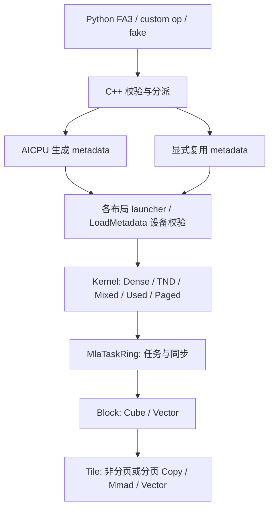

# CANN FIA MLA → FA3 NPU：契约与架构

本文保存已确认的迁移契约和实现依据。**第 1、4 节定义范围，第 2–3 节定义接口，第 5–6 节说明 metadata 与实现架构，第 7 节定义验收口径。** 当前开放能力、运行结果和环境只在 [status](status.md) 维护，实施顺序和完成条件只在 [plan](plan.md) 维护；本文的目标能力不等于已接通能力。

| 核对内容 | 阅读位置 |
| --- | --- |
| 来源、迁移范围与排除项 | [固定依据](#1-范围与固定依据)、[功能边界](#4-功能边界) |
| 参数、布局、长度与输出 | [入口与记录选择](#21-入口与记录选择)、[选项与返回值](#22-后端选项与返回值)、[两种表示](#3-两种-mla-的接口映射)、[代表用例](#42-代表用例与参考实现边界) |
| 记录格式、校验与复用 | [metadata 协议](#5-metadata-设计)、[共同调度约束](#62-调度字段与边界) |
| 分配前缀、used 与真实地址 | [长度与布局](#63-长度与布局调度)、[stride 与 storage](#64-输入-stride-与地址校验) |
| 分页缓存的接口、地址与设备校验边界 | [PA 契约与来源](#643-nd-paged-cache-契约与来源)、[v6 协议与消费者](#57-v6nd-pa-记录) |
| Kernel / Block / Tile 与生产接入 | [代码结构](#6-代码结构)、[数值路径](#65-数值路径与资源布局)、[同步依赖](#66-同步依赖与组件复用结论)、[接入与构建](#67-生产接入与构建) |
| 精度、性能与证据 | [验收口径](#7-验收口径)、[参考工具边界](#72-参考工具与对照边界) |

术语：BSND 为 `[B,S,H,D]`，TND 为 `[T,H,D]`；“分配长度”决定物理起点，“used”限定其中参与计算的前缀。PA 表示 paged attention；FD 表示 FlashDecode/split-KV。下文的“独立组件/探针”有自己的验收边界，不能据其通过推断公开前向已开放。

## 1. 范围与固定依据

迁移集合是 **910B/C 上 CANN FIA 已有 MLA 前向能力，与官方 FA3 可表达能力的交集**，再加接入所必需的 metadata 支持。接口冲突按 FA3 调整；不搬迁普通 MHA/GQA、量化大框架、950 专用模板或反向算子。MLA prefill 中使用 GQA 的分组语义仍在范围内。

**迁移原则：保留固定 CANN 实现的行为，只做 CATLASS 风格的结构重构和必要的 FA3 接入。** 以源实现的验证积累为基础，保持数值路径与设备流水，具体边界见第 6 节。

| 依据 | 固定版本 | 用途 |
| --- | --- | --- |
| 本仓 | `cab322eda3112fdbfefd99c8632b6393273562f3` | 迁移前基线 |
| CANN ops-transformer | `ca18aee610729ca5270a44e2d84c751bc687fbf0` | MLA 功能与性能来源 |
| CATLASS 子模块 | `769cd40a8716b28650b6bebb08db4834eea4462f` | 组件、分层与编程风格 |
| 官方 Dao-AILab/flash-attention | `d15f1531a460ba456f41b01a774f33ab2db8febf`，2026-09-22 | 取该提交的 `hopper/` FA3 实现；不混用 FA2、FA4 或 CuTe MLA 接口 |

官方一手依据：

- [Python 入口与 metadata 签名](https://github.com/Dao-AILab/flash-attention/blob/d15f1531a460ba456f41b01a774f33ab2db8febf/hopper/flash_attn_interface.py)：`flash_attn_func`、`flash_attn_varlen_func`、`flash_attn_with_kvcache`、`get_scheduler_metadata`。
- [C++ 校验与调度](https://github.com/Dao-AILab/flash-attention/blob/d15f1531a460ba456f41b01a774f33ab2db8febf/hopper/flash_api.cpp)：`mha_fwd`、`mha_fwd_get_scheduler_metadata`；以实际分支为准，不仅看 docstring。
- [官方测试](https://github.com/Dao-AILab/flash-attention/blob/d15f1531a460ba456f41b01a774f33ab2db8febf/hopper/test_flash_attn.py)：`has_qv`、异维 Q/V、varlen、kvcache、metadata 的组合。
- [split 合并](https://github.com/Dao-AILab/flash-attention/blob/d15f1531a460ba456f41b01a774f33ab2db8febf/hopper/flash_fwd_combine_kernel.h)：部分结果与 LSE 的合并行为。
- [split 块范围](https://github.com/Dao-AILab/flash-attention/blob/d15f1531a460ba456f41b01a774f33ab2db8febf/hopper/block.h)：在 mask 范围内按 ceil-div 分片；M10a 只复用分片规则，逻辑 tile 与 mask 范围仍取 CANN。
- [softmax](https://github.com/Dao-AILab/flash-attention/blob/d15f1531a460ba456f41b01a774f33ab2db8febf/hopper/softmax.h) 的 `finalize` 与 [写回](https://github.com/Dao-AILab/flash-attention/blob/d15f1531a460ba456f41b01a774f33ab2db8febf/hopper/epilogue_fwd.hpp) 的 `store` / `store_zero`：全遮罩行及 kernel 内空 KV 的 O/LSE；不能只参考 host 的全局空张量分支。

CANN 根目录：`/home/zhangqijia/repo/ops-transformer/attention/fused_infer_attention_score`。下列路径均相对于此目录：

| 来源 | 已核实的事实 |
| --- | --- |
| `op_host/arch22/fia_tiling_nonquant_mla.cpp`，`IsCapable` | 专用模板为 FP16/BF16，内容维 512、RoPE 64、KV 头数 1；含 PA、FlashDecode、mask 等分支 |
| `op_kernel/arch22/fia_kernel_nonquant_mla.h`、`fia_block_cube_nonquant_mla.h`、`fia_block_vec_nonquant_mla.h`、`fia_block_vec_flashdecode_arch22.h` | 解码流水、两个矩阵乘、softmax、输出更新及 split 合并 |
| `op_host/arch22/fia_tiling_nonquant.cpp`，`IsHighPerformanceTemplate`；`op_kernel/arch22/fia_kernel_nonquant.h` 及关联 Block | prefill 的内容维 128 + RoPE 64、V 维 128 在通用非量化路径中，不能按文件名只取带 `mla` 的文件 |
| `op_host/arch22/fused_infer_attention_score_tiling_check_feature.cpp` | 维度、布局、mask、页大小和特性交叉约束；`CheckFeatureHeadDim`、`CheckFeatureAxisInfo`、`CheckFeatureBlockSize` 等 |
| `tests/pytest/test_fia_mla_d512_pa_dim0_noncontiguous.py` | PA 首维 stride 回归；golden 分别使用独立 K 和 V，不能假定源代码总是忽略 V |

源码与文档可能不一致。例如 V5 文档对 decode 的 K/V 复用描述不能替代上述 kernel 与测试；TensorList 的文档描述也必须经过 arch22 host 校验核实。实现时将实际可运行组合固定为用例，未证实组合标为待核实，不能静默删减。

## 2. FA3 入口与后端边界

- [Python FA3 入口](../../flash_attn_npu_3/flash_attn_npu_interface.py) 与 [910 C++ 前向](../../csrc/ascend910/flash_attn_npu_3/flash_api.cpp) 按 `qv` 和维度识别两种 MLA 表示，透传内容与 RoPE 分量，明确校验支持边界。
- 输出按 V 维度分配，真实路径与 fake 对齐 MLA 64/512、192/128 的 O/LSE shape。
- dense/varlen metadata 调用传入实际 `headdim_v=v.shape[-1]`，使入口、调度和设备执行使用同一组维度。
- 复用 [metadata 参数](../../csrc/ascend910/flash_attn_npu_3/fa_metadata_args.h) 和 [AICPU 实现](../../csrc/ascend910/flash_attn_npu_3/fa_metadata.aicpu) 的启动与流同步机制，MLA 使用与源实现对应的调度字段。
- 普通 FA 保持现有 `uint8` metadata 协议兼容；MLA 提供设备 `int32` 调度 tensor，公开使用 `has_softcap`，计算 scale/softcap 数值由前向传入。
- 窗口归一化、split 范围及未支持参数按固定官方 FA3 分支逐项核对。

### 2.1 入口与记录选择

下表描述 512+64 的单 split 入口映射；非 PA BSND 显式 `num_splits=2..256` 优先使用 v17，自动 `num_splits=0` 优先使用 v18；混合 TND Q + BSND KV 显式/自动 split 分别使用 v21/v22（[6.2.24](#6224-混合原生自动-split-生产适配)）；非 PA TND Q/KV 显式 split 使用 v19，自动使用 v20（[6.2.20](#6220-tnd-自动-split-生产适配)），见 [6.2.17](#6217-tnd-显式-split-生产适配) 及 [6.2.12](#6212-bsnd-显式-split-生产适配) 与 [6.2.15](#6215-bsnd-自动-split-生产适配)。可调用能力及验收状态以 [status](status.md) 为准。长度 tensor 均为同设备连续 int32，分配前缀为 `[B+1]`，实际长度为 `[B]`。**公开 varlen 支持 `seqused_q/k`；公开 kvcache 与 metadata 生成器没有 Q-used 参数。**

| 公开入口 | 输入与长度 | 记录选择 |
| --- | --- | --- |
| `flash_attn_func` | BSND Q/KV，使用整容量 | 无 mask 每次内部 v1，causal 每次内部 v7，非默认窗口每次内部 v12；无显式复用参数 |
| `flash_attn_varlen_func` | TND Q/KV，两组分配前缀、两组 max；可选 `seqused_q/k` | 非默认窗口每次内部 v13，causal 每次内部 v8；无 mask 时任一 used 存在用 v5，否则 v3；无显式复用参数 |
| `flash_attn_with_kvcache`，BSND Q | Q 整容量，只读 BSND cache；`cache_seqlens` 为 None（整容量）、`0..Sk` 整数或长度 tensor | 无 mask 且无长度/记录走 v1，否则 v2；causal 使用内部或显式 v7，非默认窗口使用内部或显式 v12 |
| `flash_attn_with_kvcache`，TND Q | Q 使用完整分配段，须给 Q 前缀和 `max_seqlen_q`；只读 BSND cache，KV 长度同上 | 无 mask 使用内部或显式 v4；causal 使用内部或显式 v9，非默认窗口使用内部或显式 v14；整数长度按 cache 的 B 物化 |
| `get_scheduler_metadata`，非 PA | 必须给 KV 长度 tensor，不接受 None/整数；`headdim=64, headdim_v=512` | 无 mask 的 BSND/混合生成 v2/v4；BSND/混合 causal 生成 v7/v9；BSND/混合非默认窗口生成 v12/v14；精确字数见 [第 5 节](#5-metadata-设计) |
| `flash_attn_with_kvcache(page_table=...)` | BSND/TND Q + ND PA cache；TND 须给 Q 前缀和 max Q；Q 使用完整分配段 | 无 mask 内部或显式 v6；BSND/TND causal 内部或显式 v10/v11，BSND/TND 非默认窗口内部或显式 v15/v16；KV 长度 None/整数/tensor，整数按逻辑 B 物化 |
| `get_scheduler_metadata(page_size=P)` | BSND/TND Q；KV 长度 tensor，可选 Q 前缀；`max_seqlen_k` 为逻辑容量 C | 无 mask 生成 v6，BSND/TND causal 分别生成 v10/v11，BSND/TND 非默认窗口分别生成 v15/v16；不接收或检查页表、物理页池 |

`flash_attn_func` / `flash_attn_varlen_func` 没有页表或显式 metadata 参数；PA 通过 kvcache 接入。used 只缩短使用范围，不移动分配起点。内部 used 分派见 [6.7.1](#671-非分页入口与记录选择)，记录格式和复用约束见 [第 5 节](#5-metadata-设计)。

### 2.2 后端选项与返回值

512+64 后端接受 `causal=False`，非 PA BSND、TND Q/KV varlen 和 TND Q + BSND KV cache 及 BSND/TND Q + PA KV 接通 `causal=True`。非 PA BSND、TND Q/KV varlen、TND Q + BSND KV cache 及 BSND/TND Q + ND PA KV cache 支持有限/单侧 `window_size` 及 causal 叠加，按 [6.2.6](#626-独立-cpu-window-归一化与范围) 归一化。非 PA BSND 另支持自动 `num_splits=0` 和显式 `num_splits=2..256`，无 mask/causal/window 分别使用 v18/v17；非 PA TND Q/KV 支持自动 `num_splits=0` 和显式 `num_splits=2..256`，分别使用 v20/v19。混合 TND Q + BSND KV 显式 `num_splits=2..256` 使用 v21，见 [6.2.22](#6222-混合显式-split-生产适配)。混合自动使用 v22，见 [6.2.24](#6224-混合原生自动-split-生产适配)；PA 仍要求 `num_splits=1`。其他选项限定为 `softcap=0`、`pack_gqa=None`、`sm_margin=0`、`attention_chunk=0` 和 `rotary_interleaved=True`。追加 KV、rotary/量化输入、cache 重映射/leftpad 等选项由 Python 与 C++ 明确拒绝。metadata 生成器要求 `has_softcap=False`、`max_seqlen_k_new=0`，拒绝数值 scale/softcap 兼容关键字。单 split 时，`page_size=None` 的无 mask 使用 v2/v4、BSND/混合 causal 使用 v7/v9；指定合法 P 时无 mask 生成 v6、BSND/TND causal 分别生成 v10/v11、BSND/TND 非默认窗口分别生成 v15/v16，按相应布局/mask 显式复用。

func/varlen/内部前向的 `num_splits` 默认 1，kvcache/metadata 默认 0；非 PA BSND/混合的默认 cache/metadata 请求因此使用自动路径，PA 须显式传 1。三种非 PA 布局的前向接受 0..256，负值明确拒绝。生成器 `qkv_dtype` 默认 BF16，必须匹配当次输入。前向默认 scale 见 [3.3](#33-共同契约)，显式值须能表示为有限 FP32；scale 不进入 MLA metadata。

请求 LSE 的开关分别为 func/varlen 的 `return_attn_probs=True` 和 kvcache 的 `return_softmax_lse=True`。前两者返回 `(O,LSE)`，kvcache 返回 `(O,LSE,out_accum,lse_accum)`；单 split 时两个 accumulator 为同设备空 tensor，dtype 随 PyTorch 默认浮点 dtype（通常 FP32），真实/fake 一致。BSND 显式 S>1 的 accumulator 为真实 FP32 `[S,B,H,Sq,512]` / `[S,B,H,Sq]`，不压紧 Q-used；func 仍只返回 `(O,LSE)`。BSND 自动请求采用静态后端容量 26，返回 FP32 `[26,B,H,Sq,512]` / `[26,B,H,Sq]`，实际每 M 片数由设备决定；Direct 写第 0 片，未使用片初始化为 0/-inf。混合显式 cache/raw/私有入口返回 FP32 `[S,H,totalQ,512]` / `[S,H,totalQ]`，按原 Q allocation 放置，见 6.2.22。TND 自动 raw/私有入口返回 `[26,H,totalQ,512]` / `[26,H,totalQ]`，保留原 allocation 间隙；公开 varlen 仍返回二元结果。容量不是均匀分片数量，具体适配见 6.2.15 和 6.2.20。O/LSE 的维度、dtype 与空值见 [3.3](#33-共同契约)。

192/128、其他 mask 组合、其他布局 split 和调度选项的目标契约仍保留在下文，但未完成对应计划步骤前必须明确拒绝。这里的 910B C1V2 与容量限制属于本后端，不是官方 FA3 的通用限制。

## 3. 两种 MLA 的接口映射

### 3.1 压缩 MLA：512 + 64

CANN 一般形式为 `scores = (Q_content K_contentᵀ + Q_rope K_ropeᵀ) * scale`，再以 V 加权求和。
FA3 的 `qv` 形式为 `scores = (q kᵀ + qv vᵀ) * scale`，输出为 `softmax(scores) v`。

| CANN 含义 | FA3 参数 | 典型 dense shape |
| --- | --- | --- |
| queryRope | `q` | `[B, Sq, Hq, 64]` |
| keyRope | `k` / `k_cache` | `[B, Sk, 1, 64]` |
| query 的内容部分 | `qv` | `[B, Sq, Hq, 512]` |
| 共享的压缩 KV | `v` / `v_cache` | `[B, Sk, 1, 512]` |
| attentionOut | `out` | `[B, Sq, Hq, 512]` |

内部可将 `qv → CANN query`、`q → queryRope`、`k → keyRope`、`v → key 和 value`，直接重用同一压缩 KV 数据，不拼接 576 维张量、不展开所有头。

**边界必须明确：** CANN 可计算的独立 `K_content != V` 的 512 维场景，FA3 `qv` 接口不能等价表达；拼成 Q/K 576 维又超过该 FA3 路径的维度范围。这一组合按“TriDao 不支持特性除外”排除，不能通过偷偷替换 V 宣称支持。源测试中这类数据要重新构造为共享压缩 KV，并保留该排除说明。

### 3.2 展开 MLA prefill：192 / 128

- FA3 输入 `q=[Q_content(128), Q_rope(64)]`、`k=[K_content(128), K_rope(64)]`，`v` 为独立 128 维，`qv=None`；输出最后一维为 128。
- CANN RoPE 合并和分离两种形式归一到这一入口。FA3 的 `qv` 校验要求 V 维度至少为 256，不能把 128 维 prefill 内容塞进 `qv`。
- kernel 内可读取 192 维完整行，或用带真实 stride 的两个视图读取内容/RoPE；slice 后行 stride 仍可能是 192，不能当作紧凑 128 或 64。
- “prefill”和“decode”表示这里的数据表示方式，不按 `Sq==1` 分派。512 维路径也必须覆盖多 query token 和变长 query。

### 3.3 共同契约

以下同时包含已接通与待迁移能力的目标语义；调用前按 [2.2](#22-后端选项与返回值) 和 [status](status.md) 核对支持范围。

| 差异 | 适配规则 |
| --- | --- |
| 入口 | 保留 `flash_attn_func`、`flash_attn_varlen_func`、`flash_attn_with_kvcache`；内部按 qv、Q/K/V 维度分派，无新 `flash_mla` 公共入口 |
| scale | 显式值原样生效；缺省按 FA3：`(Dq + Dqv)^(-1/2)`，无 qv 则 `Dq^(-1/2)`。典型 decode 为 `1/sqrt(576)`，prefill 为 `1/sqrt(192)`；CANN 对照显式传同一值 |
| RoPE | CANN 的 queryRope/keyRope 是已形成的位置分量，不等于 FA3 的 `rotary_cos/sin`。本迁移接收已处理的分量，不能重复旋转 |
| dense/varlen | 对外 BSND / TND；CANN BSH、BNSD、NTD 等在模型边界用 reshape/permute 归一，支持最后一维连续的合法外层 stride，不每步强制复制完整 cache |
| 长度 | FA3 `cu_seqlens_*` 为带起始 0 的设备 int32 前缀和；`cache_seqlens` / `seqused_*` 是实际使用长度。CANN 常用 int64 且累计数组不带起始 0，内部重新解析，不能重解释指针 |
| 长度上界 | `max_seqlen_*`、cache 容量、每样本实际长度分别处理；padding 槽位不参与 softmax。不能只拿 batch 中最大实际长度生成所有样本的 mask |
| PA | `page_table:int32[B, max_pages]`，cache 为 `[num_pages, page_size, Hkv, D]`；携带页表行 stride 和 K、V 各自 stride，处理乱序页、尾页及首维非连续；目标契约与固定源映射见 [6.4.3](#643-nd-paged-cache-契约与来源) |
| 头数 | decode 的迁移范围 Hkv=1；prefill 保留 CANN 与 FA3 共同支持的 Hq/Hkv 整除组合。不是把整套普通 GQA 移过来 |
| mask | 对外只用 `causal`、`window_size`；右下对齐的位置中心为 `i + Sk - Sq`。CANN 0/3/4 模式归一为无 mask/右下 causal/band |
| 窗口归一化 | 固定 FA3 版本在入口按 `Sk-1`、`Sq-1` 处理左右窗口，并有单 query 分支；数学窗口与实际归一化分支都要测试，不能只验证等长序列 |
| 输出 | O 与 V 的末维相同、dtype 与 FP16/BF16 输入相同；LSE 为 FP32，dense `[B,Hq,Sq]`、varlen `[Hq,Tq]`，数学量为自然对数 |
| 空行/空 KV | O 为 0。非分页的整个 K 张量容量为 0 时，`mha_fwd` host 分支令 LSE 为 `+inf`；容量非零但某行全被 mask 或样本实际 KV 长度为 0 时，`softmax::finalize` / `epilogue::store_zero` 写 `-inf`，split 全空合并也为 `-inf`。零 query 的 O/LSE 保留空 shape；PA 须按 [6.4.3](#643-nd-paged-cache-契约与来源) 核对官方分支，不能按物理 cache 的空 shape 套用非分页规则 |
| 返回值 | 按入口对齐：dense/varlen 的可选 LSE 返回二元组；固定版本 kvcache 开启 `return_softmax_lse` 实际返回 O、LSE 及两个 accumulator，共四项，不能只按旧 docstring 实现 |
| split | `num_splits=0` 自动、1 不分割、>1 请求分割，固定官方实现上限为 256；核数限制属于实现资源策略，不能把现仓仅 PA+TND、至多核数的限制误称为 FA3 限制 |

## 4. 功能边界

| 能力 | 处理与验收 |
| --- | --- |
| FP16/BF16；512+64 压缩表示；192/128 prefill | 必迁，含 out 和 LSE |
| dense、TND、实际长度、GQA 分组（prefill） | 必迁；含非均匀长度、多 token、小 batch、尾块及零长度边界 |
| PA、16 对齐且不超过 1024 的源页大小、合法 stride | 必迁 ND 路径；CANN `GetBlockSize` / `CheckFeatureBlockSize` 要求 16..1024 的 16 倍数；固定 FA3 允许任意正页大小，TMA 整除条件只选择实现。因此交集保留全部 64 种源页大小，不额外限制为 128/256 的倍数 |
| 无 mask、右下 causal、有限/单侧窗口、FlashDecode | 必迁；包含功能组合，不能仅验证每个开关单独可用 |
| metadata、自动/显式调度、重复执行、图执行 | 本需求必需；普通 FA3 的既有路径需回归 |
| CANN 独立 512 维内容 K/V | FA3 qv 无等价表达，排除；见 3.1 |
| tree mask / sparseMode=9、任意用户 mask、独立左上 causal 接口 | FA3 hopper 公共入口没有等价参数，排除；保留能用标准右下窗口表达的计算 |
| 外部 NZ cache、CANN 布局字符串和特殊输出布局 | 不增加 CANN 专用公开参数；普通布局可由视图归一，NZ 外部格式按 FA3 不支持排除。内部是否使用分块布局由性能决定 |
| INT8 全量化、伪量化、后量化、CANN 专用量化因子 | 不迁移；不以 FA3 的 FP8 descale 冒充等价支持；950 的量化 MLA 不在芯片范围内 |
| PSE、公共前缀、TensorList、padding 参数、sink | 按 4.1 的 X05–X07 排除；TensorList/PSE/公共前缀/左 padding 不在所取源 MLA 能力内，源 prefill 可接受 sink，但固定 FA3 无等价参数。有效区末尾 padding 仍纳入实际长度验收 |
| 新 KV 原地追加、内置 rotary、cache_leftpad、attention_chunk、FA3 额外维度/头数组合 | 不因 FA3 签名存在就扩为本次 CANN MLA 迁移任务；未实现组合明确报错，不允许忽略。若后来源能力盘点证明属于交集，补入计划 |
| softcap、pack_gqa、sm_margin | 数学或调度参数不能默默丢弃；MLA 适配分别实现其有效语义，硬件调度方式可不同，资源不足清楚报错 |
| backward | 原 FIA 为推理前向，迁移不扩反向范围；qv 路径上游测试也跳过 backward。新增 MLA 前向不能误走本仓等维 backward，需要明确拦截未支持的梯度请求 |

这张表是需求边界；下列来源清单和代表用例定义验收追踪关系，运行结果只记入 status。

### 4.1 源能力清单

下表的 CANN 路径相对于第 1 节固定源目录，FA3 路径相对于固定官方提交的 `hopper/`。函数名用于源码追踪，不把 host 接受或 tiling 分支存在等同于已实测通过。用例 ID 对应 4.2；排除项在后续入口接通时必须明确拒绝。

| 能力 | 固定来源及边界 | 结论 / 用例 |
| --- | --- | --- |
| 512+64，FP16/BF16，KV 头数 1，单/多 query | `op_host/arch22/fia_tiling_nonquant_mla.cpp::IsCapable`；`op_kernel/arch22/fia_block_cube_nonquant_mla.h` 的内容与 RoPE 乘法 | 纳入共享 KV 子集；D01、D02 |
| 192/128 prefill，RoPE 分离/合并，独立 V | `op_host/arch22/fia_tiling_nonquant.cpp::IsHighPerformanceTemplate`；`fused_infer_attention_score_tiling_check_feature.cpp::CheckFeatureHeadDim`；通用 `fia_kernel_nonquant.h` | 纳入；P01、P02，不能由 decode 文件名推断不支持 |
| prefill 分组头 | `op_host/arch22/fia_tiling_nonquant.cpp` 的 `set_gSize(n1Size / n2Size)`；`fused_infer_attention_score_tiling_check_consistency.cpp` 的 `CheckQShape` / `CheckKVShape`；FA3 `mha_fwd` 的 `num_heads % num_heads_k` 校验 | 纳入两端有效整除组合；P01、P02；512 路径仍只允许 Hkv=1 |
| BSH/BSND/BNSD、TND/NTD、特殊输出布局 | MLA `IsCapable` 和 `CheckFeatureLayout`，专用 decode 不接受 NTD query，通用 prefill 可接受 | BSND/TND 纳入；普通布局由视图归一，特殊输出不增加公开参数；D/P/T01、ST01 |
| 实际长度、累计长度、padding 槽位 | `CheckFeatureActualSeqLens*`、`GetQActualSeqLenForPostQuant` / `GetKVActualSeqLenForPostQuant`；FA3 `cu_seqlens_*` / `seqused_*` / `cache_seqlens` | 纳入；T01、U01；CANN int64 累计尾值与 FA3 带 0 的 int32 前缀和须数值转换 |
| ND PA、页大小、尾页 | `CheckFeatureBlockSize`、`CheckFeatureLayout`、MLA 与通用 `GenTilingKey` 的 PA 分支；FA3 `mha_fwd` 的 page table 解析 | 纳入；PA01；源页大小为 16 的倍数且 16..1024；不把 NZ 一并纳入 |
| PA 首维不连续，K/V/RoPE 独立 stride | `fia_tiling_nonquant_mla.cpp::FillArch22MlaKvStrideParams`；`tests/pytest/test_fia_mla_d512_pa_dim0_noncontiguous.py::STRIDE_PROFILES` | 纳入 FA3 可表达的 stride；PA02；压缩表示中 FA3 K 是 RoPE，FA3 V 是共享内容 KV |
| 无 mask、右下 causal、band/window | `CheckFeatureMask`，MLA `IsCapable` 的 sparse 0/3/4；`flash_api.cpp::mha_fwd` 窗口归一化 | 纳入；MS01..MS03；源 sparse 3/4 仍需合法 mask tensor，基线适配不能只传 mode |
| FlashDecode / split-KV | 两个 tiling 的 `IsFlashDecode` / `GenTilingKey`；`op_kernel/arch22/fia_block_vec_flashdecode_arch22.h`；官方 combine kernel | 纳入；FD01、FD02；源自动分割与 FA3 0/1/显式 split 分别记录，不能伪称 CANN 有同一公开参数 |
| O、可选 LSE、空张量、空行 | `CheckFeatureLse`、`fia_tiling_empty_tensor.cpp`；FA3 `mha_fwd`、`softmax.h::finalize`、`epilogue_fwd.hpp::store_zero` | 纳入；Z01、MS02；空行符号按 FA3 路径区分，见 3.3 |
| metadata、图、重复执行 | 本仓 `fa_metadata.aicpu`；官方 `get_scheduler_metadata`、`mha_fwd_get_scheduler_metadata` | 接入必需的适配，非宣称原 FIA 签名已有相同 metadata 协议；MD01、GR01 |
| softcap、pack_gqa、sm_margin | 官方 `flash_attn_interface.py` 与 `flash_api.cpp` 的数学/调度参数；源 FIA 不能直接等参对照 | 纳入有效语义；SC01、MD01；softcap 用数学 reference 验收，CANN 无同义参数时单列性能口径 |
| 独立 512 维内容 K/V | 源 PA stride 测试的独立 golden K/V；FA3 `mha_fwd` 的 qv 维度校验 | 排除 X01：FA3 qv 的内容点积必须使用输出 V；不能替换源 V 来掩盖差异 |
| tree、任意 mask、独立左上 causal | MLA `IsCapable` 支持 sparse 9，`CheckFeatureSparseMode` 限制；FA3 公共入口只提供 causal/window | 排除 X02：无等价公开参数；可表达的标准窗口计算仍纳入 MS01..MS03 |
| 外部 NZ cache | `CheckFeatureLayout` / `CheckFeatureHeadDim` 的 NZ 分支与源 PA 测试 | 排除 X03：FA3 无外部 NZ 协议；ND PA 必迁，CANN 原生 NZ 性能可另列 |
| 全量化、伪量化、后量化和量化因子 | MLA `IsCapable` 的输入/输出 dtype 校验；`CheckParaExistenceMlaNoquant`；其他 arch/量化模板 | 排除 X04：超出此次非量化 910B/C 范围，不用 FP8 descale 替代 |
| TensorList | `CheckFeatureTensorList` 拒绝任何非 NO_ROPE 模式；专用 MLA `IsCapable` 也拒绝 | 排除 X05：不属于此次 MLA 源能力 |
| PSE、公共前缀、query/KV padding 参数 | split 由 `CheckParaExistenceMlaNoquant` 拒绝；combined 由 `CheckFeaturePSE` / `CheckFeatureGqaPrefix` / `CheckFeatureLeftPadding` 拒绝非 NO_ROPE | 排除 X06：不因 FIA 总签名存在就迁移；实际长度与有效区末尾 padding 仍纳入 U01 |
| learnable sink | 专用 MLA `IsCapable` 拒绝；通用路径 `CheckFeatureLearnableSink` 可接受每 query head 的 BF16 sink | 排除 X07：固定 FA3 hopper 无 sink 参数，不能宣称所有 CANN MLA 都不支持 |
| KV 追加、内置 rotary、cache_leftpad、attention_chunk、额外维度/头数、反向 | 固定 FA3 入口有前述额外选项；源本次 MLA 是已形成 RoPE 的前向计算，padding 校验见 X06 | 排除 X08：不是已确认迁移交集；MLA 梯度请求与未实现选项明确拒绝 |

### 4.2 代表用例与参考实现边界

所有数值用例使用 FP16 和 BF16。`D` 表示共享 512+64，`P` 表示 192/128；除 D 的 Hkv=1 外，头数写为 Hq/Hkv。未特别标注时无 mask、默认 scale，两个表示均校验 O/LSE。下表覆盖已接通和待接通功能的目标验收输入，**不是已运行 NPU 测试列表**；无意义或源拒绝的交叉组合须记录原因，不以 skip 冒充覆盖。

| ID | 代表输入 / 交叉条件 | 验收重点 |
| --- | --- | --- |
| D01 | D，BSND，B=2，Sq=1，Sk=257，8/1；默认 scale 与 0.23 | 两项点积、共享 KV、非整块 KV、输出 512 |
| D02 | D，BSND，B=1，Sq=7，Sk=65，16/1 | 多 query 不误分派到 prefill |
| P01 | P，BSND，B=2，Sq=17，Sk=31，8/2；源 split 与 combined RoPE | 两种 CANN 表示对同一 FA3 输入，独立 V、GQA、输出 128 |
| P02 | P，BSND，B=1，Sq=33，Sk=129，8/8 和 8/1 | 非分组/最大分组及尾块，内容/RoPE 视图 row stride=192 |
| T01 | D/P，TND，Q 长度 [3,0,1]，KV 长度 [17,0,33]；增加 `seqused` 小于分配长度的变体 | FA3 前缀和 [0,3,3,4] / [0,17,17,50] 与 CANN 尾值 [3,3,4] / [17,17,50]；累计/实际长度不混用 |
| U01 | D/P，BSND 容量 Sq=7、Sk=33，Q 实用 [3,1]、KV 实用 [17,0]，padding 填 poison | mask 按样本实际长度；非零容量中的空 KV LSE=-inf；分配容量不等于实际长度 |
| ST01 | D/P，BSND 与 TND 外层切片、非零 storage offset、BNSD/NTD 归一视图 | 最后一维连续，batch/row/head stride 保留；不每次复制完整 cache |
| PA01 | D/P，BSND/TND query，Q [3,1]，KV [page_size+1,2*page_size-3]，乱序页；页大小遍历 16..1024 的 16 倍数 | 尾页、页表 padding、无关物理页；性能代表页 16/128/256/1024 |
| PA02 | PA01，K/V 首维 padding 分别取 (17,0)、(0,29)、(17,37)，另测所有外层 stride | D 的 K 为 RoPE、V 为共享内容，P 保留独立 192/128 K/V；地址计算独立；源独立 512 维内容 K/V 用例不能原样宣称可迁移 |
| MS01 | D/P，Sq=2、Sk=5，causal；dense/TND/PA | 允许列分别为 0..3、0..4，右下对齐 |
| MS02 | D/P，Sq=5、Sk=2，causal；dense/TND/PA，有/无 split | 前三行全空，O=0、LSE=-inf；后两行分别看 1、2 个 KV |
| MS03 | D/P，(Sq,Sk)=(3,5)/(1,3)/(5,2)，窗口 (1,0)/(0,0)/(-1,0)/(0,-1)，叠加 causal；另取左右界恰为 Sk-1/Sq-1 | 单侧窗口、单 query、归一化边界、跨 PA 页的有限窗口 |
| FD01 | D/P，Sq=1/7，Sk=8193，split=0/1/2/8/256，dense/TND/PA | O/LSE 与不分割一致，显式分割资源校验、长 KV 性能；CANN 使用原生自动策略 |
| FD02 | D/P，小 KV、split 多于有效块、部分/全部空 split | 中间 -inf 哨兵和合并，accumulator shape/dtype/返回数量，不把未初始化槽位当数值 |
| Z01 | D/P，(Sq,Sk)=(0,3)/(3,0)/(0,0)，再测 batch 内零长度 | 全局空 K 为 +inf，kernel 内空行 -inf；零 query 的空 shape 与无 NaN |
| MD01 | D/P，D01/P01 输入，有/无 metadata，scale 默认/0/0.23；pack_gqa None/False/True；sm_margin 0/合法正值/耗尽资源 | 默认 scale 不写死到调度；跨层复用和参数有效语义，普通 FA byte metadata 回归 |
| SC01 | D/P，D02/P01 输入，softcap 0/15；metadata 复用时修改正 softcap 数值 | softcap 作用于两个分量总分数乘 scale 后的值；`has_softcap` 只表达调度特征 |
| GR01 | D/P，T01/PA01，图内长度修改并重算 metadata；多次 replay、跨层、多 stream | 图内/图外 metadata 生命周期、fake 与真实输出、workspace 隔离 |

代表用例定义输入与预期行为；参考实现、源执行器各自覆盖到哪里，见 [7.2](#72-参考工具与对照边界)。

## 5. metadata 设计

metadata 指 FA3 的 `get_scheduler_metadata` → `scheduler_metadata` 调用链，以及 func/varlen 的内部生成链路。兼容公开调用语义，NPU 记录布局由本后端管理，不与 CUDA buffer 互换。B 表示 batch，以下字数单位均为 int32。记录中的 token 起点属于分配坐标，不是元素或字节地址；真实地址还须结合各输入的 stride，见 [6.4](#64-输入-stride-与地址校验)。

| 协议 | version / kind | 精确字数 | 表达的布局与长度 |
| --- | --- | --- | --- |
| [v1](#52-v1整容量-dense-记录与消费者) | 1 / 1 | 401 | BSND Q/KV 均使用整容量 |
| [v2](#53-v2bsnd-实际-kv-长度记录与消费者) | 2 / 2 | 401+B | BSND Q 使用整容量，KV 保存逐样本实际长度 |
| [v3](#54-v3紧凑-tnd-记录与设备消费) | 3 / 3 | 405+4B | 紧凑 TND Q/KV；两轴起点来自分配前缀，使用整个分配段 |
| [v4](#55-v4tnd-q-与-bsnd-kv-混合记录) | 4 / 4 | 406+5B | TND Q 使用整个分配段，BSND KV 保存 64 位物理起点与实际长度 |
| [v5](#56-v5分配与-used-记录) | 5 / 5 | 410+8B | BSND Q/KV、TND Q/KV、TND Q + BSND KV；分别保存分配起点、容量与可选 Q/KV-used |
| [v6](#57-v6nd-pa-记录) | 6 / 6 | 408+5B | ND PA，BSND/TND Q 分配与可选 Q-used、非累计 KV 长度 |
| [v7](#59-v7bsnd-causal-记录) | 7 / 7 | 410+8B | 非 PA BSND 右下 causal；分配起点/容量、可选内部 Q-used 和 KV 实际长度 |
| [v8](#510-v8tnd-causal-记录) | 8 / 8 | 410+8B | 非 PA TND Q/KV 右下 causal；两组分配前缀、可选 Q/KV-used |
| [v9](#511-v9混合-causal-记录) | 9 / 9 | 410+8B | 非 PA TND Q + BSND KV 右下 causal；Q 分配前缀、可选内部 Q-used 与 KV 实际长度 |
| [v10](#512-v10bsnd-pa-causal-记录) | 10 / 10 | 408+5B | BSND Q + ND PA KV 右下 causal；可选内部 Q-used、P/C 与实际 KV 长度 |
| [v11](#513-v11tnd-pa-causal-记录) | 11 / 11 | 408+5B | TND Q + ND PA KV 右下 causal；Q 分配前缀、可选内部 Q-used、P/C 与实际 KV 长度 |
| [v12](#514-v12bsnd-window-记录) | 12 / 12 | 413+8B | 非 PA BSND window；allocation/used、调用级上界及归一化窗口身份 |
| [v13](#515-v13tnd-window-记录) | 13 / 13 | 413+8B | 非 PA TND Q/KV window；双前缀/used、调用级 maxQ/maxK 及归一化窗口身份 |
| [v14](#516-v14混合-window-记录) | 14 / 14 | 413+8B | 非 PA TND Q + BSND KV window；Q 分配前缀/可选内部 used、KV 容量/实际长度及归一化窗口身份 |
| [v15](#517-v15bsnd-pa-window-记录) | 15 / 15 | 411+5B | BSND Q + ND PA KV window；Q 容量/可选内部 used、P/C、KV 实际长度及归一化窗口身份 |
| [v16](#518-v16tnd-pa-window-记录) | 16 / 16 | 411+5B | TND Q + ND PA KV window；Q 分配前缀/总量/maxQ、可选内部 used、P/C、KV 实际长度及归一化窗口身份 |
| [v17](#6212-bsnd-显式-split-生产适配) | 17 / 17 | 416+10B | 非 PA BSND 显式 split；allocation/used、窗口、片数和 M 前缀 |
| [v18](#6214-bsnd-自动-split-的-v18-安全协议) | 18 / 18 | 758+10B | 非 PA BSND 自动 split；原生 AIC/FD/Vector 端点与 M 前缀 |
| [v19](#6217-tnd-显式-split-生产适配) | 19 / 19 | 416+10B | 非 PA TND Q/KV 显式 split；双 allocation/used、窗口、片数和紧凑 M 前缀 |
| [v20](#6219-tnd-自动-split-的-v20-安全协议) | 20 / 20 | 758+10B | 非 PA TND Q/KV 自动 split；双 allocation/used、原生端点与紧凑 M 前缀 |
| [v21](#6221-混合显式-split-计划与-v21-安全协议) | 21 / 21 | 416+10B | TND Q + BSND KV 显式 split；64 位 KV 起点与紧凑 Q 计划；生产接入见 [6.2.22](#6222-混合显式-split-生产适配) |
| [v22](#6223-混合原生自动-split-计划与-v22-安全协议) | 22 / 22 | 758+10B | TND Q + BSND KV 自动 split；紧凑 Q、64 位 KV 起点和原生 AIC/FD/Vector 端点；生产接入见 [6.2.24](#6224-混合原生自动-split-生产适配) |

协议能表达某布局，不代表该布局已接通生产入口。生成记录、设备校验、独立 attention、入口调用分别验收；当前接入层次见 [status](status.md)，生产分派见 [6.7](#67-生产接入与构建)。v1–v4 均不表达独立 Q-used 或 TND KV-used；v5 使用的归一与调度见 [6.3.4](#634-分配长度与-used-的-cpu-归一)。

### 5.1 签名与复用规则

- 保留官方参数名、顺序与默认值。`get_scheduler_metadata` 没有 `qv`、`cu_seqlens_k` 或 `seqused_q` 参数；`flash_attn_func` / `flash_attn_varlen_func` 没有显式 metadata 参数，采用内部生成。显式复用通过只读 kvcache 接入，不增加公共参数。
- 非分页生成器必须接收设备连续 `int32[B]` 的 `cache_seqlens`。无 Q 前缀时，无 mask 生成 v2、causal 生成 v7，`max_seqlen_q/k` 对应 BSND 分配容量；提供同设备连续 `int32[B+1]` 的 `cu_seqlens_q` 时生成无 mask v4，`max_seqlen_q` 是每段 Q 上界，`max_seqlen_k` 是物理 cache 容量。v4 的 Q 总量由 AICPU 从前缀尾值推导，前向再与真实 Q shape 核对。
- `None` / `0..Sk` 整数便利输入只属于 kvcache。None 表示整容量；整数先在 host 校验再物化设备 tensor。混合路径的 None 也物化为设备长度，再使用 v4。显式记录仍须逐项核对当次前缀和长度，None 不表示信任记录快照。
- 记录保存静态几何、dtype、调度特征、切块、分核及长度快照，不保存地址、scale、stride 或可变 scratch。前向独立校验真实 qv 与 Q/K/V；softcap 接入后的数值同样由前向提供，不由 `has_softcap` 代替。
- 无记录时内部生成，显式复用时省去 AICPU 生成；两者共用源调度函数。host 只读 shape/dtype/stride 等静态信息，长度值由 AICPU/设备读取，不增加长度 D2H、`.item()` 或主机同步。host 分配预算仍可能计算调度，见 [6.7](#67-生产接入与构建)。
- 同设备、同调度条件和长度下可跨层复用；长度变化后重新生成。记录可克隆或用连续偏移视图复用，不依赖 Python 私有属性。每次调用独占 O/LSE/workspace；stream 和输入只读要求见 [5.8](#58-stream-与内存生命周期)。

普通 FA3 保留 `uint8` 协议。其旧数值参数 `softcap` / `softmax_scale` 为关键字兼容项，仍写入 byte 记录；单独 `has_softcap=True` 拒绝，须同时给出正 `softcap`。省略 `has_softcap` 时可由正 `softcap` 启用；True 与零值冲突、负值或非有限值均拒绝。MLA 不接受这两个生成器数值关键字。

**PA 生成接口与协议边界。** 上述 v1–v5 均不表达分页，不能把物理页当作 BSND batch，或只设置一个 PA 标志后复用旧记录。v6 保存 PA 类型、页大小、每样本逻辑容量、Q 分配/实际长度和 KV 实际长度及源调度；编码与独立调用 context 见 [5.7](#57-v6nd-pa-记录)。公开生成器 `get_scheduler_metadata(..., page_size=P)` 只知道逻辑几何和长度，既没有页表、物理页数，也没有 K/V storage 信息；生成器不校验或快照这些数据。P 须为 16..1024 的 16 倍数，`max_seqlen_k=C` 须在 0..16384 且可被 P 整除；`cache_seqlens` 仍必须是同设备连续 `int32[B]`，可选 `cu_seqlens_q` 是同设备连续 `int32[B+1]`。无 Q 前缀时 Q 使用 BSND 整容量，有前缀时使用 TND 分配段，总 Q 由 AICPU 推导。BSND/TND 公开 PA 前向核对记录的页大小与逻辑容量，再独立校验当次前缀、页表和物理 cache，见 [6.4.3](#643-nd-paged-cache-契约与来源)。

同长度、Q 分配和调度条件下，记录可跨合法页表映射、物理 cache 和 stride 复用；页表变化不要求重算调度，但每次消费仍检查有效页号。长度、Q 前缀或页大小改变则重生成；页表和 cache 在当次异步调用结束前只读。内部 Q-used 每次生成，不开放显式复用，也不新增公共参数。原 v1–v5 与普通 FA3 byte 协议保持兼容，PA 与非 PA 记录必须互相拒绝。

#### 共同编码与失败规则

[`mla_metadata.h`](../../csrc/ascend910/flash_attn_npu_3/mla/mla_metadata.h) 定义共同前缀：`magic=0x4d4c4131`；前八字依次为 magic、version、kind、wordCount、dtype、生成状态、源调度状态、保留位。其后 393 字为 `MlaMetadataSchedule`，保存几何、端点、FD 记账、workspace 与局部资源需求。保留位为零；64 位字段拆为低/高 32 位，只要求 4 字节对齐，允许奇数 storage offset。

v2–v15 生成器先按静态 B 计算精确字数，要求 wordCount 不超过 `UINT32_MAX`，再检查输出地址、对齐、地址加法及与输入的区间重叠。不安全输出返回失败且不写记录；区间判断不做可能溢出的终点加法。只读输入可以相互别名，不能与输出重叠。输出安全但 dtype、描述符、形状、长度值或调度失败时，写非成功头部并清零八字头后的**全部载荷**，包括快照。v3–v15 成功记录从调度器拥有的快照序列化，不二次读取原始前缀或 used。

| 生成错误 | v1 / v2 | v3 | v4 / v5 / v6 / v7 / v8 / v9 / v10 / v11 / v12 / v13 / v14 / v15 |
| --- | --- | --- | --- |
| dtype 不支持 | `UnsupportedDtype=1` | 同左 | 同左 |
| 形状、平台或调度失败 | `ScheduleFailure=2`，另存调度状态 | 同左 | 同左 |
| 输入描述符错误 | `InvalidCacheLengths=3` | `InvalidPrefixes=3` | `InvalidLengths=3` |
| 长度数值错误 | v1 非整容量为 `UnsupportedCacheLength=4`；v2 越界为 `ScheduleFailure/UnsupportedShape` | `ScheduleFailure`，另存调度状态 | 同左 |

各协议消费者使用独立调用 context，先核对精确字数、版本/类型、生成状态、dtype，再校验形状、平台、实际 blockDim、workspace、局部资源、长度和端点。协议之间相互拒绝，不因 magic/dtype 相同就互换；64 位 workspace 和地址不能窄化。校验失败不改写返回调度。

设备适配层另检查输入地址、4 字节对齐、地址加法和编译 dtype。每个 Cube/Vector 在 TPipe、attention 同步和 O/LSE/workspace 写入之前完成校验；`Load*Metadata` 遇错执行不受 `NDEBUG` 影响的 `AscendC::Trap()`。**生成器写失败记录，消费者才触发设备异常**，由调用或同步点报告；异常用独立进程验收，不承诺错误上下文可继续使用。

消费者保证兼容性和计算地址边界，不认证记录来源或调度最优性；`maxCost` 仅作诊断。FD 记账及未使用核端点按各版本规则检查，例如 v5 要求未启用的数组和未用端点为零。空容量也不能绕过记录/长度校验；全局空容量见 [6.2.3](#623-全局空容量)，非空容量中的零长度按 [6.3](#63-长度与布局调度) 处理。

### 5.2 v1：整容量 dense 记录与消费者

[`BuildDenseMetadata`](../../csrc/ascend910/flash_attn_npu_3/mla/mla_metadata.cpp) 生成固定 `int32[401]`，可选 KV 长度必须逐项等于容量，缺省使用整容量。v1 只用于无长度和记录的整容量前向，不由公开 metadata 生成器返回；生成失败清零调度载荷。

[`mla_metadata_consumer.h`](../../csrc/ascend910/flash_attn_npu_3/mla/mla_metadata_consumer.h) 实现 CPU/设备共用校验，[`kernel/mla_metadata.hpp`](../../csrc/ascend910/flash_attn_npu_3/mla/kernel/mla_metadata.hpp) 提供设备适配。非空 dense 端点须单调并覆盖全部任务；`CheckDenseCacheLengths` 重新核对当次长度。通过后才构造 `MlaDenseKernelSchedule`。

### 5.3 v2：BSND 实际 KV 长度记录与消费者

[`mla_bsnd_metadata.h`](../../csrc/ascend910/flash_attn_npu_3/mla/mla_bsnd_metadata.h) 在 401 字共同前缀后追加 B 个实际 KV 长度；隐式整容量也保存快照，B=0 仍以版本/类型区分 v1。[`BuildBsndKvLengthMetadata`](../../csrc/ascend910/flash_attn_npu_3/mla/mla_bsnd_metadata.cpp) 接受 `[0,Sk]` 的长度，复用 `BuildBsndKvLengthSchedule`，与 AICPU 编译同一调度/序列化源码。

[`消费者`](../../csrc/ascend910/flash_attn_npu_3/mla/mla_bsnd_metadata_consumer.h) 逐项比较当次长度，缺省表示整容量。端点须单调且位于完整 M 块之间；省略尾部从样本边界开始，且各样本 KV 长度均为零。非空容量中的全零长度仍校验完整调度和 workspace。[`LoadBsndKvLengthMetadata`](../../csrc/ascend910/flash_attn_npu_3/mla/kernel/mla_bsnd_metadata.hpp) 校验后交给实际长度 Kernel；blockDim 必须匹配实际发射，静态预算见 [6.7.2](#672-校验输出与发射)。

### 5.4 v3：紧凑 TND 记录与设备消费

[`mla_tnd_metadata.h`](../../csrc/ascend910/flash_attn_npu_3/mla/mla_tnd_metadata.h) 的 401 字共同前缀后保存 Q/KV 总容量及 Q/KV max 上界；每样本四字为 `queryStart、kvStart、queryLength、kvLength`，单位为 token。调度 `s1Size/s2Size` 使用观测最大段长。[`BuildTndMetadata`](../../csrc/ascend910/flash_attn_npu_3/mla/mla_tnd_metadata.cpp) 接收两组 `int32[B+1]` 分配前缀，B=0 仍须两组 `[0]`；无 used 的 varlen 每次内部生成 v3，任一 used 存在时改用 v5。

[`消费者`](../../csrc/ascend910/flash_attn_npu_3/mla/mla_tnd_metadata_consumer.h) 核对总容量、max 上界、观测最大段长及两组完整前缀，空容量也不跳过。逐样本 M/S2 块数、端点和零成本后缀不能用矩形容量代替；末端及其后每个样本须 Q=0 或 KV=0，端点可在零 KV 样本的合法 M 块之间。[`LoadTndMetadata`](../../csrc/ascend910/flash_attn_npu_3/mla/kernel/mla_tnd_metadata.hpp) 返回独立 `MlaTndKernelSchedule`，避免误传 BSND Kernel。

### 5.5 v4：TND Q 与 BSND KV 混合记录

[`mla_tnd_bsnd_metadata.h`](../../csrc/ascend910/flash_attn_npu_3/mla/mla_tnd_bsnd_metadata.h) 的第 401..405 字（从 0 起）为 `totalQuery、maxQueryLength、kvCapacity、totalKvCapacity.low/high`，KV 总量为 64 位 `B*Sk`。每样本五字为 `queryStart、kvStart.low/high、queryLength、kvLength`；KV 起点恒为 `uint64(b)*Sk`。`s1Size` 为观测 Q 最大段长，`s2Size` 为物理 Sk。

[`BuildTndBsndMetadata`](../../csrc/ascend910/flash_attn_npu_3/mla/mla_tnd_bsnd_metadata.cpp) 接收 Q 前缀和逐样本 KV 长度。B=0 仍须 Q `[0]`，仅此时允许 KV null/count=0；底层 null 不代表整容量。生产 [`ComputeMlaTndBsndMetadataFromPrefix`](../../csrc/ascend910/flash_attn_npu_3/mla/mla_tnd_bsnd_metadata.aicpu) 在描述符校验后从 Q 尾值推导总量，独立入口保留显式总 Q，二者共用格式与失败规则。

[`消费者`](../../csrc/ascend910/flash_attn_npu_3/mla/mla_tnd_bsnd_metadata_consumer.h) 核对 Q 总量/max、Sk、64 位 KV 总量/起点、完整 Q 前缀及当前 KV 长度；前缀错误为 `InvalidPrefixes=12`，KV 错误为 `InvalidCacheLengths=11`。[`LoadTndBsndMetadata`](../../csrc/ascend910/flash_attn_npu_3/mla/kernel/mla_tnd_bsnd_metadata.hpp) 将五字 span 交给 `MlaTndBsnd`，设备寻址保持 64 位。长度和端点规则见 [6.3.3](#633-tnd-q-与-bsnd-kv-的混合调度)。

### 5.6 v5：分配与 used 记录

[`mla_used_metadata.h`](../../csrc/ascend910/flash_attn_npu_3/mla/mla_used_metadata.h) 在共同前缀后为 Q/KV 各存四字 `layout、totalTokens.low/high、maxLength`，layout 0/1 为 BSND/TND。第 409 字 `usedFlags` 的 bit 0/1 分别表示显式 Q/KV-used，其余为零；空 batch 的非空地址、零计数数组仍算显式提供。每样本八字为 `queryStart.low/high、kvStart.low/high、queryCapacity、kvCapacity、queryLength、kvLength`，单位为 token。

[`BuildUsedMetadata`](../../csrc/ascend910/flash_attn_npu_3/mla/mla_used_metadata.cpp) 与 [`AICPU`](../../csrc/ascend910/flash_attn_npu_3/mla/mla_used_metadata.aicpu) 共用 `BuildUsedSchedule`，覆盖 BSND Q/KV、TND Q/KV、TND Q + BSND KV。缺省 used 使用整个分配段；显式整段 used 与缺省 used 的源切块可能不同，因此保留存在标记。任一轴为空仍完整校验其余前缀/used；非空分配中的全零 used 保留调度和 workspace。

[`ReadUsedMetadata`](../../csrc/ascend910/flash_attn_npu_3/mla/mla_used_metadata_consumer.h) 接收独立 context 和当次四数组描述符，逐样本核对分配起点、容量、used、标志及端点/零成本后缀；未启用数组、未用端点和非 FD 记账按协议校验。[`LoadUsedMetadata`](../../csrc/ascend910/flash_attn_npu_3/mla/kernel/mla_used_metadata.hpp) 通过后，[`MlaUsed`](../../csrc/ascend910/flash_attn_npu_3/mla/kernel/mla_used.hpp) 才进入共享任务环。缩短 used 不压紧后续样本，未使用 Q 槽位不新增输出承诺；长度归一见 [6.3.4](#634-分配长度与-used-的-cpu-归一)，公开/内部入口边界见 [2.1](#21-入口与记录选择) 和 [6.7.1](#671-非分页入口与记录选择)。

### 5.7 v6：ND PA 记录

[`mla_paged_metadata.h`](../../csrc/ascend910/flash_attn_npu_3/mla/mla_paged_metadata.h) 定义 `version=6、kind=6`。共同前缀后，第 401..404 字为 Q 的 `layout、totalTokens.low/high、maxLength`（layout 0/1 为 BSND/TND）；第 405 字仅 bit 0 表示显式 Q-used，第 406/407 字为 P/C。每样本五字为 `queryStart.low/high、queryCapacity、queryLength、kvLength`。Q 起点按原分配保持 64 位；KV 长度非累计，不保存密集 KV 起点、页表、物理池、stride、地址或 scale。

[`BuildPagedMetadata`](../../csrc/ascend910/flash_attn_npu_3/mla/mla_paged_metadata.cpp) 复用 `BuildPagedSchedule`，三组输入为 TND Q 前缀、可选 Q-used、必需 KV 长度；BSND 不接收 Q 前缀。B=0 的 TND 仍须 `[0]`，仅 B=0 允许 KV null/count=0，空 Q-used 保留存在标记。共同调度独立保存源 `s2Size=ceil(max(KV length)/P)*P`，不能用 C 替代。输入/输出区间、失败清零及快照规则遵循 [共同编码](#共同编码与失败规则)。

[`ComputeMlaPagedMetadata`](../../csrc/ascend910/flash_attn_npu_3/mla/mla_paged_metadata.aicpu) 在输出、dtype 和全部长度描述符检查后从 TND 前缀尾值推导总 Q；BSND 仍校验显式总量，不读回 host。记录写完执行 `DataStoreBarrier`；不安全输出或空 launch 参数返回 1 且不写记录。公开 `PagedMetadataOp` 与内部前向共用此生成器，返回同设备连续 `int32[408+5B]`，无 Python 私有属性。

公开生成器按静态 B/maxQ/C 选择 blockDim：三者均非零时固定平台全核，否则单核。设备判定的零 Q/KV 调度仍为单工作核、零 workspace；工作核数和发射核数分开。生成器没有 Q-used 或页表参数，不执行 attention。生产 TND 空 Q 的发射适配见 [6.7.6](#676-tnd-pa-前缀与空-q)。

[`ReadPagedMetadata`](../../csrc/ascend910/flash_attn_npu_3/mla/mla_paged_metadata_consumer.h) 使用独立 `MlaPagedMetadataContext`、三组当前长度和当次 `MlaPagedCacheInputs`，依次检查记录/几何/描述符、逐样本快照、源 S2、全部有效页和资源/端点。调用方先用 `BuildPagedCacheLayout` 校验完整 storage；消费者再核对跨度、元素计数、地址/对齐及溢出。即使 Q 分配/used=0 也检查有效 KV 页；页表 padding 不读取。空表或空池仅在所有 KV 长度为零且描述合法时通过。

[`LoadPagedMetadata`](../../csrc/ascend910/flash_attn_npu_3/mla/kernel/mla_paged_metadata.hpp) 在每个 Cube/Vector、TPipe 和 attention 同步/输出写入前完成上述校验，失败执行 release Trap。合法页表、物理池和 stride 可以变化后复用记录；当次长度/前缀仍须匹配。设备校验、Copy 和 attention 分别由 [消费者测试](../../tests/mla/unit/paged_bsnd/test_flash_attn_npu_v3_mla_paged_metadata_consumer.py)、[release 探针](../../tests/mla/unit/paged_bsnd/test_flash_attn_npu_v3_mla_paged_metadata_device.py) 及 [6.4.3](#643-nd-paged-cache-契约与来源) 的组件测试验收。生成器失败记录不等于消费者 Trap，记录校验通过也不等于 attention 精度通过。

### 5.8 stream 与内存生命周期

v1–v6 的生产或独立生成路径使用当前 stream / AICPU stream 的双事件依赖。v7/v8/v9/v10/v11/v12/v13/v14/v15/v16/v17/v18/v19/v20 在调用者当前 stream 顺序提交 AICPU 生成和 attention 消费：长度更新先于生成，生成的设备写屏障完成后才能执行消费。`MlaMetadataArgs` / `MlaTndMetadataArgs` / `MlaTndBsndMetadataArgs` / `MlaUsedMetadataArgs` / `MlaPagedMetadataArgs` 中的地址仅属于当次发射；对长度和记录登记实际使用的 allocator stream，并保留 tensor 生命周期。生成完成后记录不依赖原长度存储，但每次消费仍须与当次长度比较。

v7/v8/v9/v10/v11/v12/v13/v14/v15 发射前通过 `NPUStream::stream()` 排空 torch_npu 的 host 提交队列，保证此前排入的长度更新等任务已提交，再在调用线程使用现有 ASC 发射器；该操作不等待设备完成。设置 `ASCEND_LAUNCH_BLOCKING` 或 `TORCH_NPU_SANITIZER` 时保留 `RunOpApiV2` 调试路径。前向与独立生成均保留发射错误检查、profiler 标记和输入/输出生命周期；不依赖 torch_npu 未导出的私有发射符号。

v5 的 `UsedForward` 持有两组分配前缀与两组可选 used，生成和 attention 使用同一组当次描述符，并在 worker/current stream 登记其非空 storage。B=0 的显式空 used 以零计数、非空地址表示存在：host 使用已持有 metadata 的地址作不读取的零跨度描述符，不将空 Tensor 的 null `data_ptr` 误当作缺省参数。

跨 stream 复用由调用方建立正常 stream/event 依赖；前向对本次输入、长度和记录登记 stream。生成或消费期间不得改写长度/记录或共享可变 scratch。图内生成应在 replay 时重读设备长度，图外快照不会自动更新；fake/compile 与完整 graph replay 的验收层次见 [status](status.md)。新增协议须更新 version、kind 和 wordCount 校验，避免旧记录被新语义误读。

### 5.9 v7：BSND causal 记录

[`mla_causal_metadata.h/.cpp`](../../csrc/ascend910/flash_attn_npu_3/mla/mla_causal_metadata.h) 定义 `version=7、kind=7`，沿用 v5 的 `410+8B` 字 allocation/used 编码，仅接受 BSND Q/KV。`BuildCausalBsndMetadata` 通过 `PrepareUsedSchedule` 复用 v5 的输入校验、快照、基本块与预算，对快照中的有效 Sq/Sk 直接调用 `BuildCausalSchedule`，覆盖完整 M 块并填写端点、成本和实际 workspace 偏移，再由共享序列化器写记录。无需先运行无 mask 分核；v5 仍使用原完整调度。非空物理容量按平台全核发射，空容量保留单校验核；失败记录规则与 v5 相同。

causal host 生成/前向路径在设置设备 guard 后，按 host 线程和设备缓存已校验的不可变芯片资源描述；每次复制后按静态空容量选择发射核数。v1–v6 仍走原平台查询路径。

v7 另以线程、设备、dtype、B/Sq/Sk/H 和 AIC/AIV 核数为身份，最多保存 16 个不可变的整容量分核候选。候选由相同的 `PrepareUsedSchedule` / `BuildCausalSchedule` 计算，通过内部 `MlaCausalMetadataArgs` 按值传给 AICPU，不改变公开 v7 编码。生成器每次仍检查原描述符、allocation/used、平台和溢出，读取当次有效长度快照；只有所有长度均等于容量且候选 shape、核数和基本块匹配时才复用分核端点与成本，否则运行原 causal 分核。空容量或候选构建失败也走原路径。缓存不保存设备 tensor、长度结果或 metadata；排队发射持有候选所有权，淘汰不会使未完成发射悬空。host 构建包含 `mla_causal.cpp` / `mla_tnd_schedule.cpp`，CPU 全记录等价和多线程/stream 长度更新、淘汰、生命周期检查覆盖此路径。

causal CPU 调度为有效长度与 M 前缀一次预留容量，分核候选选择和完整 M 成本核算复用同一份已准备 `SplitContext`。本仓移植的 `SplitCore` 保留原入口，新增接收已完成块/成本统计的上下文重载；分核公式、遍历顺序和结果不变，两种入口均以固定源完整字段差分验收。

公开生成器使用显式 KV 长度标记（第 409 字 bit 1）；显式记录搭配前向 None 时物化整容量长度，保持与整容量记录的复用身份。没有显式记录的缺省 KV 使用已定义的缺省长度语义，私有记录不设置该 bit，省去长度填充。内部 Q-used 另设置 bit 0，每次内部生成，拒绝显式复用。记录不保存 scale、stride、tensor 地址或 mask 数据；右下 causal 由独立 version/kind 表达，旧 v5 和无 mask 记录不能当作 causal 记录。

`ReadUsedMetadata<true>` / `LoadUsedMetadata<InputT,true>` 在原 v5 校验基础上检查 v7、BSND 布局和最终 `(B,0,0)` 端点，覆盖尾部全遮罩 Q 行；消费者逐项核对当次长度后才进入 attention。`MlaUsed<InputT,false,HasStrides,true>` 复用既有 `MlaTaskRing` causal 特化，使用有效 Sq/Sk 做右下对齐，按分配容量和独立 stride 寻址。所有有效全遮罩行 O=0、LSE=-inf；全局空非 PA KV 容量沿用 +inf；未使用 Q 槽位不增加输出承诺。

### 5.10 v8：TND causal 记录

同一 [`mla_causal_metadata.h/.cpp`](../../csrc/ascend910/flash_attn_npu_3/mla/mla_causal_metadata.h) 定义 `version=kind=8`，沿用 v5 的 `410+8B` allocation/used 编码，仅接受 TND Q/KV。`BuildCausalTndMetadata` 和 `ComputeMlaCausalTndMetadata` 复用长度校验、分配/used 快照、源分块与 causal 完整 M 分核。两组分配前缀决定物理起点，独立 used 限定有效 Sq/Sk；右下对齐使用有效长度，不使用容量或声明的 max。分配全空但声明 max 非零时，按观测容量选择空调度，仍检查全部长度。TND 不使用 BSND 整容量分核候选，也不读取设备长度到 host。

`ReadUsedMetadata<true>` 固定 BSND v7，`ReadUsedMetadata<true,true>` 固定 TND v8；launcher 按已知布局选择模板，核对记录布局、version/kind、两个前缀、used 存在标记及逐样本快照；无 mask 的 v3/v5、BSND v7 和混合布局均不能被当作 v8 使用。TND used launcher 的 causal 特化调用 `MlaUsed<InputT,true,HasStrides,true>`，复用现有 causal 任务环与四路独立 stride；不改 Block/Tile 算法、mask 数值路径或 CATLASS。

公开 `flash_attn_varlen_func`、专用 `_mla_causal_tnd_forward` 与通用 `fwd` 汇入 `TndForward(..., causal=true)` / `UsedForward`，每次内部生成 v8，不增加公开参数或显式 metadata 复用。输出为分配形状 `[Tq,Hq,512]` / `[Hq,Tq]`；有效全遮罩行为 `O=0、LSE=-inf`，全局空 KV 分配沿用 `+inf`，未使用 Q 槽位不新增值承诺。发射沿用 v7 当前 stream 顺序和生命周期规则，同时登记两组前缀与 used 的 storage。该 v8 不用于 cache 或显式复用；混合 causal cache 使用独立 v9，见下节。TND PA causal 使用独立 v11，见 [5.13](#513-v11tnd-pa-causal-记录)。

### 5.11 v9：混合 causal 记录

同一 causal metadata 单元定义 `version=kind=9`，沿用 `410+8B` 编码，仅接受非 PA TND Q + BSND KV。Q 前缀决定分配起点和容量，KV 的物理起点为 64 位 `b*Sk`；有效 Sq/Sk 来自 Q-used/KV 实际长度，右下对齐按有效长度计算。`BuildCausalMixedMetadata` 复用现有 mixed allocation/used 解析和 causal 完整 M 分核，不使用 BSND 整容量候选。

公开 `_mla_causal_mixed_metadata` 经 `ComputeMlaCausalMixedMetadataFromPrefix` 在 AICPU 推导 Q 总分配量；共享序列化先检查输出/重叠、dtype 和全部输入描述符，再读取 Q 前缀尾值。调度器继续检查首项、单调性、max/总量、used 与资源，成功时序列化拥有的快照；失败写入及无写入规则沿用第 5.1 节。生产前向的内部生成器 `ComputeMlaCausalMixedMetadata` 使用 tensor 静态总量，每次消费者将快照与当次前缀/长度完整匹配。

TND used launcher 按已知 KV 布局选择固定 v9 消费特化 `ReadUsedMetadata<true,false,true>`；v7/v8 仍使用各自固定模板。v4/v5/v7/v8 与 v9 互不通用。记录绑定 dtype、布局、容量/max、分配前缀、used 存在标记/快照和平台资源，不绑定实际输入地址、四路合法 stride 或 scale。公开 cache 无 Q-used 时可跨合法视图复用，前缀/长度改变后必须重建；内部 Q-used 每次生成 v9，拒绝与显式 metadata 组合，不新增公开 Q-used 参数。

公开只读 cache、专用 `_mla_causal_mixed_forward/cache` 和通用 `fwd` 汇入 `CausalMixedForward` / `UsedForward`；`MlaUsed<InputT,true,HasStrides,true>` 按 Q 分配起点及 BSND KV 物理起点访问，复用 causal 数值组件。输出为 `[Tq,Hq,512]` / `[Hq,Tq]`；有效全遮罩行为 `O=0、LSE=-inf`，全局空 KV 容量沿用 `+inf`，未使用 Q 槽位不新增值承诺。cache 请求 LSE 时同时返回两个独立的默认浮点 dtype 空 accumulator。当前 stream、队列排空、allocator 登记与捕获生命周期沿用 v7/v8；前缀、used 和 metadata 均保留至实际使用结束。

### 5.12 v10：BSND PA causal 记录

v10 使用独立 `version=kind=10`，复用 [v6](#57-v6nd-pa-记录) 的 `408+5B` 结构及五字快照：Q 分配起点 low/high、Q 容量、Q 有效长度、KV 有效长度。只接受 BSND Q；v6 与 v10 消费者在头部双向拒绝，不从记录内容猜测 mask。公开 cache/metadata 不新增 Q-used 参数；内部 `seqused_q` 每次生成新记录且拒绝显式复用。

`PreparePagedSchedule` 先校验长度并按固定源 PA 规则决定 M/N 切块，`s2Size=ceil(max(KV)/P)*P`；[causal 页适配](../../csrc/ascend910/flash_attn_npu_3/mla/mla_causal_paged_metadata.cpp) 再用逐样本有效 Sq/Sk 调用既有 causal 完整 M 分核。`P<512` 且不能整除 512 时 N 基块为 `floor(512/P)*P`，随后截到源 S2。消费者要求完整 causal 末端、合法 workspace/资源及当次长度快照，所有核在 TPipe/事件/输出写入前检查每个有效页，包括 Q/used 为零的样本；无效 padding 页不读取。

mask 中心为 `i+Sk-Sq`，Q 分配与实际长度分离，沿用 `MlaPagedBsnd<InputT,true>`、causal 任务环及既有页 Copy。有效全遮罩或零 KV 行为 `O=0、LSE=-inf`；合法 C=0/空池遵循同一 PA 空值契约，未使用 Q 槽位无新增值承诺。记录绑定 dtype、BSND 几何、Q-used 存在标记/有效长度、KV 长度、P/C 和资源；不绑定实际页 ID、物理池大小、地址、合法 stride 或 scale，改变这些输入时仍逐次校验当次页表及 storage。长度/P/C 改变必须重建。生成与前向沿用 causal 当前 stream 的顺序提交和 allocator 生命周期。

### 5.13 v11：TND PA causal 记录

v11 使用独立 `version=kind=11`，复用 v6/v10 的 `408+5B` 结构，只接受 TND Q + ND PA KV。v6/v10/v11 在消费头部互斥；布局和 mask 由当前调用确定，不从记录猜测。CPU 显式总量生成器与 AICPU 从 Q 前缀末项推导总量分别验收。前缀须为同设备 contiguous int32[B+1]，首项为零、单调不降，每段不超过 maxQ；消费时末项须与当次 Q/qv 的 Tq 一致。允许空段和全空 Q，声明 maxQ>0 时仍按公共生成器的静态几何选择验证核并检查全部有效页。

Q 分配前缀决定起点与容量，内部 Q-used 限定有效长度；KV 长度始终按样本非累计。mask 中心按有效 `i+Sk-Sq`，不随分配间隙、maxQ 或页边界偏移。页 Copy、完整 M causal 分核和数值任务环沿用 v10，TND launcher 显式选择 `MlaPagedTnd<InputT,true>`。输出分配形状为 O `[Tq,Hq,512]`、LSE `[Hq,Tq]`；有效全遮罩及零 KV 行是 `O=0、LSE=-inf`，未使用 Q 槽位不新增值承诺。

公开只读 cache 和 metadata 支持 v11 生成/复用，公开接口不新增 Q-used；内部 Q-used 每次新生成且拒绝显式复用。记录绑定 Q 分配前缀/总量/maxQ、used 标记/有效长度、KV 长度、dtype、头数、P/C 和资源，不绑定实际页 ID、物理池大小、地址、合法 stride 或 scale。改变前缀/长度/P/C 须重建；合法页池/stride/scale 改变可复用，但每次仍完整校验当次页表和 storage，包括 Q=0、used=0 样本。发射及 allocator 生命周期沿用当前 stream 顺序协议。

### 5.14 v12：BSND window 记录

非默认原始 `window_size` 选择独立 `version=kind=12`。复用 v5 的 410 字前缀和每样本八字 allocation/used 快照，尾部增加三个 int32 字：归一化 `kind`（0 无 mask、1 causal、2 local）、left、right，总长 `413+8B`。调用级 Q/K 上界由前缀的 BSND 容量保存；不能用 used 长度替代。按固定 FA3 规则归一化成无 mask/causal 的非默认窗口仍使用 v12，旧 v1/v2/v5/v7 记录互斥；归一化 kind/left/right 相同的不同非默认原始窗口可以复用 v12。

[`mla_window_metadata.aicpu`](../../csrc/ascend910/flash_attn_npu_3/mla/mla_window_metadata.aicpu) 每次读取设备长度，复用 `PrepareUsedSchedule` 的 allocation/used 校验和固定源切块，再调用 `BuildWindowSchedule` 生成完整 M 分核。尾部一并参与输出字数、地址和输入重叠校验；失败记录清零八字头部之后的全部载荷。CPU/sanitizer 桥执行同一 AICPU 源并与独立固定源、逐行/任务枚举对照。

消费者由 BSND launcher 固定选择 window 模板；在任何空值捷径、TPipe、同步或输出写入之前，核对 v12、三字归一化身份、两轴容量/起点、used 存在标记及当次长度、完整 M 端点和资源。`MlaUsed<InputT,false,HasStrides,false,true>` 复用已验收的 window 任务环、Block/Tile；四路合法 stride 独立寻址，有效 Sq/Sk 决定右下中心。有效全遮罩/零 KV 行 O=0、LSE=-inf；全局空非 PA KV 容量保留 LSE=+inf，未使用 Q 槽位无新增数值承诺。

公开 func 每次内部生成；只读 kvcache 支持 None/整数/tensor KV 长度及显式 v12 复用，公开生成器仍要求长度 tensor。内部 Q-used 每次生成且拒绝显式 metadata。记录不绑定输入地址、合法 stride 或 scale，改变窗口身份或长度须重建；每次仍校验当次 storage 与长度。生成和消费沿用当前 stream 顺序、host 提交队列排空及 allocator 生命周期规则。专用 `_mla_window_bsnd_forward/cache/metadata`、通用 raw C++/custom op 及 fake 使用相同边界，TND Q/KV 的窗口由独立 v13 接入；混合窗口由独立 v14 接入，BSND/TND PA 窗口分别由 v15/v16 接入。


### 5.15 v13：TND window 记录

非 PA TND Q/KV 的非默认原始窗口使用独立 `version=kind=13`，沿用 v12 的 `413+8B` 编码。两组 int32 分配前缀分别决定 Q/KV 的物理起点与容量；可选 `seqused_q/k` 只限定有效长度。前缀中的 TND total/max 与三字归一化窗口身份共同绑定调用；归一化始终使用调用级 maxQ/maxK，有效 Sq/Sk 决定逐样本右下中心。归一化成 causal/无 mask 的非默认窗口仍保留 v13 身份，v3/v5/v8/v12 均不能替代。

`BuildWindowTndMetadata` 与 `ComputeMlaWindowTndMetadata` 复用已验收的 allocation/used 校验、源分块和完整 M window 分核。总分配为零而声明 max 非零时仍生成空调度并检查全部长度；输出重叠、失败清零与溢出规则沿用 v12。TND launcher 固定选择 `ReadUsedMetadata<false,false,false,true,true>`，在任何空值捷径、同步、TPipe 或写入之前匹配 v13、布局、调用窗口和当次双前缀/used 快照。

`MlaUsed<InputT,true,HasStrides,false,true>` 复用 window 任务环和四路独立 stride；Block/Tile、地址/Copy 算法不变。O/LSE 分配形状为 `[Tq,Hq,512]` / `[Hq,Tq]`；有效全遮罩/零 KV 行为 O=0、LSE=-inf，全局空 KV 分配保留 LSE=+inf，未使用 Q 槽位无新增值承诺。

公开 `flash_attn_varlen_func`、专用 `_mla_window_tnd_forward` 和通用 `fwd` 每次内部生成 v13；real/fake 使用同一静态边界，不新增公开显式 metadata、cache 或页表参数。长度与窗口更新重新生成记录，沿用当前 stream 顺序、提交队列排空及 allocator 生命周期。混合窗口的 cache/metadata 行为见 v14，BSND/TND PA window 分别见 v15/v16。

### 5.16 v14：混合 window 记录

非 PA TND Q + BSND KV 的非默认原始窗口使用独立 `version=kind=14`，沿用 `413+8B` 编码。Q 分配前缀决定样本起点和容量，可选内部 Q-used 只缩短有效前缀；KV 分配起点为 `b*Sk`，保存容量和逐样本实际长度。归一化使用调用级 maxQ 和 BSND KV 容量 Sk，逐样本有效 Sq/Sk 决定右下中心；非默认窗口归一化成 causal/无 mask 后仍保留 v14。v9/v12/v13 和旧记录不能替代，归一化 kind/left/right 相同的非默认窗口可复用。

`BuildWindowMixedMetadata` 复用共享 allocation/used 校验、固定源切块和完整 M window 分核。内部前向传静态总 Q；公开生成器的 `ComputeMlaWindowMixedMetadataFromPrefix` 在设备上校验前缀后推导总 Q，无 host 读回。两种生成形式均先检查描述符和输出重叠，失败清零全部载荷；空分配仍检查全部动态长度。TND launcher 显式选择混合窗口消费者 `ReadUsedMetadata<false,false,false,true,false,true>`，在任何空值捷径、TPipe、同步或写入之前核对版本、布局、窗口、容量与当次长度快照。

`MlaUsed<InputT,true,HasStrides,false,true>` 沿用既有 window 数值核和四路独立 stride，Q/KV 分别按 TND/BSND 起点寻址。输出为 `[Tq,Hq,512]` / `[Hq,Tq]`；有效全遮罩/零 KV 行 O=0、LSE=-inf，全局空 KV 容量保持 LSE=+inf，未使用 Q 槽位不新增值承诺。

公开只读 kvcache 支持 None/整数/tensor KV 长度及显式 v14 复用，生成器仍要求 KV 长度 tensor；二者均不增加 Q-used 参数。内部 Q-used 每次生成且拒绝显式记录。专用 `_mla_window_mixed_forward/cache/metadata`、通用 raw/custom op 与 fake 使用相同静态边界，混合前向仍拒绝 `max_seqlen_k`。记录不绑定地址、合法 stride 或 scale；改变窗口身份、分配前缀或有效长度须重建，消费仍检查当次 storage/长度。生成与消费沿用当前 stream 顺序、提交队列排空和 allocator 生命周期。

### 5.17 v15：BSND PA window 记录

BSND Q + ND PA KV 的非默认原始窗口使用独立 `version=kind=15`，精确字数 `411+5B`。沿用 v6/v10 的 408 字前缀和每样本五字 allocation/used 快照，末尾追加归一化 kind/left/right。窗口归一化使用 Q 分配容量和逻辑 KV 容量 C；调度 S2 仍为 `ceil(max(usedKV)/P)*P`，二者不能混用。非默认窗口归一化成 causal/无 mask 后仍保留 v15，不能冒用 v6/v10/v11 或非分页窗口记录；归一化身份相同的非默认窗口可复用。

`BuildWindowPagedBsndMetadata` 复用 PA 长度解析、固定源页切块和完整 M window 分核。`ComputeMlaWindowPagedBsndMetadata` 在调用者 stream 读取全部动态长度；descriptor/输出重叠先校验，失败清零全部载荷（含窗口尾部），空容量仍检查动态长度。BSND launcher 显式选择 `ReadPagedMetadata<false,true>`，在 TPipe、同步、写入和空值捷径之前核对 v15、窗口、P/C、Q allocation/used、当次 KV 长度及全部有效页。即使某样本 Q-used 为零，也不省略它的有效页检查。

`MlaPagedBsnd<InputT,false,true>` 复用 window 任务环、PA 地址/Copy 与 Block/Tile，四路合法 stride 独立寻址；有限/单侧窗口与 causal 叠加支持跨页、页尾和非零 S2 起点。有效全遮罩/零 KV 行（含 C=0/空物理池）为 O=0、LSE=-inf；未使用 Q 槽位无新增数值承诺。

公开只读 cache 支持 None/整数/tensor KV 长度及显式 v15 复用，metadata 生成器仍要求 KV 长度 tensor，公开签名不增加 Q-used。内部 Q-used 每次生成且拒绝显式记录。现有 `_mla_paged_bsnd_forward` 和 `_mla_paged_metadata` 增加默认关闭的内部窗口参数，公开、通用 raw/custom op 与 fake 使用相同静态边界。记录不绑定页表、物理池、地址、合法 stride 或 scale；每次前向仍验证当前 storage/有效页，改变长度或归一化窗口须重建。TND PA window 使用独立 v16，见下一节。

### 5.18 v16：TND PA window 记录

TND Q + ND PA KV 的非默认原始窗口使用独立 `version=kind=16`，精确字数 `411+5B`，沿用 v15 的窗口尾部和 PA allocation/used 快照。调用级 maxQ/逻辑容量 C 决定归一化窗口，逐样本有效 Sq/Sk 决定右下中心；Q 分配前缀决定物理起点，内部 used 不压紧分配间隙。非默认窗口归一化成无 mask/causal 时仍使用 v16，不能冒用 v6/v11/v15；归一化身份相同的非默认窗口可以复用。

`BuildWindowPagedTndMetadata` 复用固定源 PA 切块和完整 M window 分核。CPU 显式总 Q 与 `ComputeMlaWindowPagedTndMetadata` 从设备前缀推导总 Q 分别验收；前缀必须起始 0、单调、逐段不超过 maxQ，消费时尾值等于实际 Q/qv 的 Tq。描述符/输出重叠先检查，失败清零全部载荷（含窗口尾部）；空分配/空 KV 仍核验动态输入。

TND launcher 显式调用 `LoadPagedMetadata<InputT,false,true>` 和 `MlaPagedTnd<InputT,false,true>`。共享 PA 消费者根据当次布局选择 v16，在 TPipe、同步、空值捷径或输出写入前核验版本、窗口、Q 前缀/used、KV 长度、P/C 及全部有效页，包括 Q/used 为零的样本。window 数值任务环、Block/Tile、页 Copy 和四路 stride 算法沿用已有组件。

公开只读 cache 与 metadata 生成器支持 v16 生成/复用；`_mla_paged_tnd_forward` 新增默认关闭的内部窗口参数，公共签名不增加 Q-used。内部 used 每次生成且拒绝显式 metadata，公开 Q 使用完整分配段。合法页表/物理池、地址、stride 和 scale 改变不绑定记录，但每次必须检查当次 storage/页号；窗口身份、前缀/长度、maxQ/P/C 改变须重建。real/fake/compile 沿用相同静态边界和当前 stream 生命周期。O/LSE 为 `[Tq,Hq,512]` / `[Hq,Tq]`；有效全遮罩及零 KV 为 O=0、LSE=-inf，未使用 Q 槽位无新增数值承诺。

### 5.19 v17：BSND 显式 split 记录

非 PA BSND 显式 S=2..256 使用 `version=kind=17`，精确字数为 `416+10B`。静态几何、allocation/used 快照、窗口和紧凑 M 前缀的编码及独立校验见 [6.2.12](#6212-bsnd-显式-split-生产适配)。记录绑定 S、归一化窗口、长度和源基本块；合法 stride、内容、地址与 scale 不绑定，前向仍检查当次输入。不能与其他版本互用，空容量同样先验证记录及动态长度。

## 6. 代码结构

接入点为现有 [Python FA3 包](../../flash_attn_npu_3/flash_attn_npu_interface.py) 与 [flash_api.cpp](../../csrc/ascend910/flash_attn_npu_3/flash_api.cpp)。MLA 适配位于 `csrc/ascend910/flash_attn_npu_3/mla/`。BSND、TND 和混合布局共用以下分层，公开入口与具体 launcher 见 [6.7](#67-生产接入与构建) 和下表：



v2 消费后将快照传给 `MlaDense<InputT, true, HasStrides>` 实际长度特化。独立驱动与生产发射分开，计算组件按下表复用；生产入口是否开放以 [status](status.md) 为准。

| 布局 | 驱动与记录消费 | 计算组件 |
| --- | --- | --- |
| BSND Q/KV | `mla_launch_impl.hpp` 消费 v1/v2 | `MlaDense<InputT, HasKvLengths, HasStrides>` → `MlaNonPaged<InputT, HasKvLengths, false, false, false, HasStrides>` |
| 紧凑 TND Q/KV | [`mla_tnd_launch_impl.hpp`](../../csrc/ascend910/flash_attn_npu_3/mla/mla_tnd_launch_impl.hpp) 与 [`mla_tnd_attention_probe.cpp`](../../tests/mla/support/mla_tnd_attention_probe.cpp) 消费 v3 | `MlaTnd<InputT, HasStrides>` → `MlaNonPaged<InputT, true, true, false, false, HasStrides>`，共用 Cube / Vector / Tile |
| TND Q + BSND KV | [`mla_tnd_bsnd_launch_impl.hpp`](../../csrc/ascend910/flash_attn_npu_3/mla/mla_tnd_bsnd_launch_impl.hpp) 与 [`mla_tnd_bsnd_attention_probe.cpp`](../../tests/mla/support/mla_tnd_bsnd_attention_probe.cpp) 消费 v4 | [`kernel/mla_tnd_bsnd.hpp`](../../csrc/ascend910/flash_attn_npu_3/mla/kernel/mla_tnd_bsnd.hpp)::`MlaTndBsnd<InputT, HasStrides>` → `MlaNonPaged<InputT, true, true, true, false, HasStrides>`，共用 Cube / Vector / Tile |
| 分配与 used：BSND Q/KV | `mla_bsnd_used_launch_impl.hpp` 消费 v5 | `MlaUsed<InputT, false, HasStrides>` → `MlaNonPaged<InputT, true, false, false, true, HasStrides>` |
| BSND causal、可选内部 Q-used | 同一 BSND used launcher 的 causal 特化消费 v7 | `MlaUsed<InputT,false,HasStrides,true>` → `MlaTaskRing` 的 used/causal 特化；复用 Cube / Vector / Tile |
| BSND 显式 S=2..256、可选内部 Q-used | [`mla_split_bsnd_launch_impl.hpp`](../../csrc/ascend910/flash_attn_npu_3/mla/mla_split_bsnd_launch_impl.hpp) 消费 v17 | `MlaSplitKvUsedBsnd` → 任务环/Block/Tile partial，后续 stream Kernel → `MlaSplitKvMerge` Block |
| BSND window、可选内部 Q-used | BSND used launcher 的 window 特化消费 v12 | `MlaUsed<InputT,false,HasStrides,false,true>` → 同一 window 任务环及四路 stride |
| TND Q/KV window、可选 Q/KV used | TND used launcher 的 window 特化消费 v13 | `MlaUsed<InputT,true,HasStrides,false,true>` → 同一 window 任务环及四路 stride |
| TND Q + BSND KV window、可选内部 Q-used | TND used launcher 的混合 window 特化消费 v14 | 同一 `MlaUsed` window 数值核，按混合 allocation/stride 寻址 |
| BSND/TND Q + ND PA KV window、可选内部 Q-used | PA BSND/TND launcher 的 window 特化消费 v15/v16 | `MlaPagedBsnd` / `MlaPagedTnd` window 数值核，复用页地址/Copy 和跨页 mask |
| TND Q/KV causal、可选 Q/KV-used | TND used launcher 的 causal 特化消费 v8 | `MlaUsed<InputT,true,HasStrides,true>`，按分配起点、有效长度及四路 stride 复用同一任务环 |
| TND Q + BSND KV causal、可选内部 Q-used | TND used launcher 的混合 causal 特化消费 v9 | 同一 `MlaUsed` 数值核，KV 以物理容量定位、以实际长度计算 mask |
| 分配与 used：TND Q/KV 或 TND Q + BSND KV | `mla_tnd_used_launch_impl.hpp` 消费 v5；独立对照使用 `mla_used_attention_probe.cpp` | 两布局共用 `MlaUsed<InputT, true, HasStrides>` → `MlaNonPaged<InputT, true, true, false, true, HasStrides>`；按 span 分离分配起点与有效长度，按四路独立 stride 计算元素地址 |

v3/v4 各自使用独立 context 和 Kernel 调度类型，防止将布局不同的起点快照误传给 BSND 或紧凑 TND。混合 span 的 KV 起点从两个 uint32 字恢复为 uint64，并在任务环 `RunInfo` 与 Tile 坐标中保持 64 位。三种非 PA 布局的显式与自动 split 已接入 FD Block；PA split 与 192/128 通用路径继续按计划迁移。

PA 链路通过编译期特化复用上述任务环和 Cube/Vector：

| 层次 | 代码入口 | 职责 |
| --- | --- | --- |
| 地址描述 | [`mla_paged_layout.h/.cpp`](../../csrc/ascend910/flash_attn_npu_3/mla/mla_paged_layout.h) | host 静态 storage/stride 描述；CPU 动态页表检查与分段查询是另两个接口，见 [6.4.3](#643-nd-paged-cache-契约与来源) |
| 调度与记录 | `mla_paged_schedule.h`、`mla_tnd_schedule.cpp`、`mla_paged_metadata.*`、`mla_causal_paged_metadata.cpp` | 逻辑几何/长度 → 源 PA 切块及相应分核 → 无 mask v6 / BSND causal v10 / TND causal v11；不接收物理页表 |
| 当次设备校验 | [`mla_paged_metadata_consumer.h`](../../csrc/ascend910/flash_attn_npu_3/mla/mla_paged_metadata_consumer.h)、[`kernel/mla_paged_metadata.hpp`](../../csrc/ascend910/flash_attn_npu_3/mla/kernel/mla_paged_metadata.hpp) | 固定 v6/v10/v11 + 当前长度 + 当次 cache 描述/页表 → 调度或 Trap；不搬运 cache 内容 |
| 页内 Copy | [`tile/mla_paged_copy.hpp`](../../csrc/ascend910/flash_attn_npu_3/mla/tile/mla_paged_copy.hpp) | 已校验的 cache 描述/页表与逻辑 token 范围 → L1 NZ；QK 联合搬运内容/RoPE，PV 搬运共享 V |
| BSND/TND PA attention | [`kernel/mla_paged.hpp`](../../csrc/ascend910/flash_attn_npu_3/mla/kernel/mla_paged.hpp) 与 [`mla_paged_attention_probe.cpp`](../../tests/mla/support/mla_paged_attention_probe.cpp) | v6/v10/v11 消费 → `MlaPagedBsnd` / `MlaPagedTnd` → `MlaTaskRing` 的 PA 特化；BSND/TND causal 显式启用既有 mask 特化，含 Q-used、设备空行初始化及页内 Copy |

`setup.py` 编入含 v6/v10/v11 生成器的 PA AICPU 单元、BSND/TND PA attention 实例、静态计划及地址 `.cpp`；两种内部 PA 前向使用共同 PA 消费者和 Copy 特化，公开 PA 前向通过专用算子接通 BSND/TND，causal 分别实例化 BSND/TND。构建范围与运行调用方必须分别核对，不能从 `.so` 含有某个对象推断公开能力。

- 以固定 CANN 源码为起点，保留来源及版权；许可证位于 [`LICENSE.cann`](../../csrc/ascend910/flash_attn_npu_3/mla/LICENSE.cann)。CATLASS 示例用于理解分层，不能替代源执行流程。
- 允许文件拆分、命名、类/模板组织、参数封装、构建接入和 gert/optiling 解耦。复用已有组件须保证运算、布局、精度、资源与同步契约等价；无法等价时在本仓封装源逻辑，不修改 CATLASS 子模块来容纳常规迭代。
- 保留切块/分核策略、数值顺序、中间 dtype、累加与舍入、尾块、内部布局、缓冲数量及生命周期、预取和事件依赖。FA3 必需的指针/长度/stride/mask/split 差异单列，不顺带改变 Kernel 算法。
- 目标兼容 910B/C 的资源配置；平台核数、Cube/Vector 比例及存储容量来自查询。调度和源逻辑保留 C1V1/C1V2；生产开放的平台见 status，合成 C1V1 调度测试不等于 910C 前向验收。
- 新 AICPU 文件须加入 `setup.py`，设备 header 的增量依赖也须覆盖；构建细节见 [6.7](#67-生产接入与构建)。生产入口不调用原 CANN attention 算子充当迁移实现。

### 6.1 压缩 MLA 的来源映射

以下映射固定到第 1 节 CANN commit；路径仍相对于 FIA 根目录，`../common/` 指 `attention/common/`。目标路径相对于本仓 `csrc/ascend910/flash_attn_npu_3/mla/`，各模块的实现状态见 [plan](plan.md)。

| 固定源文件 / 函数 | CATLASS 层次与迁移位置 | 必须保留的行为 |
| --- | --- | --- |
| `op_host/arch22/fia_tiling_nonquant_mla.cpp`：`CalcInnerSize`、`CalcMBaseSize`、`Split`、`CalcMmResSize`、`CalcNormalWorkspaceSize` | `mla_schedule.h/.cpp`，host/AICPU 共用的无 gert 调度计算 | 切块、分核输入、workspace 尺寸及核数；不另写一套形状启发式 |
| 同一 tiling：`DealSameSeqEachBatch`、`CreateSplitInput`；`SplitCore` 的 `GetS1SeqSize/GetS2SeqSize` | `mla_bsnd_schedule.h/.cpp`，BSND 实际 KV 长度调度 | int32 长度完整校验后数值转换为源 int64；非均匀长度的 M 基块、成本与零长度尾部端点规则 |
| `op_host/fused_infer_attention_score_tiling_info_parser.cpp`：`GetS1Size`、`GetMaxActualSeq`、`ProcessKVActualSeqLoop`；同一 tiling 与 `SplitCore` 的累计长度分支 | `mla_tnd_schedule.h/.cpp`，CPU/AICPU 共用紧凑 TND 解析与调度 | 带 0 的 int32 前缀和校验、token 起点、数值转换的 int64 尾值、逐样本 M 块与零成本尾部 |
| 同一 parser 与 tiling：Q 累计长度、KV 非累计实际长度组合 | `mla_tnd_bsnd_schedule.h` 声明，`mla_tnd_schedule.cpp` 实现并复用变长调度 | Q 紧凑起点与 KV 的 64 位 `b*Sk` 分开，物理 KV 容量不随实际长度缩短 |
| 同一 tiling 的 `CreateSplitInput` 非累计 Q/KV 分支及 `SplitCore` | `mla_used_schedule.h` 声明，`mla_tnd_schedule.cpp` 的 CPU/AICPU 共用 used 入口 | 分配起点/容量与实际使用长度分别保存，Q/KV 独立选择累计尾值或非累计 used，复用变长端点映射 |
| `../common/op_host/split_core.cpp`：`SplitCore`、`CalcSplitInfo`、`CalcCostInfo`、`CalcSplitPlan`、`AssignByBatch/Row/Block`、`ForceAssign` | 调度模块私有的 `detail/cann_split_core.h/.cpp` | 枚举核数、cost、容差、遍历次序和相同 cost 时保留已有方案的规则；专用 MLA 使用此文件，不是 `split_core_v2.cpp`；保留源算法分支不表示开放对应功能 |
| 同一 `split_core.cpp`：`CalcNextTokenLeftUp`、`CalcS2Range`、`CalcS1GCache`、`SplitCore` | CPU `mla_causal.h/.cpp`，v7 BSND / v8 TND / v9 mixed / v10/v11 PA AICPU 调用 | 右下 causal 的逐样本有效长度、块范围与成本；完整 M 块端点及全遮罩行的输出归属，见 6.2.4 |
| 同一 `split_core.cpp`：`CalcPreTokenLeftUp`、BAND 分支、成本与分核；固定 FA3 `hopper/flash_api.cpp` 的 forward/metadata 归一化 | CPU `mla_window.h/.cpp`，v12/v13/v14/v15/v16 AICPU 与 host 归一化调用 | 调用级窗口归一化、逐样本 band 范围/空行和完整 M 分核，见 6.2.6。保留 `LICENSE.cann` 与 `LICENSE.fa3` |
| `op_host/fused_infer_attention_score_tiling.h`；`op_kernel/arch22/fia_public_define.h`：`ConstInfo`、`RunInfo` | 调度字段与 Kernel 运行时参数 | 明确字段宽度、单位、端点语义和运行时状态，见 6.2 |
| `op_kernel/arch22/fused_infer_attention_score_v3.cpp`：`INVOKE_FIA_OP_GENERAL_IMPL` 的 `BSH_KVBSH_MLA_TILING` 分支 | 独立实例化单元、launcher 和生成器 | FP16/BF16、无 PA、无 FD、BSND 输入输出、C1V1/C1V2；不带入 FIA 注册与大签名 |
| `op_kernel/arch22/fia_kernel_nonquant_mla.h`：`Init`、`InitCalcParamsEach`、`CalcParams`、`FlashAttention`、`ExecuteTask` | `kernel/mla_dense.hpp` | 核区间解析、三项任务环、两级延迟流水、初始化及排空 |
| `op_kernel/arch22/fia_block_cube_nonquant_mla.h`：`ComputeMm1/2`、`ProcessMm1/2` | `block/mla_cube.hpp` | QK 内容/RoPE 排列、L1/L0 切分、FP32 累加、Fixpipe 写回和原子加 |
| `op_kernel/arch22/fia_block_vec_nonquant_mla.h`：`SoftmaxFlashV2Compute`、`AmlaVecCompute`、`ProcessAmlaNupdate`、`ProcessVec1L/2L`、`DealBmm2ResBaseBlock` | `block/mla_vector.hpp` | 源 softmax 与 aMLA 更新、舍入、尾列、行分工、O/LSE 写回；不是普通 online softmax 的替代实现 |
| `../common/op_kernel/matmul.h`：`MatmulKPP`、`LoadDataToL0A/B`；`buffers_policy.h` | `tile/` 与 Cube Block 的局部资源管理 | L0 双缓冲、加载布局、首 K 清零、unitFlag 和小矩阵 PIPE_M barrier |
| `../common/op_kernel/memcopy/attn_copy_gm_to_l1.h`：`CopyQueryGmToL1`、`CopyKvGmToL1` | `tile/mla_copy.hpp` | BSND 的 S1G 展平次序、ND→NZ、跨 query/head 的复制分段 |
| 同一文件：`CopyKKropePAGmToL1`、`CopyKvGmToL1::ProcessPageAttention` | `tile/mla_paged_copy.hpp`，复用 `mla_copy.hpp` | 页内拆段、QK 每段共用页号查询、K/V 独立 64 位 stride、NZ 偏移；事件仍由 Block 管理 |
| `op_kernel/arch22/memory_copy.h`：`CopyAttenOutUbToGm`、`DataCopySoftmaxLseBSND` | `block/mla_vector.hpp` 的 dense 写回 | 保留 O 的 query/head 首段、中段和尾段复制，以及 LSE 的 `[B,Hq,Sq]` 寻址 |
| `../common/op_kernel/vector_common.h`：`RowDivs`、`RowMuls`、`ComputeSoftMaxLse` | `tile/mla_vector_ops.hpp` | 保留行列 repeat 选择、广播布局、向量指令及 barrier 顺序 |

对应 C1V2 dense 非 FD key 为 FP16 `105000000010000001`、BF16 `105000000010022221`；C1V1 分别为 `105000000110000001`、`105000000110022221`。key 只用于核对来源，FA3 不暴露 CANN key。源 `FiaKernelNonQuantMla::FlashDecode` 与 `fia_block_vec_flashdecode_arch22.h` 的合并保留到 M10；192/128 的通用 `fia_kernel_nonquant.h` 保留到 M11，均不混入现有 dense 分派。

### 6.2 调度字段与边界

本节集中定义布局共用的字段、平台和空容量规则。逐样本长度及物理起点见 [6.3](#63-长度与布局调度)，真实输入地址见 [6.4](#64-输入-stride-与地址校验)。这些是后端实现边界，不能当作官方 FA3 的通用限制。

#### 6.2.1 基本块、字段与无 split 映射

`mBaseSize` 初值 256。固定源 `CalcMBaseSize` 仅在等长且 `(B*Hkv)%aicNum != 0` 时，按最小公倍数求可均分 S1G 的候选，须整除 `Sq*Hq` 并在 128..256；非均匀实际 KV 长度保持 256。不能改成按头数选择 8/16 行。正常 tiling 只调用一次 `Split`；非 PA 的 `s2BaseSize=min(Sk,512)`，不在分核后擅自重跑 `CalcInnerSize`。

| 源字段 / 计算 | 本仓归属与单位 | 规则 |
| --- | --- | --- |
| `baseParams.bSize/n2Size/gSize/s1Size/s2Size/headDim/headDimRope` | `MlaSchedule` 静态几何，元素/头/序列计数 | 对共享 KV 分别为 B、1、Hq、Sq、Sk、512、64；窄化前校验 |
| `innerSplitParams.mBaseSize/s2BaseSize` | 可复用调度，元素数 | 保留源基本块；BSND 的 `gS1=s1*Hq+head`，不是 head-major |
| `outerSplitParams.bN2End/gS1End/s2End`、`usedCoreNum` | 每核区间的排他结束三元组；gS1/S2 是块索引 | 第 0 核从零开始，其余从前核端点开始；Kernel 再乘基本块 |
| `aicNum/aivNum/cvRatio`、`CalcNumBlocks/CalcScheduleMode` | 平台资源、启动维度、`BATCH_MODE` | 核数、使用核数、blockDim 分开；端点容量 26 不是芯片核数 |
| `mm1ResSize/mm2ResSize` | 每核每槽元素数，字节计算用宽整数 | `M=align16(min(Sq*Hq,mBaseSize))`、`N=align32(s2BaseSize)`、`R1=M*N`、`R2=M*512`；N 对齐 32 个元素 |
| `fdParams`、`fdAccumOutSize/fdLogSumExpSize` | split 调度及 workspace 记账 | 保留源字段作对照；非 FD 路径不消费 split，不能清零原 FD 方案冒充等价 |
| `scaleValue`、地址、stride、workspace 地址 | 当次 launch 参数；独立于记录 | scale 仍在 QK 后 FP32 Muls 生效，缺省为 `1/sqrt(576)` |
| `softmaxLseFlag/outputLayout/batchContinuous/needInit`、长度/PA/mask 标志 | 布局与功能条件；地址另传 | 按功能步骤映射；dense 保留 LSE 初始化与同步，未接通组合明确拒绝 |
| `RunInfo.loop/bn2IdxInCurCore/isFirstSInnerLoop/isLastS2Loop/isValid` | 每次 launch、每核私有状态 | 任务环和缓冲轮换不进入可复用记录 |

**已接通无 mask 路径的禁止 split 映射。** `num_splits=1` 先运行原 `SplitCore`；无 FD 时保留原结果，有 FD 时将端点向上对齐到完整 M 块结束处、合并空区间，重建 `s2End=0` 分区。按源 `CalcBatchCache/CalcS1GCache` 重算正常块与尾块成本。基本块、原候选算法和设备数值/事件顺序不变；映射结果与原生非 FD 输出分开验收，不称为原生 CANN 输出。

#### 6.2.2 平台与溢出

`MlaPlatformInfo` 携带可用 L1/UB/L0、libapi 预留及平台 `CalcTschBlockDim(c*cvRatio,c,c*cvRatio)` 表，按实际使用核数索引，不能猜测 blockDim。源 `SetSplitOutput` 对 C1V1 的 FD vector 可能按两倍核数读取；本仓按 vector 实长复制到 52 项容量数组并清零剩余项，oracle 比较原完整 vector，不执行该越界序列化循环。

字段与地址限制由 [`mla_schedule.h`](../../csrc/ascend910/flash_attn_npu_3/mla/mla_schedule.h) 定义：`B<=2^32-1`、`Sq<=2^30`、`Hq<=floor((2^32-1)/512)`、`Sq*Hq<=2^32-256`、`B*Sq*Hq<=floor((2^63-1)/1024)`。还须检查 uint32 LCM/总物理块数、资源及 uint64 workspace 加法。它们是实现限制，不是官方 FA3 接口限制。QK/P workspace 按 S2 基块预算，不按完整 KV 容量分配；调度失败不改写调用方原输出。

#### 6.2.3 全局空容量

`B=0`、`Sq=0` 或 `Sk=0` 时，v1/v2 保留真实形状、dtype、平台信息，使用一个校验核；基本块、端点、FD、workspace 和局部内存需求为零。生成和消费仍校验全部当次长度，不能因空输出绕过错误上报。校验后跳过 attention，不访问 Q/K/V/qv 或分配 attention workspace；空 batch/query 返回空 shape，全局空 KV 在同一 stream 填 `O=0、LSE=+inf`。非零容量中的样本零 KV 为 `O=0、LSE=-inf`，与全局空容量分开验收。

#### 6.2.4 独立 CPU causal 范围与分核

[`mla_causal.h/.cpp`](../../csrc/ascend910/flash_attn_npu_3/mla/mla_causal.h) 只实现共享 512+64、Hkv=1、右下 causal、`num_splits=1` 的独立 CPU 算法。调用方先用既有长度解析器校验 allocation/used，再提供逐样本有效 Sq/Sk；位置中心为 `i+Sk-Sq`，不使用容量或 batch 最大长度。S1G 顺序仍为 query-major。块描述给出半开行/query/key/S2 区间、前导全遮罩行数，以及源 S2 正常/尾块和整块成本。Sq=0 仅接受块 0，返回空区间；Sk=0 的所有有效 Q 行都标为全遮罩。

分核接受调用方选择的逻辑 M=1..256、N=1..512、1..26 个 Cube、C1V1/C1V2，沿用既有每样本字段/地址边界和保守的 uint32 总矩形 tile 上限；不在这里选择生产基本块或验设备资源。先运行原 `SplitCore`，将部分 S2 端点向上对齐到完整 M 块、合并重复端点，再逐块重算 causal 成本，不能用无 mask 的首块成本乘块数。最后端点规范为 `(B,0,0)`，包含尾部零成本 Q 块；全部有效 Q/head 行有且仅有一个所属核。全空输入保留单个零成本核；未使用数组项为零，失败保持输出不变。

该 CPU 组件由独立 probe、v7 BSND、v8 TND 和 v9 mixed / v10/v11 PA AICPU 生成器调用；范围和分核验收本身不能证明设备 O/LSE、mask 或 causal 前向已开放。[CPU 测试](../../tests/mla/unit/causal_bsnd/test_flash_attn_npu_v3_mla_causal_schedule.py) 编译固定源 Git blob 对照范围/成本和全部原生 FD 字段，另用独立逐行可见 key 与每核任务枚举验完整 M 映射；布局输入对照从原始 allocation/used 直接解读，不复用待测解析器。

#### 6.2.5 独立 BSND causal 数值组件

M08b1 在 [`MlaTaskRing`](../../csrc/ascend910/flash_attn_npu_3/mla/kernel/mla_dense.hpp) / `MlaVector` 增加默认关闭的编译期 causal 特化；独立 `MlaCausalBsnd` 包装只接受连续 BSND、完整 Q 分配段和调用方已校验的逐样本 uint32 KV 有效长度，以及 M08a 的完整 M 分核。生产通过 v7/v8/v9 和 `MlaUsed` causal 特化复用这些数值组件，支持 BSND/TND/混合 stride 及 allocation/used，见 [5.9](#59-v7bsnd-causal-记录)、[5.10](#510-v8tnd-causal-记录) 和 [5.11](#511-v9混合-causal-记录)；BSND/TND PA 分别通过 [v10](#512-v10bsnd-pa-causal-记录) / [v11](#513-v11tnd-pa-causal-记录) 和 `MlaPagedBsnd/Tnd<InputT,true>` 复用同一 causal 任务环。

任务环按每个 M 块最后一个 query 和有效 `Sk-Sq` 计算 S2 半开范围，边界 tile 保留实际 KV 尾长度，逐行 mask 在 Vector 中执行。完全没有可见 key 的 M 块不消耗任务环槽位，O/LSE 初始化覆盖这些行；部分遮罩块保留 Cube/Vector 的原事件、softmax/aMLA、双缓冲与排空顺序。任务描述保存有效长度差，不能用容量或其他样本的长度。迁移侧生成隐式 causal mask，沿用固定源的有限负值哨兵；最终全遮罩行显式写 O=0、LSE=-inf，全局空非 PA KV 容量仍为 +inf。

独立设备 probe 从固定 Git blob 编译原 CANN Kernel，传真实 2048×2048 bool 三角 mask、sparse mode 3 和原始 int64 有效 KV 长度，双方使用同一非 FD 调度。数学对照按原始长度切片并传 causal=True，不读取迁移调度或长度快照。源全遮罩 LSE=+inf 与 FA3 的符号差异单独检查；非空行 O/LSE 逐元素源一致，并接受双数学精度检查；源精度冲突按第 7 节优先级记录。组件验收状态只在 status 记录，不能把实现代码或 CPU 证据写成已通过实机验收。

#### 6.2.6 独立 CPU window 归一化与范围

[`mla_window.h/.cpp`](../../csrc/ascend910/flash_attn_npu_3/mla/mla_window.h) 实现共享 512+64、Hkv=1、`attention_chunk=0`、`num_splits=1` 的独立 CPU window 组件。该组件由 v12 BSND、v13 TND、v14 混合、v15 BSND PA 和 v16 TND PA window 的 host 归一化和 AICPU 分核复用；组件自身不定义 metadata，公开接入见 [5.14](#514-v12bsnd-window-记录) 、[5.15](#515-v13tnd-window-记录) 、[5.16](#516-v14混合-window-记录) 、[5.17](#517-v15bsnd-pa-window-记录) 和 [5.18](#518-v16tnd-pa-window-记录)。

`NormalizeWindow` 先使用调用级 `maxQueryLength/maxKvLength`：左窗 ≥ `maxKvLength-1`、右窗 ≥ `maxQueryLength-1` 分别归为 -1；按固定 FA3 的单 query、双侧恰为 -1 特例消除 causal，再由剩余 causal 强制右窗为 0。左侧为负且右侧为 0 是 causal；其他至少一侧非负为 local；双负为无 mask。分类后，负侧分别填为 K/Q 上界减一。保留官方对负值与恰为 -1 的区别，不把当前样本 used 长度用作调用级归一化上界。

归一化后的有效行中心为 `i+Sk-Sq`，其中 Sq/Sk 是解析 allocation/used 后的逐样本有效长度，且必须不超过调用级上界。local 包含 `[i+Sk-Sq-left, i+Sk-Sq+right]` 内的合法 key；causal 使用原范围，无 mask 忽略两侧界。大正 int64 窗口先归一化再参与运算；host 归一化后仍小于 `INT32_MIN` 的负值返回 `FieldOverflow`，因为固定 FA3 forward 的 `set_params_fprop` 接收 int 窗口，而 metadata 保持 int64，不能将该窄化域外的两种行为冒充一致。Q/K 上界沿用已有 MLA 限制，零上界允许归一化参数为 -1，但实际空行不计算可见 key。

`BuildWindowBlock` 复用 causal 的字段/形状/逻辑 tile 校验，增加 lower-bound 描述；输出半开 row/query/key/S2 范围、前导全遮罩行数与正常/尾 S2 成本。空 key 并集统一为 `[0,0)`；Sk=0 时全部有效行为空。规范非负窗口在右下对齐下没有额外空尾行。cost 按实际访问的 S2 数量（含非零起点）计算，边界 tile 仍需逐行 mask。所有失败保持输出不变。

`BuildWindowSchedule` 的 causal 特例直接复用 `BuildCausalSchedule`，其余使用不变的固定源 band/无 mask SplitCore；在独立适配器中将候选端点上取整到完整 M 块、合并重复端点并重算窗口成本。保留 6.2.4 的 tile/核数、累计行数与 uint32 矩形 tile 上限、末端 `(B,0,0)`、空输入单零成本核及所有有效行唯一归属。现有 causal、allocation/used 和 SplitCore 实现不变。

[`window CPU 测试`](../../tests/mla/unit/window_bsnd/test_flash_attn_npu_v3_mla_window_schedule.py) 独立编译固定 CANN Git blob，对照范围/成本与所有原生 FD 字段；从哈希校验的固定 FA3 `flash_api.cpp` 提取 forward/metadata 原文，并保留 forward 到 int 参数的转换。另用 Python 逐行 key 枚举、完整 M 任务枚举与原始五布局 allocation/used 映射验收，不用迁移结果构造 oracle。普通与 ASan/UBSan 使用同一集合；CPU 通过不代表设备窗口数值、性能或公开能力通过。

#### 6.2.7 独立 BSND window 数值组件

`MlaWindowBsnd` 在同一 [`MlaTaskRing`](../../csrc/ascend910/flash_attn_npu_3/mla/kernel/mla_dense.hpp) 中增加默认关闭的 window 模板特化，只接连续 BSND、完整 Q 分配段、已校验的逐样本 uint32 KV 长度、6.2.6 的完整 M 分核与归一化窗口。轻量 [`MlaWindowKernelParams`](../../csrc/ascend910/flash_attn_npu_3/mla/mla_window_params.h) 保存归一化后的发射参数，本身不是 metadata 协议；生产 BSND/TND 的 `MlaUsed` window 特化复用同一数值路径，记录及公开边界见 [5.14](#514-v12bsnd-window-记录)。

按固定源 `CalcCurS2StartEndWithSparse`，每个 M 块的首/末 query 与有效 `Sk-Sq` 决定可见 S2 半开范围。任务环跳过遮罩前缀，首块标志取实际 S2 起点而非零；全遮罩块不增加 created/executed 计数，已有三槽任务环、两槽 workspace、Cube 事件及排空顺序保持不变。任务描述保存按样本计算的左右界，正常/尾 S2 的实际宽度仍以有效 KV 为准。

[`WindowMask`](../../csrc/ascend910/flash_attn_npu_3/mla/tile/mla_causal_mask.hpp) 对齐 S1G 行，在既有右界遮罩上增加左界遮罩；沿用源 `ElewiseCompute` 的有限负值哨兵和原 softmax/aMLA 舍入。规范窗口没有额外空尾行，前导全遮罩行复用 causal epilogue：O=0、LSE=-inf；全局空非 PA KV 容量仍为 +inf。归一化为 causal/无 mask 的情况由同一组件显式分类处理，不将调用级上界替换成当前 used 长度。窗口数值特化不改变共享 Cube、Copy、地址或 CPU 调度算法；v12 的 metadata 接入另见 [5.14](#514-v12bsnd-window-记录)。

[`独立 window probe`](../../tests/mla/support/mla_window_attention_probe.cpp) 编译未修改的固定 CANN Kernel，传真实 2048×2048 bool 压缩三角 mask、band sparse mode 4 和独立归一化的 pre/next；causal/无 mask 分别使用 3/0。双方使用同一非 FD 完整 M 调度，源的 int64 KV 长度直接来自原始用例。双数学 reference 从原始有效长度切片、按调用级参数独立归一化，并复用内容缓存；不读取迁移后的范围或任务描述。检查非空 O/LSE 逐元素源一致，空行先单独验源 +inf 与 FA3 符号适配，源精度限制仍按第 7 节记录。组件性能只比较同调度固定源与迁移 Kernel 和预分配 probe 调用，不称公开 E2E。验收结果只在 status 维护。

#### 6.2.8 独立 CPU split-KV 分区与布局

[`mla_split_kv.h/.cpp`](../../csrc/ascend910/flash_attn_npu_3/mla/mla_split_kv.h) 是 M10a 独立 CPU 组件，自身不定义 metadata 或发射设备计算。M10c1b 将其与任务/持久布局编入生产，用于 BSND 显式 split 的预算与计划；M10c2b2 接入 BSND 原生自动调度，见 6.2.15。调用方先完成既有 allocation/used 解析，传入有效长度、调用级窗口上界和逻辑 M/S2 基块。复用 6.2.6 的归一化、mask 范围及 6.2.4 的字段/tile/核数校验，不改变这些共享组件。

| 接口 | 独立协议与边界 |
| --- | --- |
| `BuildNativeSplitKvSchedule` | 保留固定源 `SplitCore` 的完整三元端点、所有 FD 归约字段、最大/总成本、M/S2 块数；FD 归约行基块为 8，C1V1/C1V2 按真实 vector 长度复制并清零余项。原生端点允许省略零成本行，后续设备步骤必须独立初始化其输出。 |
| `ResolveSplitKvRequest` | 固定 FA3 的 `<=0` 为自动、1 禁止 split、2..256 显式。自动数量由后端传入，须为 1..256；原生无 FD 时取 1，有 FD 时可用 `maxS2SplitNum` 作为上界。这里不实现 CUDA occupancy heuristic，也不把 CANN 原生变长分区说成均匀显式分片。正请求超过 256 在窄化前拒绝。 |
| `BuildSplitKvBlock` | 接收已解析的分片数和索引，在每个 M 块的 mask S2 区间 `[a,b)` 中按 `ceil((b-a)/S)` 分片。空尾片规范为 `[b,b)`，key 区间规范为 `[kvEnd,kvEnd)`，成本为零；非空片沿用正常/尾块成本，所有片覆盖且不重叠。边界 tile 仍需逐行 mask。 |
| `BuildSplitKvWorkspace` | 给出固定 CANN 内部缓冲的元素数、字节偏移及 host 预算；调用方已选定 M/N 和最大有效 Q 行数。它不是全局空 tensor 分派，也不产生公共 accumulator。 |
| `BuildSplitAccumulatorLayout` / `GetSplitAccumulatorOffsets` | 描述 FA3 公共 FP32 accumulator 的容量 shape、连续元素 stride 与行字节偏移；BSND 为 `[S,B,H,Q,512]` / `[S,B,H,Q]`，TND 为 `[S,H,T,512]` / `[S,H,T]`。Q/T 是分配容量，used 不压紧间隙；TND 查询为绝对分配 token，batch 坐标须为 0。S=1 返回无存储描述，坐标查询拒绝。 |

内部 workspace 仍有每核两个 GM 槽：QK FP32、P FP16/BF16、PV FP32、Vector FP32，其偏移按 `blockDim` 计算。host 正常预算按 `aicNum`，保留源额外的 aMLA nUpdate/softmaxSum 记账。启用 FD 后接续 `aicNum*2*M*512` 个 FP32 O 元素和 `aicNum*2*2*M*8` 个 FP32 sum/max 元素；sum/max 各占后一缓冲的一半。固定源在 `DealBmm2ResBaseBlock` 中先执行 aMLA `RowDivs`，再由 `Bmm2FDDataCopyOut` 写回，因此部分 O **已归一化、尚未转为输入 dtype**；原始 sum/max 仍不是 LSE，源缓冲也不是 FA3 的 accumulator 布局。FD 关闭时仍保留 tiling 的元素数字段，但不分配 FD 段。零 Q 行的原始 workspace 公式仍保留 host 记账；全局空分派后续须显式处理，不能套用该公式宣称运行过空值计算。

所有构造与地址查询失败均保持输出不变。workspace 总字节数及 accumulator stride/字节数须可表示为非负 int64；乘加前检查，不能依赖 uint64 回绕。S=1 的无存储描述不是一个占位数值 tensor；S>1 的空容量保留 FA3 shape 和 PyTorch 连续 stride。这里只证明布局可表示，实际设备分配、空片初始化、partial attention、合并数值及生产/公开接入分别按后续步骤验收。

[`split_kv 单元测试`](../../tests/mla/unit/split_kv/test_split_kv.py) 编译固定 CANN Git blob 的 `SplitCore` 和 workspace 函数；FA3 请求、shape 和显式分片片段从固定哈希源码提取。独立 Python 枚举检查每个 S2 tile 的唯一归属、FD 归约次数与行拆分、vector 归约端点、mask/空片、buffer 不重叠及 allocation 地址；stride 另与 CPU torch meta tensor 对照。普通与 ASan/UBSan 运行同一集合。源读取及编译身份在 [`mla_split_kv_build.py`](../../tests/mla/support/mla_split_kv_build.py) 管理，读取 CANN 固定 Git blob，不依赖源仓当前 HEAD。

FA3 oracle 与 window 共用 `MLA_FA3_SOURCE_ROOT`（默认 `/tmp/mla-fa3-reference/d15f1531a460ba456f41b01a774f33ab2db8febf`）；本模块另需该提交的 `hopper/block.h`，SHA-256 为 `4c9b132fdbff869716ca673f087cf2ede20f041fa8923c2f181394b716981083`。缺失或哈希不符直接失败；每次验收保存原文件、许可证、提取片段、编译命令、二进制哈希和完整请求/响应，不依赖旧通过记录来跳过编译或执行。

#### 6.2.9 独立 BSND split-KV partial attention

[`MlaSplitKvBsnd`](../../csrc/ascend910/flash_attn_npu_3/mla/kernel/mla_split_kv.hpp) 是连续 BSND、共享 512+64、FP16/BF16 的独立组件。通过默认关闭的 `IsPartial` 特化复用任务环、Cube、softmax/aMLA 和逐行 window mask；[`MlaSplitKvKernelParams`](../../csrc/ascend910/flash_attn_npu_3/mla/mla_split_kv_params.h) 是当次 launch 数据，不是 metadata。调用方先校验有效长度和 6.2.8 的分片/workspace；每个物理 AIC 消费一个 M 块的 `[s2Begin,s2End)`，首尾标志使用该片端点，三槽任务环保留两轮排空。当前独立 launcher 使用 910B C1V2；多于物理核数的显式片由测试驱动分波，尚不是生产 split 调度。

每波的第 `core` 个片写入原生 FD 的第 `core` 个槽。非空片的 FP32 O、每行八路广播 sum/max 保留源 `ComputeLogSumExpAndCopyToGm` / `Bmm2FDDataCopyOut` 的计算、舍入和事件顺序；未分配的槽及 host reserve 不写入。无 S2 tile 的空片由设备写 `O=0、sum=0、max=-inf`，不读取 Q/K/V；有 tile 但某行全遮罩时仍保留源原始 FD 缓冲行为。[独立归并组件](#6210-独立-bsnd-fd-归并与-accumulator-适配) 处理这些行，并完成 `log(sum)+max`、FA3 `[S,B,H,Q,512]` / `[S,B,H,Q]` 布局和空行语义适配，不能直接返回原始 FD 缓冲。`num_splits=1` 的独立片可用于数值检查，不分配公共 accumulator；生产显式分片另通过 [6.2.12](#6212-bsnd-显式-split-生产适配) 接入持久槽和四路 stride。

[`partial probe`](../../tests/mla/support/mla_split_kv_attention_probe.cpp) 编译未修改的固定 CANN Kernel/Block 头文件，执行源初始化、`CreateTask` / `ExecuteTask` 和实际 FD 写回，跳过 FD 合并；仅测试 harness 提供单片边界和空片初始化。源接收真实压缩 mask、原始 int64 KV 长度及独立 mask 参数；双方每个片与原始输入逐行 key 枚举对照。模块 [`split_kv_attention`](../../tests/mla/unit/split_kv_attention/test_attention.py) 比较真实 FP32 部分 O/sum/max，检查八路广播、尾块、空片、全遮罩、重复执行、输入/输出和 workspace guard；不以完整 attention 输出替代分片验收。

[`双数学 reference`](../../tests/mla/support/mla_split_kv_attention_reference.py) 从原始输入计算片内可见键，FP64 与输入 dtype 两条公式分别产生 FP32 O、LSE、max/sum，按内容缓存复用。非空有效行使用第 7 节不变阈值；源逐元素一致但数学超限单列源精度限制，源原始全遮罩行另行保存。组件性能使用相同片边界、预分配 workspace 和固定源 partial 阶段；源初始化保留，host 分片、mask 准备和 H2D 不计时，不称公开或 metadata E2E。完成状态与实测证据见 status。

#### 6.2.10 独立 BSND FD 归并与 accumulator 适配

[`MlaSplitKvMerge`](../../csrc/ascend910/flash_attn_npu_3/mla/kernel/mla_split_kv_merge.hpp) 消费一个 BSND M 块的源布局 FP32 部分 O 和八路广播 sum/max。独立 probe 每次发射一个 Vector 归并任务；BSND 显式 split 的生产多任务与 metadata 接入见 [6.2.12](#6212-bsnd-显式-split-生产适配)，自动接入见 [6.2.15](#6215-bsnd-自动-split-生产适配)。调用方校验原始长度、分片端点、缓冲容量和 M10a 地址协议；[`launch 参数`](../../csrc/ascend910/flash_attn_npu_3/mla/mla_split_kv_merge_params.h) 只保存当次 BSND 几何、mask 和逻辑 KV 半开区间，不保存跨调用状态。TND 生产地址特化见 [6.2.17](#6217-tnd-显式-split-生产适配)，PA split 留给后续步骤。

[`Block`](../../csrc/ascend910/flash_attn_npu_3/mla/block/mla_split_kv_merge.hpp) 保留固定 `fia_block_vec_flashdecode_arch22.h` 的 max、exp、乘 sum、顺序 ColAdd、除总权重及按片顺序 RowMuls/Add。部分 O 已归一化，不再除以片内 sum；保留两槽 O 预取及 MTE2/Vector 事件，按 query 分段写回 LSE 和 accumulator。[`FD Tile`](../../csrc/ascend910/flash_attn_npu_3/mla/tile/mla_fd_ops.hpp) 迁移原向量指令，复用既有 RowMuls 和 LSE；最终 FP16 用 CAST_ROUND、BF16 用 CAST_RINT。行块按 `max(1,min(8,192/S))` 限制统计容量，256 片使用 8 KiB 统计缓冲；重复次数超过 uint8 范围的指令分为 255+余项，保持片顺序。

逐行有效性由片的真实 KV 区间与原始右下 causal/window 相交确定，不通过 sum/max 的数值猜测。无 tile 片和片内全遮罩行均视为无贡献，设备将其 O 清零、sum 置零并排除 max；因此无效 O 中的 NaN 也不会进入乘加。所有片均无贡献的归并行输出 O=0、LSE=-inf；这是内部 softmax 空行语义，公开全局零 KV 容量的 +inf 在 6.2.12 的设备记录校验后单独处理。

S>1 时，同一设备任务按 M10a 的 `[S,B,H,Q,512]` / `[S,B,H,Q]` 连续 FP32 地址写 accumulator：有效片逐元素保留源 FP32 O，LSE 为 `log(sum)+max`；无效片为 0/-inf。S=1 不分配也不写 accumulator。最终 O 为 BSND，LSE 为 `[B,H,Q]`；尾 M 不触及其他行。仅组件计时可选择已规范化统计量模式，省略行适配和 accumulator 写入，此模式不对外开放。

[`归并 probe`](../../tests/mla/support/mla_split_kv_merge_probe.cpp) 直接执行未修改固定源 FD Block；测试 harness 从原始可见键独立规范化无贡献片。全空行给源一个零 O 的中性项，单列源有限负最大值 LSE 与迁移 -inf 的差异。源 6 KiB 缓冲在一行时最多容纳 192 片，原向量 repeat 也不能表示 256；oracle 对超域请求明确拒绝，不扩写源缓冲或修改其算法。193..256 的迁移扩展通过独立 FP64/FP32 合并方程及真实 partial 的完整 attention 双数学验收，不能声称这些请求跑过原生 FD。

[`模块测试`](../../tests/mla/unit/split_kv_merge/test_merge.py) 每次新构建并执行双方 partial，比较真实原始缓冲，再验证归并源一致性、双数学、空行、accumulator 的每行地址、重复执行和 guard；合成统计量另覆盖权重跨度、低于 mask 哨兵的有效 max 和 192/255/256 资源边界。数学结果按内容缓存，组件性能单列规范化输入的源/迁移归并，以及迁移行适配加 accumulator 的调用成本，不称公开 E2E。当前实测完成情况见 status。

#### 6.2.11 BSND 显式 split 任务归属与持久 partial 布局

[`mla_split_kv_plan.h/.cpp`](../../csrc/ascend910/flash_attn_npu_3/mla/mla_split_kv_plan.h) 定义独立 CPU 计划，补齐单块 partial/merge 组件之间的跨波所有权与地址协议。它不生成设备 metadata、不选择实际可运行的 Tile 资源、不发射 Kernel，也不改变公开 split 边界。新任务编号与持久存储是本仓对 FA3 显式 split 的接入适配，不冒充 CANN 原生自动 FD 的变长分核。

`BuildSplitKvPlanLayout` 只用静态 BSND 容量、逻辑 M/N、显式 S=2..256 和已知 AIC/blockDim/CV 比构造内存上界，不分配任务数组或 tensor。复用 M10a 的非 FD scratch 公式，保留每核双槽与全部源 host reserve；其后向上对齐到 32 字节，再依次安排 FP32 O、八路 sum、八路 max。源 host reserve 在奇数 M 时未必对齐，不能直接作为新缓冲起点。新增持久区以 `B*ceil(Sq*H/M)*S*M` 行为上界，所有乘加和包含 libApi 的总字节数必须能表示为非负 int64。FA3 accumulator 单独沿用 `[S,B,H,Sq,512]` / `[S,B,H,Sq]`，不与原始 sum/max 混用。

`BuildSplitKvPlan` 接收既有 allocation/used 解析后的逐样本实际 Q/KV 长度，并重新检查长度数量、容量边界与调用级 window 身份。计划持有长度副本；有效 Q 的 M 块形成紧凑前缀，零 Q 样本的重复前缀不占任务。第 g 个有效 M 块的第 s 片编号为 `g*S+s`，AIC 归属为编号模 blockDim，后续迭代步长为 blockDim；merge 归属为 g 模 `blockDim*cvRatio`。任务数、前缀和波次为 64 位，不能截为 uint32。

每个片拥有独立的 `[g,s,M行,512或8]` 持久槽，所有片完成前不得覆盖或复用这些槽。merge 必须排在全部 partial 写入完成之后，例如在同一 stream 的后续 Kernel 中执行；CPU 唯一归属验证不能替代设备同步验收。每个有效 Q 行均有唯一 merge 所有者，mask 无可见键、零实际 KV 和空尾片仍保留 partial 任务，以便设备初始化。M 尾部和静态上界中未使用的槽不参与归并，未使用 Q 的输出不增加值承诺。

`Task` 复用固定 CANN mask 块范围和固定 FA3 ceil-div 显式分片，使用该样本有效 Sq/Sk 做右下对齐；窗口归一化仍使用调用级容量。`Merge` 提供同一 M 块的连续分片起点。`Row` 分别计算原分配 BSND O、head-major LSE、FA3 accumulator 和原始 partial 的字节地址，Q-used 不压紧最终输出中的间隙。所有构造与查询失败均保持输出不变，默认空计划也拒绝任务查询。

全局 B/Q/KV 容量为零时，计划保留 accumulator shape，但任务与 workspace 为零；合法非空容量中的全零 KV-used 则保留初始化任务与预算。空容量仍校验所有静态参数和实际长度。这里只定义调度边界，不宣称执行过公开空值初始化、metadata 校验或 attention；生产接入与设备验收见 6.2.12。

[`模块测试`](../../tests/mla/unit/split_kv_plan/test_plan.py) 本次编译并执行固定 CANN 块范围/workspace 与 FA3 分片/shape 片段，另从原始长度逐行枚举可见键、跨波唯一槽、merge 覆盖和 allocation 地址；覆盖 C1V1/C1V2、超核波数、193..256 扩展任务、64 位编号和 int64 字节边界。普通与 ASan/UBSan 运行同一集合。这里只对照 CPU 分片公式，不声称源 FD 归并支持超过 192 片；没有公开新行为时不注册伪 split E2E。

#### 6.2.12 BSND 显式 split 生产适配

本节描述 M10c1b 的实现协议，完整验收证据见 [status](status.md)。范围为非 PA BSND、共享 512+64、FP16/BF16、显式 `S=2..256`，复用无 mask、causal/window、四路独立 stride 和 allocation/used；自动路径另见 6.2.15，TND 显式/自动 split 见 6.2.17/6.2.20，混合自动见 6.2.24，PA split 继续拒绝。

[`v17 生成器`](../../csrc/ascend910/flash_attn_npu_3/mla/mla_split_bsnd_metadata.h) 使用 `version=kind=17`，记录为 contiguous int32 `[416+10B]`。前 `410+8B` 字沿用 v5 的静态几何、资源、源基本块、无 FD 端点及 allocation/used 快照；尾部依次保存归一化窗口 kind/left/right、S 和 B+1 个 low/high uint64 紧凑 M 前缀。源端点仅作为原调度身份校验，显式任务由前缀与 S 决定。记录不保存 CPU 对象、地址、scale 或跨调用状态，失败状态与清空 payload 沿用既有序列化规则。

CPU/AICPU 生成器复用 `BuildUsedSchedule` 的源基本块及 `BuildSplitKvPlan`。独立 [`消费者`](../../csrc/ascend910/flash_attn_npu_3/mla/mla_split_bsnd_consumer.h) 先检查真实 v17 头部，再用只读 schema view 复用完整 v5 校验；随后核对当前窗口、S、原始有效长度及每个 M 前缀，独立重算持久缓冲地址并与 host 预算比较。不能把尾部前缀当可信任务数，也不能用有限 mask 哨兵判断片是否有贡献。全局空容量仍运行设备记录/长度校验。

[`生产 launcher`](../../csrc/ascend910/flash_attn_npu_3/mla/mla_split_bsnd_launch_impl.hpp) 在同一 stream 上依次发射 partial 与 merge，第二次发射提供全局阶段顺序。partial 按 6.2.11 的 64 位任务编号循环；每次复用 `MlaTaskRing` 的数值与排空事件，scratch 按物理核复用，O/sum/max 写入任务独占的持久槽。merge 按有效 M 块循环，复用 FD Block 并独立写最终 O/LSE 与 FP32 accumulator。有效 Q 长度决定右下 mask 中心，分配 Q 长度决定输出及 accumulator 地址，二者不可互换。

host 用 M=256、N=512 给出静态上界，AICPU 的实际源 M 为 256 或容量行数的约数。显式 S>1 返回真实 `[S,B,H,Sq,512]` / `[S,B,H,Sq]` FP32 accumulator；无贡献片为 0/-inf。全局零 KV 容量在设备校验之后按 FA3 将 O 置零、LSE 置 +inf，accumulator 初始化为 0/-inf；未使用 Q 行不增加数值承诺。公开 metadata 可跨层、scale 复用，但长度、mask、S 或形状不匹配必须失败。内部 Q-used 每次生成新记录，仍拒绝与显式 metadata 同用。

新模块 [`unit/split_kv_bsnd`](../../tests/mla/unit/split_kv_bsnd/test_metadata.py) 验证序列化、独立消费、源片段及边界，普通/sanitizer 使用同一集合；设备源差分实际执行固定 CANN partial 与可表示域 FD，193..256 单列双数学扩展。公开测试及日常注册在 [`e2e/split_kv_bsnd`](../../tests/mla/e2e/split_kv_bsnd/test_public.py)。公开性能使用预先固定的 [`输入集合`](../../tests/mla/support/mla_split_bsnd_cases.py) 及既有 R=1/4、预热/重复/完成同步口径；两阶段 Kernel 明细与公开 wall 分开记录。

显式分片使用 FA3 的均匀 ceil-div 规则，与原生 CANN 自动 FD 的变长任务归属不同；显式组保留原生 FD 分类。自动生产路径按 6.2.15 纳入其原生 FD 性能，不能由 FD Block 的独立数值闭环替代自动路径验收。固定输入清单在采样前确定，不能根据耗时决定是否适用。


#### 6.2.13 BSND 自动 split 的独立任务与归约计划

[`MlaAutoSplitKvPlan`](../../csrc/ascend910/flash_attn_npu_3/mla/mla_auto_split_kv_plan.h) 是 M10c2a 的独立 CPU 组件。复用 6.2.8 的固定 CANN 原生自动分区，保留全部 AIC 的 `(B,M,S2)` 排他端点和 FD Vector 的 `(head,8行片)` 包含端点；不把 `maxS2SplitNum` 代入显式均匀分片公式。长度仍由已有 allocation/used 解析器提供，mask 使用有效 Sq/Sk，最终 BSND O/LSE 地址使用分配容量。

计划只保存 O(B+AIC) 的长度、64 位 M 前缀、原生分区和 FD 前缀，不创建逐 M 或逐 S2 描述符数组。`Task(group,split)` 用相邻原生端点与该 M 块的可见范围求交，保留 AIC 所有者及不同 M 块的实际片数。一个非空片覆盖完整 M 时为 Direct，跨核片为 Partial；源端点省略的零 KV／全遮罩 M 块为 Empty，由 `group % AIC` 独立初始化遍历负责。零 Q 不占 M，空 B/Q/KV 容量不产生任务，但仍完整校验输入。

仅 Partial 使用持久 FP32 O 与八路 sum/max。原生每个 AIC 至多参与首尾两个 FD M 块，因此静态预算保留 `2*AIC` 个 M 槽（单核为零）；实际地址按 `(FD head,该 head 的 split)` 紧凑排列，位于完整源 scratch 预算之后并按 32 字节对齐。Direct/Empty 无 partial 地址，不能覆盖这些槽。静态 scratch 使用 AIC 容量作为 blockDim；后续设备发射须保持该地址约定。`Merge(head,part)` 保留原生 Vector 分区，提供 8 行范围、首槽及实际片数，M 尾部按有效行裁剪。归并必须在全部 partial 写回完成后执行，CPU 验收不替代设备阶段同步。

静态 accumulator 描述以 AIC 数作为后端容量上界，复用 FA3 的 `[S,B,H,Sq,512]`／`[S,B,H,Sq]` FP32 地址；单核无 accumulator。它与每个 M 块实际分片数分开：Direct 占第 0 片，其余无贡献片和 Empty 行需要调用者初始化为 0/-inf。这里只定义容量与地址，不承诺公开自动请求的返回形状或初始化已执行；生产接入须同时验证自动请求选择、设备长度、真实返回值及 fake/compile。全局空容量仍保留合法 accumulator 描述，workspace 为零。所有构造/查询失败保持输出不变，计划拥有长度副本。

[`模块测试`](../../tests/mla/unit/auto_split_kv_plan/test_plan.py) 新编译固定源 SplitCore/workspace 和 FA3 shape 片段；独立枚举原始输入的可见 tile、AIC 唯一覆盖、FD 首片编号、每核至多两个 FD 块、Vector 8 行归约、持久槽无覆盖及原分配行地址。普通与 ASan/UBSan 使用同一集合，最大逻辑容量检查不分配 tensor。该组件不直接作为设备记录；独立记录协议见 6.2.14，设备和公开自动接入及其日常 E2E 见 6.2.15。CPU 组件证据不替代设备分派、数值或公开验收。

#### 6.2.14 BSND 自动 split 的 v18 安全协议

[`v18 构造器`](../../csrc/ascend910/flash_attn_npu_3/mla/mla_auto_split_bsnd_metadata.h) 与 [`独立消费者`](../../csrc/ascend910/flash_attn_npu_3/mla/mla_auto_split_bsnd_consumer.h) 是 M10c2b1 的共享协议组件，独立验收序列化及 CPU/AICore 共用头中的校验/查询逻辑。M10c2b2 将其编入生产 setup、AICPU 和设备三阶段，并接入公开自动请求，见 6.2.15；独立 CPU 证据不代替生产验收。

记录使用 `version=kind=18`、连续 int32 `[758+10B]`。前 `410+8B` 字保留 v5 的完整 allocation/used、平台、源基本块和无 FD 调度身份；消费者核验真实 v18 头部后，用只读 schema view 复用 v5 安全检查。这段无 FD 端点不作为自动任务。尾部依次编码归一化窗口 3 字、原生 usedCoreNum 1 字、三个 26 项 AIC 端点数组、4 个 FD 标量、6 个 26 项和 2 个 52 项 FD 数组，以及 B+1 个 low/high uint64 M 前缀。记录不存成本、地址、CPU 对象或逐任务数组。

构造器以已校验的源基本块调用 6.2.13 的自动计划。沿用现有设备协议的 C1V2 限制，C1V1 明确拒绝；非空容量的 blockDim 必须等于 AIC 容量，以匹配按物理核复用的 scratch。全局空容量使用单校验核和零 workspace，但长度、窗口、平台及头部仍须校验。合法输出缓冲上的生成失败清空 payload 并写失败头，非法缓冲或与长度重叠则在写入前失败。

消费者不调用构造器、CPU 计划或 SplitCore。相邻 AIC 排他端点构成不重叠区间，与每个 M 的真实 mask 可见区间相交；检查端点顺序、范围和最后非空样本覆盖，从内部端点独立重建全部 FD head/片数/首片，检查紧凑持久槽不超过 2×AIC。原生 window 端点可以停在首个可见 tile 前，不能把该零成本前缀计为 partial；全零成本也允许原生端点位于 batch 末尾。FD 8 行分块及尾行数按有效 Q 重算，Vector 包含端点必须严格递增且完整覆盖归约行。所有未使用数组槽须为零；静态预算按实际源 M/N 独立重算，超预算拒绝；另外检查 FP32 accumulator 的分配容量和空 tensor 连续 stride 溢出，不能用实际长度或 FD workspace 的上界代替。校验复杂度与 B/AIC 有关，不遍历全部 M。

成功校验后，`AutoSplitBsndTask/Merge/Row` 在记录与调用 context 保持不变的前提下查询所有者、逻辑片段、持久槽与 BSND 分配行地址；查询及消费失败不改写输出。Direct/Empty 的初始化责任、FD 阶段同步和 AIC 容量 accumulator 描述沿用 6.2.13，协议本身不执行初始化或数值计算。模块所属的 [`协议测试`](../../tests/mla/unit/auto_split_bsnd_metadata/test_metadata.py) 新编译固定 CANN SplitCore/workspace 和 FA3 片段，另以原始长度枚举 tile/归约/地址，并对头、平台、长度、窗口、分区、FD、Vector、宽整数前缀和预算进行损坏及溢出检查；普通与 sanitizer 使用同一集合。

#### 6.2.15 BSND 自动 split 生产适配

本节描述 M10c2b2 的实现协议，验收状态见 [status](status.md)。范围为非 PA BSND、共享 512+64、FP16/BF16、`num_splits=0`，覆盖无 mask/causal/window、四路独立 stride 和内部 Q-used。公开 func、只读 cache、metadata 与通用 real/fake/compile 共用生产分派；TND 自动接入见 6.2.20，混合自动见 6.2.24，PA split 仍明确拒绝。

[`v18 AICPU`](../../csrc/ascend910/flash_attn_npu_3/mla/mla_auto_split_bsnd_metadata.aicpu) 在当前 stream 上读取当次长度，生成 6.2.14 的记录并执行设备写屏障。显式记录允许跨输入内容和 scale 复用；当次长度、窗口或几何不匹配必须失败。内部 Q-used 每次生成新记录，拒绝与显式 metadata 同用。真实和 fake 返回相同静态 shape，不读取设备长度、FD 数量或最大片数决定 host 分配。

自动 accumulator 固定为后端最大 AIC 容量 26：FP32 `[26,B,H,Sq,512]` / `[26,B,H,Sq]`。这是固定 FA3 自动 split 静态容量语义的后端资源适配，并非 CUDA occupancy heuristic 或 26 等分；实际每个 M 的 native 片数保持不变。完整 M 的 Direct 原始 FP32 O 写第 0 片，不能先转为输入 dtype 再补成 FP32。每个片的 LSE 由真实 sum/max 转换；未使用片和无贡献行初始化为 0/-inf。host/fake 独立检查容量字节数和空 tensor stride 溢出，静态容量独立于 v18 内部按实际 AIC 数校验的描述。

[`自动 launcher`](../../csrc/ascend910/flash_attn_npu_3/mla/mla_auto_split_bsnd_launch_impl.hpp) 在同一 stream 顺序执行三阶段，每阶段在访问输出前独立验证 v18：

1. init 按向量核划分不重叠连续区域，初始化 O/LSE 和全部 accumulator。全局零 KV 容量按 FA3 使用 O=0、LSE=+inf；仅有效 KV 为零时 LSE=-inf。空容量仍完成长度、窗口和记录校验。
2. partial 按原生 AIC 端点循环其拥有的 M/片，复用共享 partial 的数值和任务环。FD 写紧凑持久槽；Direct 写位于 FD 预算之后的独立每核临时槽，随后各 Vector 按源 16 行对齐的行归属立即归并到最终输出及第 0 片。partial 新增默认关闭的绝对偏移特化，自动任务直接传真实槽地址，避免紧凑 FD 槽号小于物理核号时出现减法下溢；已有显式路径保持原寻址。
3. merge 在前一 Kernel 全部写回后，按原生 Vector 端点处理 FD 的 8 行任务，复用 FD Block 的实际片数、归约顺序及 accumulator 适配。初始化、Direct 和 FD 的输出所有权互不重叠，不依赖单 Kernel 内未经证明的跨核屏障。

host 以 M=256/N=512 预算源 scratch、最多 2×AIC 个持久 FD 槽及 AIC 个 Direct 临时槽；设备按实际源 M/N 独立验证。全局空容量只发 init，其他请求保留三段发射，性能原始记录分别保存各段时间。

[`本模块单元`](../../tests/mla/unit/auto_split_bsnd/test_source.py) 新编译固定源 SplitCore，并对原生 AIC/FD 字段逐项比较；以原始任务范围实际执行未修改的源 partial/FD Block，检查 O/LSE、真实 accumulator 和独立双数学。[`公开测试`](../../tests/mla/e2e/auto_split_bsnd/test_public.py) 与 [`Trap`](../../tests/mla/e2e/auto_split_bsnd/test_trap.py) 覆盖窗口/causal、变长/空值/stride、复用/生命周期、fake/compile 和损坏记录；日常节点在 regression_cases 注册。独立 reference 对同一原始输入和原生端点作内容缓存，片段 PV 只计算该片的 key 区间，阈值不变。

公开性能使用预先固定的 [`输入集合`](../../tests/mla/support/mla_auto_split_bsnd_cases.py)，保留 R=1/4、5 次预热、5×20 wall 和完成同步；三段 Kernel 明细与公开调用 wall 分开记录。该自动组将原生 FD 与非 FD 同时纳入配置内及配置间等权平均，不按计时结果筛选，保存所有单例和分段退化。

#### 6.2.16 TND 显式 split 任务与持久布局

[`mla_split_tnd_plan.h/.cpp`](../../csrc/ascend910/flash_attn_npu_3/mla/mla_split_tnd_plan.h) 是独立 CPU 计划，解决 TND Q/KV 紧凑分配与 BSND 固定容量地址的差异。该组件本身不生成设备 metadata、不选 Tile 资源、不发射 Kernel。M10c3b 将其接入生产预算和 AICPU，数值、同步与公开入口另见 6.2.17。

静态 `BuildSplitTndPlanLayout` 接收 B、totalQ/totalKV、maxQ/maxKV、H、逻辑 M/N、显式 S=2..256 和 AIC/blockDim/CV 资源。totalQ/totalKV 必须在 int32 内且能由 B 个不超过 max 的段组成；每段行数、总输出地址和 accumulator 字节数沿用既有长度/布局限制。max 是调用级上界，不当作真实分配步长。全局 totalQ 或 totalKV 为零仍检查所有静态边界、保留 `[S,H,totalQ,512]` / `[S,H,totalQ]` FP32 accumulator 描述，任务和 workspace 为零。

令 T=totalQ、A=min(B,T)。最多 A 个样本有 Q token，每个有效 M 尾块最多补 M−1 行，故持久 M 组数上界为 `min(A*ceil(maxQ*H/M), floor((T*H+A*(M-1))/M))`。这是安全上界，不承诺最小分配量；不能仅用 `ceil(T*H/M)`，因为不同样本的尾块不能合并。使用总量也避免把稀疏紧凑输入膨胀为 B×maxQ。复用 6.2.11 的源非 FD scratch、32 字节对齐和 `[group,split,M行,512或8]` 持久 O/sum/max；所有预算乘加和 libApi 总字节数检查 int64 溢出，不分配大 tensor 或逐任务数组。

`BuildSplitTndPlan` 通过 `ParseUsedLengths` 完整校验两组 allocation 前缀、缺省或显式 Q/KV-used，并持有归一化段的副本。有效 Q 生成紧凑 uint64 M 前缀，重复前缀跳过零 Q 段；零 used KV、全遮罩和空尾片仍有初始化任务。Task/Merge 的编号、跨波循环所有者和持久槽顺序沿用显式 BSND 计划，窗口使用调用级 max 归一化、逐段 used 长度做右下对齐。所有 partial 完成之后才可归并，CPU 所有权检查不替代设备同步。

Task 同时返回原始 Q/KV allocation token 起点、段容量与 used 长度，后续四路输入各自使用独立 stride。Row 使用 `allocationQStart+localQuery` 计算连续 TND O、head-major LSE 及 FA3 accumulator，不能累加 used 或用 batch×maxQ；unused Q 间隙不压紧。构造和查询失败均保持输出不变，默认空计划拒绝查询。

[`模块测试`](../../tests/mla/unit/split_tnd_plan/test_plan.py) 新编译固定 CANN 块范围/workspace 与 FA3 显式分片/shape 片段，独立枚举 mask 可见范围、分配 token、持久槽及 merge 覆盖。小分配分区穷举核对静态上界，具名边界覆盖 int32 总量、超过 uint32 的组/任务、int64 字节界、零段、used 间隙、失败原子性和输入生命周期；普通与 ASan/UBSan 运行同一模块集合。不执行历史单元，不以已有无 mask 或 BSND E2E 充当 TND split 验收。

#### 6.2.17 TND 显式 split 生产适配

范围为非 PA TND Q/KV、512+64、FP16/BF16、显式 S=2..256，支持三种 mask、独立 stride 及双 allocation/used；完成情况和原始证据以 [status](status.md) 为准。公开 varlen 签名和二元返回不变，每次内部生成记录。通用 Python/C++ raw 和私有前向返回真实 `[S,H,totalQ,512]` / `[S,H,totalQ]` FP32 accumulator；TND 自动见 6.2.20，混合自动见 6.2.24，PA split 继续明确拒绝。

[`v19 生成器`](../../csrc/ascend910/flash_attn_npu_3/mla/mla_split_tnd_metadata.h) 使用 contiguous int32 `[416+10B]`、version=kind=19。前 `410+8B` 字保留 v5 完整 TND 几何、源资源/端点及双 allocation/used 快照，尾部为窗口 kind/left/right、S 和 B+1 个 uint64 紧凑 M 前缀。CPU/AICPU 复用 `BuildUsedSchedule` 和 `BuildSplitTndPlan`；[`消费者`](../../csrc/ascend910/flash_attn_npu_3/mla/mla_split_tnd_consumer.h) 先检查真实 v19 头，再用 v5 schema view 独立验证几何/长度/端点，重算 M 前缀和 6.2.16 的持久上界。相同字段数量不允许 v17 与 v19 混用；不信任序列化任务数量或偏移。

[`launcher`](../../csrc/ascend910/flash_attn_npu_3/mla/mla_split_tnd_launch_impl.hpp) 同 stream 顺序发射 partial、merge，两次各自校验当前记录与设备长度。partial 使用绝对持久槽偏移，复用任务环的 TND allocation/used 和四路独立 stride；每个 64 位任务独占 O/sum/max 槽，scratch 按物理核复用。merge 通过 TND 地址特化写原 allocation token：O 为 token-major，LSE 为 `[H,totalQ]`，accumulator 的 split/head 步长依赖 totalQ。head 间距超过 DMA uint32 字段时逐头写，地址仍为 64 位。Q-used 只限定参与行、KV-used 只限定参与列，均不移动后续样本。

host 用 6.2.16 的紧凑 totalQ 上界预算 workspace，不读取设备长度。无贡献片初始化为 0/-inf；全局零 KV 容量在设备校验后令 O=0、LSE=+inf、accumulator=0/-inf。未使用 Q 槽没有新增数值承诺。内部 `_mla_split_tnd_metadata` 用于复用/测试，未扩展官方 metadata 生成器的公共签名；内部显式记录可跨层和 scale 复用，双前缀、used、mask、S、dtype、几何变化均须重新生成，否则 Trap。

[`模块单元`](../../tests/mla/unit/split_tnd/test_metadata.py) 覆盖普通/ASan/UBSan 协议与源分片，[`设备对照`](../../tests/mla/unit/split_tnd/test_source.py) 将每个原始有效样本映射到固定 CANN partial/FD 执行器，独立检查 TND O/LSE/accumulator 和双数学。193..256 沿用 FD 资源扩展口径。公开真实/fake/compile、长度/stride/空值、复用、无 host readback、流生命周期与 Trap 在 [`e2e/split_tnd`](../../tests/mla/e2e/split_tnd/test_public.py)，日常小输入在 regression_cases 注册。公开性能用预先固定的 [`输入矩阵`](../../tests/mla/support/mla_split_tnd_cases.py) 和既有 TND R=1/4 计时，原生 packing/restoration 包含在调用内；producer/partial/merge 时间分别保留，显式路径的原生 FD 仍按 6.2.12 单列。 全部 KV-used 为零经原生 packing 后走空张量模板；固定源对照包同时编入双 dtype 共用的空 KV key `100000000000000020`，按既有 template=5 的适用口径将该模板单列，仍保留准确性和全部计时结果。

#### 6.2.18 TND 原生自动 split 任务与持久布局

[`MlaAutoSplitTndPlan`](../../csrc/ascend910/flash_attn_npu_3/mla/mla_auto_split_tnd_plan.h) 是独立 CPU 组件，复用固定 CANN 的原生 AIC/FD 分区和 6.2.13 的任务/8 行 Vector 归约协议，不重新均匀分片。通过 `ParseUsedLengths` 校验并拥有双 allocation 前缀与可选 Q/KV-used 对应的段信息；调用方输入销毁后查询仍有效。M10c4b1 将其用于 6.2.19 的独立 v20 协议；M10c4b2 将其用于生产静态预算与 AICPU，见 6.2.20。

静态 `BuildAutoSplitTndPlanLayout` 接收紧凑 totalQ/totalKV、maxQ/maxKV、B/H、逻辑 M/N、AIC/CV 与 libApi 字节数。总量、段界及行数限制沿用 6.2.16；最大 M 组数使用该节的总量上界，不能由 B×maxQ 或仅 `ceil(totalQ*H/M)` 替代。源非 FD scratch 复用既有组件，只有 FD 任务占持久槽，每 AIC 最多首尾两个 FD M，故最多 2×AIC 槽；AIC=1 时没有 FD 持久槽。该 CPU 预算不包含后续设备 Direct 临时槽，生产接入须独立确定并验收。

自动 accumulator 容量为 AIC；AIC>1 时 FP32 shape 为 `[AIC,H,totalQ,512]` / `[AIC,H,totalQ]`，AIC=1 不分配。它是静态资源容量，不代表实际每 M 的片数。原生 Direct/Partial/Empty 分类、独立 Empty 初始化遍历、FD 紧凑前缀及原生 Vector inclusive 端点沿用 6.2.13。只有实际 FD 分片写持久区，所有 partial 完成后才可归并。Direct 对应 accumulator 的第 0 片，未使用片和无贡献行由后续执行层初始化为 0/-inf；CPU 计划不执行数值计算或设备同步。

Task 返回原 allocation Q/KV token 起点、段容量和 used 长度；四路输入各自应用实际 stride。Row 以 `allocationQStart+localQuery` 计算 TND O、`[H,totalQ]` LSE 和 accumulator，保留 Q-used 间隙及 64 位地址。全局 totalQ 或 totalKV 为零时任务/workspace 为零，仍验证全部静态参数、前缀/used 并保留合法 accumulator 描述；仅 used KV 为零则保留 Empty 初始化任务。构造和查询失败不修改输出。

[`本模块单元`](../../tests/mla/unit/auto_split_tnd_plan/test_plan.py) 新编译固定 CANN AIC/FD 分区、workspace 和 FA3 TND accumulator 片段，独立枚举可见 tile、任务/归约所有者及 allocation 地址。覆盖三种 mask、非均匀分配/used 间隙、Direct/FD/Empty 混合、零段/全空、跨 M 与 8 行尾块、int32 总量、超过 uint32 的组前缀、精确 int64 字节边界、输入生命周期及失败原子性；小分配分区穷举核对静态上界，普通和 ASan/UBSan 使用同集合。此组件尚无新公开行为，累计 E2E 只验证已开放路径。

#### 6.2.19 TND 自动 split 的 v20 安全协议

[`v20 构造器`](../../csrc/ascend910/flash_attn_npu_3/mla/mla_auto_split_tnd_metadata.h) 与 [`消费者`](../../csrc/ascend910/flash_attn_npu_3/mla/mla_auto_split_tnd_consumer.h) 是 M10c4b1 的独立共享协议组件；只验收 CPU 序列化及 CPU/AICore 共用头的校验和查询逻辑。v18 的空容量、FP32 accumulator 上界和 Row 地址依赖 BSND，故先独立验收 TND 协议，再由 M10c4b2 整体接入生产。生产 AICPU、设备 init/partial/merge 和公开 TND `num_splits=0` 的接入另见 6.2.20；CPU 协议证据不代替设备验收。

记录为 contiguous int32 `[758+10B]`、`version=kind=20`。前 `410+8B` 字保存 v5 的 TND 几何、平台/资源、双 allocation/used 和无 FD 端点快照；尾部字段位置与 6.2.14 相同，保存窗口、原生 AIC/FD/Vector 端点和 B+1 个 uint64 M 前缀。相同字数不允许与 v18 或其他版本混用；没有序列化 CPU 对象、地址或逐任务数组。生成器使用实际源 M/N 调用 M10c4a 计划；C1V2、非空容量 blockDim=AIC 及失败记录/非法缓冲原子性沿用 v18。

消费者先检查真实 v20 头与 TND 布局，再由 v5 schema view 完整核验当次双前缀/used；调用级 max 只作为上界和窗口身份，不作分配步长。源 scratch 按实际最大 allocation 段及已校验 M/N 重算，可以小于以 maxQ 计算的静态预算。原生端点、可见区间、FD 重建、每核首尾槽预算、8 行 Vector 包含端点及数组零尾复用 v18 共用实现，保持 BSND wrapper 与 Row 语义。TND 独立按 totalQ/totalKV 判定全局空容量、重算 6.2.16 的紧凑 M 上界和 `[AIC,H,totalQ,512]` / `[AIC,H,totalQ]` FP32 accumulator 容量及连续 stride；零 used 不能绕过分配容量溢出检查。AIC=1 无 accumulator，所有失败保持输出不变。

`AutoSplitTndTask` 返回原 allocation 起点/容量/used 与原生任务；`AutoSplitTndRow` 以原 token 写 O、head-major LSE 和 accumulator，保留 unused Q 间隙。`AutoSplitTndMerge` 使用原生 8 行归约范围。查询要求记录/context 自成功校验以来保持不变；协议不执行初始化、Direct 临时槽、数值归并或跨阶段同步。生产静态容量、Direct 临时区、真实/fake 返回及性能由 M10c4b2 独立验收，见 6.2.20；不能把 CPU 协议或已有 BSND 数值证据当作 TND 自动能力。

[`模块测试`](../../tests/mla/unit/auto_split_tnd_metadata/test_metadata.py) 新编译并执行固定 CANN AIC/FD/workspace 和 FA3 TND accumulator 片段，独立枚举三种 mask、非均匀双前缀/used、任务/归约所有者和 allocation 地址；覆盖所有尾字段、长度描述符、交叉版本、宽整数前缀、精确 accumulator 字节边界及失败原子性。普通与 ASan/UBSan 集合一致，另以同输入核对 v18/v20 分区及既有 BSND 地址。共用头变化后的生产构建与累计 E2E 实际执行，数值 reference 按内容复用；该协议组件的独立步骤无新公开行为；生产步骤另注册专属 TND 自动日常用例。


#### 6.2.20 TND 自动 split 生产适配

非 PA TND Q/KV 的 `num_splits=0` 复用固定 CANN 原生 AIC/FD 分区，支持 512+64、FP16/BF16、三种 mask、双 allocation/used 和四路独立 stride；完成情况及本轮实测范围见 [status](status.md)。公开 varlen 每次内部生成 v20 并保持 `(O,LSE)` 返回；通用 raw/私有入口还返回真实 FP32 `[26,H,totalQ,512]` / `[26,H,totalQ]` accumulator，并允许完整校验的 v20 复用。容量 26 是后端静态资源上界，不改变每个 M 的原生片数；混合自动见 6.2.24，PA split 仍拒绝。

[`v20 AICPU`](../../csrc/ascend910/flash_attn_npu_3/mla/mla_auto_split_tnd_metadata.aicpu) 复用 6.2.18 的计划和 6.2.19 的生成器。host 使用紧凑 totalQ/totalKV 预算源 scratch、最多 2×AIC 个 FD 槽与每核一个 Direct 临时槽，再独立检查固定 26 片的 accumulator 字节/stride 上界；不读取设备长度或 FD 数量。四路输入使用已校验的 TND allocation 起点与真实 stride；归并的 batchIndex 表示原 Q token 起点，sq 表示 totalQ。

[`共享三阶段实现`](../../csrc/ascend910/flash_attn_npu_3/mla/mla_auto_split_launch_impl.hpp) 由 BSND/TND 薄实例选择协议与地址特化，每阶段均在输出访问前独立校验当次记录和长度。init 按实际 totalQ 初始化完整 O/LSE 和静态 accumulator，totalKV=0 时 LSE=+inf，即使调用级 maxKV 非零；只有 usedKV=0 时 LSE=-inf。任一总量为零只发 init，长度/协议仍检查。partial 保留原生 AIC 顺序与绝对 partial 地址，Direct 使用 FD 区后独立每核临时槽并立即归并真实 FP32 第 0 片；merge 在同 stream 上等待 partial 完成，再按原生 8 行 Vector 所有权归并 FD。所有未使用片/分配间隙初始化为 0/-inf，保持原 allocation token 坐标。

[`本模块固定源检查`](../../tests/mla/unit/auto_split_tnd/test_source.py) 从固定 CANN 重新编译 AIC/FD oracle，按原始任务范围实际执行未修改的 partial/FD 源核；双数学 reference 使用原始 allocation/used、mask 与内容缓存。专属 [`公开 E2E`](../../tests/mla/e2e/auto_split_tnd/test_public.py) 和 [`Trap`](../../tests/mla/e2e/auto_split_tnd/test_trap.py) 检查 Direct/FD/Empty、长度/stride/空容量、真实 accumulator、静态溢出、复用/生命周期与 real/fake/compile。小输入三 mask、双 dtype、空值及 fake/compile 在 regression_cases 注册，后续累计回归。

公开性能使用预先固定的 [`TND 自动输入`](../../tests/mla/support/mla_auto_split_tnd_cases.py)，沿用 R=1/4、5 次预热、5×20 wall、完成同步及原生 packing/restoration 的计时边界；记录每个 init/partial/merge 与 AICPU task，三阶段总 Kernel 时间和公开 wall 分开。此组的原生 FD 与非 FD 一并计入配置内/配置间等权平均；其他未迁移路径的分类不变。

#### 6.2.21 混合显式 split 计划与 v21 安全协议

[`MlaSplitMixedPlan`](../../csrc/ascend910/flash_attn_npu_3/mla/mla_split_mixed_plan.h) 是非 PA TND Q + BSND KV 的独立 CPU 计划，接收紧凑 totalQ、调用级 maxQ、BSND 单样本容量 Sk、B/H、M/N、显式 S=2..256 及平台资源。Q 前缀仍为 int32 `[B+1]`、总量不超过 INT32_MAX；KV 不接受前缀，其总容量是 64 位 `B*Sk`，允许超过 INT32_MAX/UINT32_MAX。可选 Q/KV-used 经既有解析器校验并保存为拥有存储的 span；used 不移动后续样本的原 allocation 起点。

持久预算沿用 6.2.16 的紧凑 Q 上界，不能按 `B*maxQ` 膨胀。每个任务的 KV 起点是 uint64 `b*Sk`；Q/O/LSE 和 `[S,H,totalQ,512]` / `[S,H,totalQ]` FP32 accumulator 坐标仍取原 Q allocation token。源 workspace、三种 mask 的分片、跨波 AIC/Vector 所有权和部分槽顺序复用显式组件。零 totalQ、零 B 或零 Sk 没有任务/workspace；非空容量中的全零 KV-used 保留初始化任务。所有容量/字节数及 libApi 加法独立检查，失败不改写输出，查询不依赖调用方输入生命周期。

[`v21 构造器`](../../csrc/ascend910/flash_attn_npu_3/mla/mla_split_mixed_metadata.cpp) 复用 `BuildUsedSchedule` 与上述计划，记录为 contiguous int32 `[416+10B]`、version=kind=21。前 `410+8B` 字为 v5 的混合几何、源资源/端点和 allocation/used 快照；尾部为 window kind/left/right、S 及 B+1 个 uint64 M 前缀。不序列化地址、CPU 对象或逐任务数组。非法输出缓冲保持不变；合法缓冲上的生成失败以失败记录返回。

[`独立消费者`](../../csrc/ascend910/flash_attn_npu_3/mla/mla_split_mixed_consumer.h) 是 CPU/AICore 共用头，先核验真实 v21 头和 TND Q/BSND KV 身份，再由 v5 schema view 逐项核验当次几何、平台、长度与 64 位物理起点；同字数的 v17/v19 不能混用。它重算 M 前缀、持久预算和 FP32 accumulator 上界，不信任生成器的任务数/偏移；即使零 used 或空 KV，也不能绕过 accumulator 溢出。所有失败保持消费结果不变。

M10c5a 独立闭环 CPU 构造/计划及共享校验协议，M10c5b 的生产适配见下节。CPU 协议和历史无 mask 证据不能替代设备固定源/双数学、真实 accumulator、公开 E2E、Trap、生命周期和平均公开性能。

[`本模块单元`](../../tests/mla/unit/split_mixed_protocol/test_plan.py) 新编译固定 CANN 范围/workspace 与 FA3 分片/accumulator 片段，独立枚举三种 mask、allocation/used 间隙、任务归属、原 Q 行及跨 uint32 的 KV 地址；覆盖紧凑静态界限、宽任务号、精确溢出界和失败原子性。另以 [`协议单元`](../../tests/mla/unit/split_mixed_protocol/test_metadata.py) 检查双 dtype、资源/长度/窗口/片数/前缀损坏、旧版本拒绝、非法缓冲、64 位 span 与空值下的独立 accumulator 检查。普通及 ASan/UBSan 运行同一模块集合，后续不累计历史单元。

#### 6.2.22 混合显式 split 生产适配

非 PA TND Q + BSND KV 支持 512+64、FP16/BF16、显式 `S=2..256`，覆盖无 mask、右下 causal、窗口及 causal 叠加、Q allocation/used、实际 KV 长度与四路独立 stride。公开 `flash_attn_with_kvcache` 及 `get_scheduler_metadata` 保持固定 FA3 签名；混合自动见 6.2.24，PA split 继续明确拒绝。完成状态和实际验收证据以 [status](status.md) 为准。

[`v21 AICPU`](../../csrc/ascend910/flash_attn_npu_3/mla/mla_split_mixed_metadata.aicpu) 使用同一构造器；隐式生成由 Q tensor 得到静态 totalQ，公开生成只在设备上读取 Q allocation 前缀的尾值。公开模式复用 `BuildUsedMetadataWithSchedule` 的描述符、输出重叠、前缀及失败记录校验，重算完整 M 前缀；没有 host 回读。记录不含地址、输入指针或 tensor stride，可在相同逻辑 allocation/used、mask、S 和 dtype 的不同 storage view 上复用。公开生成器不接收 Q-used，内部 Q-used 通过当次生成验收；传入记录仍须逐字段与当前调用校验。

[`生产前向`](../../csrc/ascend910/flash_attn_npu_3/mla/mla_forward.cpp) 使用 `BuildSplitMixedPlanLayout` 计算紧凑 Q 的静态 workspace 上界。双 dtype 薄实例复用 [`TND 显式 launcher`](../../csrc/ascend910/flash_attn_npu_3/mla/mla_split_tnd_launch_impl.hpp)，以独立 v21 context/read 校验记录后同 stream 发射 partial、merge。partial 的 KV 地址选择 BSND batch/token stride；Q 与 merge 仍按原 allocation token 定位，64 位 `b*Sk` 不收窄成 TND int32 前缀。数值 Kernel/Block/Tile、分片规则、跨波持久槽和 source 归并复用既有组件，两个阶段各自校验记录与当前长度。

公开请求 LSE 时返回 `(O,LSE,out_accum,lse_accum)`，其中 accumulator 为真实 FP32 `[S,H,totalQ,512]` / `[S,H,totalQ]`，每个有效 Q 行保留各片的归一化 partial O 与 partial LSE；空片为 0/-inf。内部 unused Q allocation 间隙不压紧。全局空容量在 metadata 校验后填 O=0、LSE=+inf、accumulator=0/-inf；非空容量中零 KV 或全遮罩有效行的 LSE=-inf。cache 只读，输入、长度和记录的 stream 生命周期随提交保留。

[`本模块固定源`](../../tests/mla/unit/split_mixed/test_source.py) 用独立原始 Q 段与矩形 KV 起点映射未修改 CANN partial/FD 执行器，并核对双数学与 accumulator；[`公开专项`](../../tests/mla/e2e/split_mixed/test_public.py) 覆盖三 mask、长度/stride/空容量、复用、real/fake/compile 与生命周期，release Trap 单独运行。[`固定性能输入`](../../tests/mla/support/mla_split_mixed_cases.py) 使用六种配置、双 dtype；沿用混合原生转换成本与隐式/生成/复用各 R=1/4 的六段平均口径，原生自动 FD 仍单列。profile 验证 AICPU→partial→merge 顺序、dtype、设备与完整阶段时间，不将两个数值阶段误计为单 Kernel。

#### 6.2.23 混合原生自动 split 计划与 v22 安全协议

[`混合自动计划`](../../csrc/ascend910/flash_attn_npu_3/mla/mla_auto_split_mixed_plan.h) 接收 TND Q 的 int32 allocation 前缀、totalQ/maxQ、BSND KV 容量 Sk、可选 Q/KV-used 和调用级窗口。它复用紧凑 Q 的拥有存储计划、原生 AIC 变长分区、FD 持久槽及 8 行 Vector 归约；共享构造器显式选择 KV 布局。KV 无前缀，矩形总量和原始 `b*Sk` 起点保留 64 位，不施加 TND 的 INT32_MAX 总量限制。计划不持有调用方的长度指针。

静态预算以 totalQ 与非空 Q 段数限定 M 组，不使用 `B*maxQ`；FD 持久槽最多 `2*AIC`，Direct/Empty 不占槽，任务和 M 前缀为 uint64。真实 accumulator 布局为 `[AIC,H,totalQ,512]` / `[AIC,H,totalQ]` FP32（单核没有 accumulator）；Q/O/LSE/accumulator 地址使用原 allocation token，KV 地址再结合独立 batch/token stride。零 B、totalQ 或 Sk 无任务/workspace；非空容量的全零 KV-used 保留 Empty 初始化任务。静态容量、连续 stride、字节上界和 libApi 加法失败均不改写输出。

[`v22 构造器`](../../csrc/ascend910/flash_attn_npu_3/mla/mla_auto_split_mixed_metadata.cpp) 输出精确 int32 `[758+10B]`。前 `410+8B` 字沿用 v5 混合几何/资源和 allocation/used；尾部与 v18/v20 同 schema，依次保存归一化 window、原生 AIC 端点、FD 头/分片/8 行归约及 Vector 端点、B+1 个 uint64 M 前缀，version=kind=22。协议要求 C1V2，非空 scratch 按物理 AIC 容量分配；非法输出缓冲保持不变，合法缓冲上的失败清空 payload 并写失败头。

[`独立消费者`](../../csrc/ascend910/flash_attn_npu_3/mla/mla_auto_split_mixed_consumer.h) 先验证 v22 与 Q=TND/KV=BSND 身份，再经 v5 view 核对当前长度、64 位起点、几何和平台；共享原生端点/FD/Vector 校验以独立 KV 布局模板参数扩展，v18/v20 保持原参数。它重算紧凑前缀、持久预算与 accumulator 上界，不调用生成器或 CPU 计划，拒绝损坏记录、陈旧长度和交叉版本。校验及查询失败都保持输出不变。

[`本模块单元`](../../tests/mla/unit/auto_split_mixed_protocol/test_plan.py) 重新编译固定 CANN AIC/FD/Vector、workspace 与 FA3 accumulator 片段，并独立枚举三种 mask 的可见行、任务所有权和原 allocation 地址；[`协议单元`](../../tests/mla/unit/auto_split_mixed_protocol/test_metadata.py) 覆盖双 dtype、空容量、坏描述符、资源/长度/端点损坏、uint32 之外的 KV 起点及精确溢出。普通与 ASan/UBSan 使用同一集合。M10c6a 独立验收本协议；M10c6b 增加安全 prefix 模式并接入 AICPU、设备三阶段和公开自动请求，见 6.2.24。CPU 证据不替代新入口的数值/公开验收。

#### 6.2.24 混合原生自动 split 生产适配

非 PA TND Q + BSND KV 的 `num_splits=0` 保留固定 CANN 每 M 的原生变长 AIC 分片和 FD/8 行 Vector 归约；支持 512+64、FP16/BF16、无 mask/causal/window、Q allocation/used、实际 KV 长度与四路独立 stride。公开 cache/metadata 保持 FA3 签名；内部 Q-used 每次生成，不能与显式 metadata 同用。PA split 仍明确拒绝。实际验收状态见 [status](status.md)。

[`v22 AICPU`](../../csrc/ascend910/flash_attn_npu_3/mla/mla_auto_split_mixed_metadata.aicpu) 编入同一 CPU 构造器。隐式生成以 Q tensor 的 totalQ 为静态界；公开生成通过安全 prefix 模式在设备上读取前缀尾值，再完整核验原始前缀/长度并构造记录。失败记录保留 v22 身份并清空 payload，长度恢复后可重生成。记录不绑定内容、scale 或 stride，但复用须匹配当次 allocation/used、窗口和几何，三个设备阶段各自校验。

[`生产分派`](../../csrc/ascend910/flash_attn_npu_3/mla/mla_forward.cpp) 用紧凑 totalQ 预算源 scratch、最多 2×AIC 个持久 FD 槽和每核一个 Direct 临时槽，独立核验固定 26 片 accumulator 字节/stride 上界。双 dtype 薄实例在 [`共享自动 launcher`](../../csrc/ascend910/flash_attn_npu_3/mla/mla_auto_split_launch_impl.hpp) 中显式选择 Q=TND/KV=BSND；partial 按原 Q allocation 和真实 KV batch/token stride 读取，merge 保留原 token 坐标。v18/v20 wrapper 的布局选择与数值语义不变。

公开请求 LSE 返回 `(O,LSE,out_accum,lse_accum)`，真实 FP32 accumulator 为 `[26,H,totalQ,512]` / `[26,H,totalQ]`。容量 26 是后端资源上界，不能解释为均匀 26 分片。init 初始化所有分配行和片为 0/-inf；全局空 KV 的最终 LSE=+inf，非空容量的零 used/全遮罩行为 -inf。Direct 把原始 FP32 O 写第 0 片，Partial 按原生片数写持久槽，merge 在同 stream 等待 partial 后归约；未使用片保持 0/-inf。cache 只读，输入、长度与记录的流生命周期随提交保留。

[`所属数值单元`](../../tests/mla/unit/auto_split_mixed/test_source.py) 从固定源重新编译 AIC/FD oracle，逐字段核对原生端点并实际运行未修改 partial/FD 源核；按原 allocation 映射 O/LSE 和真实 accumulator，检查双数学。内部 Q-used 的 reference 通过等价 used-Q 前缀获取调度几何，该测试记录不传入生产前向；原始 allocation 仍独立决定输出位置。专属 [`公开 E2E`](../../tests/mla/e2e/auto_split_mixed/test_public.py) / [`Trap`](../../tests/mla/e2e/auto_split_mixed/test_trap.py) 覆盖三 mask、长度/stride/空容量、metadata 失败恢复/复用、real/fake/compile、storage 与流生命周期；日常小输入在 regression_cases 注册。

[`固定性能集合`](../../tests/mla/support/mla_auto_split_mixed_cases.py) 覆盖长 KV、跨 M、空 used、独立 stride 和 Direct 临时槽复用，双 dtype、隐式/生成/复用各 R=1/4。保留 5 次预热、5×20 wall、完成同步及原生 packing/restoration 计时边界；原生 FD 和非 FD 同纳入配置内/配置间等权平均，原生空模板按既有约定单列。profile 独立验证 AICPU→init→partial→merge 的顺序、dtype、设备、完整阶段与实际加载身份。

#### 6.2.25 BSND PA 显式 split 计划与 v23 安全协议

[M10c7a 计划](../../csrc/ascend910/flash_attn_npu_3/mla/mla_split_paged_bsnd_plan.h) 独立组合 BSND Q + ND PA KV、512+64、显式 `S=2..256` 的 CPU 任务和持久布局。复用固定 CANN PA 源几何、有效长度解析与无 split 调度证书，显式片段复用固定 FA3 分片和现有三种 mask 范围；原生自动 FD 不改写成均匀显式分片。本步仅交付 CPU 计划及可由 CPU/AICore 共用的校验/查询头文件；尚未接入 AICPU、设备 partial/merge 或公开 PA split，公开仍明确要求 `num_splits=1`。

- 页大小 P 为 16..1024 的 16 倍数，逻辑容量 C 为 0..16384 且为 P 的整数倍。记录分别保存 C 和源 `ceil(max(KV-used)/P)*P` 调度上界；基本 N 先按 P 调整（例如 P=112 得到 448，P=528 保留 512），再截短到源上界。分片以有效长度和原 Q 几何求三 mask 的逻辑 token 范围，不能将物理页池容量或压紧后的 Q 长度代替它们。
- 任务 prefix 按有效 Q 的 M 块累计，全部用 uint64；任务 `g*S+s` 和 merge `g` 分别以 AIC 数与两倍 AIC 数循环分核。持久槽为 `[compact M, S, M row, 512/8]`，跨波不复用；必须等所有 partial 写完再归并。零 Q-used 无任务，单个零 KV 或全遮罩 M 仍有空分片初始化所有者；全零有效 KV 的源空证书使用 M=256、容量对应 N 作为显式初始化几何。B、Q 容量或 C 为零时无任务/workspace，但 FP32 accumulator shape/stride 仍须验证。
- 静态预算独立于当次长度：M 块数上界 `B*ceil(Qcap*H/128)`，持久行数上界 `B*ceil(Qcap*H/256)*S*256`，两者分别限制任务数与字节数。源允许 M=256 的尾块，其他 M 必须为容量行数的 128..256 因子，故后一个上界覆盖每种有效 M。scratch 按 M=256、容量对应 PA N 保守预留；当次计划仍给出实际 M/N 的偏移。FP32 accumulator 为 `[S,B,H,Qcap,512]` / `[S,B,H,Qcap]`，独立检查 int64 stride/字节溢出；Q-used 不移动原 allocation 的 O/LSE/accumulator 行地址。
- [v23 构造](../../csrc/ascend910/flash_attn_npu_3/mla/mla_split_paged_bsnd_metadata.h) 使用 `414+7*B` 个 int32：v6 的 408 字 prefix 与 B 个五字 span，追加 `window(kind,left,right)`、S 与 B+1 个低/高 uint64 M prefix。生产和独立消费者分别重建前缀与预算。输出描述符错误或输入/输出重叠返回 false 并保留输出；可安全写入的失败返回完整失败 header 并清空其余 payload；计划/查询/消费者失败均不修改目标对象。
- [独立消费者](../../csrc/ascend910/flash_attn_npu_3/mla/mla_split_paged_bsnd_consumer.h) 先检查真实 v23 header，再通过 v6 schema view 校验逻辑几何、完整分配/used/长度、平台、源端点及 workspace；另外校验窗口/S、静态资源和宽 M prefix，任务查询独立二分定位 batch。版本、P/C、长度或 mask 变化均需重新生成 metadata。v6 的无 mask 调度证书不决定显式任务所有权，v23 prefix 覆盖所有有效 M。
- 记录不绑定页号、物理 cache 地址/页池、stride 或 scale。消费者必须每次接收完整物理描述并校验所有有效页，即使 Q-used 为零或 mask 全遮罩；页表 padding 不读。合法的重排页表可复用逻辑记录；非法页号和不足的 backing span 必须拒绝。后续设备路径须在写入/同步前完成这些检查，保证记录、长度、页表和输入在调用期间稳定，并逐页 Copy，不能只检查 fragment 首尾页。

[本模块单元](../../tests/mla/unit/split_paged_bsnd_protocol/test_plan.py) 重新编译固定源 PA tiling、mask/workspace 与 FA3 分片/accumulator 片段，独立枚举行、页、分片和原 allocation 地址；[协议单元](../../tests/mla/unit/split_paged_bsnd_protocol/test_metadata.py) 覆盖双 dtype、三 mask、尾页/跨页、空容量/全空/used、损坏记录/页描述符、静态预算与宽任务号。普通和 ASan/UBSan 使用同一集合。该 CPU 证据不代表 PA split 数值、Trap 或公开性能已验收。

### 6.3 长度与布局调度

[`BuildDenseSchedule`](../../csrc/ascend910/flash_attn_npu_3/mla/mla_schedule.cpp) 处理整容量 BSND；以下入口复用同一 `detail/cann_split_core.*`，由 host/CPU 驱动与相应 AICPU 生成器编译同一源码。长度先完整校验，再数值转换为固定源格式；分配起点与 used 分别处理。记录格式见 [第 5 节](#5-metadata-设计)。

#### 6.3.1 BSND 实际长度与零尾部

[`BuildBsndKvLengthSchedule`](../../csrc/ascend910/flash_attn_npu_3/mla/mla_bsnd_schedule.cpp) 先校验全部 int32 长度再数值转换为源 int64，不重解释指针；缺省或整容量长度退化为既有 dense 结果。源 `CalcSplitPlan` 在成本耗尽后可能把尾部零 KV 样本留在计算端点之外；消费者校验省略部分逐样本为零。设备计算按源 `InitActualSeqLenQ/KV`、`InitOutputSingleCore`、`GetTaskDealMode/DEAL_ZERO` 独立初始化空行，不能仅凭计算分区覆盖它们。

`MlaDense<InputT, true, HasStrides>` 复用 dense 的 Cube / Vector / Tile：KV 分配容量与 batch 起点不随实际长度变化，物理 stride 见 [6.4.1](#641-bsnd-输入-stride-与地址校验)；S2 块数、尾块宽度和最后一块标志来自已校验 v2 的逐样本快照。零 KV 任务只推进轴，不递增任务环计数；存在零 KV 时，按全部输出范围清零 O，LSE 初始化为 FA3 的 `-inf`，因此端点之外的零尾部同样有定义结果。非空行由原数值路径覆盖输出；默认 `MlaDense<InputT>` 保持整容量行为。生产入口和独立驱动在任何 TPipe、attention 事件或输出写入前调用 v2 校验消费者。

固定源 `FiaInfoParser::ProcessKVActualSeqLoop` 对 BSND 中任意短 KV 设置 host `needInit`，源 probe 原样传入该标志；迁移特化仅在存在零 KV 时清零 O，避免重复初始化随后必被覆盖的非空输出。源零 KV 的 LSE 为 `+inf`，对照逐项检查此差异，并按第 3 节契约验收迁移结果的 `-inf`。

#### 6.3.2 紧凑 TND 解析与调度

[`ParseTndLengths` / `BuildTndSchedule`](../../csrc/ascend910/flash_attn_npu_3/mla/mla_tnd_schedule.h) 只接收 Q/KV 均为紧凑 TND 的输入，由 CPU 驱动和 v3 AICPU 生成器共用。两组前缀和均须为 `int32[B+1]`，包括 B=0 时的 `[0]`；起始 0、单调非降、尾值等于各自总容量，逐段差值不超过调用方的 `maxQueryLength/maxKvLength`。max 参数是上界，可大于观测最大值；源调度的 `s1Size/s2Size` 使用观测最大段长。先完成全部校验，再分配拥有存储的逐样本 token 起点与长度，并数值转换为不带起始 0 的 int64 累计尾值送入既有 `SplitCore`。不保留输入地址，失败不改写原结果；该入口不接受 used，独立 CPU used 见 [6.3.4](#634-分配长度与-used-的-cpu-归一)；混合 BSND KV 使用 [6.3.3](#633-tnd-q-与-bsnd-kv-的混合调度) 的独立入口；v3 协议见 [5.4](#54-v3紧凑-tnd-记录与设备消费)。

固定源 `ProcessKVActualSeqLoop` 的 `isSameActualseq` 比较**累计尾值**，不是 TND 各段差值，因此等段长 TND 与 BSND 可能选择不同 M 基块。例如 B=10、Q 每段 2、Hq=128、KV 每段 511，在 20 核时 TND 的 M=256、BSND 的 M=128；TND KV 改为 `[511,0,...,0]` 后累计尾值相同，M=128。该源行为保留，由原始 parser 函数与 tiling 独立差分验证；不以 BSND 的等长判断替换。BSND 等价检查在基本块相同的用例比较全部字段，布局特有的基本块差异另验计算覆盖与成本。

TND 的 M 块数随样本变化，禁止用 `B*统一块数` 展平端点。无 split 映射保留源端点跨空 query 样本的 batch 坐标，只向上取整被 S2 切开的 M 块并合并重复区间；逐批成本前缀计算包含尾 M 块。省略的后缀必须逐样本满足 Q=0 或 KV=0。总 Q 或总 KV 为零时沿用全局空容量的单校验核、零 workspace 规则，仍校验所有前缀和；两者总量非零但有效样本互不相交时保留源全零成本调度及 workspace。

TND 的 batch/max/head 字段沿用 [6.2.2](#622-平台与溢出) 的静态界限，其中 `maxKvLength<=16384` 限制每段长度上界，**不是整个 TND KV tensor 的总容量上限**。总 Q/KV 另须 `<=INT32_MAX`；地址上界检查 `totalQuery*Hq`，而非矩形 `B*maxQueryLength*Hq`。总物理块数按实际各段的 M/S2 块乘积求和，须落在 uint32 内；LCM、平台资源和 uint64 workspace 加法仍独立检查。公开紧凑 TND 的真实/fake/C++ 入口采用相同静态界限，前缀数值与调度资源由设备生成器及消费者校验。

[`kernel/mla_tnd.hpp`](../../csrc/ascend910/flash_attn_npu_3/mla/kernel/mla_tnd.hpp) 的独立计算入口只接受 `MlaTndKernelSchedule`，与 BSND 复用 `MlaNonPaged` 任务环及 Cube/Vector 数值路径。每个任务保存该样本的 Q/KV token 起点；M 块按实际 Q 段长推进，空 Q/KV 样本跳过计算，输出初始化覆盖端点外的零成本尾部。Tile 接收绝对 token 起点，O 写 `[Tq,Hq,512]`，LSE 直接写 FA3 `[Hq,Tq]`，不复制或转置完整输出。LSE 使用 64 位地址；头间字节跨度超过 DMA 的 uint32 字段时逐头写入。全局空 KV 的 O/LSE 初始化之间保留 MTE3→Vector 依赖，符号遵循 3.3。

#### 6.3.3 TND Q 与 BSND KV 的混合调度

[`ParseTndBsndLengths` / `BuildTndBsndSchedule`](../../csrc/ascend910/flash_attn_npu_3/mla/mla_tnd_bsnd_schedule.h) 是 CPU/AICPU 共用的混合布局解析与调度入口。Q 接收紧凑 `int32[B+1]` 前缀和，沿用 6.3.2 的起始零、单调、尾值、max 上界及地址检查；KV 接收恰好 B 个 `int32` 实际长度，每项在 `0..Sk`，`Sk=0..16384` 为 BSND 的单样本分配容量，不要求 cache 物理连续。B=0 仍要求 Q 的 `[0]`，零长 KV 数组可用空指针；非空 batch 不接受空 KV 指针表示整容量。调度输出持有独立的起点与长度，失败不改写已有结果。

KV token 起点固定为 `uint64(b)*Sk`，短长度和零长度不压缩 cache。`B*Sk` 不受紧凑 KV 的 `INT32_MAX` 总量限制，合法起点可超过 uint32；B/Sk 的既有界限保证最大 KV 字节跨度小于 `INT64_MAX`。Q token 起点来自前缀和，v4 的 Q 长度始终是完整分配段；独立 Q-used 由 [6.3.4](#634-分配长度与-used-的-cpu-归一) 的归一组件与 v5 协议表达。

固定源 `CreateSplitInput` 接收数值转换的 int64 Q 累计尾值与非累计 KV 长度，分别设置 `isAccumSeqS1=true`、`isAccumSeqS2=false`。调度 `s1Size` 使用观测 Q 最大值，`s2Size` 保留物理 Sk；观测 KV 最大值单独保存。`ProcessKVActualSeqLoop` 的等长判定比较原 KV 数组值，因此 B=10、Q 每段 2、Hq=128、20 核、Sk=511 且 KV 每段 511 时 M=128，而紧凑 TND 为 M=256。S2 基块按容量取 `min(Sk,512)`，任务成本和总物理执行块数按各样本实际 Q/KV 长度计算；后者须落在 uint32 内。

混合布局与紧凑 TND 共用变长 M 块端点映射、零成本后缀检查和 workspace 计算。总 Q=0、B=0 或 Sk=0 时使用单校验核与零 workspace；非空物理容量中的全零 KV 保留源零成本调度和 workspace。[独立 CPU 对照](../../tests/mla/unit/mixed/test_flash_attn_npu_v3_mla_tnd_bsnd_schedule.py) 的源 oracle 读取固定 CANN Git blob，不调用迁移解析器。CPU 与 [v4 AICPU 生成器](#55-v4tnd-q-与-bsnd-kv-混合记录) 共用此组件；其 64 位起点不能写入紧凑 v3 的四字 span。独立 attention 消费完整 v4 后，Q 使用紧凑起点、KV 使用物理起点，按当次样本 Q/KV 长度推进任务；O 为 `[Tq,Hq,512]`，LSE 为 `[Hq,Tq]`。非空物理容量中全零实际 KV 仍为 `O=0、LSE=-inf`，物理 Sk=0 则为 `O=0、LSE=+inf`；两者都先校验记录。公开混合前向复用这条链路，其调用段按第 7 节验收。

#### 6.3.4 分配长度与 used 的 CPU 归一

[`ParseUsedLengths` / `BuildUsedSchedule`](../../csrc/ascend910/flash_attn_npu_3/mla/mla_used_schedule.h) 是 CPU/AICPU 共用组件，覆盖 BSND Q/KV、TND Q/KV 和 TND Q + BSND KV。每个轴描述物理总 token 数与每样本容量上界；BSND 总量必须等于 `B*capacity`，TND 总量须 `<=INT32_MAX`，其 `int32[B+1]` 分配前缀须起始 0、单调且尾值等于总量。BSND 不接受前缀。静态 Q 字段/地址、KV 每段上界与既有路径相同，TND 地址检查仍按实际总容量而非矩形上界。

两组可选 used 均为 `int32[B]`，分别完整校验 `0 <= used[b] <= 本轴分配段长`，包括实际 Q 为零时的 KV 校验。缺省 used 使用整个分配段；空 batch 的 TND 仍要求 `[0]`。校验全部形状、计数和数值后才分配拥有存储的 span；失败不改写结果，不保留输入指针。span 分别保存 64 位 Q/KV token 起点、32 位分配长度和实际长度：BSND 起点为 `b*capacity`，TND 起点为分配前缀，缩短 used 不移动后续样本。BSND Q/KV 起点均可超过 uint32。

基本块与 workspace 的几何沿用分配容量；TND 使用观测的最大**分配段长**，调用方 max 参数仍只是上界。送入固定源 `CreateSplitInput` / `SplitCore` 的实际长度按轴选择：显式 used 数值转换为非累计 int64；缺省 TND used 沿用分配累计尾值；缺省 BSND used 使用整容量长度。源 `isSameActualseq` 仍比较所选 KV 数组的原值，因此 TND 显式整段 used 与省略 used 可有不同 M 基块。此处是 FA3 的分配前缀与 used 到源调度字段的适配；物理寻址另外使用 span，不用非累计 used 推算 TND 起点。

任务、成本和 uint32 物理执行块上界按实际 Q/KV 长度计算，复用既有变长 M 端点映射与逐样本零成本后缀检查。全局空分配沿用单校验核、零 workspace；非空分配中的全零 used 保留零成本调度和 workspace。独立 [CPU 测试](../../tests/mla/unit/used/test_flash_attn_npu_v3_mla_used_schedule.py) 从固定 Git blob 编译原始 parser/tiling/SplitCore，源端独立转换输入，另以原始测试输入枚举有效任务和成本。[v5 生成、设备校验与 attention](#56-v5分配与-used-记录) 使用同一长度语义；入口分派见 [6.7](#67-生产接入与构建)，既有 v1–v4 语义不变。

### 6.4 输入 stride 与地址校验

长度调度产生逻辑 token 起点，输入描述把它换算成真实元素地址。Q、qv、K、V 各有自己的 `data_ptr()`、stride 与 storage offset；metadata 不保存这些地址或 stride。下述 CPU 地址校验、设备消费及生产接入是不同验收层次，当前层次见 [status](status.md)。

#### 6.4.1 BSND 输入 stride 与地址校验

[`BuildBsndTensorLayout`](../../csrc/ascend910/flash_attn_npu_3/mla/mla_bsnd_layout.h) 是独立 CPU 组件，接收单个 FP16/BF16 BSND 视图的 shape、元素 stride、storage offset 与 storage 字节数。Q、qv、K、V 分别构造描述，不推导另一张量的 stride。它只检查 64/512 维输入的地址，调度形状限制、dtype/device、跨张量匹配仍由前向边界另行检查。生产 BSND 前向在分配输出和发射前复用该组件，并检查 `data_ptr()` 加真实跨度的指针溢出。

描述保存 64 位 `batchStride/rowStride/headStride` 和相对 `data_ptr()` 的 `spanElements`；末维 stride 必须为 1，外层 stride 非负。只读的广播、重叠、外层切片及 BNSD 归一视图均可表达。非空视图的相对地址为 `b*batchStride+s*rowStride+h*headStride+d`；独立校验整个分配视图的末端及 storage offset 相加后的字节范围均不超过 `INT64_MAX`，且不越过 storage。每次乘加前检查溢出，不能用 used 长度缩短校验范围。空 batch/sequence 没有可达元素，`spanElements=0`，允许 offset 超过 storage；空维度/单例维度中未使用的 stride 不作字节窄化，负 stride 和非法末维仍拒绝。失败不修改输出描述。

固定 FA3 的 `set_params_fprop` / `mha_fwd` 分别读取各张量的 `data_ptr()` 和真实 stride。`data_ptr()` 已包含 storage offset，launch 不得再次加 offset；offset 只用于主机侧 storage 边界校验，stride 不写入 metadata。CPU 验收用真实 PyTorch 视图的标量地址与独立 Python 大整数 oracle；不将其记为设备执行验收。

BSND 设备组件的 `HasStrides` 模板实例将四路描述从 Kernel 传入 Cube Block / Copy Tile。前向根据四个输入的连续性选择连续或 stride 实例，覆盖整容量 v1、实际 KV 长度 v2 和 Q-used v5。Q/qv 仍按源 S1G 顺序分成首段 heads、中间矩阵和末段 heads，每一路分别计算 batch/row/head 地址；共享内容 KV 的 QK 和 PV 均使用 V 的真实布局。O/LSE、任务环、切块、数值及同步流程不变，不复制完整 cache；metadata 不绑定 stride，复用时仍检查当次长度。真实/fake/C++/compile 共用接受范围，完整 storage 与 scale 校验保留在算子的 fake/C++ 边界，公开包装器跟踪时不调用 Dynamo 不支持的 `storage_offset()` 或符号 `math.isfinite()`。

Copy Tile 沿用固定 CANN 源 `attention/common/op_kernel/memcopy/attn_copy_gm_to_l1.h` 的 ND→NZ 搬运和回退，并保留来源声明。固定源单矩阵在 `srcDValue>=65536` 时逐行复制，多矩阵在 `srcNdMatrixStride>65536` 时逐矩阵复制。FA3 适配始终保留 64 位地址运算，并将多矩阵回退边界改为 **`>=65536`**：910B 的实际 `Nd2NzParams::srcNdMatrixStride` 为 uint16，65536 会截断为零，独立实测已发现原边界产生错误输出。零 row/matrix stride 也使用逐行/逐矩阵复制；矩阵 stride 合法但 head stride 超限时必须同时走回退，不能窄化后再判断。

#### 6.4.2 TND 输入 stride 与地址组合

[`BuildTndTensorLayout`](../../csrc/ascend910/flash_attn_npu_3/mla/mla_tnd_layout.h) 将单个 `[T,H,D]` 视图映射为 `[1,T,H,D]`，复用 BSND 的完整 storage/有符号字节范围校验。描述保存 64 位 `tokenStride/headStride/spanElements`；要求 `T>=0、H>0、D=64/512`、外层 stride 非负、末维 stride=1。空 token、单例、广播、重叠和非零 offset 沿用 6.4.1 的规则，失败不修改输出。

样本 b 的元素地址相对 `data_ptr()` 为 `(allocationPrefix[b]+token)*tokenStride+head*headStride+d`。前缀决定分配起点，used 只限定有效区；不能用 used 累加值或 `b*maxLength` 代替前缀。Q/qv/K/V 分别使用自己的描述；混合布局的 K/V 则使用各自 BSND 的 batch/row/head stride。两种描述均校验完整分配区，不能因任一轴 used 为零而跳过另一轴的校验。

该组件只校验单 tensor 地址；dtype/device、四路形状、分配前缀、used 和调度资源由各自入口检查。[CPU 验收](../../tests/mla/unit/tnd/test_flash_attn_npu_v3_mla_tnd_layout.py) 使用独立大整数 oracle 和真实 PyTorch 标量地址；设备精度与公开 E2E 按 [第 7 节](#7-验收口径) 分别验收。

独立设备链路将已校验的 TND 描述表示为 `batchStride=0、rowStride=tokenStride`，复用 `MlaBsndInputLayouts` 的四路 row/head 描述。`MlaTnd`、`MlaTndBsnd` 与 `MlaUsed` 的 `HasStrides` 实例在完成 v3/v4/v5 校验后传给 Cube / Copy Tile；Q 按 TND 分配前缀寻址，KV 的寻址模式由布局及 v5 已校验的 KV layout 决定。连续实例保留原地址路径，输出布局、metadata 字节协议、任务环、数值与同步顺序不变。生产前向复用同一设备组件，并在 host 发射前增加下述四路完整 storage 校验。

生产 `TndForward`、`TndBsndForward` 与 `UsedForward` 在分配输出及发射前调用地址组件，覆盖 TND Q/KV v3/v5 和混合 TND Q + BSND KV v4/v5 的全部四路输入；连续输入也检查完整 storage。混合 Q/qv 使用 TND 描述，K/V 使用独立 BSND 描述，内部混合 Q-used 继续复用 TND used launcher。按四路连续性选择原连续实例或 `HasStrides` 实例，stride 不写入 metadata，分配前缀和 used 仍逐次在设备检查。Python/fake 与 C++ 保持相同的 storage 边界；compile 跟踪时由算子 fake 检查、执行时由真实 C++ 检查。公开混合 v4 的 metadata 可跨合法视图复用，但仍须匹配当次 Q 前缀、KV 长度及静态几何。

#### 6.4.3 ND paged cache 契约与来源

本节定义 512+64 无 mask、单 split PA 的基础接口及组件职责；BSND/TND causal 及 window 复用这些页地址/Copy 契约，增量见 [5.12](#512-v10bsnd-pa-causal-记录) / [5.13](#513-v11tnd-pa-causal-记录) / [5.17](#517-v15bsnd-pa-window-记录) / [5.18](#518-v16tnd-pa-window-记录)，192/128 和 split 扩展按计划推进。设备校验见 [5.7](#57-v6nd-pa-记录)，生产入口见 [6.7](#67-生产接入与构建)，实测结果见 [status](status.md)。本节基础链路适用 FP16/BF16、512+64 共享 KV、Hkv=1、无 mask、`num_splits=1`。Q/qv 复用 BSND 或 TND stride 描述；cache 为 `k:[Np,P,1,64]`、`v:[Np,P,1,512]`，页表为同设备 `int32[B,M]`，末维 stride=1，行 stride 可为合法非负值。K/V 各自末维连续、外层非负 stride 和独立 storage offset，沿用完整 storage/字节校验；只读广播、重叠和重复页号不因地址相同而拒绝。

##### 入口、容量与固定来源

公开入口为只读 `flash_attn_with_kvcache` 的 `page_table` 和 `get_scheduler_metadata` 的 `page_size`；BSND Q 使用整容量，TND Q 提供 `cu_seqlens_q` 与 `max_seqlen_q`。`flash_attn_func` / `flash_attn_varlen_func` 的固定签名没有页表，不能据“支持 TND query”给 varlen 新增 PA 参数。`page_table` 与 `cu_seqlens_k` 互斥；Q-used 只在内部前向接入，保持分配起点不随 used 缩短而移动。不支持的选项按 [2.2](#22-后端选项与返回值) 拒绝，迁移排除项见 [第 4 节](#4-功能边界)。

逻辑 KV 容量为 `C=M*P`，不等于 `Np*P` 或最大实际长度。调度采用每样本容量 `0..16384` 的后端边界，乘法先按宽整数检查；物理页池和跨 batch 总量不套用 16384 上限，另受页号可表达性、字段与地址界限约束。前向 `cache_seqlens=None` 表示 C，整数表示每样本同一 `0..C` 长度，tensor 是连续 `int32[B]`。整数物化用逻辑 B；TND 下 B 来自 Q 前缀长度，不能照抄官方包装器以 `q.shape[0]`（Tq）建长度 tensor 的分支。显式生成器仍只收长度 tensor，`max_seqlen_k` 须与前向 C 一致。

| 固定源锚点 | 核实结果与迁移映射 |
| --- | --- |
| CANN parser `GetBlockSize`；arch22 `CheckFeatureBlockSize` / `CheckKVShapeForPageAttention` | P 为正数、16 对齐且 ≤1024；FP16/BF16 的 32 字节对齐同样要求 16。固定官方 `flash_attn_interface.py` 的 kvcache 文档明确允许任意页大小，`flash_api.cpp::get_pagedkv_tma` 以页大小整除 tile 选择 TMA，非 TMA 路径仍存在；迁移保留 16..1024 全部 64 种 |
| CANN parser `GetKvLayout` / `GetS2SizeForPageAttention` / `GetBlockTableDim2` | ND cache 的源表示为 `BnBsH` 或 `BnNBsD`，外部 NZ 排除。普通 host tiling 从最大有效页数求 S2，最大 workspace 分支用页表列数；下发的 `maxBlockNumPerBatch` 是实际页表宽度。不能把源调度 S2、逻辑容量 C、页表行距和物理页数合为一个量 |
| arch22 `memory_copy.h::GetKvActSeqMode`；MLA `CreateSplitInput` | PA 的 KV 长度恒为 `BY_BATCH`；Q 为 TND 时才把 Q 前缀数值转换为不带起始 0 的 int64 累计尾值。不能照搬非分页 TND 对照中的累计 KV 长度 |
| MLA tiling `CalcInnerSize` / `CalcMBaseSize` / `Split` | 初始 S2 基块为 512；PA 且 P<512、`512%P!=0` 时向下对齐为 `floor(512/P)*P`，再按源次序处理短序列和分核。例：P=112、长 KV 时基块为 448；P=528 时仍为 512，仍须跨页复制。保留源 FD 候选与既有无 split 映射，不额外运行一次切块启发式 |
| MLA tiling `FillArch22MlaKvStrideParams`；Cube `Init` 中 K/V/RoPE 初始化 | 源分别下发 `keyBnStride/valueBnStride/keyRopeBnStride`。FA3 `v` 同时映射源内容 K 与 V，FA3 `k` 映射 RoPE K；两个 FA3 cache 的首维 stride 必须独立，不能因共享内容 KV 而共享 RoPE stride |
| `attention/common/op_kernel/memcopy/offset_calculator_v2.h::OffsetCalculatorImpl<..., GM_KV_PA_BNBD, ...>`；`parser.h::BlockTableParser` | 逻辑 token 先拆页号/页内位置，再查页表取物理页；源地址结果是 uint64。页表行距以 int32 表项计数，K/V stride 以各自输入元素计数，须独立传递；源未在这些 device helper 中校验页号范围，迁移消费者须在取 cache 地址前校验 |
| 同目录 `attn_copy_gm_to_l1.h::CopyKKropePAGmToL1` / `CopyKvGmToL1` | QK 同时搬运内容 K 与 RoPE K，每段共用一次页号查询、各自计算地址；PV 单独搬 V。复制在页边界拆段，保留 L1 NZ 偏移、内容/RoPE 两半的顺序及事件，不先 gather 完整 cache |
| `op_kernel/arch22/fused_infer_attention_score_v3.cpp` 的 BSH/TND、KVBSH/KVBNSD、`PAGEDCACHE_MLA_TILING` 分支 | 双 dtype、非 FD ND PA 有独立实例；FD 和 NZ 是其他分派，不能用编译成功或非分页 probe 代替 PA 原生运行证据 |
| `tests/pytest/test_fia_mla_d512_pa_dim0_noncontiguous.py` 的 `_build_block_table` / `STRIDE_PROFILES` / `_cpu_golden` | 源覆盖乱序页、尾页、无关物理页、未用列 -1 和三路独立 dim0 padding；golden 的内容 K/V 独立。迁移重构为共享内容 KV 后保留独立 RoPE/内容 stride，不把源独立 K/V 数据原样当成 FA3 可表达用例 |
| 官方 `flash_api.cpp::mha_fwd` / `mha_fwd_get_scheduler_metadata` | 页表末维连续且保存 `page_table_batch_stride`，K/V 保存各自 stride；前向由页表列数和 P 推导容量，生成器仅收到 P 与逻辑长度。metadata 不绑定页号与物理 cache 地址，不能在公开签名之外增加页表参数 |

CANN 表内路径仍相对于第 1 节 FIA 根目录，标明 `attention/common/` 的路径相对于源仓根目录。页大小/分派的源码可表达性与实机正确性分开验收；源测试仅提供用例依据，实际运行证据见 status。

##### 地址与有效页

对样本 b 的有效 KV 长度 L、token t，令 `j=t/P`、`r=t%P`、`p=page_table[b,j]`。FA3 cache X 的元素偏移为 `p*X.stride(0)+r*X.stride(1)+h*X.stride(2)+d`，基址为含 storage offset 的 `data_ptr()`；页表地址独立为 `b*table.stride(0)+j`。页号先以有符号 int32 校验 `0<=p<Np`，再转宽整数做乘加，不能先把 -1 转为无符号地址。每次复制长度为 `min(剩余行数,P-r)`；不能假定相邻逻辑页物理连续，也不能把整个 512 行块只查一次页表。

只要求每样本前 `ceil(L/P)` 项是合法页号，其余列可保留 -1 等 poison，不能因为 padding 中的哨兵拒绝合法调用。长度先检查 `0<=L<=C`，然后检查有效页；即使对应 Q-used 为 0，KV 长度和其有效页仍校验，反之 Q 前缀/used 也不因 KV 为 0 而跳过。host 检查静态 shape、dtype、同设备、stride、storage 和算术边界；页表值和动态长度由设备读取，禁止 D2H。所有参与执行的核在 attention 同步、TPipe 和 O/LSE/workspace 写入前完成消费者校验，错误执行 release Trap；运行期间页表不可被其他 stream 改写。

##### 空值与分层

B/Tq/Sq 为零的合法调用保留空输出 shape，但仍验长度、页表描述与必要的有效页。P 始终为正；M=0 或 Np=0 时所有 KV 长度必须为零。PA 的有效零 KV 行统一输出 `O=0、LSE=-inf`，包括合法空表/空物理池；不能套用非分页全局空 KV 的 `+inf` 分支。固定官方 PA host 以 `total_k=B*P` 判断空 KV，并非物理 cache 的 numel 或 C；该 host 分支不足以证明其全部空表/空池设备路径可调用。CANN `CheckBlockTable` 拒绝零元素页表，因此空表/空池适配按 FA3 数学契约单独验收，不计入原生 PA E2E。

**分层。** CPU 的 PA 地址描述优先复用 BSND/TND 的完整 storage 校验；PA 调度复用既有长度归一、源 SplitCore、无 split 端点与资源预算，仅增加源 PA 切块和逻辑容量信息。新增协议负责描述调度，消费者负责当次页表/物理 cache 校验，Kernel 负责逻辑 token 循环，Block/Tile 负责页内搬运；沿用现有 Cube/Vector 数值与同步流程。独立组件放在本仓 910 MLA 目录，保留 CANN 来源/版权，不修改 CATLASS 子模块或 CANN 源仓。

##### 静态地址描述与 CPU 动态检查

[`mla_paged_layout.h/.cpp`](../../csrc/ascend910/flash_attn_npu_3/mla/mla_paged_layout.cpp) 的三个接口必须区分：`BuildPagedCacheLayout` 只接收 shape、stride、storage offset/字节数等静态描述，不读取页表或 cache buffer，可由 host 为 NPU 视图构造描述。**仅 `ValidatePagedCachePages` 和 `GetPagedCopySegment` 读取 CPU host buffer**，不得传设备指针或为调用它们而 D2H。生产所需的动态检查由设备消费者执行；Q/qv 地址仍由 BSND/TND 组件检查。

| 接口 | 职责与边界 |
| --- | --- |
| `BuildPagedCacheLayout` | 分离逻辑 B、M、`C=M*P`、物理 Np、P、页表行距及 K/V 独立 storage；复用 BSND 完整 storage 校验，要求 `Np<=INT32_MAX+1` 使所有物理页号可由 int32 表达；不承担调度的 C≤16384 限制 |
| `ValidatePagedCachePages` | 校验每样本长度和全部有效页，仅读取前 `ceil(L/P)` 项，不读取 padding；不因 Q-used=0 跳过样本 |
| `GetPagedCopySegment` | 返回有效逻辑范围的首个页内段及 K/V 独立元素偏移，由调用方按 `rowCount` 迭代；零 count 返回零描述，失败保持输出不变 |

[`PA 地址测试`](../../tests/mla/unit/paged_bsnd/test_flash_attn_npu_v3_mla_paged_layout.py) 从固定 Git blob 提取 offset、页表 parser、QK 联合 Copy 和 PV Copy，替换搬运操作为 CPU 参数 trace，与组件和独立标量 oracle 对比。它验证地址、页边界、L1 偏移参数和查询次数，**不验证设备 Copy/L1 数值、同步、attention 或性能**；注入源 layout getter 的外层 stride 也不证明原生 FIA host 接受这些视图。大于 uint32 的 cache 地址在该套件中只作算术检查。

##### 独立设备 Copy

[`PagedCache` / PA Copy Tile](../../csrc/ascend910/flash_attn_npu_3/mla/tile/mla_paged_copy.hpp) 复用上述描述、页内分段语义和已有 ND→NZ Tile。调用方须先完成当次完整描述、长度和有效页校验，保证 QK 两坐标使用相同的合法 token 范围，并管理 L1 容量、事件与输入生命周期。Copy 不重复运行 metadata 校验；零 count 不读取页表或 cache，不能据此跳过前置校验。内容 K 与 RoPE K 的页号每段只读取一次，两路地址分别按 V/K stride 计算；PV 只搬运 V。

[`设备搬运测试`](../../tests/mla/unit/paged_bsnd/test_flash_attn_npu_v3_mla_paged_copy.py) 用独立 C1V2 probe 导出 L1 NZ，逐元素比较固定源 Copy 与原始 host 输入的标量索引；覆盖全部页大小、内容/RoPE 两半、PV 四个 D 块、双缓冲循环、零 count、真实 offset/stride 与大地址。源 Copy 的测试适配只注入 layout stride；无法等价表达的零 stride 或 >uint32 页表行距在测试侧先物化源输入，不能宣称原生 FIA 接受相同物理视图。诊断导出另同步 MTE3，固定源与迁移侧使用相同的探针缓冲/事件流程。

##### 独立 BSND/TND PA attention

[`MlaPagedBsnd` / `MlaPagedTnd`](../../csrc/ascend910/flash_attn_npu_3/mla/kernel/mla_paged.hpp) 复用既有任务环、Cube/Vector 数值流程与事件顺序；v6 的五字 span 提供 Q 分配起点、Q-used 和非累计 KV 长度。BSND Q 由样本槽位及独立 stride 寻址；TND Q/qv 使用已校验的分配前缀起点及各自 token/head stride，Q-used 只限制有效行，不移动后续样本。TND 的 O/LSE 为 `[Tq,Hq,512]` / `[Hq,Tq]`，总 Q 使用完整分配量。Cube 的编译期 PA 分支将 QK 联合内容/RoPE 与 PV 交给分页 Copy Tile，源调度 S2 不用于物理 cache 地址。各核在 `TPipe`、同步与 O/LSE/workspace 写入前完整消费 v6，检查当次长度、完整 cache 描述和所有有效页，包括 Q 分配或 used 为零的样本。

两种 Q 布局的独立 attention 都为空 query 保留空输出；非零 Q 的零 KV 有效行输出 `O=0、LSE=-inf`，合法空页表或空物理池也使用该 PA 设备空行语义。所有样本 KV 长度为零时使用已校验的单工作 C1V2、零 workspace 调度，不建立计算缓冲或读取 Q/cache。静态非空容量可保持全核发射，其余核不访问输出或预留 workspace；预算兼容见 [6.7.4](#674-bsndtnd-pa-静态发射计划)。设备组件与公开调用分别按 [第 7 节](#7-验收口径) 验收。

[`BSND`](../../tests/mla/unit/paged_bsnd/test_flash_attn_npu_v3_mla_paged_attention.py) / [`TND 独立 attention 测试`](../../tests/mla/unit/paged_tnd/test_flash_attn_npu_v3_mla_tnd_paged_attention.py) 比较未修改的固定源 PA/non-FD Kernel 和双数学 reference；数学侧从原始分配前缀、Q-used、长度和页表逐 token 索引，不读取 metadata span。固定源保留可原生表示的 K/V 独立页间距，其他 Q/cache 行/页表 stride 在测试侧计时前物化。源 TND Q 按原始 used 独立压紧并提交累计尾值，源 PA KV 仍接收非累计长度，源 `[Tused,Hq]` LSE 转为 `[Hq,Tused]` 后比较；迁移侧保留完整分配间隙和 poison。此转换不能解释为原生 FIA host 支持所有视图。非空有效行 O/LSE 要求与固定源逐元素一致，数学超限按第 7 节源精度优先级记录；零 KV 的源 `+inf` 与 FA3 `-inf` 分开检查；零工作调度/空表由数学对照验收，不伪造源可调用结果。独立 probe 的调用耗时不是公开 PA E2E。

##### CPU/AICPU 调度

[`ParsePagedLengths` / `BuildPagedSchedule`](../../csrc/ascend910/flash_attn_npu_3/mla/mla_paged_schedule.h) 在 `mla_tnd_schedule.cpp` 中复用分配/used 归一、变长 SplitCore、无 split 端点映射与资源预算；由独立与生产 v6 生成器共用。输入仅为逻辑几何及执行 CPU/AICPU 可读的长度数组，不接收页表、物理页池或 stride。P 必须为 16..1024 的 16 倍数，C 必须为 0..16384 且为 P 的整数倍；先限制 C 再计算虚拟 batch 总量，地址组件本身仍不施加这一调度上限。

Q 使用 BSND 分配容量或 TND 分配前缀，可选 Q-used 不移动 64 位分配起点；KV 必须显式提供逐样本 `int32[B]` 长度，包括 Q 分配/used 为零时，只有 B=0 才允许空指针与零计数。内部借用 BSND 虚拟分配校验 `0<=L<=C`，随后丢弃其 KV 起点；输出仅保留 Q 分配起点/容量、实际 Q/KV 长度及观测最大值，不把虚拟密集 KV 起点当作物理地址。输入数值全部校验后复制，失败保持输出不变。

调度分别保存逻辑 C 与固定源常规 PA 的 `s2Size=ceil(max(L)/P)*P`，不使用源最大 workspace 分支的 `s2Size=C`。Q 的 `s1Size` 仍按分配容量，TND 使用观测最大分配段长；基本块先按 PA 规则向下对齐 512，再裁到 `s2Size`，之后只运行一次源 SplitCore 和既有无 split 映射。B=0、Q 分配为空或所有 KV 长度为零时返回单校验核、零基本块/端点/workspace；分配非空、KV 非零而 Q-used 全零时保留零成本调度和 workspace。CPU 调度只定义工作划分；PA 空行 O/LSE 由上面的 Kernel 契约定义。

[`PA 调度测试`](../../tests/mla/unit/paged_bsnd/test_flash_attn_npu_v3_mla_paged_schedule.py) 从固定 Git blob 编译原始 parser/tiling/SplitCore，独立输入适配不调用迁移归一函数；逐字段比较分块、完整端点、FD 与 workspace，并用标量枚举有效任务和成本。原生 FD 候选另用原始 tiling 加迁移 SplitCore 对照完整字段，保留其原始结果，与 FA3 无 split 映射分开。零分配/全零 KV 的校验调度单独验收，不直接执行原始 `CalcInnerSize(0)`；这些证据不替代设备或公开 PA 验收。

### 6.5 数值路径与资源布局

QK 的 L1 循环顺序为 N→K→M，M/N 子块均为 128。576 维并非先算完整内容再算完整 RoPE：两组 288 依次为 `[content 0:256, rope 0:32]`、`[rope 32:64, content 256:512]`，每组按 K=96 的 L0 片累加到 FP32 L0C。Q 的 64 维 RoPE 一次复制跨越相邻 Q/P 槽，尾 M 用 padding 偏移保持相邻关系；复制前必须同时取得两个槽的释放事件。最终 QK 以 FP32 ND 写入 GM，再乘 scale。

Vector 保留 `SoftmaxFlashV2<float,...WITHOUT_BRC>` 和其动态 tiling；随后执行 `AmlaVecCompute`：计算 `round(-max/ln2)`、指数缩放因子、FP16/BF16 因子往返转换及 `cof/eps` 修正。P 在缩放后以 `CAST_ROUND` 转成输入 dtype。跨 S2 块的 `nUpdate` 含 `-30` 截断、`1.5` 修正、`1e-6` 和 `2^23`，以 int32 原子加更新 FP32 PV 缓冲的位表示；不能替换为常规 `O *= exp(old_max-new_max)`。

PV 同样按 N→K→M 循环，M/N 为 128、K 的 L1/L0 片分别为 256/128。首 S2 块覆盖写 FP32 GM，后续块在 nUpdate 完成后以 FP32 原子加写回。V2 每块消费完成事件，仅在最后 S2 块写输出：保留源对 `abs(PV)>1e10` 的清零、除以 `aMlaSum`、FP16 `CAST_ROUND` / BF16 `CAST_RINT`；LSE 则从原 softmax 的 max/sum 计算自然对数。单块范围也经过 aMLA 因子转换，不能省略这段数值路径。

| 资源 | 固定源布局与生命周期 |
| --- | --- |
| L1 | 每槽 `128*288*2=72 KiB`，Q/P 四槽与 K/V 三槽共 504 KiB；QK 与 PV 共用，迭代器跨任务延续。Q/P 在各自首个 N 子块加载，后续 N 复用，最后 N 才释放 |
| L0A / L0B / L0C | 分别为 `2*32 / 2*32 / 2*64 KiB`；A/B 共同跟随 K 片，C 轮换与 M/N 循环绑定；首 K 清零，最终 K/写回以 unitFlag=3 配对，其余累加用 2 |
| Vector UB | input1 `2*32 KiB`、input2 `2*8 KiB`、output1 `32 KiB`、output2 C1V2/C1V1 为 `4/8 KiB`、tmp1 `32 KiB`、mask tmp `8 KiB`；n/cof/aMlaSum/max/exp/sum 各 `2*1 KiB`，默认 max/sum 各 `1 KiB`，合计 `170/174 KiB`。即使无 mask 也保留源分区复用 |
| GM workspace | Kernel 顺序为双槽 QK FP32、P 输入 dtype、PV FP32、vec2 FP32。QK/P 用 `loop%2`，PV 用 `bn2IdxInCurCore%2`（每个新 S1G 任务递增），不是统一使用 tile 序号；调用间不得共用可变 scratch |
| workspace 预算 | 源 host 普通部分为 `2*aicNum*(6*R1+8*R2+8*mBaseSize)` 字节，包含 nUpdate/sum 的额外预留；设备按 `GetBlockNum()` 排四个段，nUpdate 实际在 UB 生成并操作 PV 的 int32 别名。保留预算与段界，不把预留当成新的 GM 数据流；框架 `libapiSize` 与用户 workspace 单列 |
| 任务 / 行分工 | 三项 `RunInfo` 环、两槽 GM；外层 M 基块最多 256。C1V2 将 M 按 16 行边界分给两条 Vector，M<=16 时第二条零行仍参与事件；C1V1 全部行由一条 Vector 处理，V1 内层每次至多 128 行 |

### 6.6 同步依赖与组件复用结论

`ExecuteTask(t)` 在 Cube 上依次发出 `QK(t)`、`PV(t-1)`；Vector 上依次执行 `V1(t-1)`、`V2(t-2)`。创建结束后仍须排空任务环。下表均为源 mode 2 跨 Cube/Vector 事件，编号不与本地 HardEvent 混为一个命名空间。

| 源事件 | 生产 → 消费 | 保护的数据 / 时机 |
| --- | --- | --- |
| `syncC1V1=7` | Cube `PIPE_FIX` → V1 wait | QK 的 FP32 GM 写回完成 |
| `syncV1C2=8` | V1 `PIPE_MTE3` → Cube wait | P 写回完成，PV 可以加载 |
| `syncC2V1=4` | Cube `PIPE_FIX` → 下一次 V1 nUpdate wait | 前次 PV 完成后才能修改其位表示；Cube 初始化先发一个 token，Vector 结束回收最后一个 |
| `syncV1NupdateC2=5` | V1 `PIPE_MTE3` → PV 首次 Fixpipe 前 wait | nUpdate 原子加完成；首块跳过 nUpdate 计算也必须发/收事件 |
| `syncC2V2=9` | Cube `PIPE_FIX` → V2 wait | PV 写回完成；V2 在非末块也消费事件 |

`syncV0C1=6` 在源常量中存在，但此非量化 dense 路径不使用。L1 Q/P 的本地事件为 2/3/4/5，K/V 为 6/7/1，保留 `MTE1_MTE2` 释放和 `MTE2_MTE1` 就绪配对；L0 的 `M_MTE1` / `MTE1_M` 与 unitFlag 共同约束覆盖写。Vector 保留 input 的 `V_MTE2` / `MTE2_V` 和 output 的 `MTE3_V` / `V_MTE3`；`AllocEventID/FreeEventID` 和零行同步不能被提前返回绕过。启用 LSE 时，源 `InitOutputSingleCore` 的初始化与 `SyncAll` 也在 dense 执行链内。

固定 CATLASS 的复用结论如下；源码核对确定可用条件，组件实际接入仍须通过设备等价验收。

| 组件 | 核对结论 |
| --- | --- |
| `gemm/tile/tile_mmad.hpp::TileMmad` | 优先复用。FP16/BF16、M/N 已向 16 对齐时，可透传源的 K、initC、unitFlag，且包含同样的 `(M/16)*(N/16)<10` PIPE_M barrier；源 `MatmulKPP` 的 K 循环和加载/释放时机仍由本仓 Block 保留 |
| `gemm/tile/atlasa2/copy_l0c_to_gm.hpp::CopyL0CToGm` | FP32、RowMajor、无量化/无 ReLU 的特化可映射源 Fixpipe 的 M/N、src/dst stride 和 unitFlag；原子模式由源 Block 在同一位置开关，不能交给默认 epilogue |
| GM→L1、L1→L0 Tile | 在本仓封装源分段复制与加载，逐项匹配 NZ/ZN、转置、尾块和 stride 后再复用。`CopyGmToL1DynamicOptimized` 对小 M 改走 DataCopy，不能直接代替源 ND→NZ；Q 的跨槽 RoPE 复制也需专门保留 |
| `epilogue/block/block_epilogue_amla_tp1_softmax.hpp` / `block_epilogue_amla_tp1_rescale_o.hpp` | 同有 aMLA 思路，但使用自有归约、UB/事件和部分不同 Cast 模式；不能整体替换源 Vector。本仓按源封装 `SoftmaxFlashV2Compute/AmlaVecCompute` 等函数 |
| `arch/resource.hpp`、`arch/cross_core_sync.hpp` | 可复用资源/简单 flag 表达；Resource 构造会 `pipe.Destroy()`，必须统一资源所有权，不能与另一套 TPipe 分配混用。带 reverse-depth 的同步封装会增加等待，保留源事件协议 |

### 6.7 生产接入与构建

[Python 包装与 fake](../../flash_attn_npu_3/flash_attn_npu_interface.py)、[C++ 通用分派](../../csrc/ascend910/flash_attn_npu_3/flash_api.cpp)、[MLA 静态校验](../../csrc/ascend910/flash_attn_npu_3/mla/mla_validation.h) 与 [专用前向](../../csrc/ascend910/flash_attn_npu_3/mla/mla_forward.cpp) 共同实现入口。下文描述非分页与 PA 512+64 路径的分派和发射机制；当前开放范围见 [status](status.md)，launcher/Kernel 对应关系见 [第 6 节开头](#6-代码结构)。

#### 6.7.1 非分页入口与记录选择

长度 tensor 均为同设备、连续 int32；分配前缀为 `[B+1]`，实际长度为 `[B]`。三种布局的 Q/K/qv/V 均允许末维连续、外层非负 stride，完整 storage 在发射前校验。`max_seqlen_*` 描述分配上界，used 不移动后续样本的分配起点；具体规则见 [6.3](#63-长度与布局调度)。

公开入口与记录选择统一见 [2.1](#21-入口与记录选择)。

内部 `_flash_attn_forward` / C++ `fwd` 的单 split 无 mask used 分支共用 `UsedForward`、v5 生成/校验与 `MlaUsed`，不增加公共签名：

| 内部输入 | 记录选择与边界 |
| --- | --- |
| BSND Q/KV | 有 `seqused_q` 时每次内部 v5，可选 `seqused_k`；无 Q-used 沿用 v1/v2；Q-used 与显式 metadata 组合拒绝 |
| TND Q/KV | 前缀、max、可选 used 及 v3/v5 选择与公开 varlen 相同；拒绝显式 metadata |
| TND Q + BSND KV | 无 Q-used 沿用 v4；有 `seqused_q` 时每次内部 v5，可选 `seqused_k`，复用 TND used launcher；Q-used 与显式 metadata 组合拒绝，混合入口始终拒绝 `max_seqlen_k` |

BSND causal 的通用 `fwd`、公开 func/cache 与专用 `_mla_causal_bsnd_forward` 汇入 `CausalBsndForward` 和同一 `UsedForward`，选择 v7；`_mla_causal_bsnd_metadata` 接通公开生成器。func 的真实/fake tensor 校验由私有算子承担；cache 请求 LSE 时通过 `_mla_causal_bsnd_cache` 在同一 C++ 边界构造两个独立的默认浮点 dtype 空 accumulator，保留公开四返回值。内部 `seqused_q` 存在时每次生成 v7，无 Q-used 时允许显式复用。TND Q/KV causal 经专用 varlen 分派生成 v8；TND Q + BSND KV causal cache/metadata 经专用 mixed 分派使用 v9，内部 Q-used 同步接通且每次重建。BSND/TND PA causal 分别使用 v10/v11 页分派，TND 前缀与有效 Q-used 分开校验。

非默认窗口在 causal 分支之前按布局分派：TND Q/KV 进入 `WindowTndForward`，每次经 `UsedForward` 生成 v13；BSND 进入 `WindowBsndForward`，经同一 `UsedForward` 生成或复用 v12；混合 cache 进入 `WindowMixedForward` 生成或复用 v14；归一化后的 causal/无 mask 特例仍保留窗口记录身份。公开 func/cache、通用 `fwd` 和专用窗口算子共享此路径，内部 Q-used 与显式 metadata 的边界见 [5.14](#514-v12bsnd-window-记录)。

显式 S=2..256 在非 PA BSND 的窗口/causal 单片分支之前汇入 `SplitBsndForward`、v17 和同一 `UsedForward`。公开 func/只读 cache、通用 Python/C++ raw 入口及私有算子共享此实现；`_mla_split_bsnd_metadata` 接通公开生成器。Autograd 注册使用 fallthrough，使 FakeTensor 保留 fake 分派；真实/fake 均拒绝 gradients。实际 partial/merge 的两阶段顺序与 accumulator 地址见 6.2.12。自动 S=0 复用同一公开/私有入口，选择 v18、原生变长分区和 init/partial/merge 三阶段，见 6.2.15；静态返回容量不读取设备长度。

非 PA TND Q/KV 显式 S=2..256 在窗口/causal 分支之前汇入 `SplitTndForward`、v19 和 `UsedForward`，见 6.2.17。公开 varlen 每次内部生成；内部 raw/私有入口另允许经完整校验的 v19 复用，单 split TND 的显式 metadata 边界不变。自动 S=0 复用同一 TND 分派，选择 v20 和共享 init/partial/merge 的 TND 特化，见 6.2.20。

#### 6.7.2 校验、输出与发射

选项、默认值与返回数量见 [2.2](#22-后端选项与返回值)。

公开包装校验选项，真实 C++ 与 fake 独立校验张量、scale 和记录外形；设备校验记录内容。Autograd 层透传，MLA 输入拒绝梯度；内部预分配 `out_` 也拒绝，以保持 functional custom op 的 alias 契约。BSND、TND、混合前向分别经 `DenseForward`、`TndForward`、`TndBsndForward`；used 分支经各自边界检查后共用 `UsedForward`。专用 custom op 与通用 `fwd` 汇入同一实现，不维护两套数值路径。

混合前向的 B/Sk 来自物理 cache，总 Q 来自 Q shape。输出 shape 与空值遵循 [3.3](#33-共同契约)。

`UsedForward` 只按静态分配容量预算 launch/workspace，前缀与 used 值留在设备检查。混合布局的 Q 起点来自 Q 分配前缀，KV 起点为 64 位 `b*Sk`；KV-used 缺省时使用整个 cache 槽位。O/LSE 保留分配区 shape，有效区及空值的输出承诺见 [5.6](#56-v5分配与-used-记录)。

各前向查询平台，为每次调用分配 O/LSE 和独立 workspace。`DenseForward` **仍在 host 调用 `BuildDenseSchedule`**，用于 launch、分配预算及独立校验 context；计算切块与端点来自设备记录。显式复用省去 AICPU 生成，不表示消除了全部 host 调度。

v2/v3/v4/v5/v7/v8/v9/v12/v13/v14 的非空物理容量按平台全核 blockDim 生成和发射，工作核数取设备记录；按源 `CalcNormalWorkspaceSize` 的最大 M=256 预算 workspace。TND 按静态总容量和 max 上界分配，不按矩形 `B*maxQ*Hq` 拒绝紧凑 Q。该预算不决定实际切块或数值路径。空 batch/query/KV 容量使用单校验核、零 workspace；空 KV 先校验记录，再初始化 O/LSE：BSND v1/v2 由 `DenseForward` 在同 stream 排入填充，TND/混合/used/causal 由对应 Kernel 写入。非空容量中的全零实际长度仍保留完整资源校验。

#### 6.7.3 实例与构建依赖

[`generate_kernels.py`](../../csrc/ascend910/flash_attn_npu_3/autogen/generate_kernels.py) 生成 FP16/BF16 C1V2 实例，BSND、TND、混合布局、BSND/TND used 及 BSND/TND PA 各用对应 launcher，混合 Q-used 复用 TND used launcher，共用 Kernel / Block / Tile。两种 dtype 均为 2 字节，调度/workspace 相同，数值舍入按 [6.5](#65-数值路径与资源布局)。修改这些生成实例应改生成器，不仅手改 autogen。显式 split 使用单独的 `mla_dispatch_fp16_split_bsnd.cpp` / `mla_dispatch_bf16_split_bsnd.cpp` 和对应 `split_tnd.cpp` / `split_mixed.cpp` 薄实例，复用同一 launcher 并由 setup 显式编入。自动 split 使用对应的 `mla_dispatch_fp16_auto_split_bsnd.cpp` / `mla_dispatch_bf16_auto_split_bsnd.cpp` 及 `auto_split_tnd.cpp` / `auto_split_mixed.cpp` 薄实例，复用共享三阶段 launcher。

CANN 9.0 Bisheng ASC launcher 未提供调度模式参数；MLA 发射使用线程局部作用域给实际 ACL launch 设置源 `BATCH_MODE`，保留其他属性及错误码，普通 FA3 发射原样透传。绕过已验收 ACL 路径或作用域内不恰好发射一次时明确失败。显式 split 的 partial 与 merge、自动 split 的 init/partial/merge 各使用独立发射作用域，保持同一 stream 顺序。

[`setup.py`](../../setup.py) 的 910 FA3 构建包含十五个 AICPU 单元：普通 FA 的 `fa_metadata.aicpu`，以及 MLA v1–v22 的 `mla_metadata.aicpu`、`mla_bsnd_metadata.aicpu`、`mla_tnd_metadata.aicpu`、`mla_tnd_bsnd_metadata.aicpu`、`mla_used_metadata.aicpu`、`mla_paged_metadata.aicpu`、`mla_causal_metadata.aicpu`、`mla_window_metadata.aicpu`、`mla_split_bsnd_metadata.aicpu`、`mla_auto_split_bsnd_metadata.aicpu`、`mla_split_tnd_metadata.aicpu`、`mla_auto_split_tnd_metadata.aicpu`、`mla_split_mixed_metadata.aicpu`、`mla_auto_split_mixed_metadata.aicpu`。v22 单元复用混合原生计划、used 调度和安全 prefix 模式。v21 单元复用混合显式计划、used 调度和安全 prefix 模式。v20 单元复用 TND 原生自动计划、used 调度和 v20 构造器。v19 单元复用 TND 显式计划与 used 调度。v18 单元复用自动计划与 v18 构造器，保留原生 AIC/FD 端点。v17 单元复用 used/window 调度和 split 计划；window 单元分别生成 v12 BSND / v13 TND / v14 混合 window；v6/v10/v11/v15/v16 由 PA AICPU 单元生成：v6 用于无 mask BSND/TND，v10/v11 分别用于 BSND/TND causal，v15/v16 分别用于 BSND/TND PA window；生产构建同时包含 PA 静态计划、布局适配器和双 dtype PA attention 实例。生产 v4 生成器由 metadata 入口和混合前向共用，v5 由内部 BSND/混合 Q-used 和公开 varlen used 前向共用，v7 由 BSND causal 生成器与前向共用；同一 causal AICPU 单元另提供 v8 TND 内部生成器及 v9 mixed 内部/公开前缀生成器。编译选项、包含的头文件和 `.cpp` 均参与依赖检查；MLA 另生成设备预处理依赖，防止 host `-MMD` 漏掉 `__NPU_ARCH__` 内的 Kernel 头。已有 `.so` 不证明源码已生效，复现须核对加载路径、哈希和链接对象。

#### 6.7.4 BSND/TND PA 静态发射计划

[`BuildPagedBsndPlan`](../../csrc/ascend910/flash_attn_npu_3/mla/mla_paged_plan.cpp) 是 BSND PA 生产前向使用的独立 host 适配器，保留不依赖 torch 的静态接口。输入只有 Q/qv/K/V 和页表的 shape、stride、storage 描述，以及 dtype、Q-used 是否存在和平台资源；不接收或读取 tensor 地址、长度值、页号及 metadata。复用既有布局校验，覆盖全部分配区，分离 `C=M*P`、物理池大小和两路 cache 的独立 stride。输出包括精确 v6 字数、逻辑 shape、四路布局、cache 描述、AICPU 平台参数和独立消费者 context；失败保持输出不变。

本适配器只接受 C1V2。它通过零 KV 容量的 `BuildDenseSchedule` 复用静态字段、平台和局部内存检查，不运行 SplitCore、不分配逐 batch 数组。B/Sq/C 任一为零时选单核和零 workspace，否则选平台全核，并固定生成器所有 `blockDims` 槽位；物理池大小及 Q-used 不参与此选择。workspace 按 M≤256、源 PA 的页大小对齐及逻辑容量预算，并检查含 libapi 的总字节数不超过 `INT64_MAX`。预算覆盖该静态几何下所有成功的 v6 调度，不预判动态长度能否通过源 tile/字段约束。

静态容量非空、实际 KV 全零时，v6 仍是单工作核、零 workspace 的记录，发射核数沿用静态选择。PA 消费者先完整校验当前长度、有效页、平台和记录，再允许调用方保留非零 workspace 预算；空记录的切块、端点、FD 记账和 workspace 载荷仍必须全零，Kernel 不访问预留区。静态空容量沿用零预算要求。静态计划只负责预算；公开 PA 前向经下述 launcher 执行设备校验与 attention。调用方还须校验真实 tensor 的 rank/dtype/device、地址和长度/metadata 描述符，物化便利长度并管理异步生命周期。[CPU 计划测试](../../tests/mla/unit/paged_bsnd/test_flash_attn_npu_v3_mla_paged_plan.py) 与 [PA attention 测试](../../tests/mla/unit/paged_bsnd/test_flash_attn_npu_v3_mla_paged_attention.py) 分别验收静态计划及设备预算兼容。

独立 [`BuildPagedTndPlan`](../../csrc/ascend910/flash_attn_npu_3/mla/mla_paged_plan.h) 接收 `[Tq,Hq,64/512]` 的 Q/qv、PA cache、页表及声明的 `maxQueryLength`；逻辑 B 来自页表行数，调用方另核对 Q 前缀描述为 `int32[B+1]`。它复用 TND 完整 storage 校验，Q/qv 描述映射为 `batchStride=0、rowStride=tokenStride`，与 BSND 共享静态平台/workspace 准备。`Tq<=INT32_MAX`，总输出地址只按实际 `Tq*Hq` 检查；声明的 max Q 仍受单样本字段约束，并要求 `Tq<=B*maxQ`，不把 `B*maxQ` 当作实际分配量。预算按 `min(Tq,maxQ)*Hq` 限制 M，context 保留原声明 max Q；B/Tq/C 任一为零使用单核与零 workspace，空物理池及 Q-used 不改变该选择。

两种布局共享 `MlaPagedPlan`，原 BSND 类型名保留为别名。TND 计划不接收前缀或 used 值，分配起点、当前有效页和记录匹配仍由既有 v6 消费者逐次检查；静态成功不能证明动态长度合法。[TND 计划测试](../../tests/mla/unit/paged_tnd/test_flash_attn_npu_v3_mla_tnd_paged_plan.py) 按全部页大小与固定源调度比较预算并交给独立 context 的消费者，另验紧凑大几何、宽地址、空值、过期前缀及 sanitizer。TND 专用与通用前向经 `PagedTndForward` 使用本计划，公开 kvcache 复用同一实现。

#### 6.7.5 BSND/TND PA 前向

公开 kvcache、通用 `_flash_attn_forward` / raw C++ `fwd` 和专用算子汇入同一 [`PagedForward`](../../csrc/ascend910/flash_attn_npu_3/mla/mla_forward.cpp)。host 校验四路完整 storage、页表/长度/记录描述符和地址，调用静态计划，分配 O/LSE/workspace，再内部生成或复用无 mask v6 / BSND causal v10 / TND causal v11 / BSND/TND window v15/v16；v15/v16 在静态计划字数上增加三字窗口身份，预算与页布局不变。动态长度、前缀和页号始终留给设备校验。

| Q 布局 | 专用算子 / C++ 入口 | 静态计划 / launcher / Kernel |
| --- | --- | --- |
| BSND，无 mask / causal / window | `_mla_paged_bsnd_forward` / `PagedBsndForward`，默认窗口按 causal 选择 v6/v10，非默认窗口选择 v15 | `BuildPagedBsndPlan` / [`mla_paged_bsnd_launch_impl.hpp`](../../csrc/ascend910/flash_attn_npu_3/mla/mla_paged_bsnd_launch_impl.hpp) / `MlaPagedBsnd` |
| TND，无 mask / causal / window | `_mla_paged_tnd_forward` / `PagedTndForward`，默认窗口按 causal 选择 v6/v11，非默认窗口选择 v16；另传 Q 前缀和 max Q | `BuildPagedTndPlan` / [`mla_paged_tnd_launch_impl.hpp`](../../csrc/ascend910/flash_attn_npu_3/mla/mla_paged_tnd_launch_impl.hpp) / `MlaPagedTnd` |

专用算子接收 None 或 tensor KV 长度，不接收整数。None 在当前流物化为逻辑容量 C；公开 kvcache 的整数先验证几何及 `0..C`，再按逻辑 B 物化。BSND 的 B 来自 Q batch，TND 的 Q 前缀元素数减一须与页表行数一致；Python 从前缀推导 B，C++ 静态计划从页表推导 B，分别检查另一侧。公开入口使用完整 Q 分配段；内部可传 `seqused_q`，存在时每次生成 v6（BSND/TND causal 为 v10/v11，BSND/TND window 为 v15/v16），拒绝显式复用。其他选项和返回数量见 [2.2](#22-后端选项与返回值)。

生成和发射遵循 [5.8](#58-stream-与内存生命周期)：持有输入、页表、前缀/长度、记录、输出和 workspace，无 mask 登记 current/worker stream 并用双 event 保证先生成后消费，causal/window 在 current stream 顺序提交。共享 host 参数位于 [`mla_paged_inputs.h`](../../csrc/ascend910/flash_attn_npu_3/mla/mla_paged_inputs.h)。每个 Cube/Vector 在 TPipe 和 attention 之前运行对应 v6/v10/v11/v15/v16 消费者，再进入既有 Kernel / Block / Tile；不读回长度、不物化完整 cache、不调用 CANN attention。

专用/通用 fake 校验几何、P/C、完整 storage、前缀/长度/记录外形，并返回与真实路径相同的 O/LSE。公开 `torch.compile(..., fullgraph=True)` 保留真实算子边界，执行时重新核对 storage 和动态值；这不等于完整图重放验收。PA 有效零 KV 行（含合法 C=0/空池）为 `O=0、LSE=-inf`，未使用 Q 槽位不新增值承诺。生产与公开验收分别见 [BSND 生产](../../tests/mla/e2e/paged_bsnd/test_flash_attn_npu_v3_mla_paged_bsnd_production.py)、[TND 生产](../../tests/mla/e2e/paged_tnd/test_flash_attn_npu_v3_mla_paged_tnd_production.py)、[BSND 公开](../../tests/mla/e2e/paged_bsnd/test_flash_attn_npu_v3_mla_paged_public.py)、[TND 公开](../../tests/mla/e2e/paged_tnd/test_flash_attn_npu_v3_mla_paged_tnd_public.py)。

#### 6.7.6 TND PA 前缀与空 Q

Q/qv 为 `[Tq,Hq,64/512]`，Q 前缀是同设备连续 `int32[B+1]`。host 校验描述与完整 storage；设备校验起始 0、单调、尾值等于实际 Tq、逐段不超过 max Q，并核对记录快照。max Q 可宽于观测值，TND 地址范围只按实际 Tq 检查，不按虚拟 `B*maxQ` 的矩形字节数拒绝紧凑输入。Q-used 仅缩短有效范围，分配起点不移动；PA KV 长度始终非累计。

Tq=0 而 B/maxQ/C 均非零时，生产适配器将静态计划的单核发射改为公开 v6 生成器的全核校验策略，仍保留零 workspace；独立 `BuildPagedTndPlan` 的单核结果不变。空 Q 仍校验当次 KV 长度和全部有效页。O/LSE 保留 `[Tq,Hq,512]` / `[Hq,Tq]`，只对有效 Q 行承诺数值。

## 7. 验收口径

**源实现对照：** 每个迁移模块须能追溯到固定 CANN 的文件/函数，注明结构重构和必要接口适配的对应关系。风格重构须经过构建、精度、边界、重复执行和相关性能检查；迁移结果以本仓实际构建和测试为依据。保留源级执行行为不承诺编译后二进制或耗时完全相同。

**功能和精度：** 对同一逻辑输入同时检查独立高精度 reference、低精度 PyTorch 对照和原 CANN。CANN 对照先统一 scale、mask、布局与共享 KV 语义；本次按 FA3 调整的差异以官方为准，不要求重现源不兼容行为。reference 不能调用待测 kernel，也不能在两个实现中共用同一个错误的长度/页表解析。复用仓库双 reference 精度准则，单独检查 LSE、inf 符号、NaN、空行和 padding；数学阈值保持固定。

**精度冲突优先级：**数学精度不满足时，以迁移结果与未修改的固定 CANN 源逐元素一致为准。必须在同一原始输入、dtype、scale、mask 与同调度源路径上实际执行双方，核对源代码/库身份，严格比较 O 和非空 LSE（`rtol=0, atol=0`）。保留双数学 reference、原阈值、误差、源与迁移输出和输入证据；源也超限时记为“源精度限制下通过”，与数学通过分别统计，不能把超限写成数学通过。源不一致、源证据缺失、NaN、shape/inf/空行契约错误仍失败；无可比源路径的输入仍按数学与 FA3 契约验收。必要的 FA3 空行 LSE 符号适配先独立检查，再归一化后比较。该规则不放宽普通 FA3 测试，不改变源算法、中间 dtype 或舍入。

**阶段范围：** 性能只验收本步已迁移的能力和执行路径。在 FD 迁移完成前，全部约定形状均用固定 CANN 源的非 FD Kernel、相同逻辑输入/基本块/核数/端点，与迁移 Kernel 对照；布局转换的边界按 [7.1](#71-固定性能矩阵与阶段边界) 和 [7.2](#72-参考工具与对照边界) 单列。记录逐例 Kernel 耗时及独立 probe 调用耗时，不能把预分配 probe 的调用时间当成公开 E2E。原生 CANN 自动调度同样不启用 FD 的用例，另按下述公开 metadata E2E 门槛验收。原生 CANN 会启用尚未迁移 FD 的用例，其原生 E2E 仅记录能力差距，不作为非 FD 迁移的阻塞项；不因此前置 FD、开放 `num_splits=0` 或改变 `num_splits=1` 语义。

源执行路径是否已迁移，按固定源调度字段和分派证据判定，不能按耗时结果筛选。保留完整预定矩阵和原始数据；FD、mask、PA 等能力接通后，对应路径再纳入验收。BSND、TND Q/KV 和混合 TND Q + BSND KV 自动 split 组已接通原生自动 FD，因此这三组把 FD 与非 FD 一并纳入平均，保留逐例与分类结果；其他布局的未迁移原生 FD 仍单列。CANN 没有公开的 FA3 `num_splits=1` 等价开关时，使用明确标识的独立源 probe 作组件对照，保留原生 CANN 分派及库，不将改装调用冒充原生 E2E。

**公开 E2E：** 用户明确的“不劣化”指 **走 MLA metadata 路径的 FA3 公开调用端到端（E2E）延迟**。在同一健康、空闲的 910B、同一输入/精度/软件栈上比较。固定 seed、预热、计时次数和同步方式，交替重复测量 CANN/新实现；保存每例耗时及运行信息。按用户调整，固定集合最多 100 个输入配置（dtype、shape、scale、长度、stride），不足 100 个时保留实际数量。双方执行路径均已迁移的配置参与验收：每个入口/R 的比值为两侧 5 轮×20 次 wall 样本中位数之比；先在一个配置内等权平均已定义的入口/R，再对所有适用配置等权取算术平均，目标 `mean_ratio <= 1.0`。单例退化只记录，不作为提交阻塞；同时报告逐例、各入口/R 均值和退化数量，不按测得耗时筛选用例。缺失结果、空集合、NaN/非正耗时或计时协议不符仍失败。原生 FD 等未迁移路径按上述规则单列，不填充平均值。

当前五种 causal 布局使用 [`mla_public_performance.py`](../../tests/mla/support/mla_public_performance.py) 合并 FP16/BF16，校验集合、分段和原始耗时比；各 `causal-*-profile` 保存 `public-profile/average.json`。单布局默认按其固定清单限量并验收平均值。M08 阶段使用 `--causal-stage-performance`，在采样前经 [`mla_validation_policy.py`](../../tests/mla/support/mla_validation_policy.py) 为 BSND、TND、混合、BSND PA、TND PA 各固定选择至多 10 个输入，含双 dtype 合计最多 100 个配置。PA 按页大小分层，其余按 used、stride 和实际长度分层，再按既有内容哈希选择；保存候选、选中和未选中清单，不按耗时筛选。阶段各布局平均值保留为诊断，最终由 [`mla_causal_stage_performance.py`](../../tests/mla/support/mla_causal_stage_performance.py) 对所有适用配置等权平均验收；它要求五布局完整、运行身份及共享源码版本一致、原始证据哈希有效，并从原始耗时重新计算结果。缺失汇总不能声明阶段性能通过。R=1/4、5 次 warmup、5 轮×20 次 wall 及完成同步保持不变；该选项不用于正确性组，也不改变其默认矩阵。

M09 五种窗口布局使用 `--window-stage-performance` 和同一确定性分层/100 配置上限，候选来自各窗口布局固定 `PERFORMANCE_CASES`，不改变专项正确性集合。阶段汇总使用 `mla_causal_stage_performance.py --mask window`，额外核验原始 window/causal 输入身份；仍要求全部五布局和完整原始证据。本模块与阶段的组合正确性、累计日常 E2E 以及普通 FA3 回归必须实际运行，不能以无 mask 历史结果代替。

E2E 从公开 Python 入口开始，测至对应调用段的 O/LSE 完成，计入入口校验、调度、输出/workspace 分配、必要转换、发射、流间依赖和全部设备计算。输入 H2D 与一次性视图准备沿用基线的对称计时边界；两边使用一致的完成同步方式。只测内部 launcher、device event span 或 profiler kernel 时间均不能替代该口径。

每个代表用例须在采集前固定 metadata 生命周期和复用次数。预生成后复用时，记录复用前向的 E2E，并单列 metadata 生成时间；实际调用段需要生成或更新 metadata 时，从 `get_scheduler_metadata` 开始计时。跨层复用须记录实际次数 R、包含一次生成及 R 次前向的完整调用段 E2E 和摊销值，并与 CANN 完成相同 R 次前向比较，不能任意增加 R 隐藏准备成本。生成加一次前向与复用前向分别报告，不能将复用数据标为包含生成成本。

kernel 时间及无 metadata 调用时间用于已迁移组件的源行为对照和瓶颈定位；不能替代适用用例的 metadata E2E 门槛。实现按源对照完成 CATLASS 分层、FA3 接入和 metadata 支持后进行对应验收；E2E 优化限定在保持源设备行为的接口、调度结果生成/复用、重复准备和发射开销。设备计算瓶颈按源实现对照定位。

分别报告 kernel 时间、无 metadata 调用 E2E、metadata 生成时间、复用前向 E2E 及上述完整调用段 E2E；图模式单列。接口适配导致的必要转换计入相应端到端成本，CANN 基线使用固定版本的原生正确分派。对于原 CANN 的原生 NZ 等不同布局优势，另列原生最佳路径结果并解释表示差异，转换成本单独明确。

**覆盖：** 两种表示 × FP16/BF16 × dense/TND/PA × mask × 长短 KV × 单/多 query × 分组/尾块/stride；加 metadata 有无、重复使用、不同 scale、长度变更、split 自动/显式、graph replay。可采用代表性组合加针对性边界测试，不要求机械的全笛卡尔积，但每项源能力都要能追溯到用例或明确排除理由。

**版本可追溯：** CANN 源码 commit 不代表当前已安装算子版本。实测前记录实际生效的 OPP/算子库路径、构建版本或文件哈希，确认其对应本次来源；记录本仓扩展的实际加载路径与构建版本。910C 需要实现与资源配置兼容，按需求不作 910C 实机验收承诺。

### 7.1 固定性能矩阵与阶段边界

性能形状在采样前固定，公开性能双 dtype 合计最多 100 个输入配置，双 dtype 使用同一矩阵；原生自动 FD 用例保留并单列，不按耗时删选。**候选矩阵定义以代码中的清单为准**；下表区分定义文件与采样驱动，限量后的实际清单随证据保存。公开和组件采样的转换边界见 [7.2](#72-参考工具与对照边界)。

| 范围 | 固定矩阵定义 | 采样驱动与计量边界 |
| --- | --- | --- |
| 整容量 BSND、S1G 多块、长 KV | [`mla_profile_cases.py`](../../tests/mla/support/mla_profile_cases.py)：`CASES/S1G_CASES/KV_CASES/LONG_KV_CASES` | [`mla_dense_profile.py`](../../tests/mla/support/mla_dense_profile.py) 同调度组件；[`mla_forward_profile.py`](../../tests/mla/support/mla_forward_profile.py) 公开 E2E |
| 独立 BSND causal | [causal attention](../../tests/mla/unit/causal_bsnd/test_flash_attn_npu_v3_mla_causal_attention.py) 的 `PERFORMANCE_CASES`：保留上述四组的 causal 变体，增加有效 KV、部分/全遮罩代表例 | `tests.mla_validation --suite causal-profile` 同调度固定源 non-FD 组件；mask 准备、host 调度、分配和 H2D 在计时外，kernel 与预分配 probe wall 分列，无公开 E2E 声明 |
| 生产/公开 BSND causal | [causal public](../../tests/mla/e2e/causal_bsnd/test_flash_attn_npu_v3_mla_causal_public.py) 的 `PERFORMANCE_CASES` 保留整容量四组、实际 KV 和 stride 的 causal 变体及部分遮罩；`USED_CASES` 固定内部 Q-used 代表 | `tests.mla_validation --suite causal-bsnd-profile`：公开驱动测复用、生成加前向、内部生成的 R=1/4；`mla_causal_bsnd_used_profile.py` 对同调度固定源组件测内部 Q-used Kernel。原生执行必须使用真实三角 mask，逐例记录 template/FD；原生必要 stride 转换计入公开 E2E |
| 公开混合原生自动 split | [`固定输入`](../../tests/mla/support/mla_auto_split_mixed_cases.py) 的 `PERFORMANCE_CASES` | `python3 -m tests.mla --suite auto-split-mixed-profile`：双 dtype、隐式/生成/复用各 R=1/4，配置内及配置间等权平均；原生 FD 纳入门槛，空模板单列，完整三阶段与原生转换成本另存 |
| 公开混合显式 split | [`固定输入`](../../tests/mla/support/mla_split_mixed_cases.py) 的 `PERFORMANCE_CASES`：双 dtype、S=2/8/256、三 mask、stride/长度及长 KV | [`test_split_mixed_profile.py`](../../tests/mla/e2e/split_mixed/test_split_mixed_profile.py)：隐式、生成、复用各 R=1/4，原生 gather/分配计入 E2E，AICPU/partial/merge 分阶段保留，原生 FD 单列 |
| 公开 BSND 显式 split | [`固定输入`](../../tests/mla/support/mla_split_bsnd_cases.py) 的 `PERFORMANCE_CASES`，含双 dtype、S=2/8/256、mask、长度/stride 和长 KV | [`test_split_bsnd_profile.py`](../../tests/mla/e2e/split_kv_bsnd/test_split_bsnd_profile.py) 复用公开 R=1/4 计时；输入身份包含 S，partial/merge 原始阶段时间保留，原生自动 FD 按 6.2.12 单列 |
| 公开 TND 显式 split | [`固定输入`](../../tests/mla/support/mla_split_tnd_cases.py) 的 `PERFORMANCE_CASES`，含非均匀双前缀、used/stride、mask、长 KV 和 S=2/8/256 | [`test_split_tnd_profile.py`](../../tests/mla/e2e/split_tnd/test_split_tnd_profile.py) 复用 TND R=1/4 计时及原生转换边界；保留 producer/partial/merge 明细及原生 FD 分类 |
| BSND 实际 KV 长度 | [同一清单](../../tests/mla/support/mla_profile_cases.py) 的 `BSND_CASES`；[BSND attention](../../tests/mla/unit/bsnd/test_flash_attn_npu_v3_mla_bsnd_attention.py) 的 `PERFORMANCE_CASES` | [`mla_forward_profile.py`](../../tests/mla/support/mla_forward_profile.py) 公开 E2E；[`mla_bsnd_profile.py`](../../tests/mla/support/mla_bsnd_profile.py) 同调度组件 |
| 紧凑 TND | [TND attention](../../tests/mla/unit/tnd/test_flash_attn_npu_v3_mla_tnd_attention.py) 与 [`mla_varlen_profile.py`](../../tests/mla/support/mla_varlen_profile.py) 的 `PERFORMANCE_CASES` | 组件由 [`mla_tnd_attention_probe.cpp`](../../tests/mla/support/mla_tnd_attention_probe.cpp) 验收；公开驱动计入每次内部 v3 生成与 R=1/4 调用段 |
| TND Q + BSND KV | [混合 attention](../../tests/mla/unit/mixed/test_flash_attn_npu_v3_mla_tnd_bsnd_attention.py) 与 [`mla_mixed_profile.py`](../../tests/mla/support/mla_mixed_profile.py) 的 `PERFORMANCE_CASES` | [`mla_tnd_bsnd_profile.py`](../../tests/mla/support/mla_tnd_bsnd_profile.py) 同调度组件；公开驱动计量复用、生成加前向、内部生成及原生转换 |
| 三布局分配/used | [used attention](../../tests/mla/unit/used/test_flash_attn_npu_v3_mla_used_attention.py) 的 `PERFORMANCE_CASES` | [`mla_used_profile.py`](../../tests/mla/support/mla_used_profile.py)；同逻辑输入/调度，源 TND 有效段在计时前压紧 |
| 公开 BSND 自动 split | [`自动用例`](../../tests/mla/support/mla_auto_split_bsnd_cases.py) | [`test_auto_split_bsnd_profile.py`](../../tests/mla/e2e/auto_split_bsnd/test_auto_split_bsnd_profile.py) 复用 R=1/4 计时；init/partial/merge 三段保留，原生 FD 与非 FD 一并纳入本组平均 |
| 公开 TND 自动 split | [`自动 TND 输入`](../../tests/mla/support/mla_auto_split_tnd_cases.py) | [`test_auto_split_tnd_profile.py`](../../tests/mla/e2e/auto_split_tnd/test_auto_split_tnd_profile.py) 复用 varlen R=1/4 计时；AICPU/init/partial/merge 原始 task 保留，原生 FD 与非 FD 一并纳入本组平均 |
| 内部 BSND/混合 Q-used | [BSND used](../../tests/mla/e2e/bsnd/test_flash_attn_npu_v3_mla_bsnd_used.py)、[混合 used](../../tests/mla/e2e/mixed/test_flash_attn_npu_v3_mla_mixed_used.py) 的 `PERFORMANCE_CASES` | [`mla_bsnd_used_profile.py`](../../tests/mla/support/mla_bsnd_used_profile.py)，混合使用 `--layout mixed`；生产 Kernel、AICPU、内部 wall 分开，无公开等价入口 |
| 公开 varlen used | [varlen used](../../tests/mla/e2e/tnd/test_flash_attn_npu_v3_mla_varlen_used.py) 的 `PERFORMANCE_CASES` | [`mla_varlen_used_profile.py`](../../tests/mla/support/mla_varlen_used_profile.py)；内部 v5 与原生必要转换计入 R=1/4 E2E |
| 公开 TND causal | [TND causal 用例](../../tests/mla/e2e/causal_tnd/test_flash_attn_npu_v3_mla_causal_tnd_public.py) 的 `PERFORMANCE_CASES` | [`mla_causal_tnd_profile.py`](../../tests/mla/support/mla_causal_tnd_profile.py)；固定双 dtype、R=1/4，原生 causal mask/分派证明，used gather/scatter 和布局转换计入源 E2E；[`组件驱动`](../../tests/mla/support/mla_causal_tnd_component_profile.py) 的 `CASES` 另测同调度源 Kernel |
| 公开混合 causal | [混合 causal 用例](../../tests/mla/e2e/causal_mixed/test_flash_attn_npu_v3_mla_causal_mixed_public.py) 的 `PERFORMANCE_CASES` | [`mla_causal_mixed_profile.py`](../../tests/mla/support/mla_causal_mixed_profile.py)；双 dtype，隐式/显式生成加前向/预生成复用各 R=1/4 等权汇总；单列公开生成时间，必要 KV gather 留在源 E2E；[`组件驱动`](../../tests/mla/support/mla_causal_mixed_component_profile.py) 另测同调度源 Kernel |
| 独立 stride attention | [BSND stride](../../tests/mla/unit/bsnd/test_flash_attn_npu_v3_mla_bsnd_stride.py)、[TND/混合 stride](../../tests/mla/unit/tnd/test_flash_attn_npu_v3_mla_tnd_stride.py) 的 `PERFORMANCE_CASES` | [`mla_bsnd_stride_profile.py`](../../tests/mla/support/mla_bsnd_stride_profile.py)、[`mla_tnd_stride_profile.py`](../../tests/mla/support/mla_tnd_stride_profile.py)；源连续物化及 used 压紧在计时前完成 |
| 生产 stride Kernel | [BSND](../../tests/mla/e2e/bsnd/test_flash_attn_npu_v3_mla_bsnd_stride_production.py)、[TND](../../tests/mla/e2e/tnd/test_flash_attn_npu_v3_mla_tnd_stride_production.py)、[混合](../../tests/mla/e2e/mixed/test_flash_attn_npu_v3_mla_mixed_stride_production.py) 的 `PERFORMANCE_CASES` | [`mla_bsnd_used_profile.py`](../../tests/mla/support/mla_bsnd_used_profile.py) 的 `--layout bsnd-stride/tnd-stride/mixed-stride`；保留独立矩阵几何，使用生产核数，组件转换仍在计时外 |
| 公开 BSND stride | [`mla_profile_cases.py`](../../tests/mla/support/mla_profile_cases.py) 的 `STRIDE_CASES` | [`mla_forward_profile.py`](../../tests/mla/support/mla_forward_profile.py)；同物理视图，CANN 转换计入复用、生成加 R=1/4 E2E |
| 公开 TND/混合 stride | [TND](../../tests/mla/e2e/tnd/test_flash_attn_npu_v3_mla_tnd_stride_production.py)、[混合](../../tests/mla/e2e/mixed/test_flash_attn_npu_v3_mla_mixed_stride_production.py) 的 `PUBLIC_CASES` | [`mla_varlen_used_profile.py --stride`](../../tests/mla/support/mla_varlen_used_profile.py)、[`mla_mixed_profile.py --stride-probes/--stride-producer`](../../tests/mla/support/mla_mixed_profile.py)；同物理视图，计入原生转换和相应 metadata 调用段 |
| 独立 PA Copy | [`mla_paged_copy_profile.py`](../../tests/mla/support/mla_paged_copy_profile.py) 的 `PERFORMANCE_CASES` | 同文件采样；P=16/112/128/256/528/1024，每种 dtype 各 12 例。相同物理视图、固定源 Copy 与迁移 Tile；不含 metadata、attention 或公开 E2E |
| 独立 BSND/TND PA attention | [BSND](../../tests/mla/unit/paged_bsnd/test_flash_attn_npu_v3_mla_paged_attention.py)、[TND](../../tests/mla/unit/paged_tnd/test_flash_attn_npu_v3_mla_tnd_paged_attention.py) 的 `PERFORMANCE_CASES` | [`mla_paged_attention_profile.py`](../../tests/mla/support/mla_paged_attention_profile.py)，TND 在三个路径参数后追加 `tnd`；同调度固定源 PA/non-FD Kernel，迁移计时包含 v6/当次页表校验，metadata 生成与测试侧物化/有效 Q 压紧在计时外；原生 FD 分派单列 |
| 生产内部 BSND PA | [生产 BSND PA](../../tests/mla/e2e/paged_bsnd/test_flash_attn_npu_v3_mla_paged_bsnd_production.py) 的 `PERFORMANCE_CASES` | [`mla_bsnd_used_profile.py --layout paged-bsnd`](../../tests/mla/support/mla_bsnd_used_profile.py)；同调度固定源 PA/non-FD 与生产 Kernel 对比，单列 v6 AICPU 和内部 wall；源测试侧物化在计时外，不能作为公开 PA E2E |
| 生产内部 TND PA | [生产 TND PA](../../tests/mla/e2e/paged_tnd/test_flash_attn_npu_v3_mla_paged_tnd_production.py) 的 `PERFORMANCE_CASES` | [`mla_bsnd_used_profile.py --layout paged-tnd`](../../tests/mla/support/mla_bsnd_used_profile.py)；全部固定矩阵使用生产核数，同调度固定源 PA/non-FD，源 Q-used 压紧及 stride 物化在计时外；单列 v6 AICPU、内部 wall 和原生 FD 分派 |
| 公开 TND window | [`TND 窗口用例`](../../tests/mla/support/mla_window_tnd_cases.py) 的 `PERFORMANCE_CASES` | [`test_mla_window_tnd_profile.py`](../../tests/mla/e2e/window_tnd/test_mla_window_tnd_profile.py)，复用 varlen 计时驱动；原生 band 参数、双前缀/used packing 与输出恢复均按既有边界，公开 R=1/4 平均 E2E，FD 单列 |
| 公开 BSND window | [`窗口公开用例`](../../tests/mla/support/mla_window_public_cases.py) 的 `PERFORMANCE_CASES` | [`test_mla_window_bsnd_profile.py`](../../tests/mla/e2e/window_bsnd/test_mla_window_bsnd_profile.py)，共用公开计时驱动；真实原生 band mask、归一化身份、func/cache 的适用 R=1/4 完整 E2E，FD 单列 |
| 公开 BSND PA | [公开 PA](../../tests/mla/e2e/paged_bsnd/test_flash_attn_npu_v3_mla_paged_public.py) 的 `PERFORMANCE_CASES` | [`mla_paged_profile.py`](../../tests/mla/support/mla_paged_profile.py)；同物理视图，原生 ND PA，必要 Q/cache/页表转换计入 R=1/4 复用、生成加前向和内部生成 E2E；原生 FD 单列 |
| 公开 BSND PA causal | [PA causal](../../tests/mla/e2e/causal_paged/test_flash_attn_npu_v3_mla_causal_paged_public.py) 的 `PERFORMANCE_CASES` | [`mla_causal_paged_profile.py`](../../tests/mla/support/mla_causal_paged_profile.py)；固定原生 ND PA、真实 causal mask，必要布局转换计入六个入口/R 段 E2E；原生 FD 单列，另测同调度源代表组件 |
| 公开 BSND PA window | [`分页窗口用例`](../../tests/mla/support/mla_window_paged_cases.py) 的 `PERFORMANCE_CASES` | [`test_mla_window_paged_profile.py`](../../tests/mla/e2e/window_paged/test_mla_window_paged_profile.py) 复用分页 causal 计时驱动；原生 ND PA band mask/实际分派、必要转换与六段 R=1/4 平均公开 E2E，FD 单列；另测代表源组件 |
| 公开 TND PA | [TND 公开 PA](../../tests/mla/e2e/paged_tnd/test_flash_attn_npu_v3_mla_paged_tnd_public.py) 的 `PERFORMANCE_CASES` | [`mla_paged_profile.py --layout tnd`](../../tests/mla/support/mla_paged_profile.py)；完整 Q 分配段，原生 TND 累计 Q 尾值与非累计 PA KV 长度，必要 Q/cache/页表物化计入 R=1/4 复用、生成加前向和内部生成 E2E；原生 FD 单列 |
| 公开 TND PA causal | [TND PA causal 用例](../../tests/mla/e2e/causal_paged_tnd/test_flash_attn_npu_v3_mla_causal_paged_tnd_public.py) 的 `PERFORMANCE_CASES` | [`mla_causal_paged_tnd_profile.py`](../../tests/mla/support/mla_causal_paged_tnd_profile.py) 复用 PA causal 计时协议；原生 TND Q 累计尾值、非累计 KV 长度及真实 mask，六段 R=1/4 E2E、FD 单列和同调度源代表组件 |
| 公开 TND PA window | [`TND 分页窗口用例`](../../tests/mla/support/mla_window_paged_tnd_cases.py) 的 `PERFORMANCE_CASES` | [`test_mla_window_paged_tnd_profile.py`](../../tests/mla/e2e/window_paged_tnd/test_mla_window_paged_tnd_profile.py)；原生 TND 累计 Q 尾值、非累计 PA KV 长度及 band mask，保留必要转换、六段 R=1/4 E2E、FD 和同调度源代表组件 |

源 host 把 decode Hq 限于 1..128，因此相应公开性能形状用 Sq 与 Hq 的乘积覆盖 S1G 边界；这不是 FA3 的 Hq 限制。更多头数由固定源 Kernel 与独立数学对照验收。整容量四组作同调度非 FD 组件对照，原生分派同路径的子集再作公开 E2E；`BSND_CASES` 的实际长度另行验收。公开全零实际长度同样计入对应路径的 E2E。

调度验收比较固定源的基本块、完整端点、使用核数、FD 字段与 workspace，并独立枚举任务，检查无遗漏/重复及每核成本。覆盖 B=0/1/多 batch、平台核数两侧、C1V1/C1V2、M 的 16/128/256 边界及尾块、KV 的 16/32/128/256/512 边界；实际长度增加 0/1/511/512/513/8193/16384、等长短序列、非均匀/全零长度及端点外零尾部。对应 [dense 调度检查](../../tests/mla/unit/dense/test_flash_attn_npu_v3_mla_schedule.py) 与 [BSND 长度调度检查](../../tests/mla/unit/bsnd/test_flash_attn_npu_v3_mla_bsnd_schedule.py)；oracle 从固定 commit 提取，不调用待测调度。

功能检查另覆盖 M 的 16/128/256 边界、非整齐 M=129/255、KV 对齐两侧及长 KV、内容/RoPE 各半独立扰动、非零 offset、scale 默认/零/负/显式值、跨块最大值变化（含 aMLA `-30` 截断）、双缓冲/任务环、重复执行和多流复用。固定源同调度非 FD Kernel 的 O 和非空行 LSE 要逐元素一致，并执行独立双 reference；数学超限按第 7 节源精度优先级记录；零 KV 行单独检查源 LSE=`+inf`、迁移 LSE=`-inf` 的 FA3 适配，不把它判为数值误差。全局空容量另按 3.3 验收。原生自动 FD 数值顺序不同时分别检查数学精度，不强求非 FD 与 FD 逐元素一致。

公开性能采样采用双 dtype、预热 5 次、五轮各 20 个 wall 样本、R=1/4，同一进程对双方固定相同 CPU 亲和性；单列 metadata 生成、Kernel 和分派证据。varlen 当前没有独立公开 v3/v5/v8 生成/复用入口，逐次生成计入前向，AICPU 时间由 profiler 单列。噪声不确定时保留原数据并补测。全局空容量在固定 dense CANN 基线之外，耗时只作诊断；独立 ctypes 生成器或记录校验驱动的调用耗时也不代表 attention 或公开 E2E。独立 TND 与混合布局的同调度 Kernel 与 probe 调用时间分别报告；公开入口的验收必须包含公开调用段。

长度/布局检查必须区分分配位置与有效范围：FA3 带起始 0 的 `cu_seqlens` 决定样本起点，`seqused` 限定使用范围，不能按缩短后的累计和重排后续样本。对未使用 query 槽位只断言固定官方定义的输出区域。独立 oracle 不得与待测端共享长度/页表解析；全零实际长度、尾部零样本及 poison padding 单独覆盖。新增公开能力按本节同一路径 E2E 口径验收，TND varlen 的内部生成计入完整调用段。

### 7.2 参考工具与对照边界

[独立数学 reference](../../tests/mla/support/mla_ref.py) 只接收规范 BSND 逻辑张量：高精度用 FP64，低精度用输入 dtype 点积与 FP32 softmax，O 为输入 dtype、LSE 为 FP32。两者不调用 FA3/CANN 或普通 attention golden；[CPU reference 测试](../../tests/mla/unit/reference/test_flash_attn_npu_v3_mla_reference.py) 另用独立标量运算与手写可见列矩阵验数学、scale、GQA、stride、mask、softcap 和空值。reference 不自行解析 TND/PA、metadata、split accumulator 或图，调用方须独立解读原始输入。

`fa3_to_cann_inputs` 显式传同一 scale，prefill 可生成保留 row stride=192 的 split 视图或 combined 表示；反向映射要求 512 维 K/V 为同一 storage view，不接受数值暂时相等的独立 buffer。下面的布局转换均位于测试对照侧，生产前向不调用原 CANN attention。

| 对照工具 | 独立输入适配与比较范围 | 计时边界 |
| --- | --- | --- |
| [BSND 实际长度 attention](../../tests/mla/unit/bsnd/test_flash_attn_npu_v3_mla_bsnd_attention.py) | 按原始有效长度逐样本切片调用双 reference；非零容量中的零 KV 单独检查迁移 LSE=-inf | 同调度固定源组件 |
| [紧凑 TND attention](../../tests/mla/unit/tnd/test_flash_attn_npu_v3_mla_tnd_attention.py) | 按独立逻辑段长切片；源用数值构造的 int64 累计尾值，不读取 v3 快照；源 LSE 转为 `[Hq,Tq]` | 同调度固定源组件，不等于公开 E2E |
| [混合 attention](../../tests/mla/unit/mixed/test_flash_attn_npu_v3_mla_tnd_bsnd_attention.py) | Q 按独立段长、KV 按 `b*Sk`；padding/空 Q cache 用 poison。源独立 TND Q + BSH KV 实例按 `GetKvActSeqMode` 接收累计 KV 尾值，物理 offset 仍为 `b*Sk`；CPU 调度 oracle 用非累计 KV | 原始源 Kernel header 不变；独立实例不是原生公开混合分派 |
| [used attention](../../tests/mla/unit/used/test_flash_attn_npu_v3_mla_used_attention.py) | 分配段累加起点、原始 used 限定有效区，不读 v5 span。源 TND 同时以累计长度决定起点/长度，因此独立压紧有效段；BSND 轴保留物理容量，迁移侧保留分配间隙和 poison | 源压紧在组件采样前完成；只比较有效 O/LSE 行，零 KV 符号差异单列 |
| [原生 BSND 执行器](../../tests/mla/support/mla_cann_baseline.py) / [基线用例](../../tests/mla/unit/reference/test_flash_attn_npu_v3_mla_cann.py) | `CannCall` 覆盖无 mask D01/D02/P01/P02、FD01、长 prefill、实际 KV 长度及 512+64 BSND 右下 causal；原生自动 split。不覆盖 TND、PA、window、全局空容量 | causal 使用预先生成的真实 2048×2048 bool 三角 mask 和 sparse mode 3；逐样本按原始长度核对双数学，保存原生分派。安装包结果只有在对应固定源码构建后才可用于源性能验收 |
| [公开 TND](../../tests/mla/support/mla_varlen_profile.py) 的 `CannTndCall` | 两组 FA3 前缀转换为不带 0 的累计尾值；源输入为紧凑 TND，LSE 转为 `[Hq,Tq]` | H2D/一次性视图在计时外，原生 Python 长度提交在计时内 |
| [公开 varlen used](../../tests/mla/support/mla_varlen_used_profile.py) 的 `CannTndUsedCall` | 根据原分配段与 used 构造设备索引；每次压紧有间隙的轴，FIA 后将 O/LSE 恢复到 Q 分配位置；缺省/整段 used 不复制该轴 | gather、分配、scatter、长度提交和完成同步均计入源 E2E；固定索引准备在计时外 |
| [公开 TND causal](../../tests/mla/support/mla_causal_tnd_profile.py) 的 `CausalTndCall` | 复用 `CannTndUsedCall` 的分配/used 适配，传真实 2048×2048 bool 三角 mask 和 sparse mode 3；有效行与双数学核对，原生 FD 单列 | 与无 mask varlen used 相同，mask 一次性准备在计时外；性能输入、分派和实际加载库身份保留 |
| [公开混合 causal](../../tests/mla/support/mla_causal_mixed_profile.py) 的 `CausalMixedCall` | 复用 `CannMixedCall` 每次 gather BSND KV 为 TND；真实 bool causal mask 与 sparse mode 3，源空行符号独立检查后适配，FD 单列 | KV gather/布局转换和分配计入原生 E2E；FA3 显式生成段包含一次公开 metadata 生成及 R 次前向，预生成复用与隐式段分别报告 |
| [公开 BSND/TND PA causal](../../tests/mla/support/mla_causal_paged_profile.py) 的 `CausalPagedCall` | 复用 `CannPagedCall` 的 ND PA 转换，传真实 bool causal mask 和 sparse mode 3；原始页表/有效长度独立映射到双数学，原生 FD 单列 | 必要 Q/cache/页表物化和分配计入原生 E2E；mask 一次性准备在外，公开生成/复用/隐式三段各 R=1/4 |
| [公开 BSND/TND PA window](../../tests/mla/support/mla_window_paged_profile.py) 的 `WindowPagedCall` | 复用 `CannPagedCall`；按 Q/逻辑 KV 容量独立归一化，实际传 band sparse mode 4 及 pre/next，causal/无 mask 特例为 3/0；原始页表/used 映射到双数学 | 保持 PA 必要转换和完成同步边界，mask 准备在外；三入口、R=1/4、原生 FD 单列 |
| [公开混合](../../tests/mla/support/mla_mixed_profile.py) 的 `CannMixedCall` | 原生 parser/checker 要求连续 Q/KV 同布局；每次从 BSND cache gather 紧凑 TND K/V。全零实际 KV 转为源空容量分派，保留其 tiling key | 两次 gather、分配、长度提交及 Q/qv 布局转换计入源 E2E；H2D/固定索引/零拷贝视图准备在计时外 |
| [公开 BSND/TND PA](../../tests/mla/support/mla_paged_profile.py) 的 `CannPagedCall` | 原生 BSND/TND Q + BnBsH cache；TND 使用完整分配段和累计 Q 尾值，保留可原生表达的 K/V 独立页 stride；其余 Q/cache/页表视图每次按原生约束物化，KV 长度始终非累计 | 双方使用同一物理输入；必要连续化、输出分配、长度提交、原生 PA 分派及完成同步均计入源 E2E；空表/空池按 FA3 专项验收 |

混合 stride 沿用表中的 `CannMixedCall`：K/V 的 batch/token 轴可零拷贝合并时用扁平索引，否则按原视图作两轴 gather；准备阶段不物化完整 cache。双方接收相同 tensor，记录 shape/stride/offset/storage；profiler 按完整任务序列区分 attention 与同名 API 前缀下的转换任务。[生产混合验收](../../tests/mla/e2e/mixed/test_flash_attn_npu_v3_mla_mixed_stride_production.py) 另验完整 storage、metadata 跨视图复用、前缀/used 更新、流生命周期与真实 Trap。

CANN 执行器使用 `npu_fused_infer_attention_score_v2.out` 显式分配 Dv 维输出，避免 torch_npu 2.7.1 默认包装器把 combined 192/128 输出分配为 192。O/LSE 有限值沿用 `assert_fa_close`；无 softcap 时阈值固定为 `max(2 * max|pt-ref| + 2 * ULP(ref), 1e-5)`。inf 符号按 [3.3](#33-共同契约) 单独检查，不能为通过测试放宽阈值。数学超限与源逐元素一致同时成立时，按第 7 节记录源精度限制；独立 causal 驱动使用 `tests/mla/support/mla_source_compare.py` 保存比较状态，输入/输出/reference 与固定源身份随用例归档。

原生非 FD、FD 和空容量按固定源调度及实际 runtime tiling key 判定，不按耗时筛选。MLA `GenTilingKey` 的 `10^5` 位为 `PA*2+FD`；[分派解析器](../../tests/mla/support/mla_native_dispatch.py) 取该位的最低位判断 FD，PA 本身不构成排除条件。每次保存实际加载的 vendor/host/device 库、SHA256、输入描述、event span 与同步 E2E；event span 可能含 host 发射间隙，不当作纯 Kernel 时间。来源和 profiler 核验分别见 [provenance 测试](../../tests/mla/unit/reference/test_flash_attn_npu_v3_mla_provenance.py)、[profile 测试](../../tests/mla/unit/tools/test_flash_attn_npu_v3_mla_profile.py)。

### 7.3 增量验收与证据继承

测试按模块所有权分为两层：

| 层级 | 位置 | 运行时机 | 后续继承 |
| --- | --- | --- | --- |
| 单元测试 | `tests/mla/unit/<模块>/` | 本模块开发，或 E2E 失败后单点定位；包括 CPU/Kernel/metadata 组件和工具自身检查 | 不继承、不累计加入其他模块开发门槛 |
| E2E 测试 | `tests/mla/e2e/`，日常清单按能力归属，专项在 `<能力>/` | 模块接通时新增小输入日常回归；专项覆盖生产/公开调用、精度、参数、真实/fake/compile、复用和生命周期 | 只继承这一层的正确性证据 |
| 共享支持 | `tests/mla/support/` | 上述两层调用的构建、独立 reference、固定源、性能和汇总驱动 | 构建/reference 内容缓存独立于测试通过证据 |

模块接通后必须提供可复现 E2E。以后改动默认跑累计 E2E，必要时按受影响能力选择；不把其他模块的 CPU、probe、sanitizer 等历史单元组一并带入。E2E 失败再运行所属模块的单元用例定位。新算法本步完成自己的单元测试，新入口本步完成自己的 E2E，不因整理层级而减弱精度或接口契约。

正确性不设默认固定数量预算。日常只收集 [`regression_cases.py`](../../tests/mla/regression_cases.py) 中明确列出的公开行为节点，多个能力合并去重，选中的清单全部执行；不先展开历史大矩阵再截断。共享 [`test_regression.py`](../../tests/mla/e2e/test_regression.py) 使用小输入、独立双数学 reference 和原精度阈值，覆盖已开放布局的双 dtype、有效长度、空 KV、stride、metadata 复用，以及代表 fake/compile 和未开放参数拒绝。它不冷编译历史组件 probe；固定源差分、长序列和资源边界仍属于受影响模块的专项验收，不能用小输入替代新算法的必要验证。

模块单元/专项的 [`matrix.py`](../../tests/mla/matrix.py) 在 pytest 构造测试节点前精简组合：每个 dtype 保留独立错误类型、每个参数值及协议参数两两组合；独立 shape 轴保留各边界和极端角点。完整 64 页 sweep 默认保留 `16/112/128/144/496/512/528/1024`，覆盖最小/最大、非二次幂及 128/512 两侧；公开专项只保留公开真实/fake 入口，内部入口留给组件测试或显式完整矩阵。原 CallSpec 的 fixture、mark、nodeid 和 RNG seed 保持，具名 tuple 用例不拆开。已知依赖更高阶组合的回归应写为具名 tuple 或标记 `mla_full_combinations`，不能依赖两两组合自动覆盖。

新增用例必须说明独立覆盖目的，不凑固定数目；日常回归以分钟内反馈为目标，耗时增长先处理大输入、reference 和重复构建。最长 reference 的 `test_cost_boundary`、性能、Trap 子进程和历史专项不进入日常清单；修改相应算法/协议时按影响范围显式运行。`--full-matrix` 恢复原穷举范围，阶段结束也不自动展开；`--max-cases` 是临时诊断截断，未运行不能记为通过。证据保存实际节点以及每个精简函数的原展开数量、保留数量与参数 ID；全量清单仅在审计或明确需要时收集。

`--resume` 只在 E2E 正确性组的依赖、输入选择、精简/完整模式、构建、实际加载扩展、运行环境及原始证据均匹配时记为继承。失败、中断、缺失文件、修改证据或依赖改变都使结果失效；单元测试和性能组不跳过执行。构建缓存命中仍须校验源/编译器/头文件/产物内容；数学缓存命中仍须校验公式/输入身份，待测实现实际执行。缓存复用不是历史通过证据。

`build/` 的旧验收目录按用户要求清理后，过去 status 中的路径只代表历史记录，不能再用于继承。当前证据位置和实测范围以最新 status 为准。

### 7.4 统一验收入口

优先使用仓库内入口：

```bash
python3 -m tests.mla --list
python3 -m tests.mla --dry-run
python3 -m tests.mla --collect-only
python3 -m tests.mla --output /tmp/mla-step/e2e
python3 -m tests.mla --e2e window_paged causal_paged --output /tmp/mla-step/affected
python3 -m tests.mla --unit window_paged --output /tmp/mla-step/unit
python3 -m tests.mla --suite detail-window_paged --output /tmp/mla-step/detail
python3 -m tests.mla --suite window-paged-profile --output /tmp/mla-step/performance
```

不指定选择参数时运行全部已接通能力的小输入日常 E2E。`--e2e <能力...>` 运行相关日常清单；加 `--full-matrix` 才包含对应能力的历史公开专项穷举。`--unit <模块>` 运行该模块精简单元集合，`--suite detail-<能力>` 运行精简公开专项；两者加 `--full-matrix` 恢复穷举。`--suite` 也保留旧命名组，用于 CPU sanitizer 或性能诊断。旧 `python3 -m tests.mla_validation` 是兼容入口。新模块在对应目录添加专项，并在 `regression_cases.py` 显式注册日常覆盖；`--list` 分别输出日常节点、专项文件和单元归属。`ordinary` 保留普通 FA3 对照回归。旧 `regression-*` 只作组件诊断，不再是累计回归主线。

直接用 pytest 定位某个历史参数节点时，设置 `MLA_FULL_MATRIX=1` 再指定完整 nodeid，避免该参数在生成阶段被代表集合省略；这只执行指定节点，不运行整组。统一入口会覆盖继承环境中的该变量，以命令行 `--full-matrix` 为准。

性能文件仍跟随对应 E2E 能力，日常正确性不会自动收集 `*_profile.py`；只有显式性能组运行计时。公开性能仍按 7.1 的固定输入、双 dtype、R=1/4、预热与 5×20 采样、算术平均 ≤1 门槛；单例退化保留记录。已有 profile 中的固定源组件采样保持原对照边界，不当作公开 E2E 计时。

所有源文件和必要执行器都在仓库。`tests/mla/support/native_package.py` 从固定 CANN commit 的只读 Git archive 重建对照 host/device 包；原生性能需要先运行：

```bash
python3 -m tests.mla.support.native_package
```

构建自动使用上游声明的第三方依赖；可通过 `MLA_NATIVE_DEPS` 指向已下载的依赖缓存，`MLA_CANN_SOURCE_ROOT` 指向固定源仓，`MLA_NATIVE_ROOT` 指定原生包工作目录。来源校验读取固定 Git 对象并核对包内头文件，不要求只读 CANN 工作区的 HEAD 或未提交内容与构建版本相同。`native_inputs/*.json` 保留原固定源构建生成的 FP16/BF16 输入声明；编译 keys 覆盖原 dense、TND、BSND PA、TND PA 的已用组合，实际分派仍由独立证据核验。

`MLA_WORK_DIR` 默认在 `/tmp/flash-attention-npu-mla-<仓库标识>`；构建/probe/reference 在 `mla-validation-artifacts/`，默认结果在 `results/`，原生 CANN 在 `native/`。可用 `--artifacts`、`--output` 指定其他仓库外目录。`build/` 仅保留无头模式的 `mla-codex-loop/` 日志、锁和恢复状态，执行器不得依赖旧步骤目录。`/tmp` 可被系统清理；长期继承时设置持久工作目录，证据缺失就重新执行，不声称仍可继承。
